# Tối ưu Coupling và Cohesion trong Java

**Subtitle:** Nghệ thuật viết mã nguồn linh hoạt, dễ bảo trì và chuẩn Clean Code.

Khóa học chuyên sâu giúp lập trình viên Java làm chủ hai khái niệm cốt lõi để xây dựng hệ thống linh hoạt và dễ bảo trì. Bạn sẽ học cách định lượng chất lượng mã nguồn thông qua các metric và áp dụng các nguyên lý SOLID để tinh chỉnh kiến trúc phần mềm.

---

## Định nghĩa chuẩn về Coupling và Cohesion

# Định nghĩa chuẩn về Coupling và Cohesion

Chào mừng bạn đến với bài học đầu tiên trong hành trình làm chủ kiến trúc phần mềm Java. Trước khi đi sâu vào các kỹ thuật refactoring hay các design pattern phức tạp, chúng ta cần phải có một cái nhìn thấu đáo và chuẩn xác về hai cột trụ của thiết kế hướng đối tượng: **Coupling (Sự phụ thuộc)** và **Cohesion (Sự gắn kết)**. 

Trong phát triển phần mềm, mục tiêu cuối cùng không chỉ là viết ra mã nguồn chạy được, mà là tạo ra một hệ thống có khả năng thích nghi với sự thay đổi. Coupling và Cohesion chính là thước đo định lượng cho khả năng đó.

## Mục tiêu

*   Định nghĩa chính xác bản chất của Coupling và Cohesion trong ngữ cảnh lập trình Java.
*   Phân tích được mối quan hệ biện chứng giữa tính linh hoạt của hệ thống và sự phức tạp của các mối liên kết.
*   Nhận diện được các dấu hiệu vi phạm (Code Smells) thông qua ví dụ thực tế.
*   Xây dựng tư duy nền tảng để đánh giá chất lượng mã nguồn trước khi thực hiện tối ưu hóa.

## 1. Coupling: Mức độ phụ thuộc giữa các module

### Khái niệm
Coupling (Độ liên kết/Độ phụ thuộc) đo lường mức độ mà một module (class, package, component) biết về module khác và phụ thuộc vào nó để thực hiện chức năng. 

Trong Java, Coupling xảy ra khi Class A gọi phương thức của Class B, kế thừa từ Class B, hoặc sử dụng Class B như một tham số/biến thực thể. 

### Các cấp độ của sự phụ thuộc

*   **Tight Coupling (Liên kết chặt):** Khi Class A biết quá nhiều về chi tiết cài đặt của Class B. Nếu Class B thay đổi, Class A gần như chắc chắn sẽ bị lỗi (Broken). Điều này tạo ra hiệu ứng domino trong hệ thống.
*   **Loose Coupling (Liên kết lỏng):** Khi Class A chỉ tương tác với Class B thông qua một giao diện (Interface) hoặc một tập hợp các quy tắc trừu tượng. Class A không quan tâm Class B thực hiện công việc đó như thế nào.

### Tại sao Tight Coupling là "kẻ thù" của bảo trì?

1.  **Tính giòn (Fragility):** Một thay đổi nhỏ ở module này có thể làm hỏng các module ở xa mà không có cảnh báo trước.
2.  **Tính cứng nhắc (Rigidity):** Khó thực hiện thay đổi vì mỗi thay đổi đòi hỏi phải sửa đổi hàng loạt các lớp liên quan.
3.  **Khó tái sử dụng (Immobility):** Bạn không thể tách một class ra để dùng cho dự án khác vì nó kéo theo một "chùm" các class phụ thuộc khác.

## 2. Cohesion: Mức độ tập trung nhiệm vụ bên trong một module

### Khái niệm
Cohesion (Độ gắn kết) đo lường mức độ liên quan giữa các thành phần bên trong một module (các method và field trong một class). Nó trả lời cho câu hỏi: "Tất cả các phần tử trong class này có đang cùng phục vụ một mục đích duy nhất hay không?"

### Các trạng thái của Cohesion

*   **High Cohesion (Gắn kết cao):** Một class chỉ làm một việc duy nhất và làm cực tốt việc đó (Single Responsibility). Các phương thức trong class thường xuyên sử dụng chung các biến thực thể (instance variables).
*   **Low Cohesion (Gắn kết thấp):** Một class thực hiện quá nhiều nhiệm vụ không liên quan đến nhau. Đây thường được gọi là "God Object" (Đối tượng vạn năng).

### Sức mạnh của High Cohesion

*   **Dễ hiểu:** Khi đọc một class có tính gắn kết cao, lập trình viên nhanh chóng nắm bắt được mục đích của nó.
*   **Dễ kiểm thử:** Các kịch bản test tập trung vào một logic nghiệp vụ duy nhất.
*   **Dễ bảo trì:** Thay đổi logic của một chức năng chỉ ảnh hưởng đến đúng class đó.

## 3. Mối quan hệ tỷ lệ nghịch giữa tính linh hoạt và sự phức tạp

Trong thiết kế phần mềm, chúng ta luôn hướng tới mục tiêu: **Low Coupling và High Cohesion**.

Tuy nhiên, có một thực tế là nếu bạn cố gắng làm cho Coupling cực thấp bằng cách chia nhỏ mọi thứ ra quá mức, bạn có thể vô tình làm tăng sự phức tạp của hệ thống (Complexity) vì số lượng các mối liên kết trung gian tăng lên. Ngược lại, nếu gộp tất cả vào một chỗ để dễ quản lý (Low Complexity ban đầu), bạn sẽ rơi vào cái bẫy của Low Cohesion.

| Đặc điểm | High Cohesion | Low Coupling |
| :--- | :--- | :--- |
| **Trọng tâm** | Bên trong một module | Giữa các module với nhau |
| **Mục tiêu** | Tối đa hóa sự tập trung | Tối thiểu hóa sự phụ thuộc |
| **Kết quả** | Code dễ đọc, dễ tái sử dụng | Code dễ thay đổi, dễ thay thế |

## 4. Ví dụ minh họa: Vi phạm cả Coupling và Cohesion

Hãy xem xét một ví dụ điển hình trong Java về một class `OrderManager` làm quá nhiều việc và phụ thuộc quá sâu vào các chi tiết cài đặt.

```java
// Ví dụ về thiết kế TỆ: Low Cohesion & Tight Coupling
public class OrderManager {
    private MySQLDatabase database; // Phụ thuộc trực tiếp vào Implementation cụ thể

    public OrderManager() {
        this.database = new MySQLDatabase(); // Tight Coupling: Khởi tạo trực tiếp
    }

    public void processOrder(Order order) {
        // 1. Logic kiểm tra tồn kho (Vi phạm Cohesion)
        if (order.getAmount() > 100) {
            System.out.println("Checking stock in warehouse...");
        }

        // 2. Logic lưu vào DB
        database.save(order);

        // 3. Logic gửi email thông báo (Vi phạm Cohesion)
        String message = "Order " + order.getId() + " processed.";
        sendEmail("admin@store.com", message);
    }

    private void sendEmail(String to, String msg) {
        // Chi tiết cài đặt gửi email nằm tại đây
        System.out.println("Sending SMTP email to " + to);
    }
}
```

### Phân tích sai lầm:

1.  **Low Cohesion:** Class `OrderManager` vừa quản lý đơn hàng, vừa kiểm tra kho, vừa lưu DB, vừa biết cách gửi email. Nó là một "Jack of all trades" (người làm đủ mọi nghề nhưng không chuyên nghề nào).
2.  **Tight Coupling:** 
    *   Nó khởi tạo trực tiếp `new MySQLDatabase()`. Nếu sau này dự án chuyển sang MongoDB, bạn phải sửa code của `OrderManager`.
    *   Nó chứa logic gửi email SMTP. Nếu muốn đổi sang SendGrid hoặc Amazon SES, bạn lại phải sửa `OrderManager`.

### Sơ đồ hóa sự phụ thuộc (Mermaid):

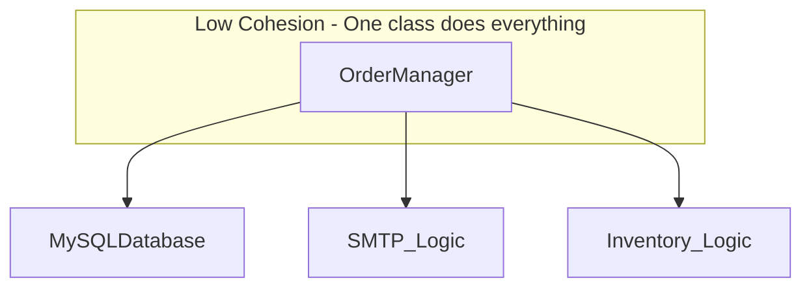

## 5. Hướng tới thiết kế tối ưu

Để giải quyết vấn đề trên, chúng ta cần tách nhỏ các trách nhiệm (tăng Cohesion) và giao tiếp qua Interface (giảm Coupling).

```java
// Thiết kế TỐT: High Cohesion & Loose Coupling

interface Database { void save(Order order); }
interface NotificationService { void notify(String msg); }

public class OrderService {
    private final Database database;
    private final NotificationService notificationService;

    // Dependency Injection: Giảm Coupling
    public OrderService(Database database, NotificationService notificationService) {
        this.database = database;
        this.notificationService = notificationService;
    }

    public void placeOrder(Order order) {
        database.save(order);
        notificationService.notify("Order processed: " + order.getId());
    }
}
```

Trong thiết kế mới:
*   `OrderService` chỉ tập trung vào luồng nghiệp vụ (High Cohesion).
*   Nó không biết `Database` là MySQL hay MongoDB (Loose Coupling).
*   Nó không biết `NotificationService` gửi qua Email hay SMS (Loose Coupling).

## Tóm tắt

*   **Coupling** là mối quan hệ bên ngoài. Hãy giữ nó **Thấp (Low)** để hệ thống linh hoạt.
*   **Cohesion** là mối quan hệ bên trong. Hãy giữ nó **Cao (High)** để mỗi class có trách nhiệm rõ ràng.
*   Một thiết kế tốt là sự cân bằng: Các module độc lập với nhau nhưng mỗi module lại cực kỳ tập trung vào nhiệm vụ của mình.
*   Sử dụng **Interface** và **Dependency Injection** là những kỹ thuật hàng đầu trong Java để đạt được trạng thái này.

## Câu hỏi tự kiểm tra

1. Nếu bạn thay đổi code trong Class A mà làm Class B không thể compile, đây là biểu hiện của cái gì?
<details><summary>Đáp án</summary>Đây là biểu hiện của <b>Tight Coupling</b> (Liên kết chặt). Class B đang phụ thuộc quá sâu vào chi tiết cài đặt của Class A.</details>

2. Một Class có 20 phương thức, trong đó 5 phương thức xử lý File, 5 phương thức tính toán lương, 10 phương thức gửi tin nhắn. Class này có tính chất gì?
<details><summary>Đáp án</summary>Class này có <b>Low Cohesion</b> (Gắn kết thấp). Nó đang vi phạm nguyên tắc Đơn nhiệm (SRP) vì chứa quá nhiều trách nhiệm không liên quan.</details>

3. Tại sao High Cohesion thường dẫn đến Loose Coupling?
<details><summary>Đáp án</summary>Khi một lớp có tính gắn kết cao, nó chỉ thực hiện một nhiệm vụ rõ ràng và cung cấp một interface hẹp (minimal interface). Điều này giúp các lớp khác tương tác với nó ít hơn, đơn giản hơn, từ đó làm giảm sự phụ thuộc lẫn nhau (Loose Coupling).</details>

---

## Tại sao Tight Coupling là 'kẻ thù' của bảo trì?

# Tại sao Tight Coupling là 'kẻ thù' của bảo trì?

Trong phát triển phần mềm, chúng ta thường nghe câu nói: "Mã nguồn duy nhất không có lỗi là mã nguồn không bao giờ thay đổi". Tuy nhiên, trong thực tế, thay đổi là hằng số duy nhất. Một hệ thống phần mềm sống là một hệ thống liên tục tiến hóa. Khi đó, Tight Coupling (Liên kết chặt chẽ) trở thành một rào cản vô hình nhưng cực kỳ tốn kém, biến những thay đổi nhỏ thành những thảm họa dây chuyền. Bài viết này sẽ phân tích sâu lý do tại sao Tight Coupling lại được coi là kẻ thù số một của công tác bảo trì phần mềm.

## Mục tiêu

*   Hiểu rõ cơ chế của Hiệu ứng gợn sóng (Ripple Effect) và cách nó làm tăng rủi ro khi chỉnh sửa mã nguồn.
*   Nhận diện các rào cản đối với việc tái sử dụng (Reusability) khi các thành phần bị dính chặt vào nhau.
*   Phân tích tác động của Tight Coupling đến tầng logic nghiệp vụ thông qua ví dụ cụ thể về Database.
*   Đánh giá chi phí cơ hội và sự suy giảm khả năng mở rộng của hệ thống khi đối mặt với nợ kỹ thuật.

## 1. Hiệu ứng gợn sóng (Ripple Effect): Khi một thay đổi nhỏ làm sụp đổ cả hệ thống

Hiệu ứng gợn sóng xảy ra khi một thay đổi trong một module yêu cầu hàng loạt thay đổi ở các module khác phụ thuộc vào nó. Trong một hệ thống Tight Coupling, các lớp (classes) biết quá nhiều về chi tiết cài đặt của nhau.

### Cơ chế tác động

Hãy tưởng tượng bạn có một lớp `OrderProcessor` trực tiếp khởi tạo một lớp `EmailService`. Nếu ngày mai, `EmailService` thay đổi constructor để nhận thêm một tham số `ApiKey`, bạn buộc phải tìm tất cả những nơi đang khởi tạo `EmailService` để sửa lại. 

```java
// Ví dụ về Tight Coupling gây ra hiệu ứng gợn sóng
public class EmailService {
    private String apiKey;
    // Trước đây: public EmailService() {}
    // Bây giờ: Thay đổi yêu cầu ApiKey
    public EmailService(String apiKey) {
        this.apiKey = apiKey;
    }
    
    public void sendEmail(String message) {
        System.out.println("Sending: " + message + " with key: " + apiKey);
    }
}

public class OrderProcessor {
    // OrderProcessor bị phụ thuộc trực tiếp vào cấu trúc của EmailService
    private EmailService emailService = new EmailService("SECRET_KEY"); 

    public void process() {
        // ... xử lý đơn hàng
        emailService.sendEmail("Order processed successfully");
    }
}
```

Trong ví dụ trên, `OrderProcessor` không chỉ phụ thuộc vào chức năng gửi email mà còn phụ thuộc vào *cách thức tạo ra* `EmailService`. Nếu hệ thống có 100 lớp sử dụng `EmailService` theo cách này, bạn sẽ phải sửa code ở 100 nơi. Đây chính là biểu hiện của sự **Cứng nhắc (Rigidity)**.

## 2. Khó khăn trong việc tái sử dụng code (Reusability)

Một trong những lời hứa lớn nhất của lập trình hướng đối tượng (OOP) là khả năng tái sử dụng. Tuy nhiên, Tight Coupling thường vi phạm lời hứa này. Hiện tượng này thường được gọi là vấn đề "Banana-Gorilla-Jungle": Bạn chỉ muốn quả chuối (một hàm cụ thể), nhưng bạn lại nhận được con khỉ đang cầm quả chuối và cả khu rừng nơi con khỉ đó sinh sống.

### Tại sao lại khó tái sử dụng?

Khi bạn muốn mang một module sang một dự án mới, nếu module đó liên kết chặt chẽ với các module khác, bạn buộc phải mang theo toàn bộ các module phụ thuộc đó. 

| Đặc điểm | Tight Coupling | Loose Coupling |
| :--- | :--- | :--- |
| **Phụ thuộc** | Phụ thuộc vào implementation (cài đặt cụ thể) | Phụ thuộc vào abstraction (interface/abstract class) |
| **Tách rời** | Gần như không thể tách rời một class ra khỏi ngữ cảnh của nó | Dễ dàng tách rời và thay thế bằng mock/stub |
| **Kiểm thử** | Khó viết Unit Test vì phải khởi tạo toàn bộ cây phụ thuộc | Dễ dàng test độc lập từng thành phần |

## 3. Phân tích ví dụ: Khi Database "bắt cóc" Business Logic

Đây là lỗi phổ biến nhất trong các dự án Java Enterprise. Logic nghiệp vụ (Business Logic) bị trộn lẫn hoặc phụ thuộc trực tiếp vào các chi tiết của Database (như SQL cụ thể, cấu trúc bảng, hoặc thư viện driver).

### Kịch bản tồi tệ

Giả sử bạn có một dịch vụ tính lương `SalaryCalculator` sử dụng trực tiếp `OracleDatabaseConnector` để truy vấn dữ liệu nhân viên.

```java
public class SalaryCalculator {
    public double calculateMonthlySalary(int employeeId) {
        // Tight coupling với Oracle cụ thể
        OracleDatabaseConnector connector = new OracleDatabaseConnector();
        String sql = "SELECT base_salary FROM employees WHERE id = " + employeeId;
        ResultSet rs = connector.executeQuery(sql);
        // ... xử lý logic
        return rs.getDouble("base_salary");
    }
}
```

**Hệ quả khi thay đổi:**
1.  **Thay đổi công nghệ:** Nếu công ty quyết định chuyển sang PostgreSQL hoặc MongoDB, bạn phải viết lại toàn bộ lớp `SalaryCalculator` mặc dù logic tính lương không hề thay đổi.
2.  **Thay đổi cấu trúc bảng:** Nếu cột `base_salary` được đổi tên thành `salary_amount`, logic nghiệp vụ bị hỏng ngay lập tức.
3.  **Khó Unit Test:** Bạn không thể test logic tính lương mà không có một database Oracle đang chạy thực tế. Điều này làm chậm quá trình CI/CD.

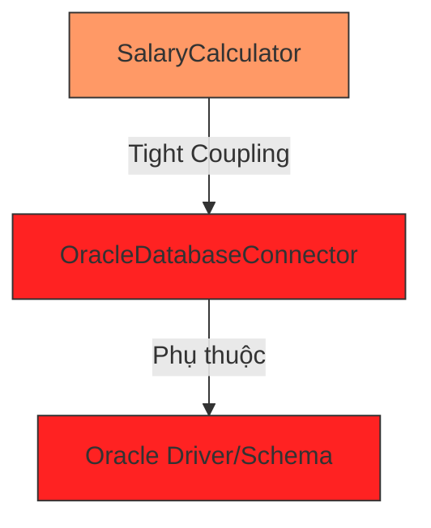

## 4. Chi phí cơ hội và khả năng mở rộng

Tight Coupling không chỉ là vấn đề kỹ thuật; nó là một vấn đề kinh tế. 

### Tốc độ ra mắt tính năng (Time-to-Market)
Khi hệ thống bị liên kết chặt chẽ, mỗi khi thêm một tính năng mới, lập trình viên phải dành 20% thời gian để viết code mới và 80% thời gian để sửa các lỗi phát sinh do hiệu ứng gợn sóng. Điều này làm giảm tốc độ phát triển và khiến doanh nghiệp mất đi cơ hội cạnh tranh.

### Nợ kỹ thuật (Technical Debt)
Sự liên kết chặt chẽ tích tụ dần theo thời gian tạo thành một đống nợ kỹ thuật khổng lồ. Đến một thời điểm, chi phí để bảo trì hệ thống cũ sẽ cao hơn cả chi phí xây dựng lại từ đầu. Tuy nhiên, việc xây dựng lại từ đầu cũng mang lại rủi ro rất lớn.

### Khả năng mở rộng (Scalability)
Nếu bạn muốn chuyển một phần của ứng dụng Monolith sang Microservices để mở rộng, Tight Coupling sẽ là rào cản lớn nhất. Bạn không thể tách một service ra nếu nó đang "dính" lấy hàng chục class khác thông qua các biến static hoặc khởi tạo trực tiếp.

## Tóm tắt

*   **Tight Coupling** làm cho mã nguồn trở nên **cứng nhắc (Rigid)**, **dễ vỡ (Fragile)** và **không thể tái sử dụng (Immobile)**.
*   **Hiệu ứng gợn sóng** biến những thay đổi đơn giản thành những đợt bảo trì kéo dài, làm tăng rủi ro bug.
*   Việc phụ thuộc vào các chi tiết cài đặt (như Database, API bên thứ ba) khiến Business Logic mất đi tính độc lập.
*   Hệ quả cuối cùng là **chi phí bảo trì tăng vọt** và khả năng thích ứng với thay đổi của doanh nghiệp bị tê liệt.

## Câu hỏi tự kiểm tra

1. Tại sao nói Tight Coupling làm giảm khả năng Unit Test của một ứng dụng Java?
<details><summary>Đáp án</summary>Vì khi một class liên kết chặt chẽ với các class khác (ví dụ: khởi tạo trực tiếp bằng từ khóa 'new'), chúng ta không thể thay thế các phụ thuộc đó bằng Mock objects. Do đó, Unit Test buộc phải chạy cùng với toàn bộ các thành phần liên quan, biến nó thành Integration Test và làm cho quá trình test chậm, khó kiểm soát dữ liệu đầu vào.</details>

2. Hiệu ứng gợn sóng (Ripple Effect) thường xuất hiện rõ rệt nhất trong tình huống nào?
<details><summary>Đáp án</summary>Xuất hiện rõ nhất khi có sự thay đổi trong chữ ký phương thức (method signature) hoặc cấu trúc dữ liệu của một class ở tầng thấp (như Repository hoặc Utility), dẫn đến việc phải sửa đổi hàng loạt các class ở tầng cao hơn đang gọi đến nó.</details>

3. Làm thế nào để nhận biết một đoạn code Java đang bị Tight Coupling với Database?
<details><summary>Đáp án</summary>Dấu hiệu nhận biết: Trong class logic nghiệp vụ có xuất hiện các câu lệnh SQL thuần, các class driver cụ thể của Database (như OracleConnection, MySqlConnection), hoặc việc khởi tạo trực tiếp các đối tượng truy cập dữ liệu mà không thông qua Interface.</details>

4. Khái niệm "Banana-Gorilla-Jungle" ám chỉ điều gì trong thiết kế phần mềm?
<details><summary>Đáp án</summary>Nó ám chỉ sự khó khăn trong việc tái sử dụng code. Khi bạn muốn sử dụng một thành phần nhỏ, bạn buộc phải kéo theo cả một hệ thống phụ thuộc khổng lồ đi kèm do chúng được thiết kế liên kết quá chặt chẽ với nhau.</details>

---

## Sức mạnh của High Cohesion

# Sức mạnh của High Cohesion

Trong thiết kế phần mềm, nếu Coupling là câu chuyện về cách các module "nói chuyện" với nhau, thì Cohesion (Sự kết dính) lại là câu chuyện về nội tâm của một module. Một module có **High Cohesion** (Độ kết dính cao) giống như một chuyên gia lành nghề: họ chỉ làm một việc duy nhất nhưng làm cực kỳ xuất sắc. Ngược lại, Low Cohesion giống như một người "đa năng" nhưng việc gì cũng dở dang, gây rối rắm cho bất kỳ ai muốn hợp tác.

Bài viết này sẽ đi sâu vào lý do tại sao High Cohesion lại là chìa khóa để giảm tải gánh nặng tư duy và tạo ra những hệ thống Java trường tồn với thời gian.

## Mục tiêu

*   Hiểu rõ khái niệm High Cohesion và cách nó tác động đến cấu trúc mã nguồn Java.
*   Nhận diện và phân tích tác hại của "God Class" đối với khả năng bảo trì.
*   Giải thích được mối liên hệ giữa Cohesion và Cognitive Load (Gánh nặng nhận thức).
*   Học cách chia nhỏ trách nhiệm để đạt được sự tập trung hóa trong Class.

## 1. Bản chất của High Cohesion: Sự tập trung hóa trách nhiệm

Cohesion đo lường mức độ liên quan giữa các thành phần bên trong một module (class, package, method). Khi một class có High Cohesion, tất cả các thuộc tính (fields) và phương thức (methods) của nó đều hướng tới một mục đích chung duy nhất.

Trong Java, High Cohesion không chỉ là việc viết code ngắn lại, mà là việc **định vị đúng ranh giới của logic**. 

### Ví dụ về sự phân rã ý niệm:

*   **Low Cohesion:** Một class `Employee` vừa chứa thông tin cá nhân, vừa chứa logic tính lương, vừa chứa logic lưu xuống Database, vừa chứa logic gửi Email thông báo lương.
*   **High Cohesion:** Class `Employee` chỉ chứa dữ liệu. Class `PayrollCalculator` lo tính lương. Class `EmployeeRepository` lo lưu trữ. Class `NotificationService` lo gửi tin nhắn.

## 2. Giảm thiểu Cognitive Load (Gánh nặng nhận thức)

Lập trình viên thường dành 80% thời gian để đọc code và chỉ 20% để viết. **Cognitive Load** là tổng lượng nỗ lực trí tuệ được sử dụng trong bộ nhớ làm việc (working memory). 

Khi bạn mở một Class có High Cohesion, não bộ của bạn ngay lập tức hình thành một "Mental Model" (Mô hình tâm trí) rõ ràng. Bạn biết chắc chắn rằng: "Class này chỉ xử lý việc giải mã Token". Bạn không cần phải lo lắng về việc đọc nhầm sang logic kết nối Database hay định dạng ngày tháng.

### Bảng so sánh gánh nặng tư duy

| Đặc điểm | High Cohesion | Low Cohesion (God Class) |
| :--- | :--- | :--- |
| **Phạm vi tìm kiếm** | Khu trú trong một mục đích duy nhất. | Phải lọc bỏ các logic nhiễu không liên quan. |
| **Khả năng dự đoán** | Cao. Nhìn tên class là biết logic bên trong. | Thấp. Phải đọc từng dòng code mới hiểu hết nó làm gì. |
| **Sự tự tin khi sửa đổi** | Cao. Ít lo ngại hỏng các phần khác. | Thấp. Luôn sợ hiệu ứng cánh bướm (Butterfly Effect). |

## 3. Đối mặt với "kẻ thù" của bảo trì: God Class

**God Class** (Lớp vạn năng) là biểu hiện cực đoan nhất của Low Cohesion. Đây là những class "biết quá nhiều" và "làm quá nhiều".

### Ví dụ thực tế trong Java

Hãy xem xét một `OrderManager` tồi tệ:

```java
public class OrderManager {
    // Quá nhiều trách nhiệm tập trung vào một nơi
    public void processOrder(Order order) {
        // 1. Validate đơn hàng
        if (order.getItems().isEmpty()) throw new RuntimeException("Empty order");

        // 2. Tính toán thuế và chiết khấu
        double tax = order.getAmount() * 0.1;
        
        // 3. Lưu vào Database
        String sql = "INSERT INTO orders ...";
        // JDBC logic ở đây...

        // 4. Gửi mail xác nhận
        String message = "Your order " + order.getId() + " is confirmed";
        // JavaMail logic ở đây...
    }
}
```

**Tại sao thiết kế này nguy hiểm?**
1.  **Khó đọc:** Khi bạn muốn sửa logic tính thuế, bạn phải cuộn qua hàng trăm dòng code xử lý SQL và Email.
2.  **Khó Test:** Để unit test logic tính thuế, bạn buộc phải khởi tạo cả Database connection và Mail server (hoặc mock rất phức tạp).
3.  **Side-effects (Tác dụng phụ):** Một thay đổi nhỏ trong cấu trúc Database có thể vô tình làm hỏng logic gửi Mail vì chúng nằm chung một "nồi canh".

### Giải pháp: Phân rã thành các Small Classes chuyên biệt

```java
public class OrderValidator {
    public void validate(Order order) { /*...*/ }
}

public class TaxCalculator {
    public double calculateTax(Order order) { /*...*/ }
}

public class OrderRepository {
    public void save(Order order) { /*...*/ }
}

public class NotificationService {
    public void sendConfirmation(Order order) { /*...*/ }
}
```

Bây giờ, mỗi class đều có High Cohesion. `TaxCalculator` chỉ quan tâm đến các con số. Nếu luật thuế thay đổi, bạn chỉ sửa đúng class đó. Ranh giới lỗi (Blast Radius) được thu hẹp tối đa.

## 4. Giảm thiểu Side-effect khi chỉnh sửa

High Cohesion tạo ra một môi trường "cách ly". Trong một class có độ kết dính cao, các phương thức thường sử dụng chung một tập các biến thực thể (fields). Điều này tạo nên một sự thống nhất về trạng thái.

Khi bạn thay đổi logic bên trong một class High Cohesion, tác động của nó thường chỉ giới hạn trong class đó. 

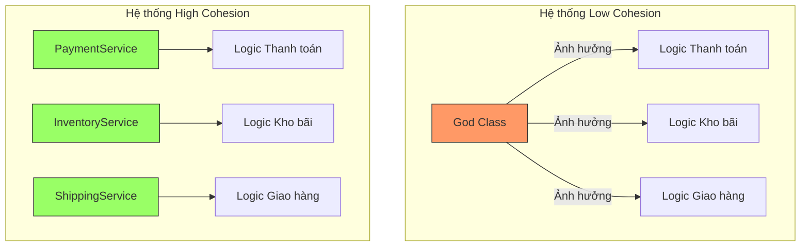

Trong mô hình High Cohesion, nếu bạn thay đổi cách tính phí giao hàng trong `ShippingService`, `PaymentService` hoàn toàn không hề hay biết và không bị ảnh hưởng. Đây chính là sự ổn định mà mọi kiến trúc sư phần mềm hướng tới.

## 5. Mối liên hệ với khả năng tái sử dụng (Reusability)

Một module làm quá nhiều việc sẽ rất khó để tái sử dụng. Nếu bạn muốn dùng lại logic "Gửi Email" từ `OrderManager` ở trên cho chức năng "Quên mật khẩu", bạn không thể làm được vì nó bị dính chặt với logic đơn hàng.

Khi bạn tách nó ra thành `EmailProvider` (High Cohesion), bạn có thể gọi nó ở bất cứ đâu trong hệ thống. High Cohesion chính là tiền đề cho việc xây dựng các bộ thư viện (libraries) và component dùng chung.

## Tóm tắt

*   **High Cohesion** là việc giữ cho các thành phần bên trong một module liên quan chặt chẽ với nhau và cùng phục vụ một mục đích.
*   Nó giúp **giảm Cognitive Load**, cho phép lập trình viên hiểu code nhanh hơn mà không cần tốn quá nhiều bộ nhớ đệm của não bộ.
*   Nó triệt tiêu **God Class**, giúp hệ thống dễ bảo trì, dễ test và ít lỗi tiềm tàng (side-effects).
*   Một hệ thống có High Cohesion thường đi kèm với các class nhỏ, tên gọi rõ ràng và trách nhiệm duy nhất.

## Câu hỏi tự kiểm tra

**1. Dấu hiệu rõ nhất của một Class có Low Cohesion là gì?**
<details>
<summary>Đáp án</summary>
Class đó có quá nhiều phương thức không liên quan đến nhau, sử dụng các tập biến thực thể (fields) khác nhau hoàn toàn, hoặc tên class thường chứa những từ chung chung như "Manager", "Helper", "Common", "Utility" nhưng chứa hàng nghìn dòng code đa mục đích.
</details>

**2. Tại sao High Cohesion lại giúp Unit Test dễ dàng hơn?**
<details>
<summary>Đáp án</summary>
Vì class chỉ làm một việc, số lượng dependency (phụ thuộc) cần phải mock sẽ ít đi. Các kịch bản test (test cases) cũng tập trung vào một luồng nghiệp vụ duy nhất, giúp code test ngắn gọn và dễ hiểu hơn.
</details>

**3. Giữa một Class 1000 dòng làm 5 việc và 5 Class mỗi class 200 dòng làm 1 việc, cái nào tốt hơn theo triết lý Cohesion?**
<details>
<summary>Đáp án</summary>
5 Class mỗi class 200 dòng tốt hơn. Mặc dù tổng số dòng code có thể tăng nhẹ do boilerplate, nhưng độ phức tạp nhận thức giảm xuống, khả năng bảo trì và tái sử dụng tăng lên đáng kể.
</details>

---

## Điểm cân bằng tối ưu trong thiết kế

# Điểm cân bằng tối ưu trong thiết kế

Trong thế giới phát triển phần mềm Java, chúng ta thường được dạy rằng "Loose Coupling" (khớp nối lỏng) và "High Cohesion" (độ kết dính cao) là những mục tiêu tối thượng. Tuy nhiên, một lập trình viên kinh nghiệm sẽ nhận ra rằng việc cực đoan hóa các nguyên lý này có thể dẫn đến một thảm họa kiến trúc khác: **Over-engineering** (thiết kế quá mức). Bài học này sẽ giúp bạn xác định "điểm ngọt" (sweet spot) – nơi mà hệ thống vừa đủ linh hoạt để mở rộng, vừa đủ đơn giản để bảo trì.

## Mục tiêu

*   Nhận diện được các dấu hiệu của việc chia nhỏ module quá mức (Class Explosion) và hệ quả của nó.
*   Phân tích được các tình huống thực tế trong Java khi cần ưu tiên hiệu năng và sự đơn giản hơn là việc tách biệt hoàn toàn.
*   Áp dụng các kỹ thuật đóng gói của Java (như package-private, inner classes) để đạt được sự cân bằng.
*   Đánh giá chất lượng thiết kế thông qua việc phân tích mối quan hệ trên Class Diagram.

## 1. Nghịch lý của việc chia quá nhỏ (Over-engineering)

Nhiều lập trình viên khi mới tiếp cận SOLID thường cố gắng tách mọi thứ thành các interface và class nhỏ nhất có thể. Họ tin rằng càng nhiều class thì hệ thống càng "sạch". Tuy nhiên, điều này dẫn đến một hiện tượng gọi là **Fragmentation** (Sự phân mảnh).

### Hệ quả của việc phân mảnh:
1.  **Cognitive Load (Tải nhận thức) tăng cao:** Khi muốn hiểu một logic nghiệp vụ đơn giản, bạn phải mở 10 file khác nhau. Việc nhảy qua lại giữa các file làm ngắt quãng luồng tư duy.
2.  **Indirection (Sự gián tiếp) vô nghĩa:** Việc tạo ra các Interface chỉ có duy nhất một Implementation mà không có kế hoạch mở rộng trong tương lai chỉ làm tăng thêm các lớp trung gian.
3.  **Boilerplate Code:** Mỗi class mới yêu cầu thêm unit test, cấu hình Dependency Injection (Spring/Guice), và quản lý file.

**Ví dụ về Over-engineering:**
Giả sử bạn có một logic tính thuế đơn giản. Thay vì viết một phương thức trong `OrderService`, bạn tách thành:
`TaxCalculatorInterface` -> `AbstractTaxCalculator` -> `VATCalculator`, `LuxuryTaxCalculator`, `TaxRoundingPolicy`, `TaxReportFormatter`...
Nếu nghiệp vụ của bạn chỉ phục vụ một thị trường duy nhất với thuế suất cố định trong 5 năm qua, việc tách này là lãng phí tài nguyên.

## 2. Khi nào nên chấp nhận Coupling cao để đổi lấy hiệu năng và sự đơn giản?

Coupling không phải lúc nào cũng là xấu. Có những trường hợp "Tight Coupling" là lựa chọn có chủ đích để tối ưu hóa.

### Trường hợp 1: Hiệu năng thực thi (Performance)
Trong các hệ thống yêu cầu độ trễ cực thấp (Low Latency), việc đi qua nhiều lớp trừu tượng (Abstraction layers) và gọi thông qua Interface sẽ tạo ra chi phí overhead cho CPU (vtable lookup). 

**Ví dụ trong Java Core:**
Hãy nhìn vào `java.util.ArrayList`. Bên trong nó có một Inner Class là `Itr` (Iterator). 
```java
public class ArrayList<E> extends AbstractList<E> ... {
    // ...
    private class Itr implements Iterator<E> {
        int cursor;       // index of next element to return
        int lastRet = -1; // index of last element returned; -1 if no such
        int expectedModCount = modCount;
        // ...
    }
}
```
Ở đây, `Itr` phụ thuộc trực tiếp (Tight Coupling) vào các field private của `ArrayList` như `elementData` và `modCount`. 
- **Tại sao chấp nhận?** Để `Itr` có thể truy cập trực tiếp vào mảng dữ liệu mà không cần thông qua các getter công khai, giúp tăng tốc độ duyệt mảng và đảm bảo tính toàn vẹn dữ liệu (fail-fast).

### Trường hợp 2: Các thành phần có vòng đời trùng khớp (Co-change)
Nếu hai class luôn luôn thay đổi cùng nhau và không bao giờ được tái sử dụng độc lập, việc tách chúng ra chỉ tạo thêm rào cản. 

## 3. Chiến lược 'Low Coupling, High Cohesion' trong thực tế Java

Để đạt được điểm cân bằng, chúng ta cần áp dụng công thức sau:

$$Chi phí Bảo trì = f(Độ phức tạp logic) + g(Số lượng mối liên kết) + h(Độ rời rạc của thông tin)$$

### Sử dụng Package-Private (Default Access Modifier)
Thay vì để mọi thứ là `public`, hãy sử dụng phạm vi mặc định của Java để giới hạn Coupling trong nội bộ một package. Điều này cho phép các class bên trong package tương tác chặt chẽ với nhau (High Cohesion) nhưng vẫn xuất hiện như một khối thống nhất (Low Coupling) đối với bên ngoài.

```java
// Trong package com.app.payment
class PaymentProcessor { // Package-private: Giấu kín với bên ngoài
    void process() { ... }
}

public class PaymentService { // Public: Cổng giao tiếp duy nhất
    private final PaymentProcessor processor = new PaymentProcessor();
    public void executePayment() {
        processor.process();
    }
}
```

### Composition over Inheritance
Kế thừa (Inheritance) tạo ra Coupling mạnh nhất giữa class cha và con. Sử dụng Composition (Thành phần) giúp bạn giữ được High Cohesion bằng cách gom các hành vi liên quan lại mà không làm mất đi tính linh hoạt.

## 4. Phân tích sơ đồ Class Diagram để đánh giá sự cân bằng

Một thiết kế cân bằng thường hiển thị trên Class Diagram với các đặc điểm:
1.  **Số lượng mũi tên đi vào (Afferent Coupling - Ca) vừa phải:** Một class không nên bị quá nhiều class khác phụ thuộc vào.
2.  **Số lượng mũi tên đi ra (Efferent Coupling - Ce) thấp:** Một class không nên biết quá nhiều về thế giới bên ngoài.
3.  **Các cụm (Clusters):** Các class có quan hệ mật thiết nên tạo thành một cụm dày đặc bên trong nhưng có rất ít đường nối ra các cụm khác.

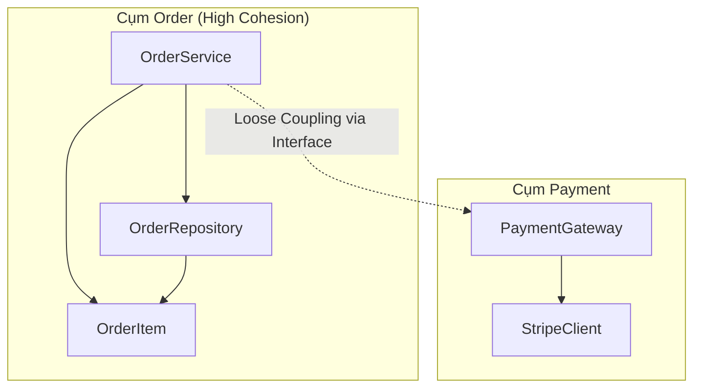

**Nhìn vào sơ đồ trên:**
- Bên trong cụm **Order**, các thành phần có thể có Coupling cao hơn một chút để xử lý logic nghiệp vụ nhanh chóng.
- Giữa cụm **Order** và **Payment**, chúng ta chỉ có duy nhất một đường nối mờ (Interface). Đây chính là điểm cân bằng lý tưởng.

## Tóm tắt

*   **Điểm cân bằng** không phải là một con số cố định, nó phụ thuộc vào quy mô dự án và yêu cầu hiệu năng.
*   **Over-engineering** xảy ra khi bạn ưu tiên sự tách biệt (Decoupling) hơn là sự dễ hiểu (Understandability).
*   Hãy giữ các thành phần liên quan chặt chẽ về nghiệp vụ ở gần nhau (High Cohesion), thậm chí chấp nhận Coupling nội bộ, nhưng phải cực kỳ khắt khe với các giao tiếp ra bên ngoài (Low Coupling).
*   Sử dụng công cụ đo lường và Class Diagram để phát hiện các "God Object" (quá nhiều kết nối) hoặc "Lazy Class" (quá ít trách nhiệm).

## Câu hỏi tự kiểm tra

1. **Khi nào việc tách một class thành hai class nhỏ hơn được coi là không cần thiết?**
   <details><summary>Đáp án</summary>Khi hai class đó luôn thay đổi cùng nhau, không thể tái sử dụng độc lập, và việc tách ra làm tăng độ phức tạp của việc điều phối (coordination) mà không mang lại lợi ích về kiểm thử hay mở rộng.</details>

2. **Tại sao việc sử dụng quá nhiều Interface trong Java đôi khi lại gây hại?**
   <details><summary>Đáp án</summary>Nó tạo ra sự gián tiếp (indirection) không cần thiết, làm tăng số lượng file cần quản lý, gây khó khăn cho việc debug (phải tìm đúng implementation) và có thể làm giảm hiệu năng nếu không được JIT compiler tối ưu hóa.</details>

3. **Trong Java, modifier nào giúp kiểm soát Coupling tốt nhất ở mức module?**
   <details><summary>Đáp án</summary>Modifier mặc định (package-private) và từ Java 9 trở đi là hệ thống Module (JPMS) với từ khóa 'exports'.</details>

4. **Công thức tính tổng độ phức tạp của hệ thống dựa trên Coupling và Cohesion là gì?**
   <details><summary>Đáp án</summary>Tổng độ phức tạp = Độ phức tạp của từng module (tỉ lệ nghịch với Cohesion) + Độ phức tạp của các mối liên kết giữa chúng (tỉ lệ thuận với Coupling).</details>

---

## Content Coupling: Mức độ nguy hiểm nhất

# Content Coupling: Mức độ nguy hiểm nhất

Trong phân cấp các loại Coupling (liên kết), **Content Coupling** (hay còn gọi là Pathological Coupling - Liên kết bệnh lý) đứng ở vị trí tồi tệ nhất. Nếu hệ thống của bạn xuất hiện loại liên kết này, nó không chỉ đơn thuần là "mã nguồn xấu" mà là một quả bom hẹn giờ cho sự ổn định và khả năng bảo trì của phần mềm. Bài học này sẽ đi sâu vào việc nhận diện, phân tích tác hại và cách triệt tiêu Content Coupling trong ngôn ngữ Java.

## Mục tiêu

*   **Nhận diện:** Xác định chính xác các biểu hiện của Content Coupling trong mã nguồn Java thông qua truy cập field trực tiếp hoặc Reflection.
*   **Phân tích hệ quả:** Hiểu rõ tại sao Content Coupling phá vỡ tính đóng gói (Encapsulation) và gây ra lỗi lan truyền (Ripple Effects).
*   **Làm chủ kỹ thuật Refactoring:** Áp dụng nguyên lý "Tell, Don't Ask" và các kỹ thuật đóng gói để chuyển đổi từ Content Coupling sang các dạng liên kết lỏng lẻo (Loose Coupling) an toàn hơn.
*   **Xây dựng tư duy phòng ngừa:** Thiết lập các quy tắc thiết kế để ngăn chặn việc can thiệp vào nội bộ của các lớp khác ngay từ giai đoạn viết code.

## 1. Content Coupling là gì?

Content Coupling xảy ra khi một module (lớp) thay đổi hoặc dựa trực tiếp vào các thành phần nội bộ của một module khác. Thay vì giao tiếp qua các giao diện (interface) hoặc phương thức công khai (public methods), lớp A lại "thò tay" vào bên trong lớp B để đọc hoặc ghi dữ liệu, thậm chí là thay đổi luồng thực thi của lớp B.

Trong Java, điều này thường xuất hiện dưới hai hình thức phổ biến nhất:
1.  Truy cập trực tiếp vào các biến thực thể (instance variables) được khai báo là `public`.
2.  Sử dụng Java Reflection API để vượt qua rào cản `private` và can thiệp vào trạng thái nội bộ.

### Sơ đồ minh họa sự khác biệt

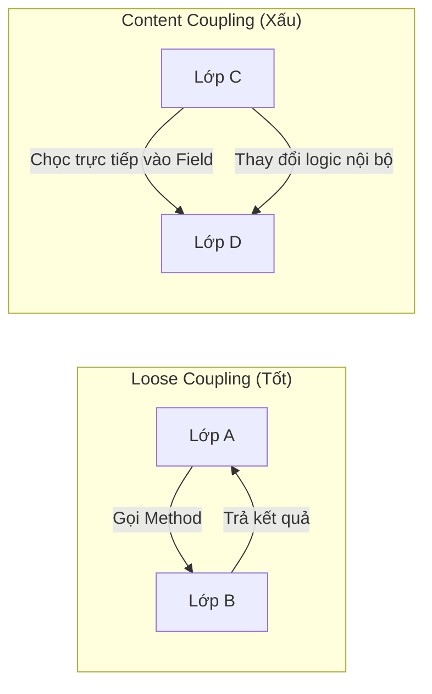

## 2. Truy cập trực tiếp Public Field: Sai lầm kinh điển

Nhiều lập trình viên mới thường có thói quen để các field là `public` để "tiện" cho việc sử dụng. Tuy nhiên, đây là cách nhanh nhất để tạo ra Content Coupling.

### Ví dụ thực tế: Hệ thống quản lý tài khoản ngân hàng

Giả sử chúng ta có lớp `BankAccount` với một field `public`:

```java
// Lớp bị phụ thuộc (Dependent Class)
public class BankAccount {
    public double balance; // Content Coupling Trigger
    
    public BankAccount(double balance) {
        this.balance = balance;
    }
}

// Lớp gây ra Coupling
public class ATMService {
    public void withdraw(BankAccount account, double amount) {
        if (account.balance >= amount) { // Truy cập trực tiếp
            account.balance -= amount;   // Thay đổi trực tiếp trạng thái nội bộ
        }
    }
}
```

**Tại sao đoạn code trên lại nguy hiểm?**

1.  **Mất kiểm soát logic (Broken Invariants):** Lớp `BankAccount` không thể đảm bảo số dư (`balance`) không bao giờ âm. Bất kỳ lớp nào khác cũng có thể gán `account.balance = -1000000;` mà `BankAccount` không hề hay biết.
2.  **Khó thay đổi cấu trúc:** Nếu sau này bạn muốn đổi kiểu dữ liệu của `balance` từ `double` sang `BigDecimal` (để chính xác hơn trong tài chính), bạn sẽ phải sửa code ở tất cả những nơi đang truy cập trực tiếp vào field này. 
3.  **Vi phạm tính đóng gói:** `BankAccount` không còn là một "hộp đen". Nó phơi bày ruột gan cho cả thế giới can thiệp.

## 3. Hiểm họa từ Reflection: Content Coupling "ngầm"

Reflection là một công cụ mạnh mẽ trong Java, nhưng khi dùng để thay đổi `private state`, nó tạo ra loại Content Coupling nguy hiểm nhất vì nó không lộ diện ở thời điểm biên dịch (compile-time).

### Ví dụ về việc phá vỡ rào cản Private

```java
public class SecretVault {
    private String secretCode = "SUPER-SECRET";
}

public class HackerTool {
    public void crackVault(SecretVault vault) throws Exception {
        Field field = SecretVault.class.getDeclaredField("secretCode");
        field.setAccessible(true); // Phá vỡ tính đóng gói
        
        // Thay đổi giá trị private mà không qua bất kỳ phương thức nào
        field.set(vault, "CRACKED-BY-HACKER");
        
        System.out.println("New code: " + field.get(vault));
    }
}
```

**Hệ quả của việc lạm dụng Reflection:**
*   **Runtime Failure:** Nếu tên field `secretCode` bị đổi thành `vaultKey`, mã nguồn vẫn biên dịch bình thường nhưng sẽ bị crash ở runtime với `NoSuchFieldException`.
*   **Security Risk:** Phá vỡ các chính sách bảo mật của ứng dụng.
*   **Opaque Logic:** Người đọc code không thể hiểu tại sao giá trị của một biến `private` lại bị thay đổi mà không có setter hay logic nội bộ nào tác động.

## 4. Tại sao Content Coupling là vi phạm nghiêm trọng nhất?

Để định lượng sự nguy hiểm, hãy xem xét bảng so sánh sau:

| Đặc điểm | Content Coupling | Data/Message Coupling (Lý tưởng) |
| :--- | :--- | :--- |
| **Tính đóng gói** | Bị phá hủy hoàn toàn | Được bảo vệ nghiêm ngặt |
| **Khả năng bảo trì** | Cực thấp (Thay đổi nhỏ gây lỗi lớn) | Cao (Thay đổi nội bộ không ảnh hưởng bên ngoài) |
| **Khả năng Unit Test** | Khó khăn vì trạng thái bị thay đổi tùy tiện | Dễ dàng thông qua Mocking/Stubbing |
| **Sự phụ thuộc** | Phụ thuộc vào cấu trúc (Structure) | Phụ thuộc vào hành vi (Behavior) |

Khi một lớp can thiệp vào nội dung của lớp khác, chúng ta tạo ra một mối quan hệ "cộng sinh độc hại". Lớp A không chỉ biết lớp B làm gì, mà còn biết lớp B được cấu tạo như thế nào. $Coupling_{Content} \rightarrow \infty$ đồng nghĩa với việc $Maintainability \rightarrow 0$.

## 5. Chiến lược Refactoring: Từ Content đến Loose Coupling

Để loại bỏ Content Coupling, chúng ta cần thực hiện hai bước chính: **Encapsulation** (Đóng gói) và áp dụng nguyên lý **Tell, Don't Ask**.

### Bước 1: Che giấu trạng thái (Encapsulation)

Chuyển tất cả các field sang `private`. Đây là quy tắc bất di bất dịch trong Java.

```java
public class BankAccount {
    private double balance; // Đã an toàn

    public double getBalance() {
        return balance;
    }
}
```

### Bước 2: Thay thế việc can thiệp bằng hành vi (Tell, Don't Ask)

Thay vì lấy dữ liệu ra để xử lý (Ask), hãy yêu cầu đối tượng thực hiện hành động đó (Tell).

**Refactored Code:**

```java
public class BankAccount {
    private double balance;

    // Logic nghiệp vụ nằm tại nơi quản lý dữ liệu
    public void withdraw(double amount) {
        if (amount <= 0) throw new IllegalArgumentException("Số tiền phải dương");
        if (this.balance < amount) throw new IllegalStateException("Không đủ số dư");
        
        this.balance -= amount;
    }
}

public class ATMService {
    public void processWithdrawal(BankAccount account, double amount) {
        // Chỉ gọi phương thức, không quan tâm balance được lưu thế nào
        account.withdraw(amount);
    }
}
```

### Lợi ích sau khi Refactor:
1.  **Tính toàn vẹn dữ liệu:** `BankAccount` tự kiểm soát điều kiện rút tiền. Không ai có thể rút quá số dư hoặc rút số tiền âm.
2.  **Tính linh hoạt:** Nếu bạn đổi `balance` từ `double` sang một đối tượng `Money` phức tạp, bạn chỉ cần sửa bên trong lớp `BankAccount`. Lớp `ATMService` hoàn toàn không bị ảnh hưởng.
3.  **Dễ kiểm thử:** Bạn có thể dễ dàng viết Unit Test cho `withdraw` trong `BankAccount` với các trường hợp biên.

## 6. Khi nào Content Coupling có thể chấp nhận được?

Trong thực tế, có rất ít trường hợp Content Coupling được chấp nhận. Tuy nhiên, có một số ngoại lệ đặc biệt:
*   **Các Framework/Library cực kỳ chuyên biệt:** Ví dụ như các thư viện Serialization (Jackson, GSON) hoặc các ORM (Hibernate). Chúng buộc phải dùng Reflection để map dữ liệu vào các private field của POJO. Tuy nhiên, đây là sự đánh đổi có tính toán ở tầng hạ tầng (infrastructure), không phải ở tầng nghiệp vụ (business logic).
*   **Inner Classes:** Đôi khi một lớp lồng (inner class) truy cập trực tiếp vào field của lớp bao ngoài. Vì chúng được coi là một đơn vị logic duy nhất, mức độ nguy hiểm thấp hơn nhưng vẫn nên hạn chế.

## Tóm tắt

*   **Content Coupling** xảy ra khi một lớp can thiệp trực tiếp vào dữ liệu hoặc logic nội bộ của lớp khác.
*   **Biểu hiện:** Public fields và lạm dụng Reflection để thay đổi private state.
*   **Tác hại:** Phá vỡ tính đóng gói, gây lỗi khó tìm (runtime errors), và khiến hệ thống cực kỳ khó bảo trì.
*   **Giải pháp:** Luôn sử dụng access modifier `private`, cung cấp các public method có ý nghĩa nghiệp vụ, và tuân thủ nguyên lý "Tell, Don't Ask".

## Câu hỏi tự kiểm tra

1. **Câu hỏi:** Tại sao việc sử dụng `public` field lại được coi là Content Coupling dù Java cho phép điều đó?
   <details><summary>Đáp án</summary>Vì khi một field là public, bất kỳ lớp nào bên ngoài cũng có thể thay đổi giá trị của nó mà không thông qua sự kiểm soát của lớp chủ quản. Điều này khiến lớp chủ quản không thể đảm bảo tính đúng đắn của dữ liệu (Invariants) và tạo ra sự phụ thuộc chặt chẽ vào cấu trúc dữ liệu thay vì hành vi.</details>

2. **Câu hỏi:** Trong trường hợp nào Reflection gây ra Content Coupling?
   <details><summary>Đáp án</summary>Reflection gây ra Content Coupling khi nó được dùng để gọi <code>setAccessible(true)</code> nhằm truy cập và thay đổi các field hoặc method được đánh dấu là <code>private</code>. Điều này tạo ra một liên kết ngầm định dựa trên tên biến/phương thức vốn dĩ không dành cho bên ngoài.</details>

3. **Câu hỏi:** Nguyên lý "Tell, Don't Ask" giúp giảm Content Coupling như thế nào?
   <details><summary>Đáp án</summary>Thay vì yêu cầu đối tượng cung cấp dữ liệu nội bộ để mình tự xử lý (Ask), ta yêu cầu đối tượng thực hiện một hành động cụ thể (Tell). Điều này giúp logic nghiệp vụ ở đúng nơi nó thuộc về (cùng với dữ liệu) và che giấu chi tiết triển khai bên trong.</details>

4. **Câu hỏi:** Nếu tôi sử dụng Lombok với `@Data` (tự động tạo Getter/Setter cho mọi field), tôi có đang tạo ra Content Coupling không?
   <details><summary>Đáp án</summary>Mặc dù sử dụng Getter/Setter là tốt hơn public field (vì bạn có thể thêm logic kiểm tra vào setter sau này), nhưng việc cung cấp Setter vô tội vạ cho mọi field vẫn có thể dẫn đến một dạng liên kết chặt chẽ về dữ liệu. Tốt nhất chỉ nên cung cấp Setter cho những gì thực sự cần thay đổi từ bên ngoài và ưu tiên các phương thức mang tính hành động (như <code>activate()</code> thay vì <code>setStatus(true)</code>).</details>

---

## Common Coupling: Hiểm họa từ Global State

# Common Coupling: Hiểm họa từ Global State

## Mục tiêu
- Nhận diện bản chất của Common Coupling thông qua việc sử dụng biến toàn cục và tài nguyên dùng chung.
- Phân tích các rủi ro tiềm tàng về tính toàn vẹn dữ liệu và khó khăn trong việc bảo trì hệ thống.
- Hiểu rõ tác động tiêu cực của Global State trong môi trường đa luồng (Multi-threading).
- Làm chủ kỹ thuật tái cấu trúc từ Common Coupling sang Dependency Injection để tăng tính linh hoạt và khả năng kiểm thử.

## 1. Khái niệm Common Coupling trong Java

Common Coupling (Liên kết chung) xảy ra khi hai hoặc nhiều module cùng truy cập vào một vùng dữ liệu chung (global data). Trong Java, điều này thường thể hiện qua việc sử dụng các biến `public static`, các hằng số có thể thay đổi, hoặc các đối tượng Singleton nắm giữ trạng thái (stateful singletons).

Khác với Data Coupling (nơi dữ liệu được truyền tường minh qua tham số), Common Coupling tạo ra một sợi dây liên kết ngầm giữa các lớp. Khi một lớp thay đổi dữ liệu chung, tất cả các lớp khác sử dụng dữ liệu đó đều bị ảnh hưởng mà không hề có sự thông báo rõ ràng.

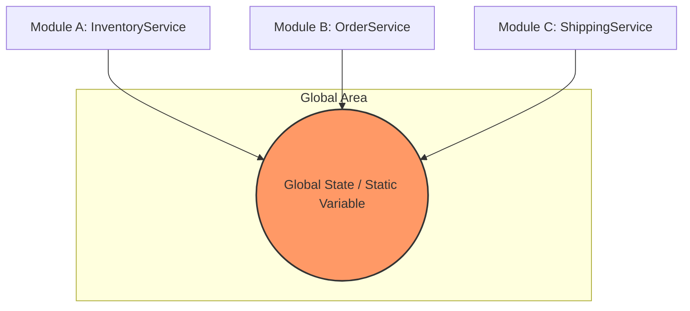

## 2. Biến Static Public: Cánh cửa dẫn đến sự hỗn loạn

Trong lập trình Java, từ khóa `static` cho phép một biến tồn tại ở cấp độ lớp thay vì cấp độ đối tượng. Khi kết hợp với `public`, biến này trở thành một "biến toàn cục" mà bất kỳ đâu trong ứng dụng cũng có thể đọc và ghi.

### Ví dụ về thiết kế tồi
Giả sử chúng ta có một lớp quản lý cấu hình hệ thống:

```java
public class SystemSettings {
    public static String currentTheme = "LIGHT";
    public static int maxConnections = 10;
}
```

Bất kỳ lớp nào cũng có thể thay đổi các giá trị này:

```java
public class ThemeManager {
    public void updateTheme(String newTheme) {
        SystemSettings.currentTheme = newTheme; // Thay đổi trực tiếp
    }
}

public class DatabaseService {
    public void connect() {
        int limit = SystemSettings.maxConnections; // Phụ thuộc vào trạng thái toàn cục
        // ... logic kết nối
    }
}
```

**Hệ lụy:**
1.  **Tính khó đoán (Unpredictability):** Bạn không bao giờ biết chắc `currentTheme` đang có giá trị gì vì bất kỳ class nào cũng có quyền thay đổi nó tại bất kỳ thời điểm nào.
2.  **Khó gỡ lỗi (Debugging Nightmare):** Khi `maxConnections` bị sai giá trị, bạn phải rà soát toàn bộ dự án để tìm xem đoạn mã nào đã gán lại giá trị đó.
3.  **Vi phạm tính đóng gói:** Trạng thái bên trong của `SystemSettings` bị phơi bày hoàn toàn, không có cơ chế kiểm soát (validation) khi dữ liệu thay đổi.

## 3. Hiểm họa trong môi trường đa luồng (Multi-threading)

Common Coupling đặc biệt nguy hiểm trong các ứng dụng Java hiện đại (như Web Spring Boot) nơi nhiều luồng (threads) chạy song song. Khi nhiều luồng cùng truy cập và sửa đổi một biến `static`, hiện tượng **Race Condition** là không tránh khỏi.

### Phân tích xung đột dữ liệu

```java
public class GlobalCounter {
    public static int count = 0;
}

// Trong một Controller hoặc Service
public void increment() {
    GlobalCounter.count++; // Phép toán này không nguyên tử (not atomic)
}
```

Phép toán `count++` thực chất gồm 3 bước: Đọc giá trị -> Tăng giá trị -> Ghi lại giá trị. Nếu hai luồng cùng thực hiện bước "Đọc" tại cùng một thời điểm, cả hai sẽ cùng ghi lại một giá trị giống nhau, dẫn đến mất mát dữ liệu.

| Luồng 1 | Luồng 2 | Giá trị count |
| :--- | :--- | :--- |
| Đọc count (0) | | 0 |
| | Đọc count (0) | 0 |
| Tăng lên 1 | | 0 |
| Ghi lại (1) | | 1 |
| | Tăng lên 1 | 1 |
| | Ghi lại (1) | 1 (Sai, lẽ ra phải là 2) |

Để giải quyết, lập trình viên thường dùng `synchronized` hoặc `AtomicInteger`. Tuy nhiên, điều này chỉ giải quyết phần ngọn (tính an toàn luồng) mà không giải quyết được phần gốc: **Sự phụ thuộc quá chặt chẽ vào trạng thái dùng chung.**

## 4. Singleton Pattern bị lạm dụng: "God Object" trá hình

Singleton Pattern được thiết kế để đảm bảo một lớp chỉ có một thực thể duy nhất. Tuy nhiên, nếu Singleton nắm giữ trạng thái (stateful), nó sẽ trở thành một biến toàn cục trá hình, gây ra Common Coupling trầm trọng.

### Ví dụ về lạm dụng Singleton

```java
public class UserSessionManager {
    private static UserSessionManager instance;
    private User currentUser;

    private UserSessionManager() {}

    public static UserSessionManager getInstance() {
        if (instance == null) instance = new UserSessionManager();
        return instance;
    }

    public void setCurrentUser(User user) { this.currentUser = user; }
    public User getCurrentUser() { return this.currentUser; }
}
```

Khi `OrderService` gọi `UserSessionManager.getInstance().getCurrentUser()`, nó đang tạo ra một liên kết ẩn. 

**Vấn đề với Unit Test:**
Khi viết kiểm thử cho `OrderService`, bạn rất khó giả lập (mock) `UserSessionManager` vì lời gọi là `static`. Hơn nữa, trạng thái của Singleton có thể tồn tại từ test case này sang test case khác, gây ra hiện tượng "Test Pollution" (kết quả test này ảnh hưởng đến test kia).

## 5. Giải pháp: Từ Common Coupling sang Dependency Injection

Để phá vỡ Common Coupling, chúng ta cần áp dụng nguyên lý **Inversion of Control (IoC)** thông qua **Dependency Injection (DI)**. Thay vì các module tự tìm đến dữ liệu chung, chúng ta sẽ cung cấp dữ liệu đó thông qua Constructor.

### Bước 1: Chuyển đổi Global State thành Object cụ thể

```java
// Thay vì static, hãy dùng một class bình thường
public class AppConfig {
    private String theme;
    private int maxConnections;

    public AppConfig(String theme, int maxConnections) {
        this.theme = theme;
        this.maxConnections = maxConnections;
    }
    // Getters và Setters có validation
}
```

### Bước 2: Sử dụng Constructor Injection

```java
public class DatabaseService {
    private final AppConfig config;

    // Yêu cầu config thông qua constructor
    public DatabaseService(AppConfig config) {
        this.config = config;
    }

    public void connect() {
        int limit = config.getMaxConnections();
        // ...
    }
}
```

### Lợi ích thu được:
- **Tính minh bạch:** Nhìn vào constructor, bạn biết ngay `DatabaseService` cần gì để hoạt động.
- **Dễ dàng Unit Test:** Bạn có thể dễ dàng tạo một đối tượng `AppConfig` giả (mock) để truyền vào.
- **Thread Safety:** Bạn có thể quản lý vòng đời của `AppConfig` thông qua các IoC Container (như Spring) để đảm bảo nó được khởi tạo đúng cách và an toàn.
- **Giảm Coupling:** `DatabaseService` không còn phụ thuộc vào lớp cụ thể `SystemSettings` mà phụ thuộc vào một thực thể (instance) cụ thể được truyền vào.

## Tóm tắt
- **Common Coupling** là việc chia sẻ trạng thái toàn cục (Global State) giữa các module.
- **Biến static public** là hình thức phổ biến nhất của Common Coupling trong Java, gây mất kiểm soát luồng dữ liệu.
- **Xung đột đa luồng** và **khó khăn trong Unit Test** là hai hậu quả nghiêm trọng nhất.
- **Singleton** không phải là giải pháp cho toàn cục, nó thường là nguyên nhân nếu bị lạm dụng để lưu trữ trạng thái.
- **Dependency Injection** là phương thuốc hữu hiệu nhất để chuyển đổi từ Common Coupling sang Loose Coupling.

## Câu hỏi tự kiểm tra

1. Tại sao Common Coupling lại làm tăng rủi ro khi thực hiện bảo trì mã nguồn?
<details><summary>Đáp án</summary>Vì khi thay đổi cấu trúc hoặc giá trị của dữ liệu chung, lập trình viên không thể biết hết được những module nào sẽ bị ảnh hưởng, dẫn đến các lỗi tiềm ẩn (side effects) ở những vị trí không ngờ tới.</details>

2. Trong môi trường Multi-threading, tại sao việc sử dụng biến static để đếm số lượng truy cập lại thường cho kết quả sai?
<details><summary>Đáp án</summary>Do hiện tượng Race Condition. Các thao tác tăng giá trị biến static không mang tính nguyên tử (atomic), dẫn đến việc nhiều luồng cùng đọc một giá trị cũ và ghi đè lên nhau.</details>

3. Làm thế nào để Unit Test một lớp có sử dụng lời gọi đến một Stateful Singleton?
<details><summary>Đáp án</summary>Rất khó khăn. Cách tốt nhất là tái cấu trúc (refactor) mã nguồn để truyền Singleton đó vào qua Constructor (Dependency Injection), cho phép thay thế bằng một Mock object trong quá trình test.</details>

4. Sự khác biệt chính giữa Data Coupling và Common Coupling là gì?
<details><summary>Đáp án</summary>Data Coupling truyền dữ liệu tường minh qua tham số hàm (rõ ràng, phạm vi hẹp), trong khi Common Coupling chia sẻ dữ liệu qua một vùng nhớ chung (ẩn khuất, phạm vi toàn cục).</details>

---

## Control Coupling: Sự lệ thuộc vào luồng xử lý

# Control Coupling: Sự lệ thuộc vào luồng xử lý

Trong kiến trúc phần mềm, việc các thành phần giao tiếp với nhau là điều tất yếu. Tuy nhiên, cách thức chúng giao tiếp sẽ quyết định hệ thống đó bền vững hay dễ đổ vỡ. **Control Coupling** (Phụ thuộc điều khiển) là một trong những loại Coupling (khớp nối) phổ biến và nguy hiểm nhất, nơi một phương thức không chỉ truyền dữ liệu mà còn cố gắng "chỉ tay năm ngón", điều khiển luồng thực thi bên trong của một phương thức khác.

## Mục tiêu
*   Nhận diện các dấu hiệu của Control Coupling thông qua tham số (Flag arguments).
*   Hiểu rõ tại sao Control Coupling vi phạm nguyên lý Single Responsibility Principle (SRP) và Open/Closed Principle (OCP).
*   Thực hành kỹ thuật Refactoring để loại bỏ sự lệ thuộc vào luồng xử lý bằng Polymorphism (Đa hình) và Strategy Pattern.
*   Nâng cao khả năng thiết kế API rõ ràng, minh bạch trong Java.

## 1. Bản chất của Control Coupling

Control Coupling xảy ra khi một Module A truyền một phần tử điều khiển (thường là một flag, một hằng số, hoặc một mã lệnh) cho Module B để chỉ thị cho Module B phải thực hiện logic nào. 

Nói cách khác, Module A biết quá nhiều về cấu trúc bên trong của Module B. Thay vì yêu cầu Module B thực hiện một nhiệm vụ cụ thể, Module A lại nói: "Hãy chạy đi, và nếu tôi đưa cho anh giá trị true, hãy làm việc X; nếu tôi đưa false, hãy làm việc Y".

### Tại sao nó lại là vấn đề?
1.  **Tính đóng gói bị phá vỡ:** Module B không còn tự chủ về logic của mình.
2.  **Khó bảo trì:** Nếu logic của Module B thay đổi hoặc có thêm trường hợp thứ ba (Z), bạn phải quay lại sửa đổi cả Module A và chữ ký phương thức (method signature) của Module B.
3.  **Khó kiểm thử (Unit Test):** Một phương thức có Control Coupling thường chứa các khối `if-else` hoặc `switch-case` phức tạp, làm tăng độ phức tạp tính toán (Cyclomatic Complexity).

## 2. Nhận diện Flag Arguments

Flag arguments (tham số cờ hiệu) là dấu hiệu rõ ràng nhất của Control Coupling. Thông thường, đây là các biến `boolean` hoặc `enum` được truyền vào phương thức.

### Ví dụ minh họa (Bad Practice)
Giả sử bạn có một hệ thống xử lý đơn hàng:

```java
public class OrderService {
    public void processOrder(Order order, boolean isInternational) {
        if (isInternational) {
            // Logic phức tạp cho đơn hàng quốc tế: thuế quan, vận chuyển biển...
            System.out.println("Processing international order with customs check.");
        } else {
            // Logic đơn giản cho đơn hàng nội địa
            System.out.println("Processing domestic order.");
        }
    }
}
```

Ở đây, người gọi (Caller) phải biết rõ hệ thống có hai luồng xử lý khác nhau và phải tự mình quyết định xem đơn hàng đó có phải là quốc tế hay không để truyền vào `true/false`. Phương thức `processOrder` đang làm hai việc khác nhau hoàn toàn, vi phạm SRP.

## 3. Lệ thuộc vào trạng thái của Object khác (External Control)

Một dạng khác của Control Coupling là khi một phương thức sử dụng `switch-case` dựa trên một thuộc tính trạng thái của đối tượng được truyền vào để quyết định logic.

### Ví dụ về tính lương (Bad Practice)

```java
public class SalaryCalculator {
    public double calculateSalary(Employee e) {
        // Control coupling dựa trên type của Employee
        switch (e.getRole()) {
            case MANAGER:
                return e.getBaseSalary() * 1.5 + e.getBonus();
            case DEVELOPER:
                return e.getBaseSalary() + (e.getOvertimeHours() * 20);
            case INTERN:
                return 500.0; // Lương cứng cho thực tập sinh
            default:
                throw new IllegalArgumentException("Unknown role");
        }
    }
}
```

Trong ví dụ này, `SalaryCalculator` bị phụ thuộc chặt chẽ vào cấu trúc của `Employee`. Mỗi khi công ty thêm một vị trí mới (ví dụ: `DESIGNER`), bạn phải tìm đến phương thức này để sửa đổi. Đây chính là biểu hiện của sự thiếu linh hoạt.

## 4. Giải pháp Refactoring: Từ Control đến Autonomy

Để giải quyết Control Coupling, chúng ta cần chuyển dịch quyền điều khiển từ phía người gọi sang phía đối tượng thực thi hoặc sử dụng các cấu trúc thiết kế hướng đối tượng.

### Giải pháp 1: Tách phương thức (Method Splitting)
Thay vì một phương thức nhận flag, hãy tách thành hai phương thức riêng biệt với tên gọi tường minh.

```java
// Trước
service.processOrder(order, true);

// Sau (Clean hơn)
service.processInternationalOrder(order);
service.processDomesticOrder(order);
```

### Giải pháp 2: Sử dụng Polymorphism (Đa hình)
Đây là cách tiếp cận kinh điển để loại bỏ `switch-case` và `if-else` điều khiển.

```java
public interface Employee {
    double calculateSalary();
}

public class Manager implements Employee {
    @Override
    public double calculateSalary() {
        return baseSalary * 1.5 + bonus;
    }
}

public class Developer implements Employee {
    @Override
    public double calculateSalary() {
        return baseSalary + (overtimeHours * 20);
    }
}
```

Lúc này, mã nguồn ở lớp xử lý chỉ đơn giản là: `double salary = employee.calculateSalary();`. Lớp xử lý không cần biết `employee` là ai, nó chỉ cần biết đối tượng đó có khả năng tính lương.

### Giải pháp 3: Strategy Pattern
Nếu logic tính toán không nằm trong đối tượng dữ liệu, hãy sử dụng Strategy Pattern.

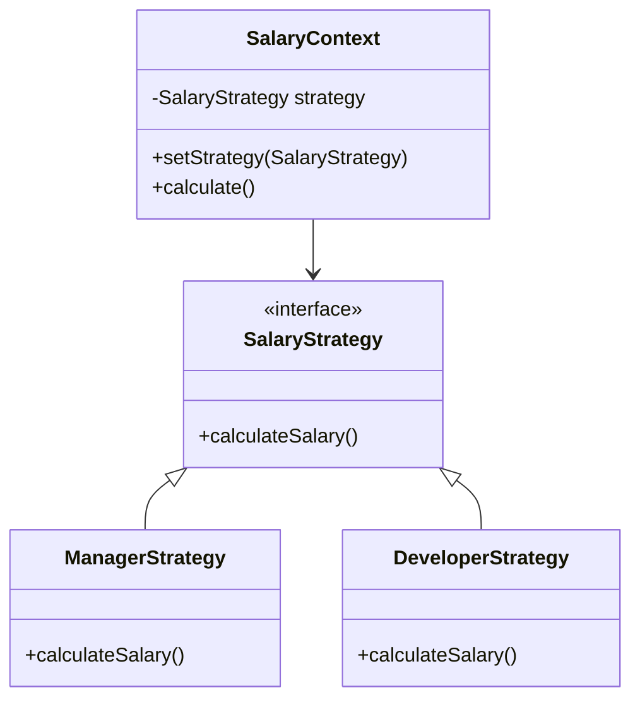

## 5. Phân tích sâu: Control Coupling vs. Data Coupling

Cần phân biệt rõ hai loại này để tránh nhầm lẫn. 

| Đặc điểm | Control Coupling | Data Coupling |
| :--- | :--- | :--- |
| **Dữ liệu truyền vào** | Flag, mã lệnh, Enum trạng thái. | Dữ liệu thô (String, int, Object). |
| **Mục đích** | Chỉ định "cách thức" thực hiện. | Cung cấp thông tin để xử lý. |
| **Tác động** | Thay đổi luồng logic bên trong. | Không thay đổi luồng, chỉ dùng để tính toán. |
| **Mức độ nguy hiểm** | Cao (Vi phạm SRP/OCP). | Thấp (Chấp nhận được). |

**Công thức đánh giá:**
Nếu bạn có thể thay đổi giá trị của tham số truyền vào mà không làm thay đổi các dòng code nào được thực thi (chỉ thay đổi kết quả đầu ra), đó là **Data Coupling**. Nếu thay đổi giá trị dẫn đến việc nhảy vào một nhánh `if` khác, đó là **Control Coupling**.

## 6. Lợi ích khi loại bỏ Control Coupling

1.  **Mã nguồn dễ đọc hơn:** Không còn những phương thức dài dằng dặc với các khối logic lồng nhau.
2.  **Dễ mở rộng:** Thêm tính năng mới bằng cách thêm class mới (Add new code), thay vì sửa code cũ (Change existing code).
3.  **Unit Test tập trung:** Bạn có thể viết test cho từng Strategy hoặc từng lớp con một cách độc lập mà không cần phải giả lập (mock) quá nhiều trạng thái điều khiển.

## Tóm tắt
*   **Control Coupling** xảy ra khi một module điều khiển luồng thực thi của module khác thông qua tham số.
*   **Dấu hiệu nhận biết:** Các tham số kiểu boolean (flags), enum điều hướng, hoặc switch-case dựa trên thuộc tính của đối tượng khác.
*   **Hệ quả:** Vi phạm SRP, OCP, làm code trở nên cứng nhắc và khó kiểm thử.
*   **Cách khắc phục:** Tách phương thức, áp dụng tính Đa hình (Polymorphism) hoặc sử dụng các Design Pattern như Strategy, State để đóng gói logic riêng biệt.

## Câu hỏi tự kiểm tra

1. **Câu hỏi:** Tại sao việc truyền một biến `boolean` vào phương thức thường được coi là một "Code Smell" liên quan đến Control Coupling?
   <details><summary>Đáp án</summary>Vì biến boolean thường ép phương thức phải chứa một cấu trúc rẽ nhánh (if-else). Điều này có nghĩa là phương thức đó đang thực hiện ít nhất hai nhiệm vụ khác nhau tùy thuộc vào giá trị của flag, vi phạm nguyên lý Đơn nhiệm (SRP) và làm tăng sự phụ thuộc của người gọi vào logic nội bộ của phương thức đó.</details>

2. **Câu hỏi:** Trong Java, nếu một phương thức nhận vào một `Enum` để quyết định thực hiện phép tính cộng, trừ, nhân, hay chia, đây có phải là Control Coupling không? Làm thế nào để refactor?
   <details><summary>Đáp án</summary>Có, đây là Control Coupling. Cách refactor tốt nhất là sử dụng Đa hình: định nghĩa một Interface <code>Operation</code> với phương thức <code>execute(a, b)</code>, sau đó tạo các lớp thực thi như <code>Addition</code>, <code>Subtraction</code>. Hoặc có thể định nghĩa logic ngay trong Enum nếu Java Enum đó triển khai một interface.</details>

3. **Câu hỏi:** Control Coupling ảnh hưởng như thế nào đến Unit Testing?
   <details><summary>Đáp án</summary>Nó làm tăng số lượng kịch bản kiểm thử (test cases) cho một phương thức duy nhất. Thay vì test một logic tập trung, bạn phải thiết lập nhiều trạng thái đầu vào khác nhau để bao phủ hết các nhánh <code>if-else</code>, dẫn đến bộ test khó duy trì và dễ bị hỏng khi logic điều khiển thay đổi.</details>

4. **Câu hỏi:** Có trường hợp nào Control Coupling là chấp nhận được không?
   <details><summary>Đáp án</summary>Trong các hệ thống cực kỳ đơn giản hoặc các thư viện cấp thấp (low-level utility) nơi hiệu năng là ưu tiên hàng đầu và logic rất ít khi thay đổi, việc sử dụng một vài flag có thể chấp nhận được để tránh overhead của việc tạo quá nhiều object/interface. Tuy nhiên, trong kiến trúc ứng dụng doanh nghiệp, nên hạn chế tối đa.</details>

---

## Stamp Coupling và Data Coupling

# Stamp Coupling và Data Coupling

Trong thiết kế phần mềm, cách thức các module trao đổi dữ liệu quyết định trực tiếp đến độ bền vững và khả năng mở rộng của hệ thống. Trong khi các bài học trước đã đề cập đến những loại coupling nguy hiểm như Global State hay Control Coupling, bài học này sẽ đi sâu vào ranh giới giữa **Stamp Coupling** và **Data Coupling**. Đây là hai mức độ tương tác phổ biến nhất trong lập trình hướng đối tượng (OOP), nơi việc lựa chọn sai lầm có thể dẫn đến hiện tượng "Interface Pollution" (ô nhiễm giao diện) và làm khó khăn cho quá trình Unit Test.

## Mục tiêu bài học

*   Phân biệt rõ ràng giữa Stamp Coupling (truyền cấu trúc) và Data Coupling (truyền dữ liệu).
*   Nhận diện các dấu hiệu của Stamp Coupling trong mã nguồn Java thực tế.
*   Hiểu rõ tác động tiêu cực của việc truyền thừa dữ liệu đối với tính đóng gói và bảo trì.
*   Nắm vững kỹ thuật Refactoring để chuyển đổi từ Stamp sang Data Coupling nhằm tối ưu hóa thiết kế.
*   Phân tích bài toán thực tế về xử lý đơn hàng (Order) để áp dụng kiến thức.

---

## 1. Stamp Coupling: Khi chúng ta đưa quá nhiều

### Định nghĩa
**Stamp Coupling** (còn gọi là Data-Structured Coupling) xảy ra khi một phương thức chấp nhận một cấu trúc dữ liệu phức tạp (một Object, một Class, hoặc một Record) làm đối số, nhưng thực tế nó chỉ sử dụng một phần nhỏ các thuộc tính của cấu trúc đó.

Trong Java, điều này thường thấy khi lập trình viên lười biếng hoặc muốn "tiện tay" truyền cả một Entity từ Database vào các Service tầng dưới.

### Ví dụ minh họa
Giả sử chúng ta có một lớp `User` chứa rất nhiều thông tin cá nhân và một service gửi email thông báo.

```java
// Lớp User chứa quá nhiều thông tin
public class User {
    private Long id;
    private String username;
    private String email;
    private String address;
    private LocalDate dateOfBirth;
    private String passwordHash;
    // Getters...
}

// Service gửi email
public class EmailService {
    // Stamp Coupling: Truyền cả User chỉ để lấy Email
    public void sendWelcomeEmail(User user) {
        String email = user.getEmail();
        System.out.println("Sending email to: " + email);
        // Logic gửi mail...
    }
}
```

### Tại sao Stamp Coupling lại là vấn đề?
1.  **Sự phụ thuộc ẩn (Hidden Dependency):** `EmailService` bây giờ phụ thuộc vào toàn bộ cấu trúc của `User`. Nếu bạn đổi tên field `email` trong lớp `User` thành `primaryEmail`, bạn buộc phải sửa đổi cả `EmailService` dù logic gửi mail không hề thay đổi.
2.  **Khó khăn khi Unit Test:** Để test phương thức `sendWelcomeEmail`, bạn phải khởi tạo một đối tượng `User` đầy đủ (hoặc Mock nó). Nếu `User` có các ràng buộc phức tạp trong constructor, việc viết test trở nên cồng kềnh.
3.  **Vi phạm nguyên lý Least Privilege:** `EmailService` không cần biết mật khẩu hay ngày sinh của người dùng, nhưng Stamp Coupling đã "phơi bày" toàn bộ thông tin đó cho nó.

---

## 2. Data Coupling: Sự tinh gọn tối đa

### Định nghĩa
**Data Coupling** xảy ra khi các module chỉ trao đổi với nhau thông qua các tham số dữ liệu đơn lẻ (primitive types) hoặc các cấu trúc dữ liệu mà mọi thành phần của nó đều được sử dụng. Đây được coi là mức độ coupling tốt nhất (ngoại trừ Message Coupling) vì nó giữ cho các thành phần độc lập tối đa.

### Refactoring ví dụ trên

```java
public class EmailService {
    // Data Coupling: Chỉ truyền đúng thứ cần thiết
    public void sendWelcomeEmail(String email) {
        System.out.println("Sending email to: " + email);
        // Logic gửi mail...
    }
}
```

Lúc này, `EmailService` hoàn toàn không biết gì về lớp `User`. Nó có thể được tái sử dụng để gửi mail cho `Admin`, `Partner`, hoặc bất kỳ chuỗi String nào hợp lệ.

---

## 3. Vấn đề Interface Pollution (Ô nhiễm giao diện)

Stamp Coupling dẫn đến một hệ lụy nghiêm trọng trong thiết kế hướng đối tượng gọi là **Interface Pollution**. Khi một Interface yêu cầu các Object lớn làm tham số, nó vô tình ép buộc các lớp triển khai (Implementation) phải biết về các kiểu dữ liệu không liên quan.

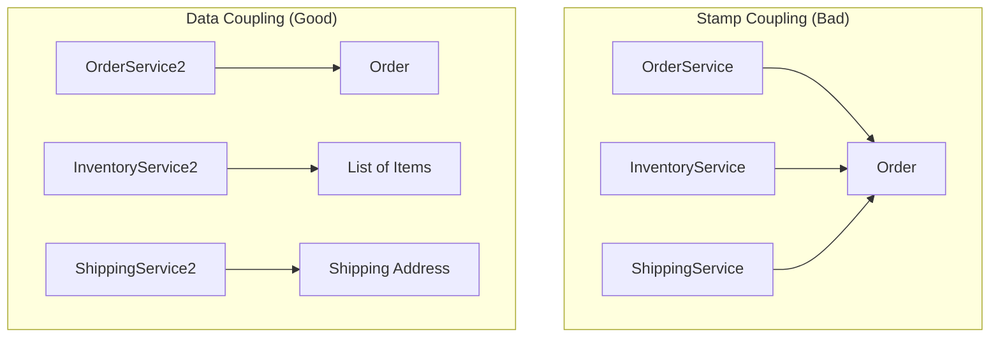

Trong sơ đồ trên, ở thiết kế xấu, cả ba dịch vụ đều phụ thuộc vào `Order`. Nếu `Order` thay đổi (ví dụ: thêm thông tin thanh toán), cả ba dịch vụ có thể phải biên dịch lại hoặc kiểm thử lại. Ở thiết kế tốt, `ShippingService` chỉ biết về `Address`, giúp cô lập thay đổi.

---

## 4. Phân tích sâu: Case Study về Order Processing

Hãy xem xét một ví dụ phức tạp hơn về hệ thống xử lý đơn hàng.

### Tình huống Stamp Coupling

```java
public class Order {
    private String id;
    private List<Item> items;
    private Customer customer;
    private PaymentInfo payment;
    private String shippingAddress;
    // ... 20 fields khác
}

public class ShippingModule {
    // Chỉ cần address và danh sách item để tính khối lượng
    public void calculateShippingCost(Order order) {
        double weight = order.getItems().stream().mapToDouble(Item::getWeight).sum();
        String address = order.getShippingAddress();
        // Tính toán dựa trên weight và address
    }
}
```

### Tình huống Data Coupling (Tối ưu)

Chúng ta có thể tách thành một DTO nhỏ hoặc truyền tham số rời:

```java
public class ShippingModule {
    public void calculateShippingCost(List<Item> items, String address) {
        double weight = items.stream().mapToDouble(Item::getWeight).sum();
        // Tính toán...
    }
}
```

**Sự khác biệt khi viết Unit Test:**
*   **Stamp:** `shippingModule.calculateShippingCost(new Order(..., ..., ..., many_nulls))` -> Cần tạo một Order giả lập rất phức tạp.
*   **Data:** `shippingModule.calculateShippingCost(listOfItems, "Hanoi")` -> Cực kỳ đơn giản, tập trung đúng vào logic cần test.

---

## 5. Khi nào Stamp Coupling là chấp nhận được?

Không phải lúc nào truyền Object cũng là xấu. Stamp Coupling được chấp nhận khi:
1.  **Tính gắn kết cao (High Cohesion):** Nếu phương thức sử dụng hầu hết (ví dụ >70%) các thuộc tính của Object đó.
2.  **Domain Models:** Trong các lớp nội bộ của một Domain, việc truyền Entity là bình thường để giữ tính nhất quán về nghiệp vụ.
3.  **Data Transfer Objects (DTO):** Khi bạn tạo ra một DTO chuyên biệt chỉ chứa 3-4 trường và phương thức sử dụng cả 4 trường đó, đó thực chất là Data Coupling dưới hình thức một cấu trúc gom nhóm.

---

## 6. Bảng so sánh tổng kết

| Đặc điểm | Stamp Coupling | Data Coupling |
| :--- | :--- | :--- |
| **Dữ liệu truyền vào** | Cả một Object/Cấu trúc lớn | Tham số đơn lẻ hoặc DTO tinh gọn |
| **Sự phụ thuộc** | Phụ thuộc vào toàn bộ cấu trúc Object | Chỉ phụ thuộc vào kiểu dữ liệu thực tế cần |
| **Khả năng tái sử dụng** | Thấp (chỉ dùng được cho Object đó) | Cao (dùng được cho nhiều nguồn dữ liệu) |
| **Độ khó Unit Test** | Cao (phải khởi tạo Object phức tạp) | Thấp (truyền giá trị trực tiếp) |
| **Interface Pollution** | Dễ xảy ra | Rất ít khi xảy ra |

---

## Tóm tắt

*   **Stamp Coupling** là việc truyền "thừa" thông tin qua các cấu trúc dữ liệu lớn. Nó làm tăng sự phụ thuộc không cần thiết và gây khó khăn cho việc bảo trì.
*   **Data Coupling** là trạng thái lý tưởng khi các phương thức chỉ giao tiếp qua những gì chúng thực sự cần.
*   **Quy tắc ngón tay cái:** Nếu bạn thấy mình gọi `object.getSomething()` chỉ một hoặc hai lần trong một phương thức dài, hãy cân nhắc chuyển sang truyền trực tiếp `something` đó làm tham số.

---

## Câu hỏi tự kiểm tra

**Câu 1:** Tại sao Stamp Coupling lại làm tăng rủi ro bảo mật trong một số hệ thống?
<details>
<summary>Đáp án</summary>
Vì khi truyền cả một Object lớn (như User) qua các lớp khác nhau, các thông tin nhạy cảm (như passwordHash, secretKey) vốn không cần thiết cho logic của lớp nhận vẫn bị phơi bày, dẫn đến nguy cơ rò rỉ dữ liệu nếu lớp nhận bị chiếm quyền điều khiển hoặc ghi log bừa bãi.
</details>

**Câu 2:** Nếu một phương thức cần 10 tham số đơn lẻ, ta nên dùng Data Coupling (truyền 10 tham số) hay gom vào một Object (Stamp Coupling)?
<details>
<summary>Đáp án</summary>
Đây là sự đánh giá giữa Coupling và Clean Code. Truyền 10 tham số (Long Parameter List) là một code smell. Giải pháp tốt nhất là tạo một **Parameter Object** (một DTO nhỏ) chứa đúng 10 thuộc tính đó và phương thức sử dụng hết 10 thuộc tính. Khi đó, nó trở thành Data Coupling (vì Object này được thiết kế riêng cho phương thức đó).
</details>

**Câu 3:** Trong Java, việc truyền một `Map<String, Object>` vào phương thức được coi là loại coupling nào?
<details>
<summary>Đáp án</summary>
Đây thường là một dạng biến tướng của Stamp Coupling (hoặc tệ hơn là Control Coupling). Vì Map có thể chứa bất cứ thứ gì, phương thức nhận không biết chắc chắn có gì bên trong, dẫn đến sự phụ thuộc lỏng lẻo về cấu trúc nhưng cực kỳ khó kiểm soát về mặt logic.
</details>

---

## Message Coupling: Đỉnh cao của Loose Coupling

# Message Coupling: Đỉnh cao của Loose Coupling

Trong kiến trúc phần mềm, nếu Coupling (Sự phụ thuộc) là một thang đo từ "nguy hiểm" đến "an toàn", thì Message Coupling chính là trạng thái lý tưởng nhất mà mọi lập trình viên Java hướng tới. Đây là cấp độ mà các thành phần trong hệ thống giao tiếp với nhau theo cách tối giản nhất: chỉ thông qua các thông điệp (messages) hoặc lời gọi hàm mà không cần biết bất cứ điều gì về cấu trúc nội bộ của nhau.

## Mục tiêu

*   Hiểu rõ bản chất của Message Coupling và tại sao nó được coi là đỉnh cao của Loose Coupling.
*   Nắm vững kỹ thuật lập trình dựa trên Interface thay vì Concrete Class.
*   Áp dụng triệt để nguyên tắc "Tell, Don't Ask" để bảo vệ tính đóng gói (Encapsulation).
*   Tối ưu hóa khả năng kiểm thử (Unit Test) thông qua việc Mocking hiệu quả.

## 1. Message Coupling là gì?

Message Coupling (hay đôi khi được gọi là No Coupling trong một số tài liệu chuyên sâu) xảy ra khi hai module giao tiếp hoàn toàn qua các tham số truyền vào hàm hoặc qua các Interface. Ở mức độ này, một đối tượng không nắm giữ trạng thái của đối tượng khác, không can thiệp vào logic nội bộ, và quan trọng nhất: nó không quan tâm đối tượng kia là ai, miễn là đối tượng đó phản hồi đúng "thông điệp" được gửi đi.

Trong Java, điều này thường được hiện thực hóa thông qua các phương thức (methods) và các Interface. 

### Bảng so sánh sự khác biệt

| Đặc điểm | Tight Coupling (Concrete) | Message Coupling (Interface) |
| :--- | :--- | :--- |
| **Đối tượng phụ thuộc** | Phụ thuộc vào một Class cụ thể | Phụ thuộc vào một bản hợp đồng (Interface) |
| **Khả năng thay đổi** | Khó khăn, dễ gây lỗi dây chuyền | Dễ dàng thay thế implementation |
| **Tính đóng gói** | Thường xuyên truy cập trực tiếp field | Chỉ tương tác qua hành vi (behavior) |
| **Độ phức tạp Test** | Phải khởi tạo cả cây phụ thuộc | Dễ dàng Mock/Stub |

## 2. Giao tiếp qua Interface thay vì Concrete Class

Sai lầm phổ biến nhất của các lập trình viên Java trung cấp là khai báo kiểu dữ liệu dựa trên lớp thực thi (Concrete Class). Điều này tạo ra một sợi dây ràng buộc cứng nhắc.

### Ví dụ thực tế: Hệ thống thanh toán

Giả sử bạn có một lớp `OrderProcessor` cần thực hiện thanh toán qua PayPal.

**Cách tiếp cận sai (Tight Coupling):**

```java
public class PayPalService {
    public void process(double amount) {
        System.out.println("Processing PayPal payment: " + amount);
    }
}

public class OrderProcessor {
    private PayPalService payPalService = new PayPalService(); // Ràng buộc cứng

    public void checkout(double amount) {
        payPalService.process(amount);
    }
}
```

Trong ví dụ trên, `OrderProcessor` bị khóa chặt vào `PayPalService`. Nếu sau này khách hàng muốn thanh toán qua VNPay hoặc Stripe, bạn phải sửa mã nguồn của `OrderProcessor`.

**Cách tiếp cận đúng (Message Coupling):**

```java
// 1. Định nghĩa thông điệp (Interface)
public interface PaymentProvider {
    void pay(double amount);
}

// 2. Các lớp thực thi khác nhau
public class PayPalProvider implements PaymentProvider {
    @Override
    public void pay(double amount) { /* Logic PayPal */ }
}

public class VnPayProvider implements PaymentProvider {
    @Override
    public void pay(double amount) { /* Logic VNPay */ }
}

// 3. Caller chỉ giao tiếp qua thông điệp
public class OrderProcessor {
    private final PaymentProvider paymentProvider;

    // Dependency Injection
    public OrderProcessor(PaymentProvider paymentProvider) {
        this.paymentProvider = paymentProvider;
    }

    public void checkout(double amount) {
        paymentProvider.pay(amount); // Message Coupling
    }
}
```

Lúc này, `OrderProcessor` không còn biết `PaymentProvider` thực sự là gì. Nó chỉ gửi một thông điệp: "Hãy thanh toán số tiền này cho tôi". Đây chính là sự tách biệt hoàn hảo.

## 3. Nguyên tắc "Tell, Don't Ask"

Để đạt được Message Coupling thực thụ, bạn phải tuân thủ nguyên tắc **Tell, Don't Ask (TDA)**. Nguyên tắc này phát biểu rằng: Đừng hỏi đối tượng về trạng thái của nó để đưa ra quyết định, hãy ra lệnh cho đối tượng đó làm việc của nó.

Khi bạn "hỏi" (Ask), bạn đang tạo ra sự phụ thuộc vào cấu trúc dữ liệu của đối tượng đó. Khi bạn "bảo" (Tell), bạn chỉ đang gửi một thông điệp.

### Minh họa bằng mã nguồn

**Vi phạm TDA (Ask):**

```java
public class Door {
    private boolean open;
    public boolean isOpen() { return open; }
    public void setOpen(boolean open) { this.open = open; }
}

public class SecuritySystem {
    public void checkDoor(Door door) {
        if (door.isOpen()) { // Hỏi trạng thái
            System.out.println("Warning: Door is open!");
        }
    }
}
```

**Tuân thủ TDA (Tell):**

```java
public interface SecurityCheckable {
    void reportStatus();
}

public class Door implements SecurityCheckable {
    private boolean open;
    @Override
    public void reportStatus() {
        if (this.open) System.out.println("Warning: Door is open!");
    }
}

public class SecuritySystem {
    public void check(SecurityCheckable item) {
        item.reportStatus(); // Chỉ ra lệnh (Tell), không hỏi trạng thái
    }
}
```

Việc chuyển từ "hỏi" sang "bảo" giúp giảm thiểu rò rỉ logic (Logic Leakage) và giữ cho các lớp độc lập với nhau về mặt dữ liệu.

## 4. Sơ đồ tương tác Message Coupling

Dưới đây là cách Message Coupling hoạt động thông qua một lớp trung gian (Interface/Abstraction):

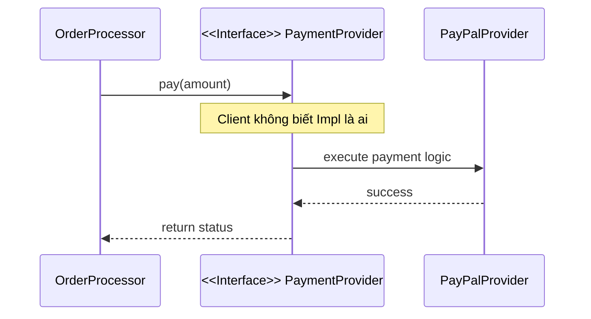

## 5. Lợi ích tối thượng trong Unit Test

Một trong những thước đo chính xác nhất của Coupling là độ khó khi viết Unit Test. Nếu bạn thấy mình phải khởi tạo quá nhiều đối tượng phụ thuộc hoặc phải thiết lập cơ sở dữ liệu để test một hàm đơn giản, bạn đang bị Tight Coupling.

Với Message Coupling, việc test trở nên cực kỳ đơn giản nhờ **Mocking**. Vì `OrderProcessor` chỉ phụ thuộc vào `PaymentProvider` (Interface), chúng ta có thể tạo ra một "kẻ giả mạo" (Mock) để kiểm tra hành vi của `OrderProcessor` mà không cần kết nối internet hay API của PayPal.

### Ví dụ sử dụng Mockito trong Java

```java
import static org.mockito.Mockito.*;
import org.junit.jupiter.api.Test;

class OrderProcessorTest {
    @Test
    void testCheckoutCallsPaymentProvider() {
        // Tạo mock cho Interface
        PaymentProvider mockProvider = mock(PaymentProvider.class);
        OrderProcessor processor = new OrderProcessor(mockProvider);

        // Thực thi
        processor.checkout(100.0);

        // Kiểm chứng: Thông điệp 'pay' có được gửi đi với đúng tham số không?
        verify(mockProvider, times(1)).pay(100.0);
    }
}
```

Nếu không có Message Coupling, bạn sẽ không bao giờ có thể cô lập được `OrderProcessor` để kiểm thử một cách thuần túy.

## 6. Mối liên hệ với SOLID

Message Coupling thực chất là sự kết hợp nhuần nhuyễn của hai nguyên lý trong SOLID:
1.  **Dependency Inversion Principle (DIP):** Phụ thuộc vào Abstraction, không phụ thuộc vào Concretion.
2.  **Interface Segregation Principle (ISP):** Thay vì một thông điệp quá lớn (Fat Interface), hãy chia nhỏ thành các thông điệp chuyên biệt để giảm thiểu sự liên quan không cần thiết.

## Tóm tắt

*   **Message Coupling** là trạng thái mà các thành phần chỉ biết về nhau qua các lời gọi phương thức trên các Interface.
*   **Interface là chìa khóa:** Luôn ưu tiên khai báo biến và tham số bằng kiểu Interface.
*   **Tell, Don't Ask:** Giảm thiểu việc lấy dữ liệu từ đối tượng khác để xử lý; thay vào đó, hãy yêu cầu đối tượng đó tự thực hiện hành vi.
*   **Testability:** Message Coupling cho phép chúng ta thay thế các thành phần thực bằng Mock Objects, giúp Unit Test chạy nhanh và độc lập.

## Câu hỏi tự kiểm tra

1. Tại sao việc sử dụng từ khóa `new` bên trong một phương thức thường dẫn đến Tight Coupling thay vì Message Coupling?
<details><summary>Đáp án</summary>Vì khi dùng `new`, bạn đang chỉ định chính xác một lớp thực thi (Concrete Class). Điều này khiến lớp hiện tại bị buộc chặt vào lớp đó, không thể thay thế bằng implementation khác và rất khó để Mock khi viết Unit Test.</details>

2. Nguyên tắc "Tell, Don't Ask" giúp ích gì trong việc duy trì Message Coupling?
<details><summary>Đáp án</summary>Nó giúp bảo vệ tính đóng gói bằng cách ngăn chặn việc truy cập vào trạng thái nội bộ của đối tượng khác. Khi chỉ gửi mệnh lệnh, sự phụ thuộc chỉ dừng lại ở chữ ký phương thức (method signature), thay vì phụ thuộc vào cấu trúc dữ liệu bên trong.</details>

3. Trong Java, nếu một phương thức nhận vào một tham số kiểu `String`, đây có được coi là Message Coupling không?
<details><summary>Đáp án</summary>Có, đây là một dạng đơn giản của Message/Data Coupling. Tuy nhiên, nếu tham số là một Object phức tạp (như `UserEntity`), hãy cẩn thận để không vi phạm Stamp Coupling (truyền quá nhiều dữ liệu không cần thiết). Message Coupling lý tưởng nhất là khi Interface chỉ chứa các phương thức cần thiết cho mục đích giao tiếp đó.</details>

---

## Coincidental và Logical Cohesion

# Coincidental và Logical Cohesion

Trong thiết kế phần mềm, Cohesion (tính kết dính) đo lường mức độ liên quan giữa các thành phần bên trong một module hoặc một lớp. Một hệ thống tốt hướng tới **High Cohesion** (kết dính cao), nơi các thành phần phối hợp chặt chẽ để thực hiện một nhiệm vụ duy nhất. Tuy nhiên, trên thực tế, lập trình viên thường rơi vào cái bẫy của việc gom nhóm mã nguồn một cách hời hợt. 

Bài viết này sẽ đi sâu vào hai cấp độ thấp nhất và yếu nhất của Cohesion: **Coincidental Cohesion** (Kết dính ngẫu nhiên) và **Logical Cohesion** (Kết dính logic).

## Mục tiêu

*   Nhận diện được các dấu hiệu của Coincidental và Logical Cohesion trong dự án Java.
*   Phân tích tác động tiêu cực của việc gom nhóm mã nguồn tùy tiện đối với khả năng bảo trì và kiểm thử.
*   Nắm vững kỹ thuật tái cấu trúc các lớp "Utility" khổng lồ thành các module chuyên biệt.
*   Phân biệt được sự khác nhau tinh tế giữa việc gom nhóm theo "phân loại bề mặt" và gom nhóm theo "chức năng thực sự".

--- 

## 1. Coincidental Cohesion: Kết dính ngẫu nhiên

### Định nghĩa
Coincidental Cohesion xảy ra khi các thành phần (phương thức, biến) được gom nhóm vào cùng một lớp chỉ vì chúng tình cờ xuất hiện cùng nhau hoặc đơn giản là lập trình viên không biết để chúng ở đâu. Các thành phần này hoàn toàn không có mối quan hệ logic hay chức năng nào với nhau.

### Ví dụ điển hình: Thảm họa mang tên `CommonUtils`
Trong các dự án Java cũ hoặc thiếu quy hoạch kiến trúc, chúng ta thường thấy sự xuất hiện của những lớp "tiện ích" chứa đủ thứ trên đời.

```java
public class CommonUtils {
    
    // Xử lý chuỗi
    public static String capitalize(String str) {
        return str == null ? "" : str.substring(0, 1).toUpperCase() + str.substring(1);
    }

    // Xử lý ngày tháng
    public static LocalDate parseDate(String dateStr) {
        return LocalDate.parse(dateStr, DateTimeFormatter.ISO_DATE);
    }

    // Xử lý mạng
    public static boolean pingHost(String host) {
        try {
            return InetAddress.getByName(host).isReachable(2000);
        } catch (IOException e) {
            return false;
        }
    }

    // Xử lý logic nghiệp vụ ngẫu nhiên
    public static double calculateTax(double price) {
        return price * 0.1;
    }
}
```

### Tại sao Coincidental Cohesion lại nguy hiểm?
1.  **Vi phạm nguyên lý Đơn nhiệm (SRP):** Lớp này đảm nhận quá nhiều trách nhiệm không liên quan.
2.  **Khó tái sử dụng:** Nếu bạn chỉ muốn dùng hàm `capitalize`, bạn vẫn phải kéo theo cả thư viện mạng và logic tính thuế khi import lớp này.
3.  **Khó bảo trì:** Khi lớp `CommonUtils` phình to lên hàng nghìn dòng, việc tìm kiếm và chỉnh sửa trở thành ác mộng.
4.  **Phá vỡ tính đóng gói:** Các logic quan trọng bị phơi bày ra ngoài dưới dạng `static`, khiến việc mock để unit test trở nên khó khăn.

--- 

## 2. Logical Cohesion: Kết dính logic

### Định nghĩa
Logical Cohesion ở cấp độ cao hơn một chút so với ngẫu nhiên. Các thành phần được gom nhóm vì chúng thực hiện các nhiệm vụ **có vẻ giống nhau về mặt phân loại** (ví dụ: tất cả đều là Input, tất cả đều là Output, hoặc tất cả đều là Validation), nhưng thực tế cách thức hoạt động và mục đích của chúng rất khác nhau.

### Ví dụ: Lớp xử lý dữ liệu đa năng

```java
public class DataHandler {
    public void process(Object data, int type) {
        switch (type) {
            case 1: // Lưu vào Database
                saveToDatabase(data);
                break;
            case 2: // Gửi qua API
                sendToCloud(data);
                break;
            case 3: // Ghi ra file CSV
                writeToCsv(data);
                break;
            default:
                throw new IllegalArgumentException("Unknown type");
        }
    }

    private void saveToDatabase(Object data) { /* logic */ }
    private void sendToCloud(Object data) { /* logic */ }
    private void writeToCsv(Object data) { /* logic */ }
}
```

Trong ví dụ trên, các phương thức được gom vào `DataHandler` vì chúng đều "xử lý dữ liệu". Tuy nhiên, logic để ghi DB khác hoàn toàn với logic gọi API hay ghi file.

### Tại sao Logical Cohesion gây khó khăn cho bảo trì?
*   **Giao diện (Interface) rối rắm:** Người dùng phải truyền vào các tham số điều khiển (như `int type` hoặc `flag`) để chọn logic mong muốn.
*   **Rủi ro từ sự thay đổi:** Khi bạn thay đổi logic ghi file CSV, bạn có nguy cơ làm hỏng hoặc ảnh hưởng đến lớp `DataHandler` vốn đang phục vụ cả Database và Cloud.
*   **Khó mở rộng:** Mỗi khi thêm một kiểu xử lý mới, bạn phải sửa đổi phương thức `process` và thêm `case` mới, vi phạm nguyên lý **Open/Closed Principle**.

--- 

## 3. So sánh Coincidental và Logical Cohesion

| Đặc điểm | Coincidental (Ngẫu nhiên) | Logical (Logic) |
| :--- | :--- | :--- |
| **Mối liên hệ** | Không có mối liên hệ nào. | Có liên hệ về mặt phân loại tổng quát. |
| **Dấu hiệu nhận biết** | Tên lớp thường là `Utils`, `Misc`, `Global`. | Có các cấu trúc `switch-case` hoặc `if-else` dựa trên cờ (flag). |
| **Sự lệ thuộc** | Các phương thức độc lập hoàn toàn. | Các phương thức có thể chia sẻ một số tham số đầu vào chung nhưng thực thi nhánh khác nhau. |
| **Mức độ tệ** | Rất tệ (Tệ nhất). | Tệ (Dễ gây nhầm lẫn là thiết kế tốt). |

### Sơ đồ minh họa sự phân mảnh

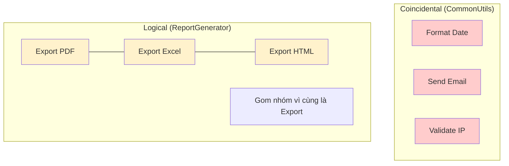

--- 

## 4. Chiến lược cải thiện

Để thoát khỏi tình trạng kết dính thấp, chúng ta cần thực hiện các bước Refactoring sau:

### Giải quyết Coincidental Cohesion
Chia nhỏ lớp `CommonUtils` thành các lớp chuyên biệt dựa trên miền dữ liệu (Domain):
*   `StringUtils`: Chỉ chứa các hàm thao tác chuỗi.
*   `DateTimeService`: Xử lý các nghiệp vụ liên quan đến thời gian.
*   `NetworkClient`: Chứa các hàm kiểm tra kết nối.
*   `TaxCalculator`: Đưa logic tính thuế về đúng module kế toán/nghiệp vụ.

### Giải quyết Logical Cohesion
Sử dụng **Polymorphism (Đa hình)** hoặc **Strategy Pattern** thay vì dùng `switch-case`.

```java
// Thay vì DataHandler với switch-case
public interface DataExporter {
    void export(Object data);
}

public class DatabaseExporter implements DataExporter {
    public void export(Object data) { /* logic DB */ }
}

public class CloudExporter implements DataExporter {
    public void export(Object data) { /* logic Cloud */ }
}
```

Bằng cách này, mỗi lớp chỉ tập trung vào một nhiệm vụ duy nhất (**Functional Cohesion**), dễ dàng kiểm thử độc lập và mở rộng mà không ảnh hưởng đến mã nguồn cũ.

--- 

## Tóm tắt

*   **Coincidental Cohesion** là kiểu gom nhóm "tiện đâu để đó", tạo ra những lớp rác khó bảo trì.
*   **Logical Cohesion** là kiểu gom nhóm dựa trên cảm giác tương đồng bề mặt, thường dẫn đến các hàm chứa logic rẽ nhánh phức tạp.
*   Cả hai đều làm tăng độ phức tạp nhận thức (cognitive load) và vi phạm nguyên lý SOLID.
*   Giải pháp luôn là: **Chia nhỏ để trị**. Hãy hướng tới việc gom nhóm các thành phần dựa trên chức năng thực tế mà chúng thực hiện.

--- 

## Câu hỏi tự kiểm tra

**Câu 1:** Một lớp `SystemManager` chứa phương thức `rebootServer()`, `calculateEmployeeBonus()` và `convertXmlToJson()` thuộc loại Cohesion nào?
<details><summary>Đáp án</summary>Đây là <b>Coincidental Cohesion</b> vì ba chức năng này hoàn toàn không liên quan gì đến nhau về mặt logic hay nghiệp vụ.</details>

**Câu 2:** Tại sao Logical Cohesion thường đi kèm với việc vi phạm nguyên lý Open/Closed (OCP)?
<details><summary>Đáp án</summary>Vì khi có một yêu cầu mới (ví dụ: thêm định dạng export mới), bạn buộc phải mở lớp hiện có ra để sửa đổi cấu trúc <code>switch-case</code> hoặc <code>if-else</code>, thay vì chỉ việc viết thêm lớp mới.</details>

**Câu 3:** Trong Java, các thư viện như `java.util.Math` có bị coi là Coincidental Cohesion không?
<details><summary>Đáp án</summary>Không hẳn. <code>Math</code> có tính <b>Logical Cohesion</b> ở mức chấp nhận được (hoặc thậm chí là Functional) vì tất cả các hàm đều phục vụ một mục đích duy nhất: thực hiện các phép toán học cơ bản. Tuy nhiên, nếu <code>Math</code> chứa thêm hàm <code>saveToFile()</code> thì nó sẽ trở thành Coincidental.</details>

**Câu 4:** Dấu hiệu mã nguồn (code smell) rõ rệt nhất của Logical Cohesion là gì?
<details><summary>Đáp án</summary>Sự xuất hiện của các tham số kiểu <code>boolean flag</code> hoặc <code>int type</code> được dùng để điều hướng luồng xử lý bên trong một phương thức.</details>

---

## Temporal và Procedural Cohesion

# Temporal và Procedural Cohesion

Trong thang đo mức độ gắn kết (Cohesion) của phần mềm, sau khi đi qua các mức độ thấp nhất như Coincidental (ngẫu nhiên) hay Logical (logic bề mặt), chúng ta tiến đến một vùng ranh giới khá phổ biến trong lập trình thực tế: **Temporal Cohesion** và **Procedural Cohesion**. 

Đây là hai mức độ gắn kết mà các lập trình viên Java thường xuyên mắc phải khi cố gắng tổ chức mã nguồn theo dòng chảy của chương trình thay vì theo bản chất của dữ liệu hay chức năng. Bài viết này sẽ phân tích sâu về cách nhận diện, hệ quả và phương pháp tái cấu trúc để đưa mã nguồn lên các cấp độ gắn kết cao hơn.

## Mục tiêu
* Phân tích và phân biệt rõ ràng giữa Temporal Cohesion (gắn kết thời gian) và Procedural Cohesion (gắn kết quy trình).
* Nhận diện các dấu hiệu "mã thối" (code smell) khi các hàm/lớp được gom nhóm dựa trên thời điểm thực thi hoặc trình tự chạy.
* Hiểu rõ tác động tiêu cực của hai loại gắn kết này đến khả năng tái sử dụng và kiểm thử đơn vị (Unit Test).
* Áp dụng kỹ thuật refactoring để chuyển đổi từ gắn kết yếu sang gắn kết chức năng (Functional Cohesion).

## 1. Temporal Cohesion (Gắn kết theo thời gian)

### Định nghĩa
Temporal Cohesion xảy ra khi các thành phần của một module được gom nhóm lại với nhau chỉ vì chúng **phải thực hiện tại cùng một thời điểm** trong quá trình vận hành của chương trình.

Trong Java, bạn thường thấy điều này ở các lớp có tên kết thúc bằng `Initializer`, `Startup`, `Bootstrapper` hoặc các phương thức kiểu `init()`, `setup()`, `cleanup()`. Mặc dù các tác vụ bên trong có vẻ cần thiết, nhưng về mặt logic, chúng không liên quan gì đến nhau ngoại trừ việc chúng cùng chạy lúc khởi động hoặc lúc đóng ứng dụng.

### Ví dụ minh họa
Hãy xem xét một lớp khởi tạo hệ thống sau:

```java
public class SystemManager {
    public void bootUp() {
        // 1. Khởi tạo cấu hình Logging
        LoggerConfig.init("log-path.xml");
        
        // 2. Kết nối Database
        DatabaseConnection.connect("jdbc:mysql://localhost:3306/db");
        
        // 3. Kiểm tra sự tồn tại của các thư mục tạm
        File tempDir = new File("/tmp/app");
        if (!tempDir.exists()) tempDir.mkdirs();
        
        // 4. Kiểm tra bản cập nhật phần mềm
        UpdateChecker.checkForUpdates();
    }
}
```

**Phân tích:**
* **Tính gắn kết:** Các hành động `init logging`, `connect DB`, `check files`, và `check updates` không có mối liên hệ logic chặt chẽ nào với nhau. 
* **Vấn đề:** Nếu bạn chỉ muốn viết một Unit Test cho việc kết nối Database, bạn bị buộc phải khởi tạo cả Logging và kiểm tra thư mục. Nếu việc kiểm tra Update bị lỗi (do không có mạng), toàn bộ quá trình `bootUp` thất bại, dù Database có thể đã sẵn sàng.

### Sơ đồ minh họa Temporal Cohesion

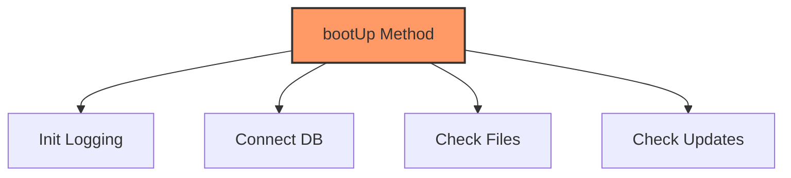

## 2. Procedural Cohesion (Gắn kết theo quy trình)

### Định nghĩa
Procedural Cohesion cao hơn Temporal một bậc. Ở đây, các thành phần được gom nhóm vì chúng **phải thực hiện theo một trình tự nhất định** (algorithm/procedure) để đạt được một mục tiêu cụ thể. Tuy nhiên, các bước này không nhất thiết phải chia sẻ dữ liệu với nhau một cách trực tiếp (khác với Sequential Cohesion nơi đầu ra của bước A là đầu vào của bước B).

### Ví dụ minh họa
Giả sử chúng ta có một lớp xử lý việc chuẩn bị báo cáo cuối tháng:

```java
public class MonthlyReportService {
    public void prepareReport(String employeeId) {
        // Bước 1: Kiểm tra quyền truy cập của người dùng
        checkUserPermission(employeeId);
        
        // Bước 2: Lấy dữ liệu từ file cấu hình
        loadReportTemplate();
        
        // Bước 3: Ghi log rằng quá trình bắt đầu
        AuditLogger.log("Starting report for: " + employeeId);
    }

    private void checkUserPermission(String id) { /* ... */ }
    private void loadReportTemplate() { /* ... */ }
}
```

**Phân tích:**
* **Tính gắn kết:** Các phương thức được gọi theo trình tự 1 -> 2 -> 3. Đây là một quy trình làm việc (workflow).
* **Vấn đề:** Lớp `MonthlyReportService` đang làm quá nhiều việc không thuộc phạm vi chính của nó. Việc kiểm tra quyền (Permission) và ghi log (Audit) thường là các Cross-cutting Concerns. Nếu quy trình thay đổi (ví dụ: không cần load template nếu không có quyền), mã nguồn sẽ trở nên chằng chịt các câu lệnh `if-else` bên trong một procedure duy nhất.

## 3. So sánh và Phân tích sự khác biệt

| Đặc điểm | Temporal Cohesion | Procedural Cohesion |
| :--- | :--- | :--- |
| **Tiêu chí gom nhóm** | Cùng thời điểm thực thi (Startup, Shutdown, Error). | Cùng một trình tự thực hiện (Algorithm steps). |
| **Mối quan hệ** | Các tác vụ độc lập hoàn toàn về logic. | Các tác vụ là một phần của một luồng xử lý. |
| **Khả năng tái sử dụng** | Rất thấp (phải lấy cả cụm). | Thấp (khó tách rời các bước trong quy trình). |
| **Ví dụ điển hình** | `init()`, `onClose()`, `handleError()`. | `processOrder()`, `prepareEnvironment()`. |

### Tại sao cả hai đều chưa tối ưu?
1. **Vi phạm Single Responsibility Principle (SRP):** Module gánh vác quá nhiều trách nhiệm khác nhau.
2. **Khó bảo trì:** Khi logic của một tác vụ nhỏ thay đổi (ví dụ: thay đổi cách kết nối DB), bạn phải sửa đổi lớp chứa cả những tác vụ không liên quan.
3. **Khó Unit Test:** Bạn không thể test cô lập từng hành vi mà không kích hoạt các hành vi đi kèm.

## 4. Hạn chế của việc gắn kết theo trình tự thực thi

Khi lập trình viên tư duy theo kiểu "Đầu tiên làm A, sau đó làm B, cuối cùng làm C", họ đang viết mã theo phong cách **Imperative (Mệnh lệnh)** thay vì **Object-Oriented (Hướng đối tượng)**. 

Trong Java, việc lạm dụng Procedural Cohesion dẫn đến các "God Classes" hoặc các Service phình to với hàng nghìn dòng code chỉ để điều phối các bước. Điều này làm mờ đi ranh giới giữa các Domain Object. 

**Hệ quả cụ thể:**
* **Fragility (Dễ vỡ):** Thay đổi thứ tự gọi hàm có thể gây ra lỗi ngầm định (side effects) mà trình biên dịch không phát hiện được.
* **Rigidity (Cứng nhắc):** Rất khó để chèn thêm một bước mới vào giữa quy trình mà không làm ảnh hưởng đến các bước xung quanh.

## 5. Chiến lược cải thiện và Refactoring

Để tối ưu hóa, chúng ta cần chuyển dịch từ Temporal/Procedural sang **Functional Cohesion** hoặc sử dụng các Design Patterns để tách biệt các mối quan tâm.

### Giải pháp cho Temporal Cohesion: Delegation (Ủy thác)
Thay vì để một phương thức `init()` làm mọi thứ, hãy sử dụng cơ chế Observer hoặc Dependency Injection để mỗi module tự quản lý việc khởi tạo của nó.

```java
// Tốt hơn: Mỗi service tự đăng ký khởi tạo
public interface Initializable {
    void initialize();
}

public class DatabaseService implements Initializable {
    public void initialize() { /* Kết nối DB */ }
}

public class AppInitializer {
    private List<Initializable> services;
    public void startAll() {
        services.forEach(Initializable::initialize);
    }
}
```

### Giải pháp cho Procedural Cohesion: Decorator hoặc Interceptor
Đối với các bước như ghi log, kiểm tra quyền, hãy tách chúng ra khỏi business logic chính bằng cách sử dụng **Aspect-Oriented Programming (AOP)** hoặc **Decorator Pattern**.

```java
// Sử dụng Decorator để tách biệt quy trình
public class AuthorizedReportService implements ReportService {
    private final ReportService target;

    public void prepareReport(String id) {
        if (authService.hasPermission(id)) {
            target.prepareReport(id);
        }
    }
}
```

## Tóm tắt
* **Temporal Cohesion** gom nhóm các tác vụ dựa trên thời điểm (ví dụ: cùng lúc khởi động). Đây là mức độ gắn kết yếu vì các tác vụ không liên quan logic.
* **Procedural Cohesion** gom nhóm dựa trên trình tự thực hiện. Dù khá hơn Temporal, nó vẫn gây khó khăn cho việc bảo trì và tái sử dụng do vi phạm SRP.
* Trong Java, hãy ưu tiên sử dụng **Dependency Injection**, **Observer Pattern**, và **AOP** để phá vỡ các liên kết theo thời gian và quy trình, hướng tới **Functional Cohesion** (mỗi module chỉ làm một việc duy nhất và làm tốt việc đó).

## Câu hỏi tự kiểm tra

1. **Câu hỏi:** Một phương thức `logAndExit(Exception e)` thực hiện ghi lỗi vào file sau đó đóng tất cả kết nối mạng và thoát chương trình. Đây là loại Cohesion nào?
   <details>
   <summary>Đáp án</summary>
   Đây là <b>Temporal Cohesion</b>. Việc ghi log và đóng kết nối mạng là hai hành động khác nhau về bản chất logic, nhưng được gom lại vì chúng cùng xảy ra khi chương trình gặp lỗi (thời điểm kết thúc).
   </details>

2. **Câu hỏi:** Sự khác biệt chính giữa Procedural Cohesion và Sequential Cohesion là gì?
   <details>
   <summary>Đáp án</summary>
   Trong <b>Sequential Cohesion</b>, đầu ra của bước này là đầu vào của bước kế tiếp (dòng dữ liệu). Trong <b>Procedural Cohesion</b>, các bước chỉ đơn thuần chạy theo thứ tự để thực hiện một thuật toán, dữ liệu không nhất thiết phải truyền trực tiếp từ bước này sang bước kia.
   </details>

3. **Câu hỏi:** Tại sao Temporal Cohesion lại gây khó khăn cho Unit Testing?
   <details>
   <summary>Đáp án</summary>
   Vì các tác vụ không liên quan bị "nhốt" chung trong một phương thức. Để kiểm tra một tác vụ nhỏ (ví dụ: kiểm tra thư mục tồn tại), bạn buộc phải kích hoạt các tác vụ nặng nề khác (ví dụ: kết nối Database), dẫn đến việc thiết lập môi trường test (test setup) trở nên phức tạp và chậm chạp.
   </details>

4. **Câu hỏi:** Design Pattern nào thường được dùng để giải quyết vấn đề Procedural Cohesion khi muốn thực hiện một chuỗi các bước kiểm tra?
   <details>
   <summary>Đáp án</summary>
   <b>Chain of Responsibility</b> hoặc <b>Template Method Pattern</b> thường được sử dụng để tổ chức lại các quy trình một cách linh hoạt hơn, giúp tách biệt các bước thực thi thành các lớp riêng biệt.
   </details>

---

## Communicational và Sequential Cohesion

# Communicational và Sequential Cohesion

Chào mừng bạn đến với bài học chuyên sâu về hai cấp độ Cohesion (sự gắn kết) tập trung vào dòng chảy dữ liệu: **Communicational Cohesion** và **Sequential Cohesion**. Nếu như ở các bài học trước, chúng ta đã biết về những loại Cohesion yếu (như Coincidental hay Logical), nơi các thành phần được gom nhóm một cách khiên cưỡng, thì ở bài này, chúng ta bước vào thế giới của sự gắn kết thực thụ dựa trên dữ liệu.

Trong phát triển phần mềm Java hiện đại, hiểu rõ cách dữ liệu luân chuyển giữa các phương thức sẽ giúp bạn thiết kế những Class không chỉ mạnh mẽ mà còn cực kỳ dễ dự đoán.

## Mục tiêu

*   Phân biệt rõ ràng định nghĩa và đặc điểm của Communicational Cohesion và Sequential Cohesion.
*   Nhận diện được dòng chảy dữ liệu (Data Flow) bên trong một Class Java.
*   Học cách tổ chức mã nguồn theo mô hình "Dây chuyền sản xuất" (Pipeline) và "Trung tâm dữ liệu".
*   Áp dụng các kỹ thuật refactoring để nâng cấp các lớp từ mức gắn kết thấp lên mức gắn kết dựa trên dữ liệu.

---

## 1. Communicational Cohesion: Sự gắn kết qua dữ liệu chung

### Định nghĩa
**Communicational Cohesion** xảy ra khi một Class chứa các phương thức thực hiện các chức năng khác nhau, nhưng tất cả đều thao tác trên cùng một tập dữ liệu đầu vào hoặc tạo ra cùng một tập dữ liệu đầu ra.

Trong Java, điều này thường thấy ở các lớp DAO (Data Access Object) hoặc các Service tập trung vào một Entity duy nhất. Các phương thức trong lớp không nhất thiết phải gọi lẫn nhau, cũng không cần quan tâm đến thứ tự thực hiện, nhưng chúng "giao tiếp" với nhau thông qua trạng thái (state) chung của đối tượng hoặc cùng một nguồn dữ liệu ngoại vi.

### Ví dụ minh họa
Hãy xem xét một lớp `EmployeeRepository` trong một hệ thống quản lý nhân sự:

```java
public class EmployeeRepository {
    private Database connection;

    // Các phương thức khác nhau nhưng cùng thao tác trên bảng Employee
    public void saveEmployee(Employee emp) { /* ... */ }
    public Employee findById(String id) { /* ... */ }
    public void updateSalary(String id, double newSalary) { /* ... */ }
    public void deleteEmployee(String id) { /* ... */ }
    public List<Employee> listAll() { /* ... */ }
}
```

**Phân tích:**
*   **Điểm chung:** Tất cả các phương thức đều xoay quanh thực thể `Employee` và nguồn dữ liệu `connection`.
*   **Tính độc lập:** Bạn có thể gọi `findById` mà không cần gọi `updateSalary`. Thứ tự không quan trọng.
*   **Ưu điểm:** Dễ dàng tìm thấy mọi logic liên quan đến một đối tượng dữ liệu tại một nơi (High Encapsulation).
*   **Rủi ro:** Nếu lớp này phình to quá mức (ví dụ: thêm logic tính lương, logic bảo hiểm), nó sẽ vi phạm SRP (Single Responsibility Principle) và chuyển dần thành một "God Object".

### Sơ đồ luồng dữ liệu (Communicational)

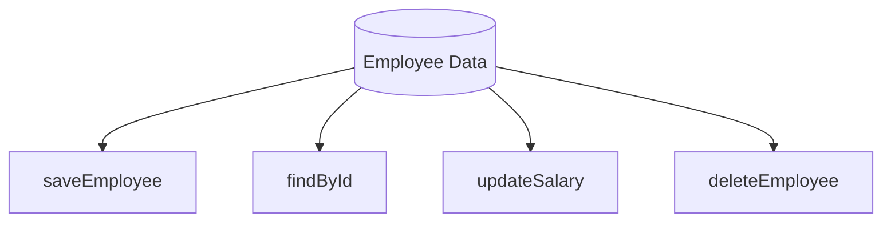

---

## 2. Sequential Cohesion: Sự gắn kết theo chuỗi (Dây chuyền)

### Định nghĩa
**Sequential Cohesion** đạt mức độ gắn kết cao hơn Communicational. Nó xảy ra khi các thành phần trong một lớp được nhóm lại vì đầu ra (output) của phương thức này là đầu vào (input) của phương thức kia.

Đây chính là mô hình "dây chuyền sản xuất". Các phương thức phải được thực hiện theo một trình tự nhất định để đạt được kết quả cuối cùng. Nếu bạn thay đổi thứ tự, logic sẽ đổ vỡ.

### Ví dụ minh họa
Giả sử chúng ta có một lớp xử lý đơn hàng `OrderProcessor`:

```java
public class OrderProcessor {
    public void process(Order rawOrder) {
        Order validatedOrder = validate(rawOrder);
        Order pricedOrder = calculatePrice(validatedOrder);
        Order taxedOrder = applyTax(pricedOrder);
        saveToDatabase(taxedOrder);
    }

    private Order validate(Order order) { /* Kiểm tra tồn kho */ return order; }
    private Order calculatePrice(Order order) { /* Tính giá gốc */ return order; }
    private Order applyTax(Order order) { /* Cộng thuế VAT */ return order; }
    private void saveToDatabase(Order order) { /* Lưu trữ */ }
}
```

**Phân tích:**
*   **Tính phụ thuộc:** `calculatePrice` cần kết quả từ `validate`. `applyTax` cần kết quả từ `calculatePrice`.
*   **Dòng chảy:** Dữ liệu biến đổi dần qua từng bước (Transformation).
*   **Ưu điểm:** Logic cực kỳ minh bạch, dễ theo dõi luồng xử lý chính.
*   **Nhược điểm:** Các phương thức khó có thể tái sử dụng độc lập ở nơi khác vì chúng được thiết kế để khớp nối khăng khít với nhau.

### Sơ đồ luồng dữ liệu (Sequential)

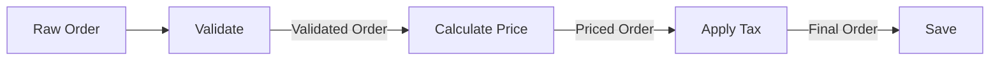

---

## 3. So sánh Communicational và Sequential Cohesion

| Đặc điểm | Communicational Cohesion | Sequential Cohesion |
| :--- | :--- | :--- |
| **Mối liên kết** | Chung dữ liệu đầu vào/đầu ra. | Đầu ra bước A là đầu vào bước B. |
| **Thứ tự thực hiện** | Không quan trọng. | Rất quan trọng (tính tuần tự). |
| **Mục tiêu** | Tập trung quản lý một thực thể dữ liệu. | Tập trung hoàn thành một quy trình nghiệp vụ. |
| **Mức độ gắn kết** | Trung bình - Khá. | Cao. |
| **Khả năng tái sử dụng** | Các phương thức riêng lẻ dễ tái sử dụng hơn. | Khó tái sử dụng lẻ, thường dùng cả chuỗi. |

---

## 4. Ví dụ thực tế: Lớp xử lý Format văn bản (Text Processing Pipeline)

Để hiểu sâu hơn, chúng ta hãy xây dựng một hệ thống xử lý văn bản thô thành các định dạng khác nhau. Hệ thống này sẽ kết hợp cả hai loại Cohesion.

### Bước 1: Sequential Cohesion để chuẩn hóa văn bản
Chúng ta tạo một lớp `TextStandardizer` để làm sạch dữ liệu thô. Các bước phải đi theo trình tự: Xóa khoảng trắng thừa -> Loại bỏ ký tự đặc biệt -> Chuyển về viết thường.

```java
public class TextStandardizer {
    public String standardize(String input) {
        String trimmed = trimWhitespace(input);
        String sanitized = removeSpecialChars(trimmed);
        return convertToLowercase(sanitized);
    }

    private String trimWhitespace(String s) { return s.trim().replaceAll("\\s+", " "); }
    private String removeSpecialChars(String s) { return s.replaceAll("[^a-zA-Z0-0 ]", ""); }
    private String convertToLowercase(String s) { return s.toLowerCase(); }
}
```

### Bước 2: Communicational Cohesion để xuất bản dữ liệu
Sau khi có văn bản chuẩn, chúng ta cần xuất nó ra các định dạng khác nhau (JSON, XML, PlainText). Các phương thức này cùng dùng chung một dữ liệu đầu vào đã chuẩn hóa.

```java
public class TextExporter {
    private final String cleanText;

    public TextExporter(String cleanText) {
        this.cleanText = cleanText;
    }

    public String toJSON() {
        return "{\"content\": \"" + cleanText + "\"}";
    }

    public String toXML() {
        return "<content>" + cleanText + "</content>";
    }

    public String toPlainText() {
        return "Content: " + cleanText;
    }
}
```

### Tổng kết mô hình tổ chức
Trong thực tế, bạn sẽ thường thấy sự kết hợp này:
1.  Sử dụng **Sequential** để biến đổi dữ liệu từ dạng A sang dạng B (Processing).
2.  Sử dụng **Communicational** để cung cấp các góc nhìn khác nhau hoặc các thao tác khác nhau trên dữ liệu B đó (Reporting/Storage).

---

## 5. Cách thiết kế Class theo dòng chảy dữ liệu hiệu quả

Khi bạn nhận thấy một Class đang có dấu hiệu quá tải, hãy kiểm tra dòng chảy dữ liệu:

1.  **Nhận diện Input/Output:** Vẽ sơ đồ các phương thức và xem chúng có truyền dữ liệu cho nhau không. Nếu có, hãy nhóm chúng vào một Class mang tính Sequential.
2.  **Tách biệt biến đổi và hành động:** 
    *   Nếu một phương thức vừa tính toán (Sequential) vừa ghi log, vừa gửi mail (Communicational), hãy tách chúng ra.
    *   Sử dụng Pattern **Pipeline** hoặc **Chain of Responsibility** để triển khai Sequential Cohesion một cách linh hoạt hơn.
3.  **Tránh State không cần thiết:** Trong Communicational Cohesion, hãy cẩn thận với việc thay đổi trạng thái biến instance quá nhiều, vì nó có thể gây ra side-effect khó kiểm soát giữa các phương thức không liên quan.

---

## Tóm tắt

*   **Communicational Cohesion**: Các phương thức tụ họp lại vì chúng cùng phục vụ một tập dữ liệu. Đây là nền tảng của việc đóng gói (Encapsulation) quanh các Entity.
*   **Sequential Cohesion**: Các phương thức tụ họp lại vì chúng tạo thành một dây chuyền xử lý. Đây là nền tảng của các luồng nghiệp vụ (Workflow/Pipeline).
*   Cả hai loại này đều tốt hơn nhiều so với việc gom nhóm theo thời gian hay logic tình cờ, vì chúng dựa trên bản chất của dữ liệu - thứ ít thay đổi nhất trong phần mềm.
*   Trong Java, hãy ưu tiên Sequential cho các lớp xử lý (Processors/Services) và Communicational cho các lớp dữ liệu hoặc kho lưu trữ (Repositories/Models).

---

## Câu hỏi tự kiểm tra

**Câu 1:** Một lớp `ReportService` có hai phương thức: `generateMonthlyReport()` và `generateYearlyReport()`. Cả hai đều đọc dữ liệu từ cùng một Database Table. Đây là loại Cohesion nào?
<details><summary>Đáp án</summary>Đây là <b>Communicational Cohesion</b>. Các phương thức không cần thực hiện theo thứ tự, nhưng chúng cùng khai thác một nguồn dữ liệu chung.</details>

**Câu 2:** Tại sao Sequential Cohesion lại được đánh giá cao hơn Communicational Cohesion?
<details><summary>Đáp án</summary>Vì Sequential Cohesion thể hiện một mối liên kết chặt chẽ và có mục đích rõ ràng hơn (quy trình nghiệp vụ). Dòng dữ liệu được định nghĩa tường minh, giúp việc debug và hiểu luồng xử lý dễ dàng hơn so với việc các phương thức chỉ đơn thuần đứng cạnh nhau vì dùng chung dữ liệu.</details>

**Câu 3:** Nếu tôi có một chuỗi Sequential Cohesion quá dài (ví dụ 10 bước), tôi nên làm gì để mã nguồn sạch hơn?
<details><summary>Đáp án</summary>Bạn nên áp dụng <b>Pattern Pipeline</b> hoặc chia nhỏ chuỗi đó thành các lớp nhỏ hơn, mỗi lớp đảm nhận một phân đoạn của chuỗi. Điều này giúp tránh vi phạm SRP và cho phép Unit Test từng phần của dây chuyền dễ dàng hơn.</details>

**Câu 4:** Trong Java Stream API, đoạn code `list.stream().filter(...).map(...).collect(...)` minh họa cho loại Cohesion nào?
<details><summary>Đáp án</summary>Đây là minh họa hoàn hảo cho <b>Sequential Cohesion</b>. Kết quả của <code>filter</code> là đầu vào của <code>map</code>, và kết quả của <code>map</code> là đầu vào của <code>collect</code>.</details>

---

## Functional Cohesion: Mục tiêu lý tưởng

# Functional Cohesion: Mục tiêu lý tưởng

Trong thang đo mức độ gắn kết (Cohesion), **Functional Cohesion** được xếp ở bậc cao nhất – mức độ hoàn hảo mà mọi kiến trúc sư phần mềm đều hướng tới. Khi một module hay class đạt được Functional Cohesion, nó không chỉ đơn thuần là "chạy đúng" mà còn đạt được sự tinh khiết trong thiết kế, giúp hệ thống trở nên cực kỳ dễ dự đoán và bảo trì.

## Mục tiêu

Sau khi hoàn thành bài học này, bạn sẽ có khả năng:
*   Định nghĩa chính xác nhiệm vụ đơn nhất (Single Task) trong ngữ cảnh thiết kế Java.
*   Nhận diện các dấu hiệu của Functional Cohesion thông qua tên phương thức và cấu trúc lớp.
*   Phân biệt được sự khác biệt giữa "làm một việc" và "làm nhiều việc liên quan".
*   Áp dụng kỹ thuật Refactoring để đưa các đoạn mã rời rạc về trạng thái Functional Cohesion.
*   Đánh giá được lợi ích của tính tái sử dụng tuyệt đối trong các thư viện dùng chung.

## 1. Định nghĩa nhiệm vụ đơn nhất (Single Task)

Functional Cohesion xảy ra khi tất cả các thành phần bên trong một module (class hoặc method) cùng đóng góp vào việc thực hiện **một và chỉ một** nhiệm vụ duy nhất, được xác định rõ ràng.

Trong Java, một phương thức đạt Functional Cohesion là phương thức mà bạn có thể mô tả chức năng của nó bằng một câu đơn giản mà không cần dùng đến các từ nối như "và" (and), "sau đó" (then), "hoặc" (or).

### Đặc điểm nhận dạng:
*   **Tính nguyên tử:** Nhiệm vụ không thể chia nhỏ thêm nữa mà vẫn giữ được ý nghĩa nghiệp vụ.
*   **Tính tập trung:** Mọi dòng code trong phương thức đều phục vụ trực tiếp cho kết quả đầu ra của nhiệm vụ đó.
*   **Tính độc lập:** Nó không quan tâm đến ngữ cảnh gọi nó là gì, nó chỉ quan tâm đến dữ liệu đầu vào và kết quả đầu ra.

## 2. Dấu hiệu nhận biết qua tên gọi

Tên của một Class hoặc Method là "hàn thử biểu" chính xác nhất cho mức độ Cohesion. Với Functional Cohesion, tên gọi thường rất cụ thể và mang tính hành động (đối với method) hoặc định danh vai trò (đối với class).

| Loại Cohesion | Ví dụ tên Method/Class | Phân tích |
| :--- | :--- | :--- |
| **Thấp (Logical)** | `processData()` | Quá mơ hồ, có thể làm đủ thứ việc từ validate đến lưu trữ. |
| **Trung bình (Sequential)** | `validateAndSaveUser()` | Làm hai việc nối tiếp nhau. |
| **Cao (Functional)** | `calculateTax()` | Chỉ tính thuế, không làm gì khác. |
| **Cao (Functional)** | `PasswordHasher` | Class chỉ có một trách nhiệm duy nhất là băm chuỗi. |

**Quy tắc ngón tay cái:** Nếu bạn không thể đặt tên cho method mà không dùng từ "And", khả năng cao bạn đang vi phạm Functional Cohesion.

## 3. Ví dụ thực tế: Lớp PasswordHasher

Hãy xem xét một ví dụ điển hình trong Java về việc thiết kế một Class đạt Functional Cohesion.

### Thiết kế vi phạm (Coincidental/Procedural Cohesion)
Giả sử bạn có một lớp `UserUtils` chứa đủ thứ hàm liên quan đến User.

```java
public class UserUtils {
    public void processUser(User user) {
        // 1. Validate email
        // 2. Hash password
        // 3. Save to Database
    }
    
    public String hashPassword(String password) {
        // Logic băm mật khẩu ở đây
        return BCrypt.hashpw(password, BCrypt.gensalt());
    }
}
```
Trong ví dụ trên, `UserUtils` đang ôm đồm quá nhiều thứ. Hàm `hashPassword` nằm chung với logic lưu DB khiến nó khó tái sử dụng cho các đối tượng khác không phải `User` (ví dụ: băm mã PIN của ví điện tử).

### Thiết kế đạt Functional Cohesion
Chúng ta tách riêng nhiệm vụ băm mật khẩu thành một Class chuyên biệt.

```java
/**
 * Class này đạt Functional Cohesion tuyệt đối.
 * Nhiệm vụ duy nhất: Chuyển đổi Plaintext sang Hash.
 */
public final class PasswordHasher {
    
    private final int logRounds;

    public PasswordHasher(int logRounds) {
        this.logRounds = logRounds;
    }

    public String hash(String rawPassword) {
        if (rawPassword == null) {
            throw new IllegalArgumentException("Password cannot be null");
        }
        return BCrypt.hashpw(rawPassword, BCrypt.gensalt(logRounds));
    }

    public boolean check(String rawPassword, String hashed) {
        return BCrypt.checkpw(rawPassword, hashed);
    }
}
```

**Tại sao đây là Functional Cohesion?**
1.  **Tập trung:** Toàn bộ Class chỉ xoay quanh thuật toán băm. Không có logic gửi mail, không có logic database.
2.  **Dễ hiểu:** Bất kỳ lập trình viên nào nhìn vào tên Class cũng biết ngay nó dùng để làm gì.
3.  **Dễ Test:** Bạn có thể viết Unit Test cho `PasswordHasher` mà không cần Mock Database hay Web Server.

## 4. Sơ đồ luồng tư duy

Sơ đồ dưới đây mô tả cách một yêu cầu phức tạp được phân rã thành các đơn vị Functional Cohesion:

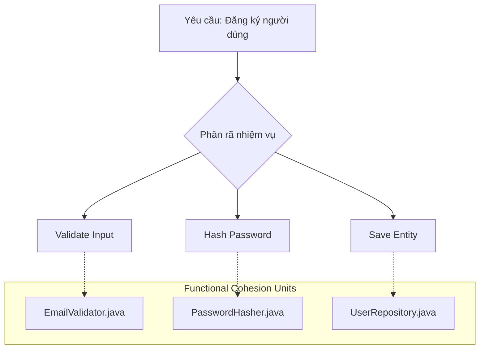

## 5. Lợi ích về khả năng tái sử dụng tuyệt đối

Khi một thành phần đạt Functional Cohesion, nó trở thành một "viên gạch" (Lego block) hoàn hảo. Bạn có thể mang viên gạch đó lắp vào bất kỳ công trình nào khác.

*   **Plug-and-Play:** Nếu ngày mai dự án yêu cầu băm mật khẩu cho hệ thống Admin riêng biệt, bạn chỉ cần copy (hoặc import) `PasswordHasher`. Bạn không cần kéo theo hàng tá dependency không liên quan.
*   **Giảm thiểu side-effects:** Vì hàm chỉ làm một việc, khả năng nó gây ra lỗi ngầm ở các vùng code khác là cực thấp. Bạn sửa logic băm (ví dụ nâng cấp từ SHA-256 lên Argon2), bạn chỉ cần sửa đúng tại một nơi.
*   **Tối ưu hóa Unit Test:** Các class Functional Cohesion thường có độ phủ code (Code Coverage) 100% rất dễ dàng vì các nhánh rẽ (branch) cực kỳ ít và rõ ràng.

## 6. Mối quan hệ với Single Responsibility Principle (SRP)

Nhiều người nhầm lẫn Functional Cohesion với SRP. Thực tế:
*   **SRP (SOLID):** Là một nguyên lý thiết kế ở mức cao (Class không nên có nhiều hơn một lý do để thay đổi).
*   **Functional Cohesion:** Là một mục tiêu đo lường chất lượng ở mức độ chi tiết (Các phần tử bên trong phải gắn kết chặt chẽ cho một nhiệm vụ).

Có thể nói: **Đạt được Functional Cohesion là cách tốt nhất để thực hiện SRP.**

## Tóm tắt

*   **Functional Cohesion** là đỉnh cao của thiết kế hướng module, nơi mỗi thành phần chỉ thực hiện một nhiệm vụ duy nhất.
*   **Dấu hiệu:** Tên hàm rõ ràng, không chứa từ nối, không phụ thuộc ngữ cảnh bên ngoài.
*   **Lợi ích:** Tái sử dụng tối đa, dễ kiểm thử, bảo trì chi phí thấp.
*   **Chiến lược:** Luôn đặt câu hỏi "Hàm này có thể chia nhỏ hơn nữa không?" khi viết code.

## Câu hỏi tự kiểm tra

1. Một phương thức tên là `calculateTotalAndApplyDiscount()` có đạt Functional Cohesion không? Tại sao?
<details><summary>Đáp án</summary>Không. Vì nó đang thực hiện hai nhiệm vụ riêng biệt: tính tổng và áp dụng giảm giá. Nên tách thành hai phương thức: <code>calculateTotal()</code> và <code>applyDiscount()</code>.</details>

2. Tại sao Functional Cohesion lại giúp giảm thiểu lỗi khi Refactoring?
<details><summary>Đáp án</summary>Vì phạm vi ảnh hưởng của thay đổi chỉ gói gọn trong một nhiệm vụ duy nhất. Khi bạn thay đổi logic bên trong một module Functional Cohesion, bạn không sợ làm hỏng các logic không liên quan khác vốn thường bị trộn lẫn trong các module có Cohesion thấp.</details>

3. Trong Java, việc sử dụng các Functional Interface (như <code>Predicate</code>, <code>Function</code>) có khuyến khích Functional Cohesion không?
<details><summary>Đáp án</summary>Có. Các Functional Interface ép buộc lập trình viên chỉ định nghĩa một phương thức trừu tượng duy nhất, từ đó hướng tư duy vào việc xây dựng các hàm xử lý đơn nhiệm, tinh khiết.</details>

---

## SRP và Cohesion: Hai mặt của một đồng xu

# SRP và Cohesion: Hai mặt của một đồng xu

Trong thiết kế phần mềm, chúng ta thường nghe về Single Responsibility Principle (SRP) và High Cohesion như hai khái niệm tách biệt. Tuy nhiên, thực tế chúng là hai góc nhìn khác nhau của cùng một vấn đề: Làm thế nào để gom nhóm các hành vi một cách logic và bền vững. Nếu Cohesion là cái đích chúng ta muốn đến (trạng thái lý tưởng của mã nguồn), thì SRP chính là con đường (nguyên lý chỉ đạo) để đạt được cái đích đó.

## Mục tiêu

*   Hiểu rõ mối quan hệ cộng sinh giữa nguyên lý SRP và chỉ số Cohesion.
*   Sử dụng khái niệm "Lý do thay đổi" (Reason to change) để định lượng mức độ Cohesion của một Class.
*   Nhận diện các dấu hiệu của một Class "ôm đồm" (God Object) thông qua các số liệu định tính và định lượng.
*   Thực hành kỹ thuật Refactoring để phân tách trách nhiệm, nâng cao tính bảo trì cho mã nguồn Java.

## 1. Mối liên hệ trực tiếp giữa 'Lý do thay đổi' và Cohesion

Robert C. Martin (Uncle Bob) định nghĩa SRP là: *"Một class chỉ nên có một lý do duy nhất để thay đổi"*. 

Hãy tưởng tượng một Class trong Java. Nếu bạn phải mở file đó ra để sửa code khi:
1.  Cấu trúc bảng Database thay đổi.
2.  Logic tính toán thuế thay đổi.
3.  Định dạng email gửi cho khách hàng thay đổi.

Thì Class đó đang có ít nhất 3 lý do để thay đổi. Trong thuật ngữ thiết kế, chúng ta nói Class này có **Low Cohesion (Độ gắn kết thấp)**. Các thành phần bên trong nó (method, field) không thực sự thuộc về nhau; chúng chỉ tình cờ được đặt chung một chỗ.

**Mối quan hệ có thể tóm tắt như sau:**
*   **SRP (Nguyên lý):** Tập trung vào việc giới hạn phạm vi tác động. Nếu bạn tuân thủ SRP, bạn sẽ tự động đẩy các thành phần không liên quan ra ngoài.
*   **Cohesion (Trạng thái):** Đo lường mức độ tập trung của các thành phần bên trong. Một Class tuân thủ SRP tốt sẽ có High Cohesion vì mọi dòng code bên trong đều phục vụ một mục đích duy nhất.

$$Cohesion \propto \frac{1}{Reasons\ to\ change}$$

Khi số lượng lý do thay đổi tiến dần về 1, độ gắn kết (Cohesion) sẽ tiến tới mức tối ưu (Functional Cohesion).

## 2. Phân tách trách nhiệm (Separation of Concerns)

Separation of Concerns (SoC) là chiến lược quản lý sự phức tạp bằng cách chia phần mềm thành các phần riêng biệt, mỗi phần giải quyết một "mối quan tâm" (concern) cụ thể. SRP là sự áp dụng SoC ở cấp độ Class.

Trong Java, việc phân tách trách nhiệm không chỉ là chia nhỏ code, mà là tạo ra các ranh giới (boundaries) rõ ràng. 

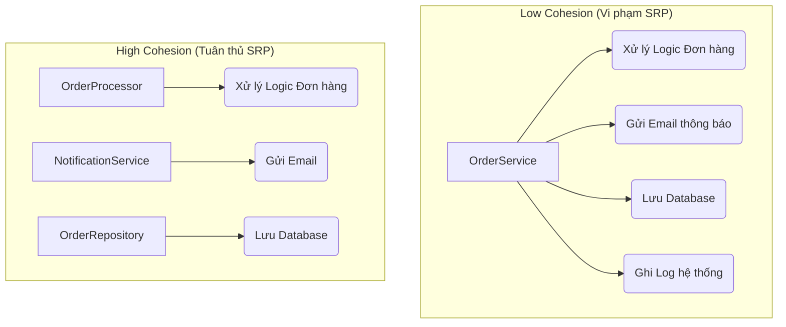

Khi tách biệt như sơ đồ trên, `OrderProcessor` không cần quan tâm email được gửi bằng SMTP hay SendGrid, cũng không cần biết dữ liệu lưu vào MySQL hay MongoDB. Đó là sự tinh tế của High Cohesion.

## 3. Ví dụ Refactor một Class vi phạm SRP trong Java

Xét một ví dụ điển hình về một Class "làm tất cả" thường gặp trong các dự án Legacy.

### Code ban đầu (Low Cohesion)

```java
public class EmployeeManager {
    // Trách nhiệm 1: Quản lý dữ liệu nhân viên
    public void saveEmployee(Employee emp) {
        // Logic kết nối DB và Insert
        System.out.println("Saving employee to database...");
    }

    // Trách nhiệm 2: Logic nghiệp vụ tính toán
    public double calculateSalary(Employee emp) {
        // Logic tính lương phức tạp
        return emp.getHoursWorked() * emp.getHourlyRate();
    }

    // Trách nhiệm 3: Trình diễn/Xuất báo cáo
    public void generateReport(Employee emp, String format) {
        if (format.equals("PDF")) {
            System.out.println("Exporting PDF report...");
        } else {
            System.out.println("Exporting HTML report...");
        }
    }
}
```

**Phân tích:**
Class `EmployeeManager` đang vi phạm SRP nghiêm trọng. Nếu quy định về thuế thay đổi, bạn sửa file này. Nếu công ty chuyển từ Oracle sang PostgreSQL, bạn sửa file này. Nếu phòng Marketing muốn đổi template báo cáo, bạn cũng sửa file này. Cohesion ở đây là **Logical Cohesion** (yếu).

### Sau khi Refactor (High Cohesion)

Chúng ta chia nhỏ thành các Class chuyên biệt, mỗi Class chỉ giữ một trách nhiệm.

```java
// 1. Chuyên biệt về lưu trữ (Data Access)
public class EmployeeRepository {
    public void save(Employee emp) {
        // Chỉ chứa logic tương tác DB
    }
}

// 2. Chuyên biệt về nghiệp vụ (Business Logic)
public class SalaryCalculator {
    public double calculate(Employee emp) {
        // Chỉ chứa công thức tính toán
        return emp.getHoursWorked() * emp.getHourlyRate();
    }
}

// 3. Chuyên biệt về hiển thị (Presentation/Reporting)
public class EmployeeReportGenerator {
    public void generatePDF(Employee emp) { /* ... */ }
    public void generateHTML(Employee emp) { /* ... */ }
}
```

**Kết quả:** Mỗi Class bây giờ cực kỳ tập trung (Highly Cohesive). Bạn có thể thay đổi cách lưu trữ mà không sợ làm hỏng logic tính lương.

## 4. Cách nhận diện Class 'ôm đồm' (God Object)

Làm sao để biết một Class đã đến lúc cần được chia tách? Ngoài cảm giác về thiết kế, chúng ta có thể dựa vào các dấu hiệu định lượng:

1.  **Số lượng dòng code (Lines of Code - LOC):** 
    *   Một Class Java vượt quá 300-500 dòng thường là dấu hiệu của việc ôm đồm quá nhiều trách nhiệm. 
    *   *Lưu ý:* Đây không phải con số tuyệt đối, nhưng là một "mùi" (code smell) cần kiểm tra.

2.  **Số lượng Method Public:** 
    *   Nếu một Class có 20 method public nhưng chia thành 3 nhóm hoàn toàn không liên quan đến nhau về mặt dữ liệu sử dụng, đó là Low Cohesion.

3.  **Số lượng Dependency (Import):**
    *   Một Class có quá nhiều câu lệnh `import` từ các package khác nhau (vừa import `java.sql.*`, vừa `javax.mail.*`, vừa `com.itextpdf.*`) chứng tỏ nó đang dính líu đến quá nhiều tầng (layer) khác nhau.

4.  **Chỉ số LCOM (Lack of Cohesion in Methods):**
    *   Đây là chỉ số đo lường sự chia sẻ các field giữa các method. Nếu các method trong Class không dùng chung các biến instance (field), chúng thực chất là những thực thể độc lập bị ép sống chung một nhà.

| Đặc điểm | High Cohesion (SRP) | Low Cohesion (God Object) |
| :--- | :--- | :--- |
| **Kích thước** | Nhỏ, gọn | Đồ sộ, khó đọc |
| **Dependency** | Ít, tập trung | Nhiều, chồng chéo |
| **Khả năng Test** | Dễ dàng (Unit Test) | Khó (Cần nhiều Mocking) |
| **Khả năng tái sử dụng** | Cao | Thấp (Kéo theo nhiều rác) |

## Tóm tắt

*   **SRP và Cohesion** là hai mặt của một đồng xu: SRP là phương pháp thực hiện, Cohesion là kết quả đạt được.
*   Một Class có **High Cohesion** khi tất cả các thành phần của nó tập trung vào một nhiệm vụ duy nhất.
*   Dấu hiệu nhận biết vi phạm SRP bao gồm: Class quá dài, quá nhiều import, và có nhiều hơn một lý do để thay đổi.
*   Việc tuân thủ SRP giúp mã nguồn dễ Unit Test hơn, giảm thiểu rủi ro lỗi lan truyền (side effects) khi thay đổi logic.

## Câu hỏi tự kiểm tra

1. **Tại sao nói SRP giúp tăng tính đóng gói (Encapsulation)?**
<details><summary>Đáp án</summary>Vì khi một Class chỉ có một trách nhiệm, nó che giấu các chi tiết thực thi của trách nhiệm đó tốt hơn. Các Class bên ngoài chỉ tương tác qua một interface hẹp, không cần biết về các logic phụ trợ không liên quan, từ đó giảm sự phụ thuộc.</details>

2. **Nếu một Class có 1000 dòng code nhưng tất cả đều phục vụ một logic thuật toán duy nhất (ví dụ: giải mã video), nó có vi phạm SRP không?**
<details><summary>Đáp án</summary>Về lý thuyết là KHÔNG vi phạm SRP nếu nó chỉ có một lý do thay đổi là thuật toán giải mã. Tuy nhiên, nó có thể vi phạm về tính đọc hiểu. Người ta thường chia nhỏ thành các class hỗ trợ (helper/utility) để đạt được sự phân tách ở mức độ thấp hơn, nhưng về mặt kiến trúc, nó vẫn là High Cohesion.</details>

3. **Làm thế nào để phát hiện một Class vi phạm SRP thông qua Unit Test?**
<details><summary>Đáp án</summary>Nếu bạn thấy việc viết Unit Test cho một Class quá khó khăn, phải Mock quá nhiều đối tượng không liên quan, hoặc một thay đổi nhỏ trong logic dẫn đến hàng loạt Test Case ở các module khác bị hỏng, đó là dấu hiệu Class đó đang ôm đồm quá nhiều trách nhiệm.</details>

---

## DIP, ISP và chiến lược giảm Coupling

# DIP, ISP và chiến lược giảm Coupling

## Mục tiêu

*   **Làm chủ nguyên lý DIP:** Hiểu cách đảo ngược luồng phụ thuộc để module cấp cao không bị trói buộc vào module cấp thấp.
*   **Thực thi ISP hiệu quả:** Biết cách chia nhỏ các Interface cồng kềnh thành các giao diện đặc hóa, giúp giảm thiểu sự phụ thuộc không cần thiết.
*   **Sử dụng Interface làm vùng đệm:** Phân tích cơ chế "giảm sốc" của trừu tượng hóa khi hệ thống có thay đổi về công nghệ hoặc logic nghiệp vụ.
*   **Ứng dụng Spring DI:** Sử dụng Dependency Injection trong Spring Framework để hiện thực hóa chiến lược giảm Coupling trong dự án thực tế.

## 1. Dependency Inversion Principle (DIP): Phụ thuộc vào trừu tượng

Trong thiết kế truyền thống, các module cấp cao (chứa logic nghiệp vụ) thường phụ thuộc trực tiếp vào các module cấp thấp (chứa logic thực thi chi tiết như truy xuất database, gọi API bên thứ ba). Điều này tạo ra một cấu trúc phân tầng cứng nhắc, nơi một thay đổi nhỏ ở tầng dưới có thể gây ra hiệu ứng domino làm hỏng tầng trên.

### Định nghĩa chuẩn của DIP

1.  Các module cấp cao không nên phụ thuộc vào các module cấp thấp. Cả hai nên phụ thuộc vào sự trừu tượng (Abstractions).
2.  Sự trừu tượng không nên phụ thuộc vào chi tiết. Chi tiết nên phụ thuộc vào sự trừu tượng.

### Ví dụ minh họa: Hệ thống thông báo (Notification System)

**Cách làm sai (Tight Coupling):**

```java
// Module cấp thấp
public class EmailSender {
    public void sendEmail(String message) {
        System.out.println("Sending Email: " + message);
    }
}

// Module cấp cao phụ thuộc trực tiếp vào EmailSender
public class NotificationService {
    private EmailSender emailSender = new EmailSender(); // Hard-coded dependency

    public void notify(String message) {
        emailSender.sendEmail(message);
    }
}
```

Trong ví dụ này, `NotificationService` bị khóa chặt vào `EmailSender`. Nếu bạn muốn thêm SMS hoặc Push Notification, bạn phải sửa code của `NotificationService`. Đây chính là biểu hiện của Tight Coupling.

**Cách làm đúng với DIP (Loose Coupling):**

```java
// Sự trừu tượng (Abstraction)
public interface MessageSender {
    void send(String message);
}

// Module cấp thấp phụ thuộc vào Abstraction
public class EmailSender implements MessageSender {
    @Override
    public void send(String message) { /* ... */ }
}

public class SmsSender implements MessageSender {
    @Override
    public void send(String message) { /* ... */ }
}

// Module cấp cao phụ thuộc vào Abstraction
public class NotificationService {
    private final MessageSender sender;

    // Dependency Injection qua Constructor
    public NotificationService(MessageSender sender) {
        this.sender = sender;
    }

    public void notify(String message) {
        sender.send(message);
    }
}
```

### Sơ đồ đảo ngược phụ thuộc

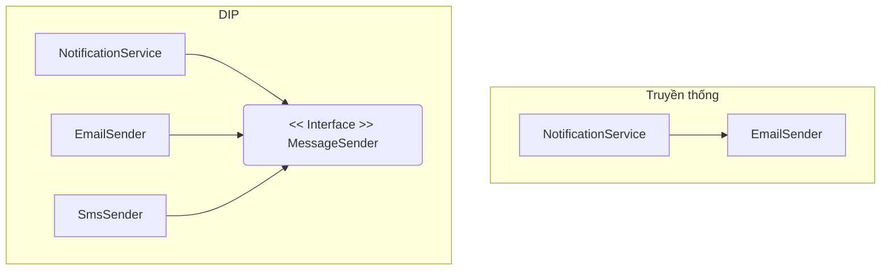

Nhìn vào sơ đồ, ở mô hình DIP, mũi tên phụ thuộc từ `EmailSender` đã bị đảo ngược hướng về phía Interface do module cấp cao định nghĩa. Giờ đây, `NotificationService` là người quyết định "luật chơi" (Interface), còn các module cấp thấp phải tuân thủ.

## 2. Interface Segregation Principle (ISP): Chia nhỏ giao diện để giảm Coupling

Nguyên lý phân tách giao diện (ISP) phát biểu rằng: **"Client không nên bị buộc phải phụ thuộc vào những phương thức mà nó không sử dụng."**

Khi một Interface quá lớn (Fat Interface), nó chứa quá nhiều phương thức phục vụ cho nhiều mục đích khác nhau. Các lớp triển khai (Concrete classes) sẽ bị buộc phải override cả những phương thức không liên quan, dẫn đến tình trạng "Polluted Interface".

### Ví dụ: Hệ thống quản lý thiết bị đa năng

Giả sử ta có một Interface `SmartDevice` cho các loại máy văn phòng:

```java
public interface SmartDevice {
    void print();
    void scan();
    void fax();
}
```

Nếu ta có một chiếc máy in đời cũ chỉ có chức năng in:

```java
public class OldPrinter implements SmartDevice {
    public void print() { /* In tài liệu */ }
    public void scan() { throw new UnsupportedOperationException(); } // Thừa thãi
    public void fax() { throw new UnsupportedOperationException(); }  // Nguy hiểm
}
```

Việc quăng ngoại lệ `UnsupportedOperationException` là một dấu hiệu đỏ của thiết kế tồi. Nó vi phạm tính đóng gói và làm tăng Coupling vì Client gọi `OldPrinter` không biết chắc phương thức nào thực sự hoạt động.

**Áp dụng ISP để tinh chỉnh:**

```java
public interface Printer { void print(); }
public interface Scanner { void scan(); }
public interface FaxMachine { void fax(); }

public class ModernRobot implements Printer, Scanner, FaxMachine {
    // Triển khai tất cả
}

public class SimplePrinter implements Printer {
    public void print() { /* Chỉ triển khai in */ }
}
```

Bằng cách chia nhỏ Interface, ta giảm thiểu sự liên kết không cần thiết. Một lớp chỉ phụ thuộc vào những gì nó thực sự cần, giúp mã nguồn trở nên linh hoạt và dễ kiểm thử hơn.

## 3. Interface làm 'vùng đệm' giảm sốc khi thay đổi

Trong kiến trúc phần mềm, Interface đóng vai trò như một bản hợp đồng (Contract). Hãy tưởng tượng Interface như một ổ cắm điện trên tường và các lớp triển khai là các thiết bị điện (quạt, đèn, sạc laptop).

### Cơ chế giảm sốc (Shock Absorption)

Khi bạn thay đổi logic bên trong một lớp triển khai (ví dụ: tối ưu thuật toán sắp xếp, thay đổi thư viện JSON parser), miễn là chữ ký phương thức (method signature) trong Interface không đổi, các module đang sử dụng Interface đó sẽ hoàn toàn không bị ảnh hưởng. 

*   **Cách ly thay đổi:** Nếu `DatabaseInterface` có phương thức `saveUser()`, bạn có thể đổi từ Hibernate sang JDBC thuần mà logic nghiệp vụ ở tầng Service không cần sửa một dòng code nào.
*   **Mở rộng không giới hạn:** Bạn có thể thêm các implementation mới (ví dụ: `CloudStorage`, `LocalStorage`) mà không làm xáo trộn các lớp hiện có.

Công thức tính mức độ phụ thuộc khi có Interface:
Nếu lớp $A$ phụ thuộc trực tiếp vào lớp $B$, mọi thay đổi ở $B$ có xác suất $P$ gây lỗi ở $A$. Khi chèn Interface $I$ vào giữa, xác suất này giảm xuống chỉ còn phụ thuộc vào sự thay đổi của $I$ (vốn rất ít khi thay đổi).

## 4. Thực thi chiến lược với Spring Framework

Spring Framework là một minh chứng điển hình cho việc áp dụng DIP và ISP để đạt được Loose Coupling thông qua cơ chế Dependency Injection (DI).

### Sử dụng @Autowired với Interface

Trong Spring, thay vì khởi tạo đối tượng bằng từ khóa `new`, ta yêu cầu Spring Container cung cấp một Bean thông qua Interface.

```java
@Service
public class OrderProcessingService {
    
    private final PaymentProcessor paymentProcessor;

    // Spring sẽ tự tìm Bean nào triển khai PaymentProcessor để inject vào
    @Autowired
    public OrderProcessingService(PaymentProcessor paymentProcessor) {
        this.paymentProcessor = paymentProcessor;
    }

    public void processOrder(Order order) {
        paymentProcessor.pay(order.getAmount());
    }
}
```

### Chiến lược linh hoạt với Qualifier và Profile

Spring cho phép ta có nhiều triển khai của cùng một Interface và hoán đổi chúng dễ dàng:

*   **@Qualifier:** Chỉ định chính xác bean nào được dùng.
*   **@Profile:** Dùng `DevPaymentProcessor` cho môi trường phát triển và `ProductionPaymentProcessor` cho môi trường thực tế.

Điều này giúp hệ thống cực kỳ linh hoạt. Bạn có thể thay đổi toàn bộ hạ tầng thanh toán chỉ bằng cách thay đổi một dòng cấu hình trong file `application.properties` mà không cần compile lại logic nghiệp vụ.

## 5. Mối liên hệ giữa DIP, ISP và Unit Test

Thiết kế tuân thủ DIP và ISP là điều kiện tiên quyết để viết Unit Test hiệu quả. 

*   **Khả năng Mocking:** Nếu `NotificationService` phụ thuộc vào Interface `MessageSender`, trong Unit Test ta có thể dễ dàng tạo một bản giả (Mock) của `MessageSender` để kiểm tra logic của Service mà không cần gửi email thật.
*   **Test độc lập:** Nhờ ISP, các Interface nhỏ gọn giúp việc tạo Mock object trở nên đơn giản hơn. Bạn không cần phải giả lập 20 phương thức của một Fat Interface chỉ để test 1 phương thức duy nhất.

Nếu bạn thấy khó khăn khi viết Unit Test cho một lớp (phải khởi tạo quá nhiều đối tượng phụ thuộc), đó là dấu hiệu cho thấy bạn đang vi phạm DIP và hệ thống đang bị Tight Coupling.

## Tóm tắt

1.  **DIP** giúp đảo ngược sự phụ thuộc: Module cấp cao và cấp thấp đều phụ thuộc vào trừu tượng. Điều này bảo vệ logic nghiệp vụ khỏi những thay đổi của hạ tầng.
2.  **ISP** giúp làm sạch các liên kết: Chia nhỏ Interface để Client không phải gánh chịu những phụ thuộc thừa thãi.
3.  **Interface** là chìa khóa để tạo ra "vùng đệm", giúp hệ thống chịu đựng được các thay đổi công nghệ mà không cần đại tu mã nguồn.
4.  **Spring DI** là công cụ mạnh mẽ để thực thi các nguyên lý này trong Java, biến lý thuyết thành kiến trúc thực tế linh hoạt.

## Câu hỏi tự kiểm tra

1. **Tại sao nói DIP giúp giảm Ripple Effect (hiệu ứng lan tỏa) khi thay đổi code?**
<details><summary>Đáp án</summary>Vì DIP ngăn chặn sự phụ thuộc trực tiếp vào các implementation cụ thể. Khi chi tiết thay đổi, miễn là Interface không đổi, các module cấp cao sẽ không bị ảnh hưởng, từ đó ngăn chặn lỗi lan truyền khắp hệ thống.</details>

2. **Một Interface có 10 phương thức, nhưng lớp A chỉ dùng 2 phương thức. Vi phạm nguyên lý nào? Cách khắc phục?**
<details><summary>Đáp án</summary>Vi phạm nguyên lý ISP (Interface Segregation Principle). Cách khắc phục là tách Interface lớn đó thành nhiều Interface nhỏ hơn, hoặc sử dụng Pattern như Adapter để lọc bớt các phương thức không cần thiết.</details>

3. **Trong Spring, nếu một Interface có 2 implementation mà không dùng @Qualifier, chuyện gì sẽ xảy ra?**
<details><summary>Đáp án</summary>Spring sẽ tung ra ngoại lệ `NoUniqueBeanDefinitionException` khi khởi động ứng dụng vì nó không biết chọn implementation nào để inject. Đây là lúc ta cần dùng @Qualifier hoặc @Primary để chỉ định.</details>

4. **DIP và DI (Dependency Injection) có phải là một không?**
<details><summary>Đáp án</summary>Không. DIP là một nguyên lý thiết kế (chiến lược), còn DI là một kỹ thuật lập trình (công cụ/cách thức) để thực hiện nguyên lý DIP đó.</details>"}

---

## Unit Test: Hàn thử biểu cho thiết kế

# Unit Test: Hàn thử biểu cho thiết kế

Trong kỹ thuật cơ khí, một thiết kế tốt là thiết kế mà các bộ phận có thể tháo rời và thay thế dễ dàng. Trong phần mềm, Unit Test chính là "hàn thử biểu" (nhiệt kế) nhạy bén nhất để đo lường độ linh hoạt đó. Nếu bạn thấy việc viết Unit Test cho một Class Java là một cực hình, đó không phải lỗi của công cụ Test, mà là tín hiệu đỏ cho thấy thiết kế của bạn đang gặp vấn đề nghiêm trọng về Coupling và Cohesion.

## Mục tiêu

*   Nhận diện mối quan hệ nhân quả giữa khả năng kiểm thử (Testability) và cấu trúc mã nguồn.
*   Phân tích các dấu hiệu của Tight Coupling và Low Cohesion thông qua quá trình viết Test.
*   Sử dụng Mockito để cô lập các phụ thuộc và hiểu giới hạn của việc giả lập.
*   Áp dụng tư duy TDD để ép buộc thiết kế hướng tới Loose Coupling ngay từ đầu.

## 1. Tại sao Tight Coupling khiến Unit Test trở nên bất khả thi?

Unit Test, theo định nghĩa, là kiểm thử một "đơn vị" mã nguồn trong sự cô lập. Khi một Class bị dính chặt (Tight Coupling) với các Concrete Class khác hoặc các tài nguyên bên ngoài (Database, File System, API), việc cô lập trở nên bất khả thi.

### Ví dụ về thiết kế "không thể test"

Giả sử bạn có một lớp `OrderService` khởi tạo trực tiếp các phụ thuộc bên trong Constructor:

```java
public class OrderService {
    private EmailSender emailSender = new EmailSender(); // Hard-coded dependency
    private DatabaseConnection db = new DatabaseConnection(); // Tight coupling

    public void checkout(Order order) {
        db.save(order);
        emailSender.send("Order Success");
    }
}
```

**Vấn đề khi viết Unit Test:**
1.  **Không thể Mock:** Bạn không thể thay thế `EmailSender` bằng một bản giả để tránh gửi email thật khi chạy test.
2.  **Hiệu ứng dây chuyền:** Để test `OrderService`, bạn buộc phải có một Database đang chạy. Nếu Database lỗi, Test của `OrderService` sẽ Fail dù logic của nó hoàn toàn đúng.
3.  **Tốc độ:** Test chạy chậm vì phải khởi tạo các kết nối mạng/DB thực tế.

### Bảng so sánh khả năng kiểm thử

| Đặc điểm | Tight Coupling (Khó Test) | Loose Coupling (Dễ Test) |
| :--- | :--- | :--- |
| **Khởi tạo** | Dùng từ khóa `new` bên trong Class | Dependency Injection qua Constructor |
| **Phụ thuộc** | Phụ thuộc vào Implementation cụ thể | Phụ thuộc vào Abstraction (Interface) |
| **Sự cô lập** | Phải chạy kèm toàn bộ hệ thống | Dễ dàng thay thế bằng Mock/Stub |
| **Tốc độ Test** | Chậm (do dính tới I/O) | Rất nhanh (chỉ chạy trên RAM) |

## 2. Dấu hiệu Cohesion thấp: Test case quá phức tạp

Nếu Coupling đo lường mối quan hệ bên ngoài, thì Cohesion đo lường sự tập trung bên trong. Một Class có Cohesion thấp (làm quá nhiều việc không liên quan) sẽ bộc lộ điểm yếu ngay khi bạn bắt đầu viết `@Test`.

### Dấu hiệu nhận biết qua Test

1.  **Setup quá cồng kềnh:** Bạn mất 50 dòng code chỉ để khởi tạo dữ liệu mẫu (Setup) cho một phương thức cần test.
2.  **Test Case "khổng lồ":** Một phương thức test phải kiểm tra quá nhiều kết quả đầu ra (Side effects) khác nhau.
3.  **Khó đặt tên Test:** Bạn không thể đặt tên ngắn gọn cho Test Case vì phương thức đó thực hiện cùng lúc: tính thuế, lưu kho, gửi thông báo và cập nhật log.

### Ví dụ minh họa

```java
// Class có Cohesion thấp
public class SuperProcessor {
    public void process(Data data) {
        // 1. Validate data
        // 2. Format data
        // 3. Calculate Tax
        // 4. Save to DB
    }
}
```

Khi viết test cho `process()`, bạn sẽ thấy mình đang viết một kịch bản kiểm thử cho cả 4 nhiệm vụ trên. Nếu logic tính thuế thay đổi, test case này hỏng. Nếu cấu trúc DB thay đổi, test case này cũng hỏng. Đây chính là biểu hiện của việc vi phạm Single Responsibility Principle (SRP).

## 3. Sử dụng Mockito để cô lập phụ thuộc

Trong Java, Mockito là công cụ mạnh mẽ nhất để bẻ gãy Tight Coupling trong quá trình Test. Nó giúp chúng ta tạo ra các "vật thế thân" cho các Interface.

### Quy trình cô lập với Mockito

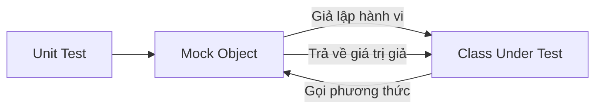

**Ví dụ áp dụng Dependency Injection và Mocking:**

```java
// Thiết kế lại để đạt Loose Coupling
public class OrderService {
    private final NotificationService notifier;

    public OrderService(NotificationService notifier) {
        this.notifier = notifier;
    }

    public void processOrder(Order order) {
        // logic...
        notifier.notify(order.getCustomerEmail());
    }
}

// Trong Unit Test
@Test
void testProcessOrder_ShouldNotifyCustomer() {
    // 1. Arrange
    NotificationService mockNotifier = Mockito.mock(NotificationService.class);
    OrderService service = new OrderService(mockNotifier);
    Order order = new Order("test@example.com");

    // 2. Act
    service.processOrder(order);

    // 3. Assert (Verify)
    Mockito.verify(mockNotifier).notify("test@example.com");
}
```

**Lợi ích:** Chúng ta chỉ tập trung kiểm tra xem `OrderService` có gọi đúng hàm `notify` hay không, mà không quan tâm `NotificationService` gửi bằng Email, SMS hay Telegram. Đó chính là sức mạnh của việc tách biệt mối quan tâm.

## 4. TDD: Ép buộc thiết kế hướng tới Low Coupling

Test-Driven Development (TDD) không chỉ là một phương pháp kiểm thử, nó là một phương pháp thiết kế. Khi bạn viết Test trước khi viết Code thực tế, bạn bị đặt vào vị trí của **người sử dụng mã nguồn** (Client).

### Tại sao TDD giúp giảm Coupling?

Khi viết Test trước, bạn sẽ ngay lập tức cảm thấy sự đau khổ nếu Class định viết quá khó để khởi tạo. Để viết được dòng code `new MyClass(...)` trong Test, bạn sẽ tự động hướng tới việc:
1.  Giảm số lượng tham số đầu vào.
2.  Sử dụng Interface thay vì Class cụ thể để dễ Mock.
3.  Chia nhỏ các phương thức lớn thành các phương thức nhỏ, tập trung vào một nhiệm vụ duy nhất (Tăng Cohesion).

### Quy trình TDD thúc đẩy thiết kế

1.  **Red:** Viết một test case cho một chức năng nhỏ. Test này sẽ fail vì code chưa tồn tại.
2.  **Green:** Viết code tối thiểu để test pass. Lúc này bạn thường dùng Dependency Injection để dễ dàng đưa dữ liệu vào.
3.  **Refactor:** Tinh chỉnh code, tách các logic không liên quan ra các Class khác. Vì đã có Test bảo vệ, bạn tự tin tách nhỏ code để tăng Cohesion.

## Tóm tắt

*   **Khả năng kiểm thử (Testability)** tỉ lệ thuận với chất lượng thiết kế. Nếu code khó test, chắc chắn Coupling đang cao hoặc Cohesion đang thấp.
*   **Tight Coupling** làm cho Unit Test trở thành Integration Test (kiểm thử tích hợp), gây chậm trễ và khó xác định nguyên nhân lỗi.
*   **Low Cohesion** dẫn đến các bộ Test Case cồng kềnh, dễ gãy (fragile) và khó bảo trì.
*   **Mockito** là công cụ hỗ trợ, nhưng không nên lạm dụng để che đậy một thiết kế tồi. Nếu bạn phải mock quá nhiều, hãy xem xét việc tách nhỏ Class.
*   **TDD** là kỷ luật giúp duy trì sự cân bằng giữa Coupling và Cohesion ngay từ những dòng code đầu tiên.

## Câu hỏi tự kiểm tra

1. **Dấu hiệu nào trong đoạn code Unit Test cho thấy Class đang vi phạm Single Responsibility Principle (Cohesion thấp)?**
<details><summary>Đáp án</summary>Dấu hiệu rõ nhất là phần Setup (phương thức @Before hoặc đoạn khởi tạo) quá dài, phải chuẩn bị rất nhiều trạng thái cho nhiều đối tượng khác nhau, và một phương thức test phải Assert nhiều kết quả không liên quan đến nhau.</details>

2. **Nếu một Class sử dụng `static method` của một Class khác bên trong logic cốt lõi, điều này ảnh hưởng gì đến Unit Test?**
<details><summary>Đáp án</summary>Nó tạo ra Tight Coupling. Static methods rất khó để Mock (trừ khi dùng các công cụ đặc biệt như PowerMock), dẫn đến việc Unit Test bị phụ thuộc vào implementation của phương thức static đó, không thể cô lập hoàn toàn Class đang test.</details>

3. **Tại sao việc phụ thuộc vào Interface thay vì Concrete Class lại làm Unit Test chạy nhanh hơn?**
<details><summary>Đáp án</summary>Vì khi phụ thuộc vào Interface, ta có thể dùng Mockito để tạo ra các đối tượng giả lập (Mock) nằm hoàn toàn trên RAM. Các Concrete Class thường chứa logic nặng hoặc kết nối I/O (DB, Network) làm chậm quá trình thực thi Test.</details>

---

## Refactoring: Từ Tight đến Loose Coupling

# Refactoring: Từ Tight đến Loose Coupling

Trong các bài học trước, chúng ta đã hiểu thế nào là Coupling (sự phụ thuộc) và Cohesion (tính gắn kết). Tuy nhiên, hiểu lý thuyết là một chuyện, việc bắt tay vào chỉnh sửa một hệ thống đang chạy với hàng nghìn dòng code chằng chịt lại là một thử thách khác. Bài học này tập trung vào các kỹ thuật Refactoring thực chiến để biến một hệ thống "cứng nhắc" thành một hệ thống linh hoạt.

## Mục tiêu

*   Nhận diện các dấu hiệu của Tight Coupling và Low Cohesion thông qua các "Code Smells".
*   Làm chủ kỹ thuật **Extract Class** để tăng tính đơn nhiệm cho Class.
*   Áp dụng **Move Method** để loại bỏ tình trạng "Feature Envy" (Ghen tị tính năng).
*   Thực hiện chuyển đổi từ **Inheritance sang Composition** để giảm sự phụ thuộc cứng.
*   Trải nghiệm quy trình tái cấu trúc một Legacy Module sang Clean Architecture.

## 1. Kỹ thuật Extract Class: Tăng Cohesion từ bên trong

Khi một Class đảm nhận quá nhiều trách nhiệm, nó trở thành một "God Object". Chỉ số LCOM (Lack of Cohesion in Methods) của nó sẽ rất cao vì các phương thức không chia sẻ chung các trường dữ liệu (fields).

### Dấu hiệu nhận biết
Một Class có quá nhiều instance variables, và chỉ một nhóm phương thức sử dụng một nhóm biến nhất định. 

### Ví dụ thực tế
Giả sử bạn có class `User` quản lý cả thông tin cá nhân lẫn logic xác thực.

**Trước khi Refactor (Low Cohesion):**
```java
public class User {
    private String username;
    private String email;
    private String passwordHash;
    private LocalDateTime lastLogin;
    private int loginAttempts;

    // Getters/Setters...

    public boolean validatePassword(String password) {
        // Logic kiểm tra hash
        return true;
    }

    public void resetPassword() {
        // Logic reset
    }
}
```

**Sau khi Refactor (Extract Class):**
Chúng ta tách logic xác thực ra class `UserAuthentication`.

```java
public class User {
    private String username;
    private String email;
    private UserAuthentication auth; // Composition
}

public class UserAuthentication {
    private String passwordHash;
    private LocalDateTime lastLogin;
    private int loginAttempts;

    public boolean validate(String password) { ... }
}
```
**Kết quả:** Class `User` giờ đây chỉ tập trung vào thông tin thực thể, còn `UserAuthentication` tập trung vào bảo mật. Nếu logic bảo mật thay đổi (ví dụ: thêm MFA), ta chỉ cần sửa `UserAuthentication`.

## 2. Kỹ thuật Move Method: Chữa trị bệnh "Feature Envy"

**Feature Envy** xảy ra khi một phương thức ở Class A sử dụng các phương thức hoặc dữ liệu của Class B nhiều hơn chính dữ liệu của Class A. Điều này gây ra Tight Coupling giữa A và B.

### Ví dụ thực tế
Class `Invoice` (Hóa đơn) đang tính toán thuế dựa trên thông tin của `Customer`.

**Trước khi Refactor (Tight Coupling):**
```java
public class Invoice {
    private Customer customer;
    private double amount;

    public double calculateTotal() {
        if (customer.getRegion().equals("VN")) {
            return amount + amount * 0.1; // VAT 10%
        }
        return amount;
    }
}
```
Trong ví dụ này, `Invoice` đang can thiệp quá sâu vào thuộc tính `region` của `Customer`. Nếu quy tắc thuế theo vùng thay đổi, ta phải sửa `Invoice`.

**Sau khi Refactor (Move Method):**
Đưa logic tính thuế về đúng nơi sở hữu dữ liệu vùng miền: Class `Customer` hoặc một `TaxStrategy`.

```java
public class Customer {
    private String region;
    public double applyTax(double amount) {
        return region.equals("VN") ? amount * 1.1 : amount;
    }
}

public class Invoice {
    private Customer customer;
    private double amount;

    public double calculateTotal() {
        return customer.applyTax(amount);
    }
}
```
**Kết quả:** `Invoice` không còn quan tâm `VN` hay `US` nữa. Nó chỉ yêu cầu `Customer` áp dụng thuế. Coupling giảm từ "phụ thuộc vào cấu trúc dữ liệu của Customer" xuống thành "phụ thuộc vào hành vi của Customer".

## 3. Thay thế Inheritance bằng Composition

Kế thừa (Inheritance) là loại Coupling mạnh nhất trong Java (Compile-time coupling). Khi class cha thay đổi, tất cả class con bị ảnh hưởng (Fragile Base Class problem).

### Bảng so sánh

| Đặc điểm | Inheritance (Is-a) | Composition (Has-a) |
| :--- | :--- | :--- |
| **Thời điểm liên kết** | Static (Compile-time) | Dynamic (Runtime) |
| **Mức độ Coupling** | Rất chặt chẽ | Lỏng lẻo (thông qua Interface) |
| **Tính linh hoạt** | Kém (Java không đa kế thừa) | Cao (Có thể thay đổi implementation tại runtime) |

### Ví dụ thực tế
Bạn có một `ReportGenerator` kế thừa từ `PdfWriter` để xuất báo cáo.

**Tệ (Inheritance):**
```java
public class ReportGenerator extends PdfWriter {
    public void createReport() {
        writeHeader("Monthly Report"); // Gọi phương thức của cha
    }
}
```
Nếu khách hàng muốn xuất file Excel, bạn phải viết lại một class mới kế thừa `ExcelWriter`.

**Tốt (Composition + Dependency Injection):**
```java
public class ReportGenerator {
    private final OutputWriter writer;

    public ReportGenerator(OutputWriter writer) {
        this.writer = writer;
    }

    public void createReport() {
        writer.write("Monthly Report");
    }
}
```
Bằng cách sử dụng Interface `OutputWriter`, `ReportGenerator` giờ đây hoàn toàn thoát khỏi sự lệ thuộc vào thư viện PDF hay Excel cụ thể.

## 4. Case Study: Refactoring Legacy Module sang Clean Architecture

Hãy xem xét một `OrderService` điển hình trong các dự án cũ, nơi mọi thứ bị trộn lẫn.

### Trạng thái ban đầu (The Mess)
```java
public class OrderService {
    public void processOrder(Order order) {
        // 1. Validation
        if (order.getItems().isEmpty()) throw new RuntimeException();
        
        // 2. Database logic
        String sql = "INSERT INTO orders ...";
        // Thực thi JDBC trực tiếp...
        
        // 3. Email notification
        String smtpServer = "smtp.gmail.com";
        // Cấu hình email và gửi...
    }
}
```
**Vấn đề:**
1.  **Tight Coupling:** Phụ thuộc trực tiếp vào JDBC và SMTP Library.
2.  **Low Cohesion:** Làm quá nhiều việc (Validate, DB, Mail).
3.  **Untestable:** Không thể Unit Test mà không có DB và Mail server thật.

### Quy trình Refactoring

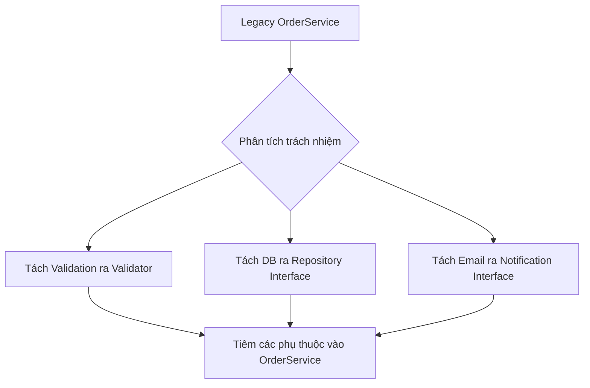

### Trạng thái sau Refactoring

```java
public class OrderService {
    private final OrderRepository repository;
    private final NotificationService notificationService;
    private final OrderValidator validator;

    // Constructor Injection (Loose Coupling)
    public OrderService(OrderRepository repo, NotificationService notify, OrderValidator val) {
        this.repository = repo;
        this.notificationService = notify;
        this.validator = val;
    }

    public void processOrder(Order order) {
        validator.validate(order);
        repository.save(order);
        notificationService.sendConfirmation(order);
    }
}
```

**Tại sao đây là Loose Coupling?**
*   `OrderService` không biết dữ liệu lưu vào MySQL hay MongoDB (thông qua `OrderRepository`).
*   `OrderService` không biết email gửi qua SendGrid hay Mailchimp (thông qua `NotificationService`).
*   Dễ dàng viết Unit Test bằng cách Mock các Interface này.

## Tóm tắt

*   **Extract Class:** Giải quyết vấn đề Class quá lớn, tăng Cohesion bằng cách nhóm các dữ liệu và hành vi liên quan vào class mới.
*   **Move Method:** Đưa logic về nơi chứa dữ liệu của nó, giảm sự can thiệp thái quá giữa các class.
*   **Composition over Inheritance:** Ưu tiên việc lắp ghép các thành phần thông qua Interface thay vì kế thừa cứng nhắc, giúp hệ thống dễ mở rộng.
*   **Refactoring** không chỉ là làm code đẹp hơn, mà là quá trình chuyển dịch các phụ thuộc từ **Concrete (Cụ thể)** sang **Abstraction (Trừu tượng)**.

## Câu hỏi tự kiểm tra

1. Khi nào ta nên thực hiện Extract Class?
   <details><summary>Đáp án</summary>Khi một class vi phạm Single Responsibility Principle (SRP), có quá nhiều dòng code (thường > 300 dòng), hoặc có một nhóm các biến instance chỉ được sử dụng bởi một nhóm nhỏ các phương thức.</details>

2. Tại sao Move Method lại giúp giảm Coupling?
   <details><summary>Đáp án</summary>Vì nó loại bỏ hiện tượng Feature Envy. Thay vì Class A phải biết chi tiết cấu trúc dữ liệu của Class B để tính toán, Class A chỉ cần gọi một phương thức của Class B. Điều này che giấu chi tiết triển khai (Encapsulation).</details>

3. Trong ví dụ OrderService sau refactor, nếu ta muốn đổi từ gửi Email sang gửi SMS, ta cần làm gì?
   <details><summary>Đáp án</summary>Ta chỉ cần tạo một implementation mới của <code>NotificationService</code> (ví dụ <code>SmsNotificationServiceImpl</code>) và truyền nó vào constructor của <code>OrderService</code> lúc khởi tạo. Code của <code>OrderService</code> hoàn toàn không thay đổi.</details>

4. Mối quan hệ giữa Unit Test và việc Refactoring sang Loose Coupling là gì?
   <details><summary>Đáp án</summary>Loose Coupling là điều kiện tiên quyết để viết Unit Test hiệu quả. Khi code được refactor sang Loose Coupling (dùng DI và Interface), ta có thể dễ dàng thay thế các phụ thuộc ngoại vi (DB, API) bằng Mock objects để kiểm thử logic nghiệp vụ một cách độc lập.</details>

---

## Các Metric đo lường Coupling (CBO, RFC)

# Các Metric đo lường Coupling (CBO, RFC)

Trong thiết kế phần mềm, chúng ta thường nói về "Loose Coupling" (liên kết lỏng lẻo) như một mục tiêu lý tưởng. Tuy nhiên, làm thế nào để biết một hệ thống là "lỏng" hay "chặt"? Nếu không có những con số cụ thể, việc đánh giá chỉ dừng lại ở mức cảm tính. Bài học này sẽ giới thiệu hai chỉ số quan trọng nhất trong bộ chỉ số Chidamber & Kemerer (CK metrics) để định lượng sự phụ thuộc: **CBO (Coupling Between Objects)** và **RFC (Response For a Class)**.

## Mục tiêu

*   Hiểu rõ định nghĩa và cách tính toán chi tiết của hai chỉ số CBO và RFC.
*   Biết cách nhận diện các lớp có nguy cơ gây lỗi cao thông qua các ngưỡng (thresholds) định mức.
*   Sử dụng biểu đồ phụ thuộc (Dependency Graph) để trực quan hóa cấu trúc hệ thống.
*   Áp dụng các chỉ số này vào quy trình Code Review và Refactoring trong dự án Java thực tế.

## 1. CBO (Coupling Between Objects): Đếm số lớp phụ thuộc

### Định nghĩa
CBO của một lớp được xác định bằng số lượng các lớp khác mà lớp đó có liên kết. Một liên kết xảy ra khi một lớp sử dụng các phương thức hoặc biến thực thể của lớp khác. 

Trong Java, CBO tăng lên khi bạn:
*   Khai báo biến thực thể (instance variable) thuộc kiểu của lớp khác.
*   Gọi phương thức tĩnh của lớp khác.
*   Có tham số phương thức hoặc kiểu trả về là một lớp khác.
*   Khởi tạo đối tượng (keyword `new`) của lớp khác.
*   Kế thừa hoặc triển khai interface (tuy nhiên, một số công cụ tách biệt coupling kế thừa ra riêng).

**Lưu ý:** CBO tính theo số lượng lớp *duy nhất*. Nếu lớp A gọi 10 phương thức khác nhau của lớp B, CBO vẫn chỉ tính là 1.

### Ví dụ minh họa

Xét một lớp `OrderProcessor` trong hệ thống thương mại điện tử:

```java
public class OrderProcessor {
    private PaymentGateway paymentGateway; // 1: Liên kết với PaymentGateway
    private InventoryService inventoryService; // 2: Liên kết với InventoryService

    public void process(Order order) { // 3: Liên kết với Order
        if (inventoryService.checkStock(order.getItems())) {
            paymentGateway.charge(order.getTotalAmount());
            EmailNotification.send("Success"); // 4: Liên kết với EmailNotification (Static call)
        }
    }
}
```

Trong ví dụ trên, CBO của `OrderProcessor` là **4** (bao gồm: `PaymentGateway`, `InventoryService`, `Order`, `EmailNotification`).

### Tại sao CBO cao lại nguy hiểm?
1.  **Khó tái sử dụng:** Để mang `OrderProcessor` sang một dự án khác, bạn phải mang theo cả 4 lớp phụ thuộc kia.
2.  **Khó Unit Test:** Bạn cần phải Mock cả 4 đối tượng này để có thể viết test cho `OrderProcessor`.
3.  **Hiệu ứng lan tỏa (Ripple Effect):** Bất kỳ thay đổi nào trong 4 lớp kia đều có thể khiến `OrderProcessor` bị lỗi.

## 2. RFC (Response For a Class): Tập hợp các phương thức có thể thực thi

### Định nghĩa
RFC là kích thước của "Response Set" của một lớp. Response Set bao gồm tất cả các phương thức có thể được thực hiện để đáp lại một thông điệp gửi đến đối tượng của lớp đó.

Công thức đơn giản:
$$RFC = M + R$$
Trong đó:
*   $M$: Số lượng phương thức được định nghĩa bên trong lớp đó.
*   $R$: Số lượng phương thức của các lớp khác được gọi trực tiếp từ bên trong lớp đó.

RFC đo lường mức độ phức tạp về mặt giao tiếp. Một lớp có RFC cao nghĩa là nó có khả năng tác động đến rất nhiều logic bên ngoài, làm tăng độ phức tạp khi gỡ lỗi (debugging).

### Ví dụ minh họa

```java
public class ReportGenerator {
    // M1
    public void generateFullReport() {
        String data = fetchData(); // Gọi phương thức nội bộ
        formatData(data); // Gọi phương thức nội bộ
        Printer.print(data); // R1: Gọi phương thức bên ngoài
    }

    // M2
    private String fetchData() {
        return Database.query("SELECT..."); // R2: Gọi phương thức bên ngoài
    }

    // M3
    private void formatData(String d) {
        Formatter.applyStyle(d); // R3: Gọi phương thức bên ngoài
    }
}
```

Tính toán RFC cho `ReportGenerator`:
*   Số phương thức nội bộ ($M$): 3 (`generateFullReport`, `fetchData`, `formatData`).
*   Số phương thức bên ngoài được gọi ($R$): 3 (`Printer.print`, `Database.query`, `Formatter.applyStyle`).
*   **RFC = 3 + 3 = 6.**

Nếu `Printer.print` lại gọi thêm 5 phương thức khác của lớp `Hardware`, RFC của `ReportGenerator` vẫn không đổi vì RFC chỉ tính các lời gọi *trực tiếp*.

## 3. Cách đọc chỉ số và ngưỡng cảnh báo

Việc sở hữu các con số là chưa đủ, bạn cần biết khi nào con số đó vượt ngưỡng an toàn. Dưới đây là bảng tham chiếu dựa trên các nghiên cứu thực nghiệm về chất lượng phần mềm Java:

| Chỉ số | Ngưỡng thấp (Tốt) | Ngưỡng trung bình | Ngưỡng cao (Nguy hiểm) |
| :--- | :--- | :--- | :--- |
| **CBO** | 0 - 5 | 6 - 14 | > 14 |
| **RFC** | 0 - 20 | 21 - 50 | > 50 (hoặc > 100 tùy quy mô) |

### Phân tích ý nghĩa:
*   **CBO > 14:** Lớp này đang đóng vai trò là "God Class" hoặc một trung tâm điều phối quá mức. Nó quá nhạy cảm với những thay đổi của hệ thống. Bạn nên xem xét áp dụng *Interface Segregation Principle (ISP)* hoặc tách lớp.
*   **RFC > 50:** Lớp này rất khó để hiểu hết luồng xử lý. Khi xảy ra lỗi, việc trace log qua hàng chục phương thức ngoại vi sẽ là một cơn ác mộng. Cần refactor bằng cách chia nhỏ các phương thức hoặc sử dụng *Composition*.

## 4. Phân tích biểu đồ phụ thuộc (Dependency Graph)

Để có cái nhìn tổng thể thay vì chỉ nhìn vào từng con số đơn lẻ, chúng ta sử dụng Dependency Graph. Đây là một đồ thị có hướng trong đó:
*   **Node (Nút):** Đại diện cho các Class hoặc Package.
*   **Edge (Cạnh):** Đại diện cho mối quan hệ phụ thuộc.

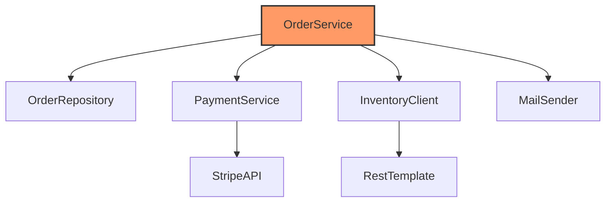

### Các kiểu cấu trúc đồ thị cần lưu ý:
1.  **Fan-in (Afferent Coupling):** Có bao nhiêu lớp khác phụ thuộc vào lớp này. Fan-in cao nghĩa là lớp này rất quan trọng và ổn định (ví dụ: `String` class trong Java).
2.  **Fan-out (Efferent Coupling):** Lớp này phụ thuộc vào bao nhiêu lớp khác (Tương đương CBO). Fan-out cao nghĩa là lớp này không ổn định.
3.  **Circular Dependency (Phụ thuộc vòng):** Lớp A phụ thuộc B, B phụ thuộc C, C lại phụ thuộc A. Đây là "tử huyệt" của thiết kế, khiến việc đóng gói và kiểm thử trở nên bất khả thi. Các công cụ như JDepend hay ArchUnit có thể phát hiện lỗi này tự động.

## 5. Công cụ đo lường trong Java

Bạn không cần phải đếm thủ công. Có nhiều công cụ mạnh mẽ hỗ trợ:
*   **MetricsReloaded (IntelliJ Plugin):** Cung cấp báo cáo chi tiết về CBO, RFC và nhiều chỉ số khác ngay trong IDE.
*   **SonarQube:** Công cụ phân tích tĩnh phổ biến nhất, cho phép thiết lập "Quality Gates" để ngăn chặn code có CBO quá cao được merge vào nhánh chính.
*   **JDepend:** Chuyên sâu về phân tích phụ thuộc giữa các Package.
*   **Checkstyle:** Có thể cấu hình để giới hạn số lượng import hoặc độ phức tạp của lớp.

## Tóm tắt

*   **CBO** đo lường số lượng "hàng xóm" mà một lớp liên kết. CBO thấp giúp tăng khả năng tái sử dụng và dễ kiểm thử.
*   **RFC** đo lường phạm vi ảnh hưởng của một lớp khi nó thực thi. RFC thấp giúp giảm độ phức tạp khi bảo trì và gỡ lỗi.
*   Sử dụng các ngưỡng **CBO < 14** và **RFC < 50** làm mục tiêu khi thiết kế.
*   Luôn kết hợp số liệu định lượng với việc quan sát **Dependency Graph** để phát hiện các vùng "mã nguồn rối rắm" (spaghetti code) hoặc phụ thuộc vòng.

## Câu hỏi tự kiểm tra

1. Nếu lớp A gọi phương thức `save()` của lớp B ở 5 vị trí khác nhau trong code, chỉ số CBO của lớp A tăng thêm bao nhiêu?
<details><summary>Đáp án</summary>Tăng thêm 1. CBO tính dựa trên số lượng lớp duy nhất bị phụ thuộc, không tính số lần gọi phương thức.</details>

2. Một lớp có 0 phương thức nội bộ nhưng gọi 20 phương thức từ các thư viện bên ngoài. Chỉ số RFC của nó tối thiểu là bao nhiêu?
<details><summary>Đáp án</summary>RFC = 0 (nội bộ) + 20 (bên ngoài) = 20.</details>

3. Tại sao việc sử dụng Interface thay vì Class cụ thể trong khai báo biến lại giúp cải thiện chỉ số CBO (xét trên góc độ thiết kế logic)?
<details><summary>Đáp án</summary>Mặc dù về mặt kỹ thuật CBO vẫn tính liên kết với Interface, nhưng việc dùng Interface giúp giảm sự phụ thuộc vào các triển khai cụ thể (Implementation). Điều này cho phép lớp đó không bị ảnh hưởng khi logic bên trong các lớp thực thi thay đổi, giúp hệ thống linh hoạt hơn (DIP trong SOLID).</details>

4. Chỉ số Fan-in cao hay Fan-out cao đáng lo ngại hơn đối với một lớp Business Logic?
<details><summary>Đáp án</summary>Fan-out cao (tương đương CBO cao) đáng lo ngại hơn vì nó cho thấy lớp Business đó đang gánh vác quá nhiều trách nhiệm và phụ thuộc vào quá nhiều thành phần khác, dẫn đến khó bảo trì. Fan-in cao thường xuất hiện ở các lớp Utility hoặc Core Framework.</details>

---

## Đo lường Cohesion bằng LCOM

# Đo lường Cohesion bằng LCOM

Trong thiết kế hướng đối tượng, chúng ta thường nói về việc xây dựng các Class có "High Cohesion" (Độ kết dính cao). Tuy nhiên, làm sao để biết một Class thực sự gắn kết hay chỉ là một "thùng rác" chứa các phương thức không liên quan? Chỉ số **LCOM (Lack of Cohesion in Methods)** chính là thước đo định lượng giúp lập trình viên Java trả lời câu hỏi đó.

## Mục tiêu

*   Hiểu rõ bản chất của chỉ số LCOM và cách nó định nghĩa sự "rời rạc" của mã nguồn.
*   Nắm vững cách tính toán LCOM dựa trên mối quan hệ giữa Method và Field.
*   Phân biệt được các phiên bản LCOM (đặc biệt là LCOM4) để áp dụng trong thực tế.
*   Biết cách đọc hiểu chỉ số này để đưa ra quyết định Refactoring chính xác.

## 1. LCOM là gì? Nguyên lý của sự rời rạc

LCOM viết tắt của **Lack of Cohesion in Methods**. Điểm khác biệt thú vị ở đây là thay vì đo độ "kết dính", chỉ số này lại đo độ "thiếu kết dính". 

*   **Chỉ số LCOM thấp:** Các phương thức trong Class sử dụng chung nhiều thuộc tính (Field). Class tập trung vào một nhiệm vụ duy nhất. Đây là dấu hiệu của thiết kế tốt.
*   **Chỉ số LCOM cao:** Các phương thức trong Class hoạt động độc lập, mỗi nhóm phương thức dùng một nhóm Field riêng. Class có dấu hiệu vi phạm nguyên lý Single Responsibility (SRP).

### Triết lý đằng sau LCOM
Một Class được coi là gắn kết khi các thành phần bên trong nó phụ thuộc lẫn nhau để tồn tại. Nếu bạn có thể chia Class đó thành hai Class nhỏ hơn mà không làm thay đổi logic của các phương thức, thì Class ban đầu đang có độ kết dính thấp.

## 2. Cách tính toán LCOM (Phiên bản nguyên thủy)

Trong phiên bản đầu tiên của Chidamber và Kemerer (CK Metric), LCOM được tính bằng cách xét các cặp phương thức $(M_i, M_j)$.

Giả sử:
*   $P$ là số lượng cặp phương thức không có thuộc tính chung.
*   $Q$ là số lượng cặp phương thức có ít nhất một thuộc tính chung.

Công thức:
$$LCOM = \max(0, P - Q)$$

Tuy nhiên, công thức này khá phức tạp khi áp dụng thủ công. Vì vậy, cộng đồng đã phát triển các phiên bản cải tiến, trong đó **LCOM4** là phiên bản phổ biến nhất vì tính trực quan.

## 3. LCOM4: Phân tích các thành phần liên thông

LCOM4 không nhìn vào các cặp, mà nhìn vào **đồ thị liên kết**. 

*   **Nút (Node):** Là các Method và Field trong Class.
*   **Cạnh (Edge):** Một cạnh tồn tại nếu Method truy cập vào Field, hoặc Method này gọi Method kia.
*   **LCOM4 = Số lượng các thành phần liên thông (Connected Components) trong đồ thị.**

### Ví dụ minh họa

Xét một Class `UserProcessor` trong Java:

```java
public class UserProcessor {
    private String username;
    private String email;
    private String configPath;

    // Nhóm 1: Xử lý User
    public void updateProfile(String newEmail) {
        this.email = newEmail;
    }
    
    public String getInfo() {
        return username + " - " + email;
    }

    // Nhóm 2: Xử lý System Config
    public void loadConfig() {
        System.out.println("Loading from " + configPath);
    }
}
```

**Phân tích đồ thị liên kết:**
1.  `updateProfile` truy cập `email`.
2.  `getInfo` truy cập `username` và `email`.
    => Nhóm 1 tạo thành một khối liên thông (vì cùng dính tới `email`).
3.  `loadConfig` truy cập `configPath`.
    => Nhóm 2 tạo thành một khối độc lập.

**Kết quả:** LCOM4 = 2. 

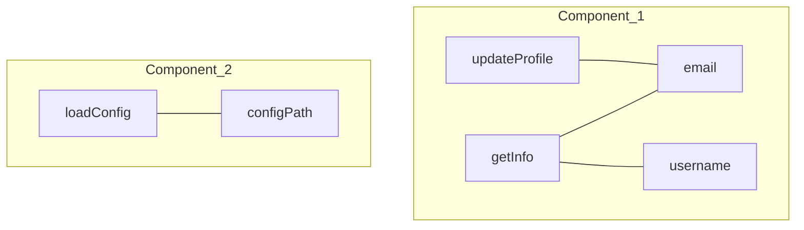

**Ý nghĩa:** Chỉ số LCOM4 = 2 cho thấy Class này nên được tách làm đôi: `UserProfileService` và `ConfigurationLoader`.

## 4. Các mức giá trị LCOM4 và hướng xử lý

| Giá trị LCOM4 | Ý nghĩa | Hành động | 
| :--- | :--- | :--- |
| **1** | Cohesion hoàn hảo. | Giữ nguyên. |
| **2-3** | Thiếu kết dính nhẹ. | Xem xét liệu Class có đang chứa các logic "tiện ích" (helper) không liên quan hay không. |
| **>5** | Rất rời rạc. | Đây là một "God Object". Cần tái cấu trúc ngay lập tức. |
| **0** | Class không có phương thức nào. | Thường là các Data Class (POJO) hoặc Interface. |

## 5. Khi nào LCOM cao là chấp nhận được?

Không phải lúc nào LCOM cao cũng là xấu. Có những trường hợp đặc biệt trong Java mà chúng ta phải chấp nhận sự rời rạc:

1.  **Data Access Objects (DAO):** Đôi khi một DAO chứa nhiều phương thức Query không dùng chung Field (vì bản chất chúng chỉ gọi EntityManager hoặc JdbcTemplate). Tuy nhiên, chúng vẫn cùng phục vụ một Entity.
2.  **Utility Classes:** Các Class như `StringUtils` hay `MathUtils` có LCOM rất cao vì các phương thức static thường độc lập hoàn toàn. Đây là đặc thù của Functional-style trong Java.
3.  **Pattern Singleton:** Đôi khi các phương thức quản lý vòng đời của Singleton không liên quan đến logic nghiệp vụ chính bên trong nó.

## 6. Ví dụ thực tế: Refactoring dựa trên LCOM

Giả sử ta có Class `OrderManager` với LCOM4 = 2:

```java
// TRƯỚC KHI REFACTOR
public class OrderManager {
    private List<Item> items;
    private String dbUrl;

    public void addItem(Item item) { items.add(item); }
    public double calculateTotal() { return items.stream().mapToDouble(Item::getPrice).sum(); }
    
    public void connectToDb() { /* dùng dbUrl */ }
    public void logOrder() { /* dùng dbUrl */ }
}
```

**Vấn đề:** Logic quản lý giỏ hàng và logic kết nối DB đang bị trộn lẫn. LCOM4 = 2 do nhóm `{addItem, calculateTotal, items}` và nhóm `{connectToDb, logOrder, dbUrl}` tách biệt.

**Sau khi Refactor:**

```java
// Class 1: Tập trung vào nghiệp vụ
public class Order {
    private List<Item> items;
    public void addItem(Item item) { ... }
    public double calculateTotal() { ... }
}

// Class 2: Tập trung vào hạ tầng
public class OrderRepository {
    private String dbUrl;
    public void save(Order order) { ... }
}
```

Bây giờ, cả hai Class mới đều có LCOM4 = 1. Hệ thống trở nên dễ bảo trì hơn, dễ Unit Test hơn.

## Tóm tắt

*   **LCOM** đo lường mức độ rời rạc của một Class dựa trên việc các Method có dùng chung Field hay không.
*   **LCOM4** là phiên bản trực quan nhất: tính số lượng các cụm (component) không liên quan trong Class.
*   **LCOM = 1** là mục tiêu lý tưởng cho hầu hết các Class nghiệp vụ.
*   Khi **LCOM > 1**, hãy cân nhắc áp dụng **Extract Class** (trong SOLID) để tách nhỏ trách nhiệm.

## Câu hỏi tự kiểm tra

1. Nếu một Class có 10 phương thức và tất cả đều truy cập vào cùng một biến instance duy nhất, LCOM4 của Class đó là bao nhiêu?
<details><summary>Đáp án</summary>LCOM4 = 1. Vì tất cả các phương thức đều kết nối tới cùng một Field, chúng tạo thành một thành phần liên thông duy nhất.</details>

2. Tại sao LCOM cao lại làm cho Unit Test khó khăn hơn?
<details><summary>Đáp án</summary>LCOM cao nghĩa là Class làm nhiều việc không liên quan. Khi viết Unit Test cho một chức năng, bạn vẫn phải khởi tạo toàn bộ Class với các phụ thuộc (Dependencies) của các chức năng không liên quan khác, gây lãng phí và khó setup Mock.</details>

3. Một Class chỉ toàn các phương thức static (Utility Class) thì chỉ số LCOM thường như thế nào?
<details><summary>Đáp án</summary>Thường rất cao (bằng số lượng phương thức static), vì các phương thức static thường không truy cập vào biến instance (Field), dẫn đến không có sự kết nối giữa chúng theo cách tính của LCOM.</details>

4. Công cụ nào trong hệ sinh thái Java có thể đo LCOM tự động?
<details><summary>Đáp án</summary>Các công cụ phân tích tĩnh như SonarQube, Checkstyle, hoặc plugin JDepend và MetricsReloaded trên IntelliJ IDEA.</details>

---

## Công cụ phân tích tĩnh trong Java

# Công cụ phân tích tĩnh trong Java

Việc hiểu lý thuyết về Coupling (Sự phụ thuộc) và Cohesion (Sự gắn kết) là bước đầu tiên, nhưng để duy trì chất lượng mã nguồn trong các dự án thực tế với hàng nghìn dòng code, bạn không thể chỉ dựa vào việc kiểm tra bằng mắt (Code Review). Bài học này sẽ hướng dẫn bạn cách sử dụng các công cụ phân tích tĩnh (Static Analysis Tools) để định lượng hóa các chỉ số thiết kế và tự động hóa việc kiểm soát chất lượng trong hệ sinh thái Java.

## Mục tiêu

*   Sử dụng SonarQube để nhận diện và đo lường các Code Smell liên quan đến Coupling và Cohesion.
*   Viết Unit Test cho kiến trúc bằng ArchUnit để ngăn chặn việc vi phạm các quy tắc thiết kế.
*   Khai thác các Plugin Metrics trên IntelliJ IDEA để theo dõi chỉ số LCOM, CBO ngay trong quá trình code.
*   Thiết lập quy trình tự động hóa (CI/CD) để biến các chỉ số này thành "chốt chặn" chất lượng.

## 1. SonarQube: Trung tâm quản lý nợ kỹ thuật

SonarQube là công cụ phổ biến nhất để phân tích chất lượng code. Thay vì chỉ tìm lỗi cú pháp, SonarQube tập trung vào **Maintainability** (Khả năng bảo trì).

### Phát hiện Code Smell liên quan đến Coupling

SonarQube sử dụng các quy tắc (Rules) để phát hiện sự phụ thuộc quá mức. Ví dụ, quy tắc "Cyclomatic Complexity" và "Cognitive Complexity" thường gián tiếp chỉ ra một Class đang ôm đồm quá nhiều trách nhiệm (Low Cohesion).

*   **Ví dụ:** Một Class có quá nhiều `import` từ các package khác nhau thường bị đánh dấu là "Brain Class" hoặc "God Class".
*   **Chỉ số Coupling:** SonarQube cung cấp biểu đồ "Dependency Structure Matrix" (trong các phiên bản Enterprise) để bạn thấy rõ module nào đang gọi module nào.

### Cách cấu hình cơ bản

Bạn có thể tích hợp SonarQube vào dự án Maven thông qua `pom.xml`:

```xml
<plugin>
    <groupId>org.sonarsource.scanner.maven</groupId>
    <artifactId>sonar-maven-plugin</artifactId>
    <version>3.9.1.2184</version>
</plugin>
```

Khi chạy lệnh `mvn sonar:sonar`, công cụ sẽ quét toàn bộ project và đưa ra báo cáo về các đoạn code có độ kết hợp quá chặt chẽ.

## 2. ArchUnit: Kiểm soát kiến trúc bằng mã nguồn

ArchUnit là một thư viện Java độc đáo cho phép bạn viết các Unit Test để kiểm tra kiến trúc. Đây là công cụ mạnh mẽ nhất để duy trì **Loose Coupling**.

### Tại sao cần ArchUnit?

Giả sử bạn thiết kế hệ thống theo mô hình Layered Architecture: `Controller -> Service -> Repository`. Một lập trình viên mới vô tình gọi trực tiếp `Repository` từ `Controller`. Về mặt logic code vẫn chạy, nhưng về mặt kiến trúc, bạn đã tạo ra một **Tight Coupling** không mong muốn.

### Ví dụ minh họa ArchUnit

```java
import com.tngtech.archunit.library.Architectures;
import static com.tngtech.archunit.lang.syntax.ArchRuleDefinition.classes;
import static com.tngtech.archunit.library.Architectures.layeredArchitecture;

@AnalyzeClasses(packages = "com.mycompany.myapp")
public class ArchitectureTest {

    @ArchTest
    static final ArchRule layer_dependencies_are_respected = layeredArchitecture()
        .consideringAllDependencies()
        .layer("Controller").definedBy("..controller..")
        .layer("Service").definedBy("..service..")
        .layer("Persistence").definedBy("..repository..")

        .whereLayer("Controller").mayNotBeAccessedByAnyLayer()
        .whereLayer("Service").mayOnlyBeAccessedByLayers("Controller")
        .whereLayer("Persistence").mayOnlyBeAccessedByLayers("Service");

    @ArchTest
    static final ArchRule no_generic_exceptions = classes()
        .should().notThrowCustomExceptions(RuntimeException.class)
        .because("Chúng ta muốn đảm bảo Functional Cohesion trong xử lý lỗi");
}
```

Với đoạn mã trên, nếu ai đó phá vỡ quy tắc về tầng (layer), Build sẽ thất bại ngay lập tức.

## 3. Plugin Metrics trong IntelliJ IDEA

Để tối ưu hóa vòng lặp phản hồi (feedback loop), bạn nên đo lường Coupling và Cohesion ngay khi đang viết code thay vì đợi đến khi đẩy lên Server.

### Plugin khuyến nghị: "MetricsReloaded"

Plugin này cho phép tính toán các chỉ số phức tạp như:

1.  **LCOM (Lack of Cohesion of Methods):** Nếu chỉ số này cao, Class của bạn đang rời rạc. Bạn nên tách nó ra.
2.  **CBO (Coupling Between Objects):** Đo số lượng class khác mà class hiện tại phụ thuộc vào.
3.  **RFC (Response For a Class):** Tổng số phương thức có thể được thực thi khi gọi một phương thức của class đó.

### Quy trình thực hiện trên IDE

1.  Cài đặt plugin **MetricsReloaded**.
2.  Chuột phải vào Package hoặc Class -> **Analyze** -> **Calculate Metrics**.
3.  Chọn profile "Complexity metrics" hoặc "Object-oriented metrics".

**Bảng diễn giải chỉ số:**

| Chỉ số | Ngưỡng cảnh báo | Hành động gợi ý |
| :--- | :--- | :--- |
| **LCOM** | > 0.8 (tùy thang đo) | Tách Class (Extract Class) vì các method không dùng chung field. |
| **CBO** | > 10 | Kiểm tra xem có đang vi phạm Law of Demeter không. |
| **WMC** | > 50 | Class quá phức tạp, cần chia nhỏ logic. |

## 4. Thiết lập Pipeline CI/CD: Chốt chặn tự động

Việc đo lường sẽ vô nghĩa nếu chúng ta lờ đi kết quả. Tích hợp vào CI/CD (như Jenkins, GitHub Actions, GitLab CI) giúp đảm bảo không có code "xấu" nào được merge vào nhánh chính.

### Mô hình hoạt động

```mermaid
graph LR
    A[Developer] -->|Push Code| B(Git Repository)
    B --> C{CI Pipeline}
    C --> D[Unit Tests]
    C --> E[ArchUnit Tests]
    C --> F[SonarQube Scan]
    D & E & F --> G{Quality Gate}
    G -->|Fail| H[Reject & Notify]
    G -->|Pass| I[Deploy/Merge]
```

### Cấu hình Quality Gate

Bạn có thể thiết lập Quality Gate trên SonarQube với các điều kiện khắt khe:
*   `Maintainability Rating` thấp hơn A: **Fail**.
*   `New Tight Coupling` xuất hiện: **Fail**.
*   `Coverage` trên code mới thấp hơn 80%: **Fail**.

## 5. Phân tích thực tế: Khi nào nên tin vào công cụ?

Công cụ phân tích tĩnh rất thông minh nhưng không hoàn hảo. 

*   **False Positive (Dương tính giả):** Đôi khi một Class có CBO cao là bắt buộc (ví dụ: một Facade Class hoặc một Configuration Class kết nối nhiều thành phần). Trong trường hợp này, bạn có thể sử dụng annotation `@SuppressWarnings` hoặc đánh dấu "Won't Fix" trên SonarQube.
*   **Tư duy thiết kế:** Đừng cố gắng đưa LCOM về 0 tuyệt đối nếu điều đó làm mã nguồn trở nên quá vụn vặt (Over-engineering). Mục tiêu là sự cân bằng.

## Tóm tắt

*   **SonarQube** giúp cái nhìn tổng quan về nợ kỹ thuật và các vi phạm thiết kế ở quy mô lớn.
*   **ArchUnit** biến các quy tắc kiến trúc (như phân tầng, hạn chế phụ thuộc chéo) thành các bài kiểm tra tự động.
*   **MetricsReloaded (IntelliJ)** cung cấp số liệu tức thời (LCOM, CBO) để điều chỉnh code ngay khi viết.
*   **CI/CD** là bước cuối cùng để đảm bảo các tiêu chuẩn về Coupling và Cohesion được thực thi nghiêm ngặt trong đội ngũ.

## Câu hỏi tự kiểm tra

1. Nếu chỉ số LCOM của một Class rất cao, điều đó có nghĩa là gì và bạn nên làm gì?
<details><summary>Đáp án</summary>LCOM cao nghĩa là các phương thức trong Class ít chia sẻ các biến thực thể (instance variables) với nhau, tức là Class có Low Cohesion. Bạn nên xem xét tách Class này thành nhiều Class nhỏ hơn, mỗi Class tập trung vào một nhiệm vụ cụ thể (tuân thủ SRP).</details>

2. ArchUnit khác gì so với các Unit Test thông thường (như JUnit)?
<details><summary>Đáp án</summary>JUnit tập trung kiểm tra logic nghiệp vụ (input/output), trong khi ArchUnit kiểm tra cấu trúc mã nguồn (ví dụ: Class A không được phép gọi Class B, hoặc các Class có hậu tố 'Service' phải nằm trong package 'service').</details>

3. Tại sao việc tích hợp SonarQube vào CI/CD lại quan trọng hơn việc chỉ chạy nó trên máy cá nhân?
<details><summary>Đáp án</summary>Vì nó tạo ra một tiêu chuẩn chung cho cả đội ngũ và ngăn chặn việc code kém chất lượng bị lọt vào hệ thống một cách khách quan, tránh tình trạng 'quên' kiểm tra hoặc bỏ qua các cảnh báo quan trọng.</details>

---

## Tổng kết và Xây dựng tư duy thiết kế

# Tổng kết và Xây dựng tư duy thiết kế

Chào mừng bạn đã đi đến chặng đường cuối cùng của khóa học chuyên sâu về **Coupling và Cohesion**. Sau khi đã đi qua các định nghĩa, phân loại chi tiết và các chỉ số đo lường (CBO, LCOM), bài học này đóng vai trò là "mảnh ghép cuối" giúp bạn chuyển hóa kiến thức lý thuyết thành bản năng thực chiến.

## Mục tiêu

*   Hệ thống hóa lộ trình chuyển đổi từ mã nguồn kém chất lượng (Code Smell) sang thiết kế sạch (Clean Design).
*   Xác lập tư duy ưu tiên tính bảo trì (Maintainability) trong môi trường phát triển phần mềm hiện đại.
*   Nắm vững quy trình tự học và cập nhật công nghệ thông qua lăng kính của tính kết dính và sự phụ thuộc.
*   Thực hành kỹ năng đánh giá hệ thống thực tế thông qua bài tập cuối khóa.

## 1. Lộ trình từ Code Smell đến Clean Code

Trong suốt khóa học, chúng ta thấy rằng không ai cố ý viết code tệ. Code Smell thường là kết quả của việc tích tụ các quyết định thiết kế vội vàng (Technical Debt). 

### Bảng tóm tắt sự chuyển dịch

| Đặc điểm | Trạng thái "Smell" | Trạng thái "Clean" |
| :--- | :--- | :--- |
| **Coupling** | Tight (Content/Common) - Phụ thuộc vào chi tiết cài đặt. | Loose (Message/Data) - Phụ thuộc vào Interface/Abstraction. |
| **Cohesion** | Low (Coincidental) - Class là một "kho chứa" tạp nham. | High (Functional) - Một Class chỉ làm một nhiệm vụ duy nhất. |
| **Thay đổi** | Hiệu ứng Domino: Sửa một chỗ, hỏng mười chỗ. | Cách ly (Isolation): Thay đổi cục bộ, không ảnh hưởng hệ thống. |
| **Kiểm thử** | Khó Mock, cần khởi tạo cả một đồ thị đối tượng phức tạp. | Dễ dàng Unit Test với các Mock/Stub đơn giản. |
| **Nguyên lý** | Vi phạm SRP, DIP. | Tuân thủ triệt để SOLID. |

### Ví dụ minh họa sự chuyển dịch trong Java

**Giai đoạn 1: Tight Coupling & Low Cohesion**
```java
public class OrderService {
    // Vừa xử lý logic, vừa trực tiếp ghi file, vừa gửi mail (Low Cohesion)
    // Phụ thuộc trực tiếp vào class cụ thể (Tight Coupling)
    public void processOrder(Order order) {
        if (order.isValid()) {
            // Ghi log trực tiếp vào FileSystem
            new FileLogger().log("Processing order"); 
            // Logic thanh toán trộn lẫn
            double tax = order.getAmount() * 0.1; 
            // Gửi mail bằng thư viện cụ thể
            GmailSender.send(order.getUserEmail(), "Success");
        }
    }
}
```

**Giai đoạn 2: Clean Design thông qua Abstraction**
```java
public class OrderService {
    private final List<OrderValidator> validators;
    private final PaymentProcessor paymentProcessor;
    private final NotificationService notificationService;

    // Dependency Injection giúp giảm Coupling
    public OrderService(List<OrderValidator> validators, 
                        PaymentProcessor paymentProcessor, 
                        NotificationService notificationService) {
        this.validators = validators;
        this.paymentProcessor = paymentProcessor;
        this.notificationService = notificationService;
    }

    public void processOrder(Order order) {
        // Functional Cohesion: Chỉ điều phối luồng nghiệp vụ
        if (validators.stream().allMatch(v -> v.validate(order))) {
            paymentProcessor.process(order);
            notificationService.notify(order.getUser());
        }
    }
}
```

## 2. Tư duy thiết kế: Tính năng hay Bảo trì?

Một lập trình viên giỏi không chỉ là người viết code chạy được, mà là người viết code có thể đọc và sửa được sau 2 năm. 

### Quy tắc đánh đổi (The Trade-off)
Trong ngắn hạn, việc tạo ra các Interface, tách nhỏ Class (tăng Cohesion) và thiết lập DI (giảm Coupling) có vẻ làm chậm tốc độ phát triển. Tuy nhiên, hãy nhìn vào công thức giá trị phần mềm:
$$Value = Functionality + Architecture$$

Nếu bạn chỉ tập trung vào *Functionality* (Tính năng), kiến trúc sẽ mục nát. Khi đó, chi phí để thêm một tính năng mới sẽ tăng theo hàm mũ vì bạn phải đối mặt với mớ hỗn độn của Tight Coupling.

### Tư duy "Design for Change"
Khi đứng trước một bài toán, hãy tự hỏi:
1.  Nếu thư viện này (ví dụ: Spring Data, Hibernate) bị thay thế, tôi phải sửa bao nhiêu Class? (Coupling check)
2.  Nếu logic tính thuế thay đổi, tôi có cần mở Class xử lý đơn hàng ra không? (Cohesion check)

## 3. Lời khuyên về việc học tập và cập nhật công nghệ

Công nghệ (Framework, Library) thay đổi mỗi ngày, nhưng nguyên lý thiết kế (Coupling/Cohesion) là bất biến. 

*   **Đừng học thuộc lòng Framework:** Hãy học cách Framework đó giải quyết vấn đề Coupling. Ví dụ: Spring IoC Container bản chất là một công cụ để quản lý Coupling.
*   **Đọc mã nguồn (Read Code):** Hãy xem các thư viện nổi tiếng như *JUnit*, *Guava* hoặc *Spring Core* tổ chức package như thế nào. Bạn sẽ thấy họ cực kỳ khắt khe trong việc giữ cho các module có tính Cohesion cao.
*   **Thực hành Refactoring hàng ngày:** Đừng đợi đến khi dự án quá nát mới sửa. Hãy áp dụng quy tắc "Boy Scout Rule": Luôn để lại mã nguồn sạch hơn một chút so với lúc bạn tìm thấy nó.

## 4. Bài tập cuối khóa: Đánh giá và tối ưu dự án Open Source

Để kết thúc khóa học, bạn hãy thực hiện một dự án nhỏ sau đây:

**Yêu cầu:**
1.  Chọn một dự án Java nhỏ trên GitHub (khoảng 20-50 classes).
2.  Sử dụng công cụ phân tích tĩnh (như **Checkstyle**, **PMD** hoặc **Sonarqube**) để xuất báo cáo về các chỉ số:
    *   **CBO (Coupling Between Objects):** Tìm ra 3 class có chỉ số cao nhất.
    *   **LCOM (Lack of Cohesion in Methods):** Tìm ra class có tính kết dính thấp nhất.
3.  **Phân tích:** Giải thích tại sao các chỉ số đó lại cao (Do logic nghiệp vụ phức tạp hay do thiết kế tồi?).
4.  **Refactoring:** Thực hiện tách ít nhất một Class có LCOM cao thành các Class nhỏ hơn có Functional Cohesion. Sử dụng Interface để giảm CBO cho một module quan trọng.
5.  **Kiểm chứng:** Chạy lại công cụ đo lường để thấy sự thay đổi của các con số.

```mermaid
graph LR
    A[Chọn Source Code] --> B[Đo lường Metric]
    B --> C{Phân tích}
    C -->|High CBO| D[Áp dụng DIP/Interface]
    C -->|High LCOM| E[Áp dụng SRP/Split Class]
    D --> F[Đo lường lại]
    E --> F
    F --> G[Kết luận]
```

## Tóm tắt

Khóa học đã trang bị cho bạn nhãn quan để nhìn thấu cấu trúc bên dưới của mã nguồn. **Coupling** và **Cohesion** không chỉ là lý thuyết suông; chúng là thước đo định lượng cho sự bền vững của hệ thống. 
*   **Low Coupling** bảo vệ bạn trước những thay đổi từ bên ngoài.
*   **High Cohesion** giúp bạn hiểu rõ nội tại bên trong của từng module.
Khi kết hợp chúng với **SOLID** và **Unit Test**, bạn đã sở hữu bộ công cụ mạnh mẽ nhất của một Software Architect.

## Câu hỏi tự kiểm tra

1. Nếu một Class có chỉ số LCOM rất cao, điều đó thường ám chỉ vi phạm nguyên lý nào trong SOLID?
<details><summary>Đáp án</summary>Vi phạm nguyên lý Đơn nhiệm (Single Responsibility Principle - SRP). LCOM cao nghĩa là các phương thức trong class ít chia sẻ thuộc tính chung, dẫn đến class đang làm quá nhiều việc không liên quan.</details>

2. Tại sao việc lạm dụng Interface (mỗi Class đều có một Interface tương ứng) đôi khi lại không tốt cho Coupling?
<details><summary>Đáp án</summary>Điều này dẫn đến tình trạng "Interface Bloat". Nếu Interface không mang tính trừu tượng thực sự mà chỉ là bản sao của Class, nó làm tăng độ phức tạp của hệ thống mà không mang lại lợi ích của Loose Coupling, đôi khi còn gây khó khăn cho việc điều hướng code.</details>

3. Trong ba loại Cohesion: Temporal, Sequential và Functional, loại nào được ưu tiên nhất và tại sao?
<details><summary>Đáp án</summary>Functional Cohesion được ưu tiên nhất. Vì nó đảm bảo một module chỉ thực hiện một nhiệm vụ duy nhất và trọn vẹn, giúp mã nguồn dễ hiểu, dễ tái sử dụng và ít bị ảnh hưởng bởi các thay đổi bên ngoài nhất.</details>

---
