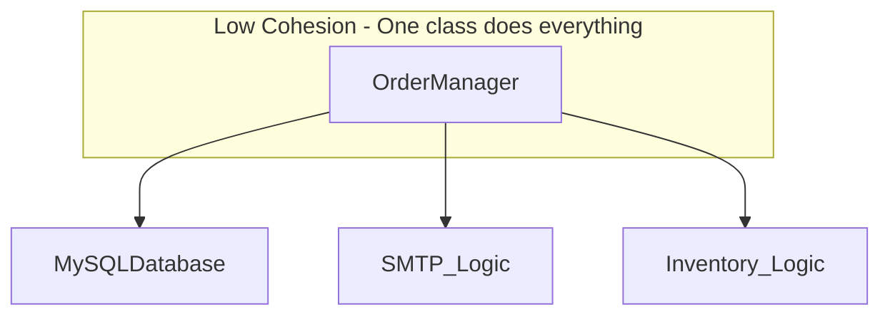

# Định nghĩa chuẩn về Coupling và Cohesion

Chào mừng bạn đến với bài học đầu tiên trong hành trình làm chủ kiến trúc phần mềm Java. Trước khi đi sâu vào các kỹ thuật refactoring hay các design pattern phức tạp, chúng ta cần phải có một cái nhìn thấu đáo và chuẩn xác về hai cột trụ của thiết kế hướng đối tượng: **Coupling (Sự phụ thuộc)** và **Cohesion (Sự gắn kết)**. 

Trong phát triển phần mềm, mục tiêu cuối cùng không chỉ là viết ra mã nguồn chạy được, mà là tạo ra một hệ thống có khả năng thích nghi với sự thay đổi. Coupling và Cohesion chính là thước đo định lượng cho khả năng đó.

## Mục tiêu

*   Định nghĩa chính xác bản chất của Coupling và Cohesion trong ngữ cảnh lập trình Java.
*   Phân tích được mối quan hệ biện chứng giữa tính linh hoạt của hệ thống và sự phức tạp của các mối liên kết.
*   Nhận diện được các dấu hiệu vi phạm (Code Smells) thông qua ví dụ thực tế.
*   Xây dựng tư duy nền tảng để đánh giá chất lượng mã nguồn trước khi thực hiện tối ưu hóa.

## 1. Coupling: Mức độ phụ thuộc giữa các module

### Khái niệm
Coupling (Độ liên kết/Độ phụ thuộc) đo lường mức độ mà một module (class, package, component) biết về module khác và phụ thuộc vào nó để thực hiện chức năng. 

Trong Java, Coupling xảy ra khi Class A gọi phương thức của Class B, kế thừa từ Class B, hoặc sử dụng Class B như một tham số/biến thực thể. 

### Các cấp độ của sự phụ thuộc

*   **Tight Coupling (Liên kết chặt):** Khi Class A biết quá nhiều về chi tiết cài đặt của Class B. Nếu Class B thay đổi, Class A gần như chắc chắn sẽ bị lỗi (Broken). Điều này tạo ra hiệu ứng domino trong hệ thống.
*   **Loose Coupling (Liên kết lỏng):** Khi Class A chỉ tương tác với Class B thông qua một giao diện (Interface) hoặc một tập hợp các quy tắc trừu tượng. Class A không quan tâm Class B thực hiện công việc đó như thế nào.

### Tại sao Tight Coupling là "kẻ thù" của bảo trì?

1.  **Tính giòn (Fragility):** Một thay đổi nhỏ ở module này có thể làm hỏng các module ở xa mà không có cảnh báo trước.
2.  **Tính cứng nhắc (Rigidity):** Khó thực hiện thay đổi vì mỗi thay đổi đòi hỏi phải sửa đổi hàng loạt các lớp liên quan.
3.  **Khó tái sử dụng (Immobility):** Bạn không thể tách một class ra để dùng cho dự án khác vì nó kéo theo một "chùm" các class phụ thuộc khác.

## 2. Cohesion: Mức độ tập trung nhiệm vụ bên trong một module

### Khái niệm
Cohesion (Độ gắn kết) đo lường mức độ liên quan giữa các thành phần bên trong một module (các method và field trong một class). Nó trả lời cho câu hỏi: "Tất cả các phần tử trong class này có đang cùng phục vụ một mục đích duy nhất hay không?"

### Các trạng thái của Cohesion

*   **High Cohesion (Gắn kết cao):** Một class chỉ làm một việc duy nhất và làm cực tốt việc đó (Single Responsibility). Các phương thức trong class thường xuyên sử dụng chung các biến thực thể (instance variables).
*   **Low Cohesion (Gắn kết thấp):** Một class thực hiện quá nhiều nhiệm vụ không liên quan đến nhau. Đây thường được gọi là "God Object" (Đối tượng vạn năng).

### Sức mạnh của High Cohesion

*   **Dễ hiểu:** Khi đọc một class có tính gắn kết cao, lập trình viên nhanh chóng nắm bắt được mục đích của nó.
*   **Dễ kiểm thử:** Các kịch bản test tập trung vào một logic nghiệp vụ duy nhất.
*   **Dễ bảo trì:** Thay đổi logic của một chức năng chỉ ảnh hưởng đến đúng class đó.

## 3. Mối quan hệ tỷ lệ nghịch giữa tính linh hoạt và sự phức tạp

Trong thiết kế phần mềm, chúng ta luôn hướng tới mục tiêu: **Low Coupling và High Cohesion**.

Tuy nhiên, có một thực tế là nếu bạn cố gắng làm cho Coupling cực thấp bằng cách chia nhỏ mọi thứ ra quá mức, bạn có thể vô tình làm tăng sự phức tạp của hệ thống (Complexity) vì số lượng các mối liên kết trung gian tăng lên. Ngược lại, nếu gộp tất cả vào một chỗ để dễ quản lý (Low Complexity ban đầu), bạn sẽ rơi vào cái bẫy của Low Cohesion.

| Đặc điểm | High Cohesion | Low Coupling |
| :--- | :--- | :--- |
| **Trọng tâm** | Bên trong một module | Giữa các module với nhau |
| **Mục tiêu** | Tối đa hóa sự tập trung | Tối thiểu hóa sự phụ thuộc |
| **Kết quả** | Code dễ đọc, dễ tái sử dụng | Code dễ thay đổi, dễ thay thế |

## 4. Ví dụ minh họa: Vi phạm cả Coupling và Cohesion

Hãy xem xét một ví dụ điển hình trong Java về một class `OrderManager` làm quá nhiều việc và phụ thuộc quá sâu vào các chi tiết cài đặt.

```java
// Ví dụ về thiết kế TỆ: Low Cohesion & Tight Coupling
public class OrderManager {
    private MySQLDatabase database; // Phụ thuộc trực tiếp vào Implementation cụ thể

    public OrderManager() {
        this.database = new MySQLDatabase(); // Tight Coupling: Khởi tạo trực tiếp
    }

    public void processOrder(Order order) {
        // 1. Logic kiểm tra tồn kho (Vi phạm Cohesion)
        if (order.getAmount() > 100) {
            System.out.println("Checking stock in warehouse...");
        }

        // 2. Logic lưu vào DB
        database.save(order);

        // 3. Logic gửi email thông báo (Vi phạm Cohesion)
        String message = "Order " + order.getId() + " processed.";
        sendEmail("admin@store.com", message);
    }

    private void sendEmail(String to, String msg) {
        // Chi tiết cài đặt gửi email nằm tại đây
        System.out.println("Sending SMTP email to " + to);
    }
}
```

### Phân tích sai lầm:

1.  **Low Cohesion:** Class `OrderManager` vừa quản lý đơn hàng, vừa kiểm tra kho, vừa lưu DB, vừa biết cách gửi email. Nó là một "Jack of all trades" (người làm đủ mọi nghề nhưng không chuyên nghề nào).
2.  **Tight Coupling:** 
    *   Nó khởi tạo trực tiếp `new MySQLDatabase()`. Nếu sau này dự án chuyển sang MongoDB, bạn phải sửa code của `OrderManager`.
    *   Nó chứa logic gửi email SMTP. Nếu muốn đổi sang SendGrid hoặc Amazon SES, bạn lại phải sửa `OrderManager`.

### Sơ đồ hóa sự phụ thuộc (Mermaid):



## 5. Hướng tới thiết kế tối ưu

Để giải quyết vấn đề trên, chúng ta cần tách nhỏ các trách nhiệm (tăng Cohesion) và giao tiếp qua Interface (giảm Coupling).

```java
// Thiết kế TỐT: High Cohesion & Loose Coupling

interface Database { void save(Order order); }
interface NotificationService { void notify(String msg); }

public class OrderService {
    private final Database database;
    private final NotificationService notificationService;

    // Dependency Injection: Giảm Coupling
    public OrderService(Database database, NotificationService notificationService) {
        this.database = database;
        this.notificationService = notificationService;
    }

    public void placeOrder(Order order) {
        database.save(order);
        notificationService.notify("Order processed: " + order.getId());
    }
}
```

Trong thiết kế mới:
*   `OrderService` chỉ tập trung vào luồng nghiệp vụ (High Cohesion).
*   Nó không biết `Database` là MySQL hay MongoDB (Loose Coupling).
*   Nó không biết `NotificationService` gửi qua Email hay SMS (Loose Coupling).

## Tóm tắt

*   **Coupling** là mối quan hệ bên ngoài. Hãy giữ nó **Thấp (Low)** để hệ thống linh hoạt.
*   **Cohesion** là mối quan hệ bên trong. Hãy giữ nó **Cao (High)** để mỗi class có trách nhiệm rõ ràng.
*   Một thiết kế tốt là sự cân bằng: Các module độc lập với nhau nhưng mỗi module lại cực kỳ tập trung vào nhiệm vụ của mình.
*   Sử dụng **Interface** và **Dependency Injection** là những kỹ thuật hàng đầu trong Java để đạt được trạng thái này.

## Câu hỏi tự kiểm tra

1. Nếu bạn thay đổi code trong Class A mà làm Class B không thể compile, đây là biểu hiện của cái gì?
<details><summary>Đáp án</summary>Đây là biểu hiện của <b>Tight Coupling</b> (Liên kết chặt). Class B đang phụ thuộc quá sâu vào chi tiết cài đặt của Class A.</details>

2. Một Class có 20 phương thức, trong đó 5 phương thức xử lý File, 5 phương thức tính toán lương, 10 phương thức gửi tin nhắn. Class này có tính chất gì?
<details><summary>Đáp án</summary>Class này có <b>Low Cohesion</b> (Gắn kết thấp). Nó đang vi phạm nguyên tắc Đơn nhiệm (SRP) vì chứa quá nhiều trách nhiệm không liên quan.</details>

3. Tại sao High Cohesion thường dẫn đến Loose Coupling?
<details><summary>Đáp án</summary>Khi một lớp có tính gắn kết cao, nó chỉ thực hiện một nhiệm vụ rõ ràng và cung cấp một interface hẹp (minimal interface). Điều này giúp các lớp khác tương tác với nó ít hơn, đơn giản hơn, từ đó làm giảm sự phụ thuộc lẫn nhau (Loose Coupling).</details>