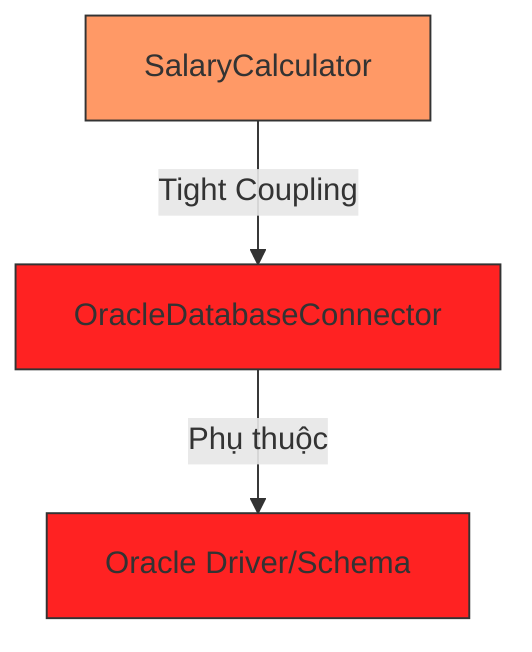

# Tại sao Tight Coupling là 'kẻ thù' của bảo trì?

Trong phát triển phần mềm, chúng ta thường nghe câu nói: "Mã nguồn duy nhất không có lỗi là mã nguồn không bao giờ thay đổi". Tuy nhiên, trong thực tế, thay đổi là hằng số duy nhất. Một hệ thống phần mềm sống là một hệ thống liên tục tiến hóa. Khi đó, Tight Coupling (Liên kết chặt chẽ) trở thành một rào cản vô hình nhưng cực kỳ tốn kém, biến những thay đổi nhỏ thành những thảm họa dây chuyền. Bài viết này sẽ phân tích sâu lý do tại sao Tight Coupling lại được coi là kẻ thù số một của công tác bảo trì phần mềm.

## Mục tiêu

*   Hiểu rõ cơ chế của Hiệu ứng gợn sóng (Ripple Effect) và cách nó làm tăng rủi ro khi chỉnh sửa mã nguồn.
*   Nhận diện các rào cản đối với việc tái sử dụng (Reusability) khi các thành phần bị dính chặt vào nhau.
*   Phân tích tác động của Tight Coupling đến tầng logic nghiệp vụ thông qua ví dụ cụ thể về Database.
*   Đánh giá chi phí cơ hội và sự suy giảm khả năng mở rộng của hệ thống khi đối mặt với nợ kỹ thuật.

## 1. Hiệu ứng gợn sóng (Ripple Effect): Khi một thay đổi nhỏ làm sụp đổ cả hệ thống

Hiệu ứng gợn sóng xảy ra khi một thay đổi trong một module yêu cầu hàng loạt thay đổi ở các module khác phụ thuộc vào nó. Trong một hệ thống Tight Coupling, các lớp (classes) biết quá nhiều về chi tiết cài đặt của nhau.

### Cơ chế tác động

Hãy tưởng tượng bạn có một lớp `OrderProcessor` trực tiếp khởi tạo một lớp `EmailService`. Nếu ngày mai, `EmailService` thay đổi constructor để nhận thêm một tham số `ApiKey`, bạn buộc phải tìm tất cả những nơi đang khởi tạo `EmailService` để sửa lại. 

```java
// Ví dụ về Tight Coupling gây ra hiệu ứng gợn sóng
public class EmailService {
    private String apiKey;
    // Trước đây: public EmailService() {}
    // Bây giờ: Thay đổi yêu cầu ApiKey
    public EmailService(String apiKey) {
        this.apiKey = apiKey;
    }
    
    public void sendEmail(String message) {
        System.out.println("Sending: " + message + " with key: " + apiKey);
    }
}

public class OrderProcessor {
    // OrderProcessor bị phụ thuộc trực tiếp vào cấu trúc của EmailService
    private EmailService emailService = new EmailService("SECRET_KEY"); 

    public void process() {
        // ... xử lý đơn hàng
        emailService.sendEmail("Order processed successfully");
    }
}
```

Trong ví dụ trên, `OrderProcessor` không chỉ phụ thuộc vào chức năng gửi email mà còn phụ thuộc vào *cách thức tạo ra* `EmailService`. Nếu hệ thống có 100 lớp sử dụng `EmailService` theo cách này, bạn sẽ phải sửa code ở 100 nơi. Đây chính là biểu hiện của sự **Cứng nhắc (Rigidity)**.

## 2. Khó khăn trong việc tái sử dụng code (Reusability)

Một trong những lời hứa lớn nhất của lập trình hướng đối tượng (OOP) là khả năng tái sử dụng. Tuy nhiên, Tight Coupling thường vi phạm lời hứa này. Hiện tượng này thường được gọi là vấn đề "Banana-Gorilla-Jungle": Bạn chỉ muốn quả chuối (một hàm cụ thể), nhưng bạn lại nhận được con khỉ đang cầm quả chuối và cả khu rừng nơi con khỉ đó sinh sống.

### Tại sao lại khó tái sử dụng?

Khi bạn muốn mang một module sang một dự án mới, nếu module đó liên kết chặt chẽ với các module khác, bạn buộc phải mang theo toàn bộ các module phụ thuộc đó. 

| Đặc điểm | Tight Coupling | Loose Coupling |
| :--- | :--- | :--- |
| **Phụ thuộc** | Phụ thuộc vào implementation (cài đặt cụ thể) | Phụ thuộc vào abstraction (interface/abstract class) |
| **Tách rời** | Gần như không thể tách rời một class ra khỏi ngữ cảnh của nó | Dễ dàng tách rời và thay thế bằng mock/stub |
| **Kiểm thử** | Khó viết Unit Test vì phải khởi tạo toàn bộ cây phụ thuộc | Dễ dàng test độc lập từng thành phần |

## 3. Phân tích ví dụ: Khi Database "bắt cóc" Business Logic

Đây là lỗi phổ biến nhất trong các dự án Java Enterprise. Logic nghiệp vụ (Business Logic) bị trộn lẫn hoặc phụ thuộc trực tiếp vào các chi tiết của Database (như SQL cụ thể, cấu trúc bảng, hoặc thư viện driver).

### Kịch bản tồi tệ

Giả sử bạn có một dịch vụ tính lương `SalaryCalculator` sử dụng trực tiếp `OracleDatabaseConnector` để truy vấn dữ liệu nhân viên.

```java
public class SalaryCalculator {
    public double calculateMonthlySalary(int employeeId) {
        // Tight coupling với Oracle cụ thể
        OracleDatabaseConnector connector = new OracleDatabaseConnector();
        String sql = "SELECT base_salary FROM employees WHERE id = " + employeeId;
        ResultSet rs = connector.executeQuery(sql);
        // ... xử lý logic
        return rs.getDouble("base_salary");
    }
}
```

**Hệ quả khi thay đổi:**
1.  **Thay đổi công nghệ:** Nếu công ty quyết định chuyển sang PostgreSQL hoặc MongoDB, bạn phải viết lại toàn bộ lớp `SalaryCalculator` mặc dù logic tính lương không hề thay đổi.
2.  **Thay đổi cấu trúc bảng:** Nếu cột `base_salary` được đổi tên thành `salary_amount`, logic nghiệp vụ bị hỏng ngay lập tức.
3.  **Khó Unit Test:** Bạn không thể test logic tính lương mà không có một database Oracle đang chạy thực tế. Điều này làm chậm quá trình CI/CD.



## 4. Chi phí cơ hội và khả năng mở rộng

Tight Coupling không chỉ là vấn đề kỹ thuật; nó là một vấn đề kinh tế. 

### Tốc độ ra mắt tính năng (Time-to-Market)
Khi hệ thống bị liên kết chặt chẽ, mỗi khi thêm một tính năng mới, lập trình viên phải dành 20% thời gian để viết code mới và 80% thời gian để sửa các lỗi phát sinh do hiệu ứng gợn sóng. Điều này làm giảm tốc độ phát triển và khiến doanh nghiệp mất đi cơ hội cạnh tranh.

### Nợ kỹ thuật (Technical Debt)
Sự liên kết chặt chẽ tích tụ dần theo thời gian tạo thành một đống nợ kỹ thuật khổng lồ. Đến một thời điểm, chi phí để bảo trì hệ thống cũ sẽ cao hơn cả chi phí xây dựng lại từ đầu. Tuy nhiên, việc xây dựng lại từ đầu cũng mang lại rủi ro rất lớn.

### Khả năng mở rộng (Scalability)
Nếu bạn muốn chuyển một phần của ứng dụng Monolith sang Microservices để mở rộng, Tight Coupling sẽ là rào cản lớn nhất. Bạn không thể tách một service ra nếu nó đang "dính" lấy hàng chục class khác thông qua các biến static hoặc khởi tạo trực tiếp.

## Tóm tắt

*   **Tight Coupling** làm cho mã nguồn trở nên **cứng nhắc (Rigid)**, **dễ vỡ (Fragile)** và **không thể tái sử dụng (Immobile)**.
*   **Hiệu ứng gợn sóng** biến những thay đổi đơn giản thành những đợt bảo trì kéo dài, làm tăng rủi ro bug.
*   Việc phụ thuộc vào các chi tiết cài đặt (như Database, API bên thứ ba) khiến Business Logic mất đi tính độc lập.
*   Hệ quả cuối cùng là **chi phí bảo trì tăng vọt** và khả năng thích ứng với thay đổi của doanh nghiệp bị tê liệt.

## Câu hỏi tự kiểm tra

1. Tại sao nói Tight Coupling làm giảm khả năng Unit Test của một ứng dụng Java?
<details><summary>Đáp án</summary>Vì khi một class liên kết chặt chẽ với các class khác (ví dụ: khởi tạo trực tiếp bằng từ khóa 'new'), chúng ta không thể thay thế các phụ thuộc đó bằng Mock objects. Do đó, Unit Test buộc phải chạy cùng với toàn bộ các thành phần liên quan, biến nó thành Integration Test và làm cho quá trình test chậm, khó kiểm soát dữ liệu đầu vào.</details>

2. Hiệu ứng gợn sóng (Ripple Effect) thường xuất hiện rõ rệt nhất trong tình huống nào?
<details><summary>Đáp án</summary>Xuất hiện rõ nhất khi có sự thay đổi trong chữ ký phương thức (method signature) hoặc cấu trúc dữ liệu của một class ở tầng thấp (như Repository hoặc Utility), dẫn đến việc phải sửa đổi hàng loạt các class ở tầng cao hơn đang gọi đến nó.</details>

3. Làm thế nào để nhận biết một đoạn code Java đang bị Tight Coupling với Database?
<details><summary>Đáp án</summary>Dấu hiệu nhận biết: Trong class logic nghiệp vụ có xuất hiện các câu lệnh SQL thuần, các class driver cụ thể của Database (như OracleConnection, MySqlConnection), hoặc việc khởi tạo trực tiếp các đối tượng truy cập dữ liệu mà không thông qua Interface.</details>

4. Khái niệm "Banana-Gorilla-Jungle" ám chỉ điều gì trong thiết kế phần mềm?
<details><summary>Đáp án</summary>Nó ám chỉ sự khó khăn trong việc tái sử dụng code. Khi bạn muốn sử dụng một thành phần nhỏ, bạn buộc phải kéo theo cả một hệ thống phụ thuộc khổng lồ đi kèm do chúng được thiết kế liên kết quá chặt chẽ với nhau.</details>