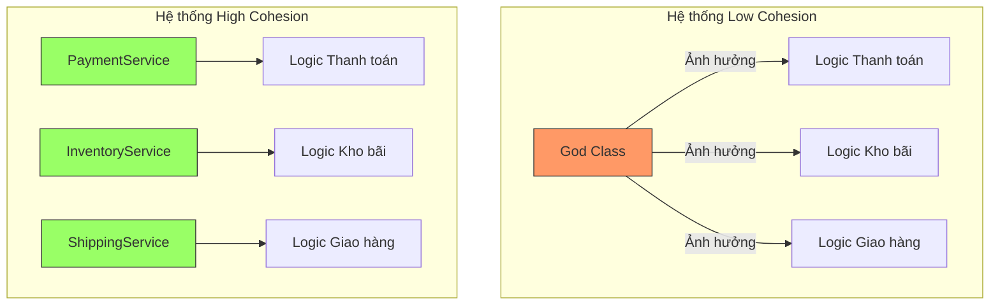

# Sức mạnh của High Cohesion

Trong thiết kế phần mềm, nếu Coupling là câu chuyện về cách các module "nói chuyện" với nhau, thì Cohesion (Sự kết dính) lại là câu chuyện về nội tâm của một module. Một module có **High Cohesion** (Độ kết dính cao) giống như một chuyên gia lành nghề: họ chỉ làm một việc duy nhất nhưng làm cực kỳ xuất sắc. Ngược lại, Low Cohesion giống như một người "đa năng" nhưng việc gì cũng dở dang, gây rối rắm cho bất kỳ ai muốn hợp tác.

Bài viết này sẽ đi sâu vào lý do tại sao High Cohesion lại là chìa khóa để giảm tải gánh nặng tư duy và tạo ra những hệ thống Java trường tồn với thời gian.

## Mục tiêu

*   Hiểu rõ khái niệm High Cohesion và cách nó tác động đến cấu trúc mã nguồn Java.
*   Nhận diện và phân tích tác hại của "God Class" đối với khả năng bảo trì.
*   Giải thích được mối liên hệ giữa Cohesion và Cognitive Load (Gánh nặng nhận thức).
*   Học cách chia nhỏ trách nhiệm để đạt được sự tập trung hóa trong Class.

## 1. Bản chất của High Cohesion: Sự tập trung hóa trách nhiệm

Cohesion đo lường mức độ liên quan giữa các thành phần bên trong một module (class, package, method). Khi một class có High Cohesion, tất cả các thuộc tính (fields) và phương thức (methods) của nó đều hướng tới một mục đích chung duy nhất.

Trong Java, High Cohesion không chỉ là việc viết code ngắn lại, mà là việc **định vị đúng ranh giới của logic**. 

### Ví dụ về sự phân rã ý niệm:

*   **Low Cohesion:** Một class `Employee` vừa chứa thông tin cá nhân, vừa chứa logic tính lương, vừa chứa logic lưu xuống Database, vừa chứa logic gửi Email thông báo lương.
*   **High Cohesion:** Class `Employee` chỉ chứa dữ liệu. Class `PayrollCalculator` lo tính lương. Class `EmployeeRepository` lo lưu trữ. Class `NotificationService` lo gửi tin nhắn.

## 2. Giảm thiểu Cognitive Load (Gánh nặng nhận thức)

Lập trình viên thường dành 80% thời gian để đọc code và chỉ 20% để viết. **Cognitive Load** là tổng lượng nỗ lực trí tuệ được sử dụng trong bộ nhớ làm việc (working memory). 

Khi bạn mở một Class có High Cohesion, não bộ của bạn ngay lập tức hình thành một "Mental Model" (Mô hình tâm trí) rõ ràng. Bạn biết chắc chắn rằng: "Class này chỉ xử lý việc giải mã Token". Bạn không cần phải lo lắng về việc đọc nhầm sang logic kết nối Database hay định dạng ngày tháng.

### Bảng so sánh gánh nặng tư duy

| Đặc điểm | High Cohesion | Low Cohesion (God Class) |
| :--- | :--- | :--- |
| **Phạm vi tìm kiếm** | Khu trú trong một mục đích duy nhất. | Phải lọc bỏ các logic nhiễu không liên quan. |
| **Khả năng dự đoán** | Cao. Nhìn tên class là biết logic bên trong. | Thấp. Phải đọc từng dòng code mới hiểu hết nó làm gì. |
| **Sự tự tin khi sửa đổi** | Cao. Ít lo ngại hỏng các phần khác. | Thấp. Luôn sợ hiệu ứng cánh bướm (Butterfly Effect). |

## 3. Đối mặt với "kẻ thù" của bảo trì: God Class

**God Class** (Lớp vạn năng) là biểu hiện cực đoan nhất của Low Cohesion. Đây là những class "biết quá nhiều" và "làm quá nhiều".

### Ví dụ thực tế trong Java

Hãy xem xét một `OrderManager` tồi tệ:

```java
public class OrderManager {
    // Quá nhiều trách nhiệm tập trung vào một nơi
    public void processOrder(Order order) {
        // 1. Validate đơn hàng
        if (order.getItems().isEmpty()) throw new RuntimeException("Empty order");

        // 2. Tính toán thuế và chiết khấu
        double tax = order.getAmount() * 0.1;
        
        // 3. Lưu vào Database
        String sql = "INSERT INTO orders ...";
        // JDBC logic ở đây...

        // 4. Gửi mail xác nhận
        String message = "Your order " + order.getId() + " is confirmed";
        // JavaMail logic ở đây...
    }
}
```

**Tại sao thiết kế này nguy hiểm?**
1.  **Khó đọc:** Khi bạn muốn sửa logic tính thuế, bạn phải cuộn qua hàng trăm dòng code xử lý SQL và Email.
2.  **Khó Test:** Để unit test logic tính thuế, bạn buộc phải khởi tạo cả Database connection và Mail server (hoặc mock rất phức tạp).
3.  **Side-effects (Tác dụng phụ):** Một thay đổi nhỏ trong cấu trúc Database có thể vô tình làm hỏng logic gửi Mail vì chúng nằm chung một "nồi canh".

### Giải pháp: Phân rã thành các Small Classes chuyên biệt

```java
public class OrderValidator {
    public void validate(Order order) { /*...*/ }
}

public class TaxCalculator {
    public double calculateTax(Order order) { /*...*/ }
}

public class OrderRepository {
    public void save(Order order) { /*...*/ }
}

public class NotificationService {
    public void sendConfirmation(Order order) { /*...*/ }
}
```

Bây giờ, mỗi class đều có High Cohesion. `TaxCalculator` chỉ quan tâm đến các con số. Nếu luật thuế thay đổi, bạn chỉ sửa đúng class đó. Ranh giới lỗi (Blast Radius) được thu hẹp tối đa.

## 4. Giảm thiểu Side-effect khi chỉnh sửa

High Cohesion tạo ra một môi trường "cách ly". Trong một class có độ kết dính cao, các phương thức thường sử dụng chung một tập các biến thực thể (fields). Điều này tạo nên một sự thống nhất về trạng thái.

Khi bạn thay đổi logic bên trong một class High Cohesion, tác động của nó thường chỉ giới hạn trong class đó. 



Trong mô hình High Cohesion, nếu bạn thay đổi cách tính phí giao hàng trong `ShippingService`, `PaymentService` hoàn toàn không hề hay biết và không bị ảnh hưởng. Đây chính là sự ổn định mà mọi kiến trúc sư phần mềm hướng tới.

## 5. Mối liên hệ với khả năng tái sử dụng (Reusability)

Một module làm quá nhiều việc sẽ rất khó để tái sử dụng. Nếu bạn muốn dùng lại logic "Gửi Email" từ `OrderManager` ở trên cho chức năng "Quên mật khẩu", bạn không thể làm được vì nó bị dính chặt với logic đơn hàng.

Khi bạn tách nó ra thành `EmailProvider` (High Cohesion), bạn có thể gọi nó ở bất cứ đâu trong hệ thống. High Cohesion chính là tiền đề cho việc xây dựng các bộ thư viện (libraries) và component dùng chung.

## Tóm tắt

*   **High Cohesion** là việc giữ cho các thành phần bên trong một module liên quan chặt chẽ với nhau và cùng phục vụ một mục đích.
*   Nó giúp **giảm Cognitive Load**, cho phép lập trình viên hiểu code nhanh hơn mà không cần tốn quá nhiều bộ nhớ đệm của não bộ.
*   Nó triệt tiêu **God Class**, giúp hệ thống dễ bảo trì, dễ test và ít lỗi tiềm tàng (side-effects).
*   Một hệ thống có High Cohesion thường đi kèm với các class nhỏ, tên gọi rõ ràng và trách nhiệm duy nhất.

## Câu hỏi tự kiểm tra

**1. Dấu hiệu rõ nhất của một Class có Low Cohesion là gì?**
<details>
<summary>Đáp án</summary>
Class đó có quá nhiều phương thức không liên quan đến nhau, sử dụng các tập biến thực thể (fields) khác nhau hoàn toàn, hoặc tên class thường chứa những từ chung chung như "Manager", "Helper", "Common", "Utility" nhưng chứa hàng nghìn dòng code đa mục đích.
</details>

**2. Tại sao High Cohesion lại giúp Unit Test dễ dàng hơn?**
<details>
<summary>Đáp án</summary>
Vì class chỉ làm một việc, số lượng dependency (phụ thuộc) cần phải mock sẽ ít đi. Các kịch bản test (test cases) cũng tập trung vào một luồng nghiệp vụ duy nhất, giúp code test ngắn gọn và dễ hiểu hơn.
</details>

**3. Giữa một Class 1000 dòng làm 5 việc và 5 Class mỗi class 200 dòng làm 1 việc, cái nào tốt hơn theo triết lý Cohesion?**
<details>
<summary>Đáp án</summary>
5 Class mỗi class 200 dòng tốt hơn. Mặc dù tổng số dòng code có thể tăng nhẹ do boilerplate, nhưng độ phức tạp nhận thức giảm xuống, khả năng bảo trì và tái sử dụng tăng lên đáng kể.
</details>