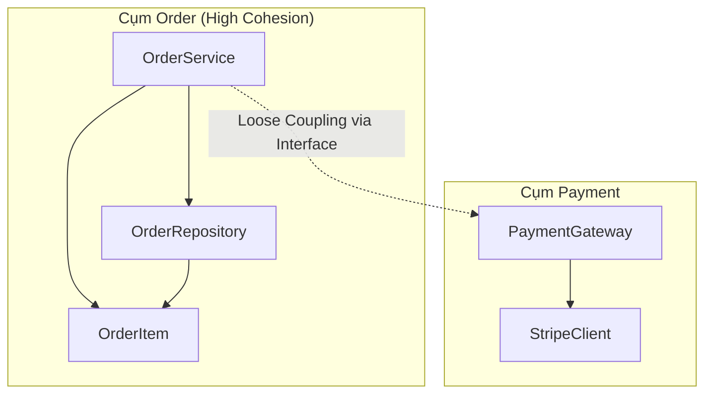

# Điểm cân bằng tối ưu trong thiết kế

Trong thế giới phát triển phần mềm Java, chúng ta thường được dạy rằng "Loose Coupling" (khớp nối lỏng) và "High Cohesion" (độ kết dính cao) là những mục tiêu tối thượng. Tuy nhiên, một lập trình viên kinh nghiệm sẽ nhận ra rằng việc cực đoan hóa các nguyên lý này có thể dẫn đến một thảm họa kiến trúc khác: **Over-engineering** (thiết kế quá mức). Bài học này sẽ giúp bạn xác định "điểm ngọt" (sweet spot) – nơi mà hệ thống vừa đủ linh hoạt để mở rộng, vừa đủ đơn giản để bảo trì.

## Mục tiêu

*   Nhận diện được các dấu hiệu của việc chia nhỏ module quá mức (Class Explosion) và hệ quả của nó.
*   Phân tích được các tình huống thực tế trong Java khi cần ưu tiên hiệu năng và sự đơn giản hơn là việc tách biệt hoàn toàn.
*   Áp dụng các kỹ thuật đóng gói của Java (như package-private, inner classes) để đạt được sự cân bằng.
*   Đánh giá chất lượng thiết kế thông qua việc phân tích mối quan hệ trên Class Diagram.

## 1. Nghịch lý của việc chia quá nhỏ (Over-engineering)

Nhiều lập trình viên khi mới tiếp cận SOLID thường cố gắng tách mọi thứ thành các interface và class nhỏ nhất có thể. Họ tin rằng càng nhiều class thì hệ thống càng "sạch". Tuy nhiên, điều này dẫn đến một hiện tượng gọi là **Fragmentation** (Sự phân mảnh).

### Hệ quả của việc phân mảnh:
1.  **Cognitive Load (Tải nhận thức) tăng cao:** Khi muốn hiểu một logic nghiệp vụ đơn giản, bạn phải mở 10 file khác nhau. Việc nhảy qua lại giữa các file làm ngắt quãng luồng tư duy.
2.  **Indirection (Sự gián tiếp) vô nghĩa:** Việc tạo ra các Interface chỉ có duy nhất một Implementation mà không có kế hoạch mở rộng trong tương lai chỉ làm tăng thêm các lớp trung gian.
3.  **Boilerplate Code:** Mỗi class mới yêu cầu thêm unit test, cấu hình Dependency Injection (Spring/Guice), và quản lý file.

**Ví dụ về Over-engineering:**
Giả sử bạn có một logic tính thuế đơn giản. Thay vì viết một phương thức trong `OrderService`, bạn tách thành:
`TaxCalculatorInterface` -> `AbstractTaxCalculator` -> `VATCalculator`, `LuxuryTaxCalculator`, `TaxRoundingPolicy`, `TaxReportFormatter`...
Nếu nghiệp vụ của bạn chỉ phục vụ một thị trường duy nhất với thuế suất cố định trong 5 năm qua, việc tách này là lãng phí tài nguyên.

## 2. Khi nào nên chấp nhận Coupling cao để đổi lấy hiệu năng và sự đơn giản?

Coupling không phải lúc nào cũng là xấu. Có những trường hợp "Tight Coupling" là lựa chọn có chủ đích để tối ưu hóa.

### Trường hợp 1: Hiệu năng thực thi (Performance)
Trong các hệ thống yêu cầu độ trễ cực thấp (Low Latency), việc đi qua nhiều lớp trừu tượng (Abstraction layers) và gọi thông qua Interface sẽ tạo ra chi phí overhead cho CPU (vtable lookup). 

**Ví dụ trong Java Core:**
Hãy nhìn vào `java.util.ArrayList`. Bên trong nó có một Inner Class là `Itr` (Iterator). 
```java
public class ArrayList<E> extends AbstractList<E> ... {
    // ...
    private class Itr implements Iterator<E> {
        int cursor;       // index of next element to return
        int lastRet = -1; // index of last element returned; -1 if no such
        int expectedModCount = modCount;
        // ...
    }
}
```
Ở đây, `Itr` phụ thuộc trực tiếp (Tight Coupling) vào các field private của `ArrayList` như `elementData` và `modCount`. 
- **Tại sao chấp nhận?** Để `Itr` có thể truy cập trực tiếp vào mảng dữ liệu mà không cần thông qua các getter công khai, giúp tăng tốc độ duyệt mảng và đảm bảo tính toàn vẹn dữ liệu (fail-fast).

### Trường hợp 2: Các thành phần có vòng đời trùng khớp (Co-change)
Nếu hai class luôn luôn thay đổi cùng nhau và không bao giờ được tái sử dụng độc lập, việc tách chúng ra chỉ tạo thêm rào cản. 

## 3. Chiến lược 'Low Coupling, High Cohesion' trong thực tế Java

Để đạt được điểm cân bằng, chúng ta cần áp dụng công thức sau:

$$Chi phí Bảo trì = f(Độ phức tạp logic) + g(Số lượng mối liên kết) + h(Độ rời rạc của thông tin)$$

### Sử dụng Package-Private (Default Access Modifier)
Thay vì để mọi thứ là `public`, hãy sử dụng phạm vi mặc định của Java để giới hạn Coupling trong nội bộ một package. Điều này cho phép các class bên trong package tương tác chặt chẽ với nhau (High Cohesion) nhưng vẫn xuất hiện như một khối thống nhất (Low Coupling) đối với bên ngoài.

```java
// Trong package com.app.payment
class PaymentProcessor { // Package-private: Giấu kín với bên ngoài
    void process() { ... }
}

public class PaymentService { // Public: Cổng giao tiếp duy nhất
    private final PaymentProcessor processor = new PaymentProcessor();
    public void executePayment() {
        processor.process();
    }
}
```

### Composition over Inheritance
Kế thừa (Inheritance) tạo ra Coupling mạnh nhất giữa class cha và con. Sử dụng Composition (Thành phần) giúp bạn giữ được High Cohesion bằng cách gom các hành vi liên quan lại mà không làm mất đi tính linh hoạt.

## 4. Phân tích sơ đồ Class Diagram để đánh giá sự cân bằng

Một thiết kế cân bằng thường hiển thị trên Class Diagram với các đặc điểm:
1.  **Số lượng mũi tên đi vào (Afferent Coupling - Ca) vừa phải:** Một class không nên bị quá nhiều class khác phụ thuộc vào.
2.  **Số lượng mũi tên đi ra (Efferent Coupling - Ce) thấp:** Một class không nên biết quá nhiều về thế giới bên ngoài.
3.  **Các cụm (Clusters):** Các class có quan hệ mật thiết nên tạo thành một cụm dày đặc bên trong nhưng có rất ít đường nối ra các cụm khác.



**Nhìn vào sơ đồ trên:**
- Bên trong cụm **Order**, các thành phần có thể có Coupling cao hơn một chút để xử lý logic nghiệp vụ nhanh chóng.
- Giữa cụm **Order** và **Payment**, chúng ta chỉ có duy nhất một đường nối mờ (Interface). Đây chính là điểm cân bằng lý tưởng.

## Tóm tắt

*   **Điểm cân bằng** không phải là một con số cố định, nó phụ thuộc vào quy mô dự án và yêu cầu hiệu năng.
*   **Over-engineering** xảy ra khi bạn ưu tiên sự tách biệt (Decoupling) hơn là sự dễ hiểu (Understandability).
*   Hãy giữ các thành phần liên quan chặt chẽ về nghiệp vụ ở gần nhau (High Cohesion), thậm chí chấp nhận Coupling nội bộ, nhưng phải cực kỳ khắt khe với các giao tiếp ra bên ngoài (Low Coupling).
*   Sử dụng công cụ đo lường và Class Diagram để phát hiện các "God Object" (quá nhiều kết nối) hoặc "Lazy Class" (quá ít trách nhiệm).

## Câu hỏi tự kiểm tra

1. **Khi nào việc tách một class thành hai class nhỏ hơn được coi là không cần thiết?**
   <details><summary>Đáp án</summary>Khi hai class đó luôn thay đổi cùng nhau, không thể tái sử dụng độc lập, và việc tách ra làm tăng độ phức tạp của việc điều phối (coordination) mà không mang lại lợi ích về kiểm thử hay mở rộng.</details>

2. **Tại sao việc sử dụng quá nhiều Interface trong Java đôi khi lại gây hại?**
   <details><summary>Đáp án</summary>Nó tạo ra sự gián tiếp (indirection) không cần thiết, làm tăng số lượng file cần quản lý, gây khó khăn cho việc debug (phải tìm đúng implementation) và có thể làm giảm hiệu năng nếu không được JIT compiler tối ưu hóa.</details>

3. **Trong Java, modifier nào giúp kiểm soát Coupling tốt nhất ở mức module?**
   <details><summary>Đáp án</summary>Modifier mặc định (package-private) và từ Java 9 trở đi là hệ thống Module (JPMS) với từ khóa 'exports'.</details>

4. **Công thức tính tổng độ phức tạp của hệ thống dựa trên Coupling và Cohesion là gì?**
   <details><summary>Đáp án</summary>Tổng độ phức tạp = Độ phức tạp của từng module (tỉ lệ nghịch với Cohesion) + Độ phức tạp của các mối liên kết giữa chúng (tỉ lệ thuận với Coupling).</details>