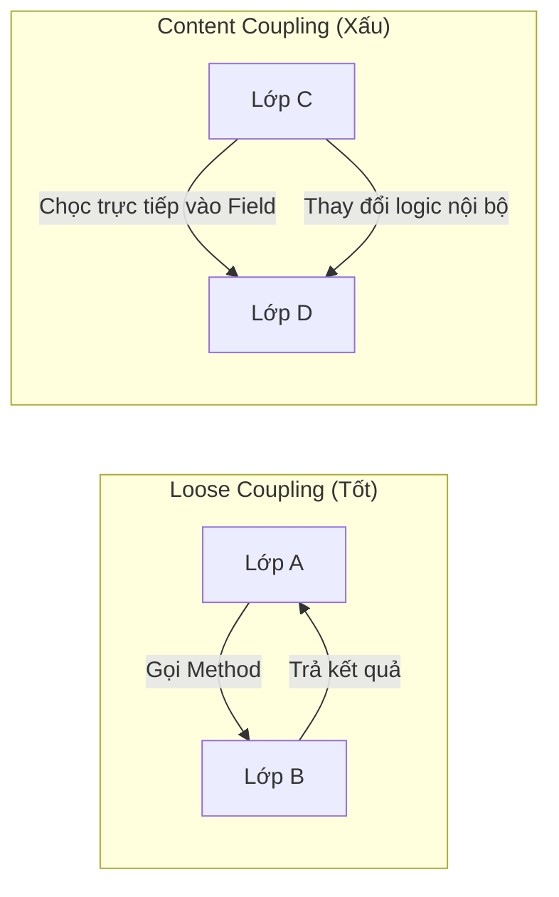

# Content Coupling: Mức độ nguy hiểm nhất

Trong phân cấp các loại Coupling (liên kết), **Content Coupling** (hay còn gọi là Pathological Coupling - Liên kết bệnh lý) đứng ở vị trí tồi tệ nhất. Nếu hệ thống của bạn xuất hiện loại liên kết này, nó không chỉ đơn thuần là "mã nguồn xấu" mà là một quả bom hẹn giờ cho sự ổn định và khả năng bảo trì của phần mềm. Bài học này sẽ đi sâu vào việc nhận diện, phân tích tác hại và cách triệt tiêu Content Coupling trong ngôn ngữ Java.

## Mục tiêu

*   **Nhận diện:** Xác định chính xác các biểu hiện của Content Coupling trong mã nguồn Java thông qua truy cập field trực tiếp hoặc Reflection.
*   **Phân tích hệ quả:** Hiểu rõ tại sao Content Coupling phá vỡ tính đóng gói (Encapsulation) và gây ra lỗi lan truyền (Ripple Effects).
*   **Làm chủ kỹ thuật Refactoring:** Áp dụng nguyên lý "Tell, Don't Ask" và các kỹ thuật đóng gói để chuyển đổi từ Content Coupling sang các dạng liên kết lỏng lẻo (Loose Coupling) an toàn hơn.
*   **Xây dựng tư duy phòng ngừa:** Thiết lập các quy tắc thiết kế để ngăn chặn việc can thiệp vào nội bộ của các lớp khác ngay từ giai đoạn viết code.

## 1. Content Coupling là gì?

Content Coupling xảy ra khi một module (lớp) thay đổi hoặc dựa trực tiếp vào các thành phần nội bộ của một module khác. Thay vì giao tiếp qua các giao diện (interface) hoặc phương thức công khai (public methods), lớp A lại "thò tay" vào bên trong lớp B để đọc hoặc ghi dữ liệu, thậm chí là thay đổi luồng thực thi của lớp B.

Trong Java, điều này thường xuất hiện dưới hai hình thức phổ biến nhất:
1.  Truy cập trực tiếp vào các biến thực thể (instance variables) được khai báo là `public`.
2.  Sử dụng Java Reflection API để vượt qua rào cản `private` và can thiệp vào trạng thái nội bộ.

### Sơ đồ minh họa sự khác biệt



## 2. Truy cập trực tiếp Public Field: Sai lầm kinh điển

Nhiều lập trình viên mới thường có thói quen để các field là `public` để "tiện" cho việc sử dụng. Tuy nhiên, đây là cách nhanh nhất để tạo ra Content Coupling.

### Ví dụ thực tế: Hệ thống quản lý tài khoản ngân hàng

Giả sử chúng ta có lớp `BankAccount` với một field `public`:

```java
// Lớp bị phụ thuộc (Dependent Class)
public class BankAccount {
    public double balance; // Content Coupling Trigger
    
    public BankAccount(double balance) {
        this.balance = balance;
    }
}

// Lớp gây ra Coupling
public class ATMService {
    public void withdraw(BankAccount account, double amount) {
        if (account.balance >= amount) { // Truy cập trực tiếp
            account.balance -= amount;   // Thay đổi trực tiếp trạng thái nội bộ
        }
    }
}
```

**Tại sao đoạn code trên lại nguy hiểm?**

1.  **Mất kiểm soát logic (Broken Invariants):** Lớp `BankAccount` không thể đảm bảo số dư (`balance`) không bao giờ âm. Bất kỳ lớp nào khác cũng có thể gán `account.balance = -1000000;` mà `BankAccount` không hề hay biết.
2.  **Khó thay đổi cấu trúc:** Nếu sau này bạn muốn đổi kiểu dữ liệu của `balance` từ `double` sang `BigDecimal` (để chính xác hơn trong tài chính), bạn sẽ phải sửa code ở tất cả những nơi đang truy cập trực tiếp vào field này. 
3.  **Vi phạm tính đóng gói:** `BankAccount` không còn là một "hộp đen". Nó phơi bày ruột gan cho cả thế giới can thiệp.

## 3. Hiểm họa từ Reflection: Content Coupling "ngầm"

Reflection là một công cụ mạnh mẽ trong Java, nhưng khi dùng để thay đổi `private state`, nó tạo ra loại Content Coupling nguy hiểm nhất vì nó không lộ diện ở thời điểm biên dịch (compile-time).

### Ví dụ về việc phá vỡ rào cản Private

```java
public class SecretVault {
    private String secretCode = "SUPER-SECRET";
}

public class HackerTool {
    public void crackVault(SecretVault vault) throws Exception {
        Field field = SecretVault.class.getDeclaredField("secretCode");
        field.setAccessible(true); // Phá vỡ tính đóng gói
        
        // Thay đổi giá trị private mà không qua bất kỳ phương thức nào
        field.set(vault, "CRACKED-BY-HACKER");
        
        System.out.println("New code: " + field.get(vault));
    }
}
```

**Hệ quả của việc lạm dụng Reflection:**
*   **Runtime Failure:** Nếu tên field `secretCode` bị đổi thành `vaultKey`, mã nguồn vẫn biên dịch bình thường nhưng sẽ bị crash ở runtime với `NoSuchFieldException`.
*   **Security Risk:** Phá vỡ các chính sách bảo mật của ứng dụng.
*   **Opaque Logic:** Người đọc code không thể hiểu tại sao giá trị của một biến `private` lại bị thay đổi mà không có setter hay logic nội bộ nào tác động.

## 4. Tại sao Content Coupling là vi phạm nghiêm trọng nhất?

Để định lượng sự nguy hiểm, hãy xem xét bảng so sánh sau:

| Đặc điểm | Content Coupling | Data/Message Coupling (Lý tưởng) |
| :--- | :--- | :--- |
| **Tính đóng gói** | Bị phá hủy hoàn toàn | Được bảo vệ nghiêm ngặt |
| **Khả năng bảo trì** | Cực thấp (Thay đổi nhỏ gây lỗi lớn) | Cao (Thay đổi nội bộ không ảnh hưởng bên ngoài) |
| **Khả năng Unit Test** | Khó khăn vì trạng thái bị thay đổi tùy tiện | Dễ dàng thông qua Mocking/Stubbing |
| **Sự phụ thuộc** | Phụ thuộc vào cấu trúc (Structure) | Phụ thuộc vào hành vi (Behavior) |

Khi một lớp can thiệp vào nội dung của lớp khác, chúng ta tạo ra một mối quan hệ "cộng sinh độc hại". Lớp A không chỉ biết lớp B làm gì, mà còn biết lớp B được cấu tạo như thế nào. $Coupling_{Content} \rightarrow \infty$ đồng nghĩa với việc $Maintainability \rightarrow 0$.

## 5. Chiến lược Refactoring: Từ Content đến Loose Coupling

Để loại bỏ Content Coupling, chúng ta cần thực hiện hai bước chính: **Encapsulation** (Đóng gói) và áp dụng nguyên lý **Tell, Don't Ask**.

### Bước 1: Che giấu trạng thái (Encapsulation)

Chuyển tất cả các field sang `private`. Đây là quy tắc bất di bất dịch trong Java.

```java
public class BankAccount {
    private double balance; // Đã an toàn

    public double getBalance() {
        return balance;
    }
}
```

### Bước 2: Thay thế việc can thiệp bằng hành vi (Tell, Don't Ask)

Thay vì lấy dữ liệu ra để xử lý (Ask), hãy yêu cầu đối tượng thực hiện hành động đó (Tell).

**Refactored Code:**

```java
public class BankAccount {
    private double balance;

    // Logic nghiệp vụ nằm tại nơi quản lý dữ liệu
    public void withdraw(double amount) {
        if (amount <= 0) throw new IllegalArgumentException("Số tiền phải dương");
        if (this.balance < amount) throw new IllegalStateException("Không đủ số dư");
        
        this.balance -= amount;
    }
}

public class ATMService {
    public void processWithdrawal(BankAccount account, double amount) {
        // Chỉ gọi phương thức, không quan tâm balance được lưu thế nào
        account.withdraw(amount);
    }
}
```

### Lợi ích sau khi Refactor:
1.  **Tính toàn vẹn dữ liệu:** `BankAccount` tự kiểm soát điều kiện rút tiền. Không ai có thể rút quá số dư hoặc rút số tiền âm.
2.  **Tính linh hoạt:** Nếu bạn đổi `balance` từ `double` sang một đối tượng `Money` phức tạp, bạn chỉ cần sửa bên trong lớp `BankAccount`. Lớp `ATMService` hoàn toàn không bị ảnh hưởng.
3.  **Dễ kiểm thử:** Bạn có thể dễ dàng viết Unit Test cho `withdraw` trong `BankAccount` với các trường hợp biên.

## 6. Khi nào Content Coupling có thể chấp nhận được?

Trong thực tế, có rất ít trường hợp Content Coupling được chấp nhận. Tuy nhiên, có một số ngoại lệ đặc biệt:
*   **Các Framework/Library cực kỳ chuyên biệt:** Ví dụ như các thư viện Serialization (Jackson, GSON) hoặc các ORM (Hibernate). Chúng buộc phải dùng Reflection để map dữ liệu vào các private field của POJO. Tuy nhiên, đây là sự đánh đổi có tính toán ở tầng hạ tầng (infrastructure), không phải ở tầng nghiệp vụ (business logic).
*   **Inner Classes:** Đôi khi một lớp lồng (inner class) truy cập trực tiếp vào field của lớp bao ngoài. Vì chúng được coi là một đơn vị logic duy nhất, mức độ nguy hiểm thấp hơn nhưng vẫn nên hạn chế.

## Tóm tắt

*   **Content Coupling** xảy ra khi một lớp can thiệp trực tiếp vào dữ liệu hoặc logic nội bộ của lớp khác.
*   **Biểu hiện:** Public fields và lạm dụng Reflection để thay đổi private state.
*   **Tác hại:** Phá vỡ tính đóng gói, gây lỗi khó tìm (runtime errors), và khiến hệ thống cực kỳ khó bảo trì.
*   **Giải pháp:** Luôn sử dụng access modifier `private`, cung cấp các public method có ý nghĩa nghiệp vụ, và tuân thủ nguyên lý "Tell, Don't Ask".

## Câu hỏi tự kiểm tra

1. **Câu hỏi:** Tại sao việc sử dụng `public` field lại được coi là Content Coupling dù Java cho phép điều đó?
   <details><summary>Đáp án</summary>Vì khi một field là public, bất kỳ lớp nào bên ngoài cũng có thể thay đổi giá trị của nó mà không thông qua sự kiểm soát của lớp chủ quản. Điều này khiến lớp chủ quản không thể đảm bảo tính đúng đắn của dữ liệu (Invariants) và tạo ra sự phụ thuộc chặt chẽ vào cấu trúc dữ liệu thay vì hành vi.</details>

2. **Câu hỏi:** Trong trường hợp nào Reflection gây ra Content Coupling?
   <details><summary>Đáp án</summary>Reflection gây ra Content Coupling khi nó được dùng để gọi <code>setAccessible(true)</code> nhằm truy cập và thay đổi các field hoặc method được đánh dấu là <code>private</code>. Điều này tạo ra một liên kết ngầm định dựa trên tên biến/phương thức vốn dĩ không dành cho bên ngoài.</details>

3. **Câu hỏi:** Nguyên lý "Tell, Don't Ask" giúp giảm Content Coupling như thế nào?
   <details><summary>Đáp án</summary>Thay vì yêu cầu đối tượng cung cấp dữ liệu nội bộ để mình tự xử lý (Ask), ta yêu cầu đối tượng thực hiện một hành động cụ thể (Tell). Điều này giúp logic nghiệp vụ ở đúng nơi nó thuộc về (cùng với dữ liệu) và che giấu chi tiết triển khai bên trong.</details>

4. **Câu hỏi:** Nếu tôi sử dụng Lombok với `@Data` (tự động tạo Getter/Setter cho mọi field), tôi có đang tạo ra Content Coupling không?
   <details><summary>Đáp án</summary>Mặc dù sử dụng Getter/Setter là tốt hơn public field (vì bạn có thể thêm logic kiểm tra vào setter sau này), nhưng việc cung cấp Setter vô tội vạ cho mọi field vẫn có thể dẫn đến một dạng liên kết chặt chẽ về dữ liệu. Tốt nhất chỉ nên cung cấp Setter cho những gì thực sự cần thay đổi từ bên ngoài và ưu tiên các phương thức mang tính hành động (như <code>activate()</code> thay vì <code>setStatus(true)</code>).</details>