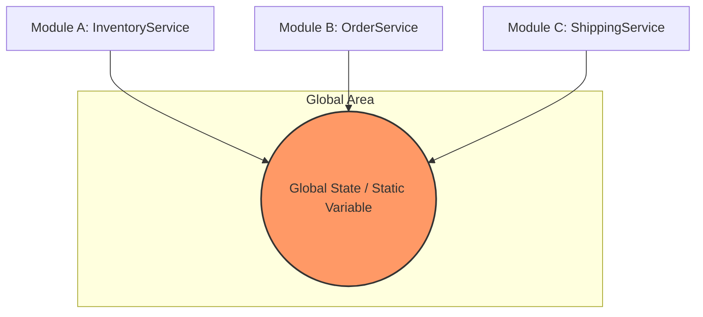

# Common Coupling: Hiểm họa từ Global State

## Mục tiêu
- Nhận diện bản chất của Common Coupling thông qua việc sử dụng biến toàn cục và tài nguyên dùng chung.
- Phân tích các rủi ro tiềm tàng về tính toàn vẹn dữ liệu và khó khăn trong việc bảo trì hệ thống.
- Hiểu rõ tác động tiêu cực của Global State trong môi trường đa luồng (Multi-threading).
- Làm chủ kỹ thuật tái cấu trúc từ Common Coupling sang Dependency Injection để tăng tính linh hoạt và khả năng kiểm thử.

## 1. Khái niệm Common Coupling trong Java

Common Coupling (Liên kết chung) xảy ra khi hai hoặc nhiều module cùng truy cập vào một vùng dữ liệu chung (global data). Trong Java, điều này thường thể hiện qua việc sử dụng các biến `public static`, các hằng số có thể thay đổi, hoặc các đối tượng Singleton nắm giữ trạng thái (stateful singletons).

Khác với Data Coupling (nơi dữ liệu được truyền tường minh qua tham số), Common Coupling tạo ra một sợi dây liên kết ngầm giữa các lớp. Khi một lớp thay đổi dữ liệu chung, tất cả các lớp khác sử dụng dữ liệu đó đều bị ảnh hưởng mà không hề có sự thông báo rõ ràng.



## 2. Biến Static Public: Cánh cửa dẫn đến sự hỗn loạn

Trong lập trình Java, từ khóa `static` cho phép một biến tồn tại ở cấp độ lớp thay vì cấp độ đối tượng. Khi kết hợp với `public`, biến này trở thành một "biến toàn cục" mà bất kỳ đâu trong ứng dụng cũng có thể đọc và ghi.

### Ví dụ về thiết kế tồi
Giả sử chúng ta có một lớp quản lý cấu hình hệ thống:

```java
public class SystemSettings {
    public static String currentTheme = "LIGHT";
    public static int maxConnections = 10;
}
```

Bất kỳ lớp nào cũng có thể thay đổi các giá trị này:

```java
public class ThemeManager {
    public void updateTheme(String newTheme) {
        SystemSettings.currentTheme = newTheme; // Thay đổi trực tiếp
    }
}

public class DatabaseService {
    public void connect() {
        int limit = SystemSettings.maxConnections; // Phụ thuộc vào trạng thái toàn cục
        // ... logic kết nối
    }
}
```

**Hệ lụy:**
1.  **Tính khó đoán (Unpredictability):** Bạn không bao giờ biết chắc `currentTheme` đang có giá trị gì vì bất kỳ class nào cũng có quyền thay đổi nó tại bất kỳ thời điểm nào.
2.  **Khó gỡ lỗi (Debugging Nightmare):** Khi `maxConnections` bị sai giá trị, bạn phải rà soát toàn bộ dự án để tìm xem đoạn mã nào đã gán lại giá trị đó.
3.  **Vi phạm tính đóng gói:** Trạng thái bên trong của `SystemSettings` bị phơi bày hoàn toàn, không có cơ chế kiểm soát (validation) khi dữ liệu thay đổi.

## 3. Hiểm họa trong môi trường đa luồng (Multi-threading)

Common Coupling đặc biệt nguy hiểm trong các ứng dụng Java hiện đại (như Web Spring Boot) nơi nhiều luồng (threads) chạy song song. Khi nhiều luồng cùng truy cập và sửa đổi một biến `static`, hiện tượng **Race Condition** là không tránh khỏi.

### Phân tích xung đột dữ liệu

```java
public class GlobalCounter {
    public static int count = 0;
}

// Trong một Controller hoặc Service
public void increment() {
    GlobalCounter.count++; // Phép toán này không nguyên tử (not atomic)
}
```

Phép toán `count++` thực chất gồm 3 bước: Đọc giá trị -> Tăng giá trị -> Ghi lại giá trị. Nếu hai luồng cùng thực hiện bước "Đọc" tại cùng một thời điểm, cả hai sẽ cùng ghi lại một giá trị giống nhau, dẫn đến mất mát dữ liệu.

| Luồng 1 | Luồng 2 | Giá trị count |
| :--- | :--- | :--- |
| Đọc count (0) | | 0 |
| | Đọc count (0) | 0 |
| Tăng lên 1 | | 0 |
| Ghi lại (1) | | 1 |
| | Tăng lên 1 | 1 |
| | Ghi lại (1) | 1 (Sai, lẽ ra phải là 2) |

Để giải quyết, lập trình viên thường dùng `synchronized` hoặc `AtomicInteger`. Tuy nhiên, điều này chỉ giải quyết phần ngọn (tính an toàn luồng) mà không giải quyết được phần gốc: **Sự phụ thuộc quá chặt chẽ vào trạng thái dùng chung.**

## 4. Singleton Pattern bị lạm dụng: "God Object" trá hình

Singleton Pattern được thiết kế để đảm bảo một lớp chỉ có một thực thể duy nhất. Tuy nhiên, nếu Singleton nắm giữ trạng thái (stateful), nó sẽ trở thành một biến toàn cục trá hình, gây ra Common Coupling trầm trọng.

### Ví dụ về lạm dụng Singleton

```java
public class UserSessionManager {
    private static UserSessionManager instance;
    private User currentUser;

    private UserSessionManager() {}

    public static UserSessionManager getInstance() {
        if (instance == null) instance = new UserSessionManager();
        return instance;
    }

    public void setCurrentUser(User user) { this.currentUser = user; }
    public User getCurrentUser() { return this.currentUser; }
}
```

Khi `OrderService` gọi `UserSessionManager.getInstance().getCurrentUser()`, nó đang tạo ra một liên kết ẩn. 

**Vấn đề với Unit Test:**
Khi viết kiểm thử cho `OrderService`, bạn rất khó giả lập (mock) `UserSessionManager` vì lời gọi là `static`. Hơn nữa, trạng thái của Singleton có thể tồn tại từ test case này sang test case khác, gây ra hiện tượng "Test Pollution" (kết quả test này ảnh hưởng đến test kia).

## 5. Giải pháp: Từ Common Coupling sang Dependency Injection

Để phá vỡ Common Coupling, chúng ta cần áp dụng nguyên lý **Inversion of Control (IoC)** thông qua **Dependency Injection (DI)**. Thay vì các module tự tìm đến dữ liệu chung, chúng ta sẽ cung cấp dữ liệu đó thông qua Constructor.

### Bước 1: Chuyển đổi Global State thành Object cụ thể

```java
// Thay vì static, hãy dùng một class bình thường
public class AppConfig {
    private String theme;
    private int maxConnections;

    public AppConfig(String theme, int maxConnections) {
        this.theme = theme;
        this.maxConnections = maxConnections;
    }
    // Getters và Setters có validation
}
```

### Bước 2: Sử dụng Constructor Injection

```java
public class DatabaseService {
    private final AppConfig config;

    // Yêu cầu config thông qua constructor
    public DatabaseService(AppConfig config) {
        this.config = config;
    }

    public void connect() {
        int limit = config.getMaxConnections();
        // ...
    }
}
```

### Lợi ích thu được:
- **Tính minh bạch:** Nhìn vào constructor, bạn biết ngay `DatabaseService` cần gì để hoạt động.
- **Dễ dàng Unit Test:** Bạn có thể dễ dàng tạo một đối tượng `AppConfig` giả (mock) để truyền vào.
- **Thread Safety:** Bạn có thể quản lý vòng đời của `AppConfig` thông qua các IoC Container (như Spring) để đảm bảo nó được khởi tạo đúng cách và an toàn.
- **Giảm Coupling:** `DatabaseService` không còn phụ thuộc vào lớp cụ thể `SystemSettings` mà phụ thuộc vào một thực thể (instance) cụ thể được truyền vào.

## Tóm tắt
- **Common Coupling** là việc chia sẻ trạng thái toàn cục (Global State) giữa các module.
- **Biến static public** là hình thức phổ biến nhất của Common Coupling trong Java, gây mất kiểm soát luồng dữ liệu.
- **Xung đột đa luồng** và **khó khăn trong Unit Test** là hai hậu quả nghiêm trọng nhất.
- **Singleton** không phải là giải pháp cho toàn cục, nó thường là nguyên nhân nếu bị lạm dụng để lưu trữ trạng thái.
- **Dependency Injection** là phương thuốc hữu hiệu nhất để chuyển đổi từ Common Coupling sang Loose Coupling.

## Câu hỏi tự kiểm tra

1. Tại sao Common Coupling lại làm tăng rủi ro khi thực hiện bảo trì mã nguồn?
<details><summary>Đáp án</summary>Vì khi thay đổi cấu trúc hoặc giá trị của dữ liệu chung, lập trình viên không thể biết hết được những module nào sẽ bị ảnh hưởng, dẫn đến các lỗi tiềm ẩn (side effects) ở những vị trí không ngờ tới.</details>

2. Trong môi trường Multi-threading, tại sao việc sử dụng biến static để đếm số lượng truy cập lại thường cho kết quả sai?
<details><summary>Đáp án</summary>Do hiện tượng Race Condition. Các thao tác tăng giá trị biến static không mang tính nguyên tử (atomic), dẫn đến việc nhiều luồng cùng đọc một giá trị cũ và ghi đè lên nhau.</details>

3. Làm thế nào để Unit Test một lớp có sử dụng lời gọi đến một Stateful Singleton?
<details><summary>Đáp án</summary>Rất khó khăn. Cách tốt nhất là tái cấu trúc (refactor) mã nguồn để truyền Singleton đó vào qua Constructor (Dependency Injection), cho phép thay thế bằng một Mock object trong quá trình test.</details>

4. Sự khác biệt chính giữa Data Coupling và Common Coupling là gì?
<details><summary>Đáp án</summary>Data Coupling truyền dữ liệu tường minh qua tham số hàm (rõ ràng, phạm vi hẹp), trong khi Common Coupling chia sẻ dữ liệu qua một vùng nhớ chung (ẩn khuất, phạm vi toàn cục).</details>