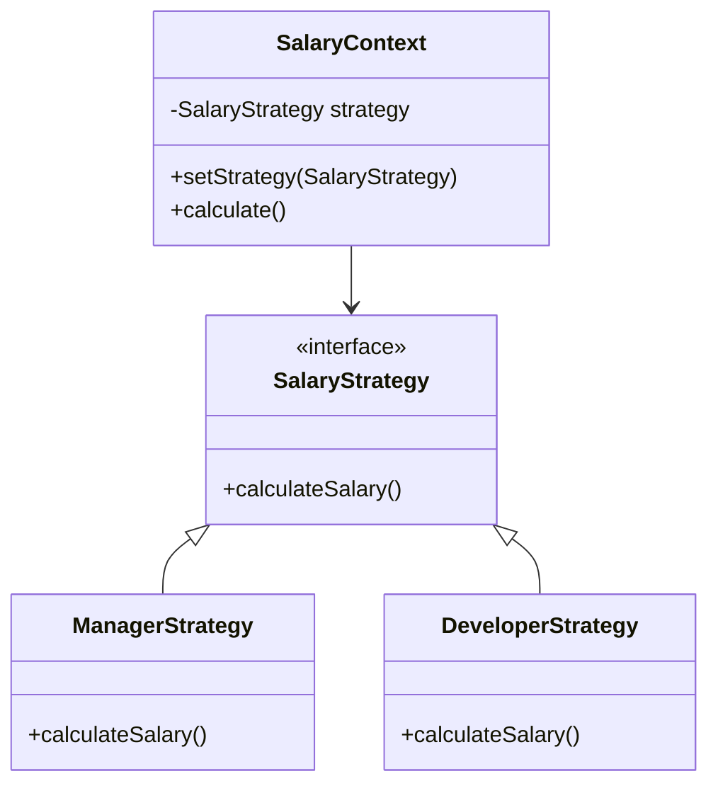

# Control Coupling: Sự lệ thuộc vào luồng xử lý

Trong kiến trúc phần mềm, việc các thành phần giao tiếp với nhau là điều tất yếu. Tuy nhiên, cách thức chúng giao tiếp sẽ quyết định hệ thống đó bền vững hay dễ đổ vỡ. **Control Coupling** (Phụ thuộc điều khiển) là một trong những loại Coupling (khớp nối) phổ biến và nguy hiểm nhất, nơi một phương thức không chỉ truyền dữ liệu mà còn cố gắng "chỉ tay năm ngón", điều khiển luồng thực thi bên trong của một phương thức khác.

## Mục tiêu
*   Nhận diện các dấu hiệu của Control Coupling thông qua tham số (Flag arguments).
*   Hiểu rõ tại sao Control Coupling vi phạm nguyên lý Single Responsibility Principle (SRP) và Open/Closed Principle (OCP).
*   Thực hành kỹ thuật Refactoring để loại bỏ sự lệ thuộc vào luồng xử lý bằng Polymorphism (Đa hình) và Strategy Pattern.
*   Nâng cao khả năng thiết kế API rõ ràng, minh bạch trong Java.

## 1. Bản chất của Control Coupling

Control Coupling xảy ra khi một Module A truyền một phần tử điều khiển (thường là một flag, một hằng số, hoặc một mã lệnh) cho Module B để chỉ thị cho Module B phải thực hiện logic nào. 

Nói cách khác, Module A biết quá nhiều về cấu trúc bên trong của Module B. Thay vì yêu cầu Module B thực hiện một nhiệm vụ cụ thể, Module A lại nói: "Hãy chạy đi, và nếu tôi đưa cho anh giá trị true, hãy làm việc X; nếu tôi đưa false, hãy làm việc Y".

### Tại sao nó lại là vấn đề?
1.  **Tính đóng gói bị phá vỡ:** Module B không còn tự chủ về logic của mình.
2.  **Khó bảo trì:** Nếu logic của Module B thay đổi hoặc có thêm trường hợp thứ ba (Z), bạn phải quay lại sửa đổi cả Module A và chữ ký phương thức (method signature) của Module B.
3.  **Khó kiểm thử (Unit Test):** Một phương thức có Control Coupling thường chứa các khối `if-else` hoặc `switch-case` phức tạp, làm tăng độ phức tạp tính toán (Cyclomatic Complexity).

## 2. Nhận diện Flag Arguments

Flag arguments (tham số cờ hiệu) là dấu hiệu rõ ràng nhất của Control Coupling. Thông thường, đây là các biến `boolean` hoặc `enum` được truyền vào phương thức.

### Ví dụ minh họa (Bad Practice)
Giả sử bạn có một hệ thống xử lý đơn hàng:

```java
public class OrderService {
    public void processOrder(Order order, boolean isInternational) {
        if (isInternational) {
            // Logic phức tạp cho đơn hàng quốc tế: thuế quan, vận chuyển biển...
            System.out.println("Processing international order with customs check.");
        } else {
            // Logic đơn giản cho đơn hàng nội địa
            System.out.println("Processing domestic order.");
        }
    }
}
```

Ở đây, người gọi (Caller) phải biết rõ hệ thống có hai luồng xử lý khác nhau và phải tự mình quyết định xem đơn hàng đó có phải là quốc tế hay không để truyền vào `true/false`. Phương thức `processOrder` đang làm hai việc khác nhau hoàn toàn, vi phạm SRP.

## 3. Lệ thuộc vào trạng thái của Object khác (External Control)

Một dạng khác của Control Coupling là khi một phương thức sử dụng `switch-case` dựa trên một thuộc tính trạng thái của đối tượng được truyền vào để quyết định logic.

### Ví dụ về tính lương (Bad Practice)

```java
public class SalaryCalculator {
    public double calculateSalary(Employee e) {
        // Control coupling dựa trên type của Employee
        switch (e.getRole()) {
            case MANAGER:
                return e.getBaseSalary() * 1.5 + e.getBonus();
            case DEVELOPER:
                return e.getBaseSalary() + (e.getOvertimeHours() * 20);
            case INTERN:
                return 500.0; // Lương cứng cho thực tập sinh
            default:
                throw new IllegalArgumentException("Unknown role");
        }
    }
}
```

Trong ví dụ này, `SalaryCalculator` bị phụ thuộc chặt chẽ vào cấu trúc của `Employee`. Mỗi khi công ty thêm một vị trí mới (ví dụ: `DESIGNER`), bạn phải tìm đến phương thức này để sửa đổi. Đây chính là biểu hiện của sự thiếu linh hoạt.

## 4. Giải pháp Refactoring: Từ Control đến Autonomy

Để giải quyết Control Coupling, chúng ta cần chuyển dịch quyền điều khiển từ phía người gọi sang phía đối tượng thực thi hoặc sử dụng các cấu trúc thiết kế hướng đối tượng.

### Giải pháp 1: Tách phương thức (Method Splitting)
Thay vì một phương thức nhận flag, hãy tách thành hai phương thức riêng biệt với tên gọi tường minh.

```java
// Trước
service.processOrder(order, true);

// Sau (Clean hơn)
service.processInternationalOrder(order);
service.processDomesticOrder(order);
```

### Giải pháp 2: Sử dụng Polymorphism (Đa hình)
Đây là cách tiếp cận kinh điển để loại bỏ `switch-case` và `if-else` điều khiển.

```java
public interface Employee {
    double calculateSalary();
}

public class Manager implements Employee {
    @Override
    public double calculateSalary() {
        return baseSalary * 1.5 + bonus;
    }
}

public class Developer implements Employee {
    @Override
    public double calculateSalary() {
        return baseSalary + (overtimeHours * 20);
    }
}
```

Lúc này, mã nguồn ở lớp xử lý chỉ đơn giản là: `double salary = employee.calculateSalary();`. Lớp xử lý không cần biết `employee` là ai, nó chỉ cần biết đối tượng đó có khả năng tính lương.

### Giải pháp 3: Strategy Pattern
Nếu logic tính toán không nằm trong đối tượng dữ liệu, hãy sử dụng Strategy Pattern.



## 5. Phân tích sâu: Control Coupling vs. Data Coupling

Cần phân biệt rõ hai loại này để tránh nhầm lẫn. 

| Đặc điểm | Control Coupling | Data Coupling |
| :--- | :--- | :--- |
| **Dữ liệu truyền vào** | Flag, mã lệnh, Enum trạng thái. | Dữ liệu thô (String, int, Object). |
| **Mục đích** | Chỉ định "cách thức" thực hiện. | Cung cấp thông tin để xử lý. |
| **Tác động** | Thay đổi luồng logic bên trong. | Không thay đổi luồng, chỉ dùng để tính toán. |
| **Mức độ nguy hiểm** | Cao (Vi phạm SRP/OCP). | Thấp (Chấp nhận được). |

**Công thức đánh giá:**
Nếu bạn có thể thay đổi giá trị của tham số truyền vào mà không làm thay đổi các dòng code nào được thực thi (chỉ thay đổi kết quả đầu ra), đó là **Data Coupling**. Nếu thay đổi giá trị dẫn đến việc nhảy vào một nhánh `if` khác, đó là **Control Coupling**.

## 6. Lợi ích khi loại bỏ Control Coupling

1.  **Mã nguồn dễ đọc hơn:** Không còn những phương thức dài dằng dặc với các khối logic lồng nhau.
2.  **Dễ mở rộng:** Thêm tính năng mới bằng cách thêm class mới (Add new code), thay vì sửa code cũ (Change existing code).
3.  **Unit Test tập trung:** Bạn có thể viết test cho từng Strategy hoặc từng lớp con một cách độc lập mà không cần phải giả lập (mock) quá nhiều trạng thái điều khiển.

## Tóm tắt
*   **Control Coupling** xảy ra khi một module điều khiển luồng thực thi của module khác thông qua tham số.
*   **Dấu hiệu nhận biết:** Các tham số kiểu boolean (flags), enum điều hướng, hoặc switch-case dựa trên thuộc tính của đối tượng khác.
*   **Hệ quả:** Vi phạm SRP, OCP, làm code trở nên cứng nhắc và khó kiểm thử.
*   **Cách khắc phục:** Tách phương thức, áp dụng tính Đa hình (Polymorphism) hoặc sử dụng các Design Pattern như Strategy, State để đóng gói logic riêng biệt.

## Câu hỏi tự kiểm tra

1. **Câu hỏi:** Tại sao việc truyền một biến `boolean` vào phương thức thường được coi là một "Code Smell" liên quan đến Control Coupling?
   <details><summary>Đáp án</summary>Vì biến boolean thường ép phương thức phải chứa một cấu trúc rẽ nhánh (if-else). Điều này có nghĩa là phương thức đó đang thực hiện ít nhất hai nhiệm vụ khác nhau tùy thuộc vào giá trị của flag, vi phạm nguyên lý Đơn nhiệm (SRP) và làm tăng sự phụ thuộc của người gọi vào logic nội bộ của phương thức đó.</details>

2. **Câu hỏi:** Trong Java, nếu một phương thức nhận vào một `Enum` để quyết định thực hiện phép tính cộng, trừ, nhân, hay chia, đây có phải là Control Coupling không? Làm thế nào để refactor?
   <details><summary>Đáp án</summary>Có, đây là Control Coupling. Cách refactor tốt nhất là sử dụng Đa hình: định nghĩa một Interface <code>Operation</code> với phương thức <code>execute(a, b)</code>, sau đó tạo các lớp thực thi như <code>Addition</code>, <code>Subtraction</code>. Hoặc có thể định nghĩa logic ngay trong Enum nếu Java Enum đó triển khai một interface.</details>

3. **Câu hỏi:** Control Coupling ảnh hưởng như thế nào đến Unit Testing?
   <details><summary>Đáp án</summary>Nó làm tăng số lượng kịch bản kiểm thử (test cases) cho một phương thức duy nhất. Thay vì test một logic tập trung, bạn phải thiết lập nhiều trạng thái đầu vào khác nhau để bao phủ hết các nhánh <code>if-else</code>, dẫn đến bộ test khó duy trì và dễ bị hỏng khi logic điều khiển thay đổi.</details>

4. **Câu hỏi:** Có trường hợp nào Control Coupling là chấp nhận được không?
   <details><summary>Đáp án</summary>Trong các hệ thống cực kỳ đơn giản hoặc các thư viện cấp thấp (low-level utility) nơi hiệu năng là ưu tiên hàng đầu và logic rất ít khi thay đổi, việc sử dụng một vài flag có thể chấp nhận được để tránh overhead của việc tạo quá nhiều object/interface. Tuy nhiên, trong kiến trúc ứng dụng doanh nghiệp, nên hạn chế tối đa.</details>