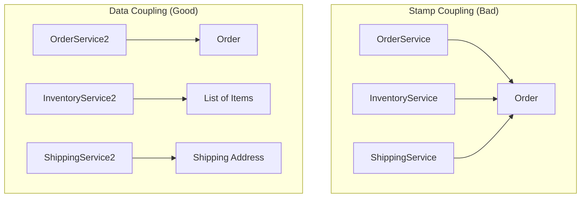

# Stamp Coupling và Data Coupling

Trong thiết kế phần mềm, cách thức các module trao đổi dữ liệu quyết định trực tiếp đến độ bền vững và khả năng mở rộng của hệ thống. Trong khi các bài học trước đã đề cập đến những loại coupling nguy hiểm như Global State hay Control Coupling, bài học này sẽ đi sâu vào ranh giới giữa **Stamp Coupling** và **Data Coupling**. Đây là hai mức độ tương tác phổ biến nhất trong lập trình hướng đối tượng (OOP), nơi việc lựa chọn sai lầm có thể dẫn đến hiện tượng "Interface Pollution" (ô nhiễm giao diện) và làm khó khăn cho quá trình Unit Test.

## Mục tiêu bài học

*   Phân biệt rõ ràng giữa Stamp Coupling (truyền cấu trúc) và Data Coupling (truyền dữ liệu).
*   Nhận diện các dấu hiệu của Stamp Coupling trong mã nguồn Java thực tế.
*   Hiểu rõ tác động tiêu cực của việc truyền thừa dữ liệu đối với tính đóng gói và bảo trì.
*   Nắm vững kỹ thuật Refactoring để chuyển đổi từ Stamp sang Data Coupling nhằm tối ưu hóa thiết kế.
*   Phân tích bài toán thực tế về xử lý đơn hàng (Order) để áp dụng kiến thức.

---

## 1. Stamp Coupling: Khi chúng ta đưa quá nhiều

### Định nghĩa
**Stamp Coupling** (còn gọi là Data-Structured Coupling) xảy ra khi một phương thức chấp nhận một cấu trúc dữ liệu phức tạp (một Object, một Class, hoặc một Record) làm đối số, nhưng thực tế nó chỉ sử dụng một phần nhỏ các thuộc tính của cấu trúc đó.

Trong Java, điều này thường thấy khi lập trình viên lười biếng hoặc muốn "tiện tay" truyền cả một Entity từ Database vào các Service tầng dưới.

### Ví dụ minh họa
Giả sử chúng ta có một lớp `User` chứa rất nhiều thông tin cá nhân và một service gửi email thông báo.

```java
// Lớp User chứa quá nhiều thông tin
public class User {
    private Long id;
    private String username;
    private String email;
    private String address;
    private LocalDate dateOfBirth;
    private String passwordHash;
    // Getters...
}

// Service gửi email
public class EmailService {
    // Stamp Coupling: Truyền cả User chỉ để lấy Email
    public void sendWelcomeEmail(User user) {
        String email = user.getEmail();
        System.out.println("Sending email to: " + email);
        // Logic gửi mail...
    }
}
```

### Tại sao Stamp Coupling lại là vấn đề?
1.  **Sự phụ thuộc ẩn (Hidden Dependency):** `EmailService` bây giờ phụ thuộc vào toàn bộ cấu trúc của `User`. Nếu bạn đổi tên field `email` trong lớp `User` thành `primaryEmail`, bạn buộc phải sửa đổi cả `EmailService` dù logic gửi mail không hề thay đổi.
2.  **Khó khăn khi Unit Test:** Để test phương thức `sendWelcomeEmail`, bạn phải khởi tạo một đối tượng `User` đầy đủ (hoặc Mock nó). Nếu `User` có các ràng buộc phức tạp trong constructor, việc viết test trở nên cồng kềnh.
3.  **Vi phạm nguyên lý Least Privilege:** `EmailService` không cần biết mật khẩu hay ngày sinh của người dùng, nhưng Stamp Coupling đã "phơi bày" toàn bộ thông tin đó cho nó.

---

## 2. Data Coupling: Sự tinh gọn tối đa

### Định nghĩa
**Data Coupling** xảy ra khi các module chỉ trao đổi với nhau thông qua các tham số dữ liệu đơn lẻ (primitive types) hoặc các cấu trúc dữ liệu mà mọi thành phần của nó đều được sử dụng. Đây được coi là mức độ coupling tốt nhất (ngoại trừ Message Coupling) vì nó giữ cho các thành phần độc lập tối đa.

### Refactoring ví dụ trên

```java
public class EmailService {
    // Data Coupling: Chỉ truyền đúng thứ cần thiết
    public void sendWelcomeEmail(String email) {
        System.out.println("Sending email to: " + email);
        // Logic gửi mail...
    }
}
```

Lúc này, `EmailService` hoàn toàn không biết gì về lớp `User`. Nó có thể được tái sử dụng để gửi mail cho `Admin`, `Partner`, hoặc bất kỳ chuỗi String nào hợp lệ.

---

## 3. Vấn đề Interface Pollution (Ô nhiễm giao diện)

Stamp Coupling dẫn đến một hệ lụy nghiêm trọng trong thiết kế hướng đối tượng gọi là **Interface Pollution**. Khi một Interface yêu cầu các Object lớn làm tham số, nó vô tình ép buộc các lớp triển khai (Implementation) phải biết về các kiểu dữ liệu không liên quan.



Trong sơ đồ trên, ở thiết kế xấu, cả ba dịch vụ đều phụ thuộc vào `Order`. Nếu `Order` thay đổi (ví dụ: thêm thông tin thanh toán), cả ba dịch vụ có thể phải biên dịch lại hoặc kiểm thử lại. Ở thiết kế tốt, `ShippingService` chỉ biết về `Address`, giúp cô lập thay đổi.

---

## 4. Phân tích sâu: Case Study về Order Processing

Hãy xem xét một ví dụ phức tạp hơn về hệ thống xử lý đơn hàng.

### Tình huống Stamp Coupling

```java
public class Order {
    private String id;
    private List<Item> items;
    private Customer customer;
    private PaymentInfo payment;
    private String shippingAddress;
    // ... 20 fields khác
}

public class ShippingModule {
    // Chỉ cần address và danh sách item để tính khối lượng
    public void calculateShippingCost(Order order) {
        double weight = order.getItems().stream().mapToDouble(Item::getWeight).sum();
        String address = order.getShippingAddress();
        // Tính toán dựa trên weight và address
    }
}
```

### Tình huống Data Coupling (Tối ưu)

Chúng ta có thể tách thành một DTO nhỏ hoặc truyền tham số rời:

```java
public class ShippingModule {
    public void calculateShippingCost(List<Item> items, String address) {
        double weight = items.stream().mapToDouble(Item::getWeight).sum();
        // Tính toán...
    }
}
```

**Sự khác biệt khi viết Unit Test:**
*   **Stamp:** `shippingModule.calculateShippingCost(new Order(..., ..., ..., many_nulls))` -> Cần tạo một Order giả lập rất phức tạp.
*   **Data:** `shippingModule.calculateShippingCost(listOfItems, "Hanoi")` -> Cực kỳ đơn giản, tập trung đúng vào logic cần test.

---

## 5. Khi nào Stamp Coupling là chấp nhận được?

Không phải lúc nào truyền Object cũng là xấu. Stamp Coupling được chấp nhận khi:
1.  **Tính gắn kết cao (High Cohesion):** Nếu phương thức sử dụng hầu hết (ví dụ >70%) các thuộc tính của Object đó.
2.  **Domain Models:** Trong các lớp nội bộ của một Domain, việc truyền Entity là bình thường để giữ tính nhất quán về nghiệp vụ.
3.  **Data Transfer Objects (DTO):** Khi bạn tạo ra một DTO chuyên biệt chỉ chứa 3-4 trường và phương thức sử dụng cả 4 trường đó, đó thực chất là Data Coupling dưới hình thức một cấu trúc gom nhóm.

---

## 6. Bảng so sánh tổng kết

| Đặc điểm | Stamp Coupling | Data Coupling |
| :--- | :--- | :--- |
| **Dữ liệu truyền vào** | Cả một Object/Cấu trúc lớn | Tham số đơn lẻ hoặc DTO tinh gọn |
| **Sự phụ thuộc** | Phụ thuộc vào toàn bộ cấu trúc Object | Chỉ phụ thuộc vào kiểu dữ liệu thực tế cần |
| **Khả năng tái sử dụng** | Thấp (chỉ dùng được cho Object đó) | Cao (dùng được cho nhiều nguồn dữ liệu) |
| **Độ khó Unit Test** | Cao (phải khởi tạo Object phức tạp) | Thấp (truyền giá trị trực tiếp) |
| **Interface Pollution** | Dễ xảy ra | Rất ít khi xảy ra |

---

## Tóm tắt

*   **Stamp Coupling** là việc truyền "thừa" thông tin qua các cấu trúc dữ liệu lớn. Nó làm tăng sự phụ thuộc không cần thiết và gây khó khăn cho việc bảo trì.
*   **Data Coupling** là trạng thái lý tưởng khi các phương thức chỉ giao tiếp qua những gì chúng thực sự cần.
*   **Quy tắc ngón tay cái:** Nếu bạn thấy mình gọi `object.getSomething()` chỉ một hoặc hai lần trong một phương thức dài, hãy cân nhắc chuyển sang truyền trực tiếp `something` đó làm tham số.

---

## Câu hỏi tự kiểm tra

**Câu 1:** Tại sao Stamp Coupling lại làm tăng rủi ro bảo mật trong một số hệ thống?
<details>
<summary>Đáp án</summary>
Vì khi truyền cả một Object lớn (như User) qua các lớp khác nhau, các thông tin nhạy cảm (như passwordHash, secretKey) vốn không cần thiết cho logic của lớp nhận vẫn bị phơi bày, dẫn đến nguy cơ rò rỉ dữ liệu nếu lớp nhận bị chiếm quyền điều khiển hoặc ghi log bừa bãi.
</details>

**Câu 2:** Nếu một phương thức cần 10 tham số đơn lẻ, ta nên dùng Data Coupling (truyền 10 tham số) hay gom vào một Object (Stamp Coupling)?
<details>
<summary>Đáp án</summary>
Đây là sự đánh giá giữa Coupling và Clean Code. Truyền 10 tham số (Long Parameter List) là một code smell. Giải pháp tốt nhất là tạo một **Parameter Object** (một DTO nhỏ) chứa đúng 10 thuộc tính đó và phương thức sử dụng hết 10 thuộc tính. Khi đó, nó trở thành Data Coupling (vì Object này được thiết kế riêng cho phương thức đó).
</details>

**Câu 3:** Trong Java, việc truyền một `Map<String, Object>` vào phương thức được coi là loại coupling nào?
<details>
<summary>Đáp án</summary>
Đây thường là một dạng biến tướng của Stamp Coupling (hoặc tệ hơn là Control Coupling). Vì Map có thể chứa bất cứ thứ gì, phương thức nhận không biết chắc chắn có gì bên trong, dẫn đến sự phụ thuộc lỏng lẻo về cấu trúc nhưng cực kỳ khó kiểm soát về mặt logic.
</details>