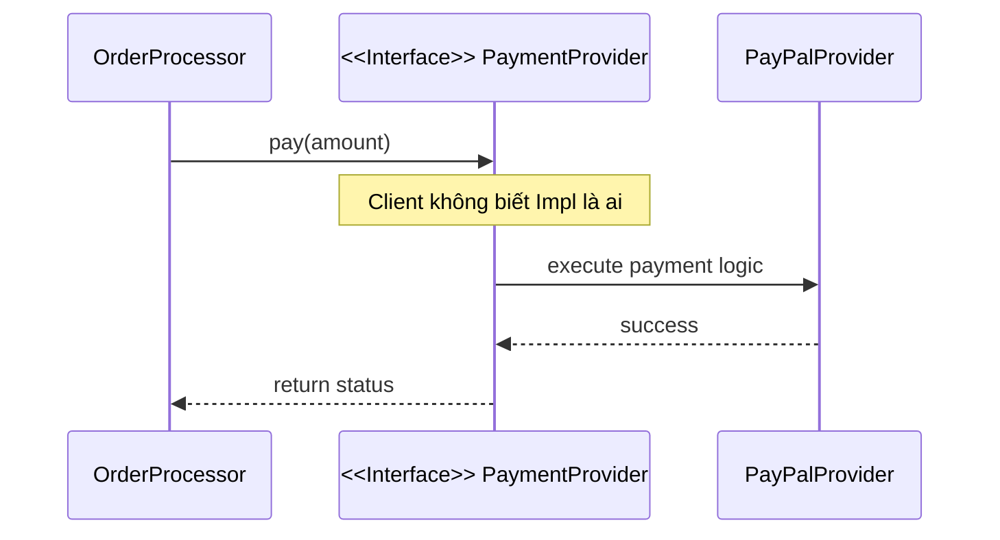

# Message Coupling: Đỉnh cao của Loose Coupling

Trong kiến trúc phần mềm, nếu Coupling (Sự phụ thuộc) là một thang đo từ "nguy hiểm" đến "an toàn", thì Message Coupling chính là trạng thái lý tưởng nhất mà mọi lập trình viên Java hướng tới. Đây là cấp độ mà các thành phần trong hệ thống giao tiếp với nhau theo cách tối giản nhất: chỉ thông qua các thông điệp (messages) hoặc lời gọi hàm mà không cần biết bất cứ điều gì về cấu trúc nội bộ của nhau.

## Mục tiêu

*   Hiểu rõ bản chất của Message Coupling và tại sao nó được coi là đỉnh cao của Loose Coupling.
*   Nắm vững kỹ thuật lập trình dựa trên Interface thay vì Concrete Class.
*   Áp dụng triệt để nguyên tắc "Tell, Don't Ask" để bảo vệ tính đóng gói (Encapsulation).
*   Tối ưu hóa khả năng kiểm thử (Unit Test) thông qua việc Mocking hiệu quả.

## 1. Message Coupling là gì?

Message Coupling (hay đôi khi được gọi là No Coupling trong một số tài liệu chuyên sâu) xảy ra khi hai module giao tiếp hoàn toàn qua các tham số truyền vào hàm hoặc qua các Interface. Ở mức độ này, một đối tượng không nắm giữ trạng thái của đối tượng khác, không can thiệp vào logic nội bộ, và quan trọng nhất: nó không quan tâm đối tượng kia là ai, miễn là đối tượng đó phản hồi đúng "thông điệp" được gửi đi.

Trong Java, điều này thường được hiện thực hóa thông qua các phương thức (methods) và các Interface. 

### Bảng so sánh sự khác biệt

| Đặc điểm | Tight Coupling (Concrete) | Message Coupling (Interface) |
| :--- | :--- | :--- |
| **Đối tượng phụ thuộc** | Phụ thuộc vào một Class cụ thể | Phụ thuộc vào một bản hợp đồng (Interface) |
| **Khả năng thay đổi** | Khó khăn, dễ gây lỗi dây chuyền | Dễ dàng thay thế implementation |
| **Tính đóng gói** | Thường xuyên truy cập trực tiếp field | Chỉ tương tác qua hành vi (behavior) |
| **Độ phức tạp Test** | Phải khởi tạo cả cây phụ thuộc | Dễ dàng Mock/Stub |

## 2. Giao tiếp qua Interface thay vì Concrete Class

Sai lầm phổ biến nhất của các lập trình viên Java trung cấp là khai báo kiểu dữ liệu dựa trên lớp thực thi (Concrete Class). Điều này tạo ra một sợi dây ràng buộc cứng nhắc.

### Ví dụ thực tế: Hệ thống thanh toán

Giả sử bạn có một lớp `OrderProcessor` cần thực hiện thanh toán qua PayPal.

**Cách tiếp cận sai (Tight Coupling):**

```java
public class PayPalService {
    public void process(double amount) {
        System.out.println("Processing PayPal payment: " + amount);
    }
}

public class OrderProcessor {
    private PayPalService payPalService = new PayPalService(); // Ràng buộc cứng

    public void checkout(double amount) {
        payPalService.process(amount);
    }
}
```

Trong ví dụ trên, `OrderProcessor` bị khóa chặt vào `PayPalService`. Nếu sau này khách hàng muốn thanh toán qua VNPay hoặc Stripe, bạn phải sửa mã nguồn của `OrderProcessor`.

**Cách tiếp cận đúng (Message Coupling):**

```java
// 1. Định nghĩa thông điệp (Interface)
public interface PaymentProvider {
    void pay(double amount);
}

// 2. Các lớp thực thi khác nhau
public class PayPalProvider implements PaymentProvider {
    @Override
    public void pay(double amount) { /* Logic PayPal */ }
}

public class VnPayProvider implements PaymentProvider {
    @Override
    public void pay(double amount) { /* Logic VNPay */ }
}

// 3. Caller chỉ giao tiếp qua thông điệp
public class OrderProcessor {
    private final PaymentProvider paymentProvider;

    // Dependency Injection
    public OrderProcessor(PaymentProvider paymentProvider) {
        this.paymentProvider = paymentProvider;
    }

    public void checkout(double amount) {
        paymentProvider.pay(amount); // Message Coupling
    }
}
```

Lúc này, `OrderProcessor` không còn biết `PaymentProvider` thực sự là gì. Nó chỉ gửi một thông điệp: "Hãy thanh toán số tiền này cho tôi". Đây chính là sự tách biệt hoàn hảo.

## 3. Nguyên tắc "Tell, Don't Ask"

Để đạt được Message Coupling thực thụ, bạn phải tuân thủ nguyên tắc **Tell, Don't Ask (TDA)**. Nguyên tắc này phát biểu rằng: Đừng hỏi đối tượng về trạng thái của nó để đưa ra quyết định, hãy ra lệnh cho đối tượng đó làm việc của nó.

Khi bạn "hỏi" (Ask), bạn đang tạo ra sự phụ thuộc vào cấu trúc dữ liệu của đối tượng đó. Khi bạn "bảo" (Tell), bạn chỉ đang gửi một thông điệp.

### Minh họa bằng mã nguồn

**Vi phạm TDA (Ask):**

```java
public class Door {
    private boolean open;
    public boolean isOpen() { return open; }
    public void setOpen(boolean open) { this.open = open; }
}

public class SecuritySystem {
    public void checkDoor(Door door) {
        if (door.isOpen()) { // Hỏi trạng thái
            System.out.println("Warning: Door is open!");
        }
    }
}
```

**Tuân thủ TDA (Tell):**

```java
public interface SecurityCheckable {
    void reportStatus();
}

public class Door implements SecurityCheckable {
    private boolean open;
    @Override
    public void reportStatus() {
        if (this.open) System.out.println("Warning: Door is open!");
    }
}

public class SecuritySystem {
    public void check(SecurityCheckable item) {
        item.reportStatus(); // Chỉ ra lệnh (Tell), không hỏi trạng thái
    }
}
```

Việc chuyển từ "hỏi" sang "bảo" giúp giảm thiểu rò rỉ logic (Logic Leakage) và giữ cho các lớp độc lập với nhau về mặt dữ liệu.

## 4. Sơ đồ tương tác Message Coupling

Dưới đây là cách Message Coupling hoạt động thông qua một lớp trung gian (Interface/Abstraction):



## 5. Lợi ích tối thượng trong Unit Test

Một trong những thước đo chính xác nhất của Coupling là độ khó khi viết Unit Test. Nếu bạn thấy mình phải khởi tạo quá nhiều đối tượng phụ thuộc hoặc phải thiết lập cơ sở dữ liệu để test một hàm đơn giản, bạn đang bị Tight Coupling.

Với Message Coupling, việc test trở nên cực kỳ đơn giản nhờ **Mocking**. Vì `OrderProcessor` chỉ phụ thuộc vào `PaymentProvider` (Interface), chúng ta có thể tạo ra một "kẻ giả mạo" (Mock) để kiểm tra hành vi của `OrderProcessor` mà không cần kết nối internet hay API của PayPal.

### Ví dụ sử dụng Mockito trong Java

```java
import static org.mockito.Mockito.*;
import org.junit.jupiter.api.Test;

class OrderProcessorTest {
    @Test
    void testCheckoutCallsPaymentProvider() {
        // Tạo mock cho Interface
        PaymentProvider mockProvider = mock(PaymentProvider.class);
        OrderProcessor processor = new OrderProcessor(mockProvider);

        // Thực thi
        processor.checkout(100.0);

        // Kiểm chứng: Thông điệp 'pay' có được gửi đi với đúng tham số không?
        verify(mockProvider, times(1)).pay(100.0);
    }
}
```

Nếu không có Message Coupling, bạn sẽ không bao giờ có thể cô lập được `OrderProcessor` để kiểm thử một cách thuần túy.

## 6. Mối liên hệ với SOLID

Message Coupling thực chất là sự kết hợp nhuần nhuyễn của hai nguyên lý trong SOLID:
1.  **Dependency Inversion Principle (DIP):** Phụ thuộc vào Abstraction, không phụ thuộc vào Concretion.
2.  **Interface Segregation Principle (ISP):** Thay vì một thông điệp quá lớn (Fat Interface), hãy chia nhỏ thành các thông điệp chuyên biệt để giảm thiểu sự liên quan không cần thiết.

## Tóm tắt

*   **Message Coupling** là trạng thái mà các thành phần chỉ biết về nhau qua các lời gọi phương thức trên các Interface.
*   **Interface là chìa khóa:** Luôn ưu tiên khai báo biến và tham số bằng kiểu Interface.
*   **Tell, Don't Ask:** Giảm thiểu việc lấy dữ liệu từ đối tượng khác để xử lý; thay vào đó, hãy yêu cầu đối tượng đó tự thực hiện hành vi.
*   **Testability:** Message Coupling cho phép chúng ta thay thế các thành phần thực bằng Mock Objects, giúp Unit Test chạy nhanh và độc lập.

## Câu hỏi tự kiểm tra

1. Tại sao việc sử dụng từ khóa `new` bên trong một phương thức thường dẫn đến Tight Coupling thay vì Message Coupling?
<details><summary>Đáp án</summary>Vì khi dùng `new`, bạn đang chỉ định chính xác một lớp thực thi (Concrete Class). Điều này khiến lớp hiện tại bị buộc chặt vào lớp đó, không thể thay thế bằng implementation khác và rất khó để Mock khi viết Unit Test.</details>

2. Nguyên tắc "Tell, Don't Ask" giúp ích gì trong việc duy trì Message Coupling?
<details><summary>Đáp án</summary>Nó giúp bảo vệ tính đóng gói bằng cách ngăn chặn việc truy cập vào trạng thái nội bộ của đối tượng khác. Khi chỉ gửi mệnh lệnh, sự phụ thuộc chỉ dừng lại ở chữ ký phương thức (method signature), thay vì phụ thuộc vào cấu trúc dữ liệu bên trong.</details>

3. Trong Java, nếu một phương thức nhận vào một tham số kiểu `String`, đây có được coi là Message Coupling không?
<details><summary>Đáp án</summary>Có, đây là một dạng đơn giản của Message/Data Coupling. Tuy nhiên, nếu tham số là một Object phức tạp (như `UserEntity`), hãy cẩn thận để không vi phạm Stamp Coupling (truyền quá nhiều dữ liệu không cần thiết). Message Coupling lý tưởng nhất là khi Interface chỉ chứa các phương thức cần thiết cho mục đích giao tiếp đó.</details>