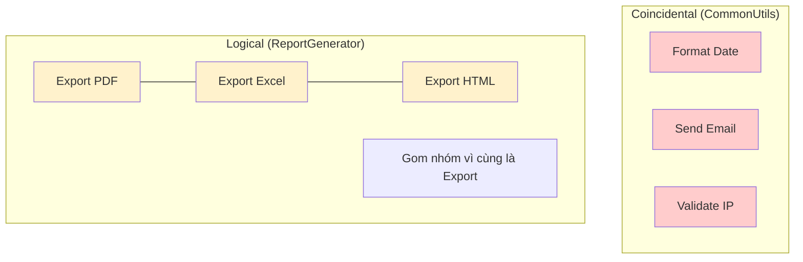

# Coincidental và Logical Cohesion

Trong thiết kế phần mềm, Cohesion (tính kết dính) đo lường mức độ liên quan giữa các thành phần bên trong một module hoặc một lớp. Một hệ thống tốt hướng tới **High Cohesion** (kết dính cao), nơi các thành phần phối hợp chặt chẽ để thực hiện một nhiệm vụ duy nhất. Tuy nhiên, trên thực tế, lập trình viên thường rơi vào cái bẫy của việc gom nhóm mã nguồn một cách hời hợt. 

Bài viết này sẽ đi sâu vào hai cấp độ thấp nhất và yếu nhất của Cohesion: **Coincidental Cohesion** (Kết dính ngẫu nhiên) và **Logical Cohesion** (Kết dính logic).

## Mục tiêu

*   Nhận diện được các dấu hiệu của Coincidental và Logical Cohesion trong dự án Java.
*   Phân tích tác động tiêu cực của việc gom nhóm mã nguồn tùy tiện đối với khả năng bảo trì và kiểm thử.
*   Nắm vững kỹ thuật tái cấu trúc các lớp "Utility" khổng lồ thành các module chuyên biệt.
*   Phân biệt được sự khác nhau tinh tế giữa việc gom nhóm theo "phân loại bề mặt" và gom nhóm theo "chức năng thực sự".

--- 

## 1. Coincidental Cohesion: Kết dính ngẫu nhiên

### Định nghĩa
Coincidental Cohesion xảy ra khi các thành phần (phương thức, biến) được gom nhóm vào cùng một lớp chỉ vì chúng tình cờ xuất hiện cùng nhau hoặc đơn giản là lập trình viên không biết để chúng ở đâu. Các thành phần này hoàn toàn không có mối quan hệ logic hay chức năng nào với nhau.

### Ví dụ điển hình: Thảm họa mang tên `CommonUtils`
Trong các dự án Java cũ hoặc thiếu quy hoạch kiến trúc, chúng ta thường thấy sự xuất hiện của những lớp "tiện ích" chứa đủ thứ trên đời.

```java
public class CommonUtils {
    
    // Xử lý chuỗi
    public static String capitalize(String str) {
        return str == null ? "" : str.substring(0, 1).toUpperCase() + str.substring(1);
    }

    // Xử lý ngày tháng
    public static LocalDate parseDate(String dateStr) {
        return LocalDate.parse(dateStr, DateTimeFormatter.ISO_DATE);
    }

    // Xử lý mạng
    public static boolean pingHost(String host) {
        try {
            return InetAddress.getByName(host).isReachable(2000);
        } catch (IOException e) {
            return false;
        }
    }

    // Xử lý logic nghiệp vụ ngẫu nhiên
    public static double calculateTax(double price) {
        return price * 0.1;
    }
}
```

### Tại sao Coincidental Cohesion lại nguy hiểm?
1.  **Vi phạm nguyên lý Đơn nhiệm (SRP):** Lớp này đảm nhận quá nhiều trách nhiệm không liên quan.
2.  **Khó tái sử dụng:** Nếu bạn chỉ muốn dùng hàm `capitalize`, bạn vẫn phải kéo theo cả thư viện mạng và logic tính thuế khi import lớp này.
3.  **Khó bảo trì:** Khi lớp `CommonUtils` phình to lên hàng nghìn dòng, việc tìm kiếm và chỉnh sửa trở thành ác mộng.
4.  **Phá vỡ tính đóng gói:** Các logic quan trọng bị phơi bày ra ngoài dưới dạng `static`, khiến việc mock để unit test trở nên khó khăn.

--- 

## 2. Logical Cohesion: Kết dính logic

### Định nghĩa
Logical Cohesion ở cấp độ cao hơn một chút so với ngẫu nhiên. Các thành phần được gom nhóm vì chúng thực hiện các nhiệm vụ **có vẻ giống nhau về mặt phân loại** (ví dụ: tất cả đều là Input, tất cả đều là Output, hoặc tất cả đều là Validation), nhưng thực tế cách thức hoạt động và mục đích của chúng rất khác nhau.

### Ví dụ: Lớp xử lý dữ liệu đa năng

```java
public class DataHandler {
    public void process(Object data, int type) {
        switch (type) {
            case 1: // Lưu vào Database
                saveToDatabase(data);
                break;
            case 2: // Gửi qua API
                sendToCloud(data);
                break;
            case 3: // Ghi ra file CSV
                writeToCsv(data);
                break;
            default:
                throw new IllegalArgumentException("Unknown type");
        }
    }

    private void saveToDatabase(Object data) { /* logic */ }
    private void sendToCloud(Object data) { /* logic */ }
    private void writeToCsv(Object data) { /* logic */ }
}
```

Trong ví dụ trên, các phương thức được gom vào `DataHandler` vì chúng đều "xử lý dữ liệu". Tuy nhiên, logic để ghi DB khác hoàn toàn với logic gọi API hay ghi file.

### Tại sao Logical Cohesion gây khó khăn cho bảo trì?
*   **Giao diện (Interface) rối rắm:** Người dùng phải truyền vào các tham số điều khiển (như `int type` hoặc `flag`) để chọn logic mong muốn.
*   **Rủi ro từ sự thay đổi:** Khi bạn thay đổi logic ghi file CSV, bạn có nguy cơ làm hỏng hoặc ảnh hưởng đến lớp `DataHandler` vốn đang phục vụ cả Database và Cloud.
*   **Khó mở rộng:** Mỗi khi thêm một kiểu xử lý mới, bạn phải sửa đổi phương thức `process` và thêm `case` mới, vi phạm nguyên lý **Open/Closed Principle**.

--- 

## 3. So sánh Coincidental và Logical Cohesion

| Đặc điểm | Coincidental (Ngẫu nhiên) | Logical (Logic) |
| :--- | :--- | :--- |
| **Mối liên hệ** | Không có mối liên hệ nào. | Có liên hệ về mặt phân loại tổng quát. |
| **Dấu hiệu nhận biết** | Tên lớp thường là `Utils`, `Misc`, `Global`. | Có các cấu trúc `switch-case` hoặc `if-else` dựa trên cờ (flag). |
| **Sự lệ thuộc** | Các phương thức độc lập hoàn toàn. | Các phương thức có thể chia sẻ một số tham số đầu vào chung nhưng thực thi nhánh khác nhau. |
| **Mức độ tệ** | Rất tệ (Tệ nhất). | Tệ (Dễ gây nhầm lẫn là thiết kế tốt). |

### Sơ đồ minh họa sự phân mảnh



--- 

## 4. Chiến lược cải thiện

Để thoát khỏi tình trạng kết dính thấp, chúng ta cần thực hiện các bước Refactoring sau:

### Giải quyết Coincidental Cohesion
Chia nhỏ lớp `CommonUtils` thành các lớp chuyên biệt dựa trên miền dữ liệu (Domain):
*   `StringUtils`: Chỉ chứa các hàm thao tác chuỗi.
*   `DateTimeService`: Xử lý các nghiệp vụ liên quan đến thời gian.
*   `NetworkClient`: Chứa các hàm kiểm tra kết nối.
*   `TaxCalculator`: Đưa logic tính thuế về đúng module kế toán/nghiệp vụ.

### Giải quyết Logical Cohesion
Sử dụng **Polymorphism (Đa hình)** hoặc **Strategy Pattern** thay vì dùng `switch-case`.

```java
// Thay vì DataHandler với switch-case
public interface DataExporter {
    void export(Object data);
}

public class DatabaseExporter implements DataExporter {
    public void export(Object data) { /* logic DB */ }
}

public class CloudExporter implements DataExporter {
    public void export(Object data) { /* logic Cloud */ }
}
```

Bằng cách này, mỗi lớp chỉ tập trung vào một nhiệm vụ duy nhất (**Functional Cohesion**), dễ dàng kiểm thử độc lập và mở rộng mà không ảnh hưởng đến mã nguồn cũ.

--- 

## Tóm tắt

*   **Coincidental Cohesion** là kiểu gom nhóm "tiện đâu để đó", tạo ra những lớp rác khó bảo trì.
*   **Logical Cohesion** là kiểu gom nhóm dựa trên cảm giác tương đồng bề mặt, thường dẫn đến các hàm chứa logic rẽ nhánh phức tạp.
*   Cả hai đều làm tăng độ phức tạp nhận thức (cognitive load) và vi phạm nguyên lý SOLID.
*   Giải pháp luôn là: **Chia nhỏ để trị**. Hãy hướng tới việc gom nhóm các thành phần dựa trên chức năng thực tế mà chúng thực hiện.

--- 

## Câu hỏi tự kiểm tra

**Câu 1:** Một lớp `SystemManager` chứa phương thức `rebootServer()`, `calculateEmployeeBonus()` và `convertXmlToJson()` thuộc loại Cohesion nào?
<details><summary>Đáp án</summary>Đây là <b>Coincidental Cohesion</b> vì ba chức năng này hoàn toàn không liên quan gì đến nhau về mặt logic hay nghiệp vụ.</details>

**Câu 2:** Tại sao Logical Cohesion thường đi kèm với việc vi phạm nguyên lý Open/Closed (OCP)?
<details><summary>Đáp án</summary>Vì khi có một yêu cầu mới (ví dụ: thêm định dạng export mới), bạn buộc phải mở lớp hiện có ra để sửa đổi cấu trúc <code>switch-case</code> hoặc <code>if-else</code>, thay vì chỉ việc viết thêm lớp mới.</details>

**Câu 3:** Trong Java, các thư viện như `java.util.Math` có bị coi là Coincidental Cohesion không?
<details><summary>Đáp án</summary>Không hẳn. <code>Math</code> có tính <b>Logical Cohesion</b> ở mức chấp nhận được (hoặc thậm chí là Functional) vì tất cả các hàm đều phục vụ một mục đích duy nhất: thực hiện các phép toán học cơ bản. Tuy nhiên, nếu <code>Math</code> chứa thêm hàm <code>saveToFile()</code> thì nó sẽ trở thành Coincidental.</details>

**Câu 4:** Dấu hiệu mã nguồn (code smell) rõ rệt nhất của Logical Cohesion là gì?
<details><summary>Đáp án</summary>Sự xuất hiện của các tham số kiểu <code>boolean flag</code> hoặc <code>int type</code> được dùng để điều hướng luồng xử lý bên trong một phương thức.</details>