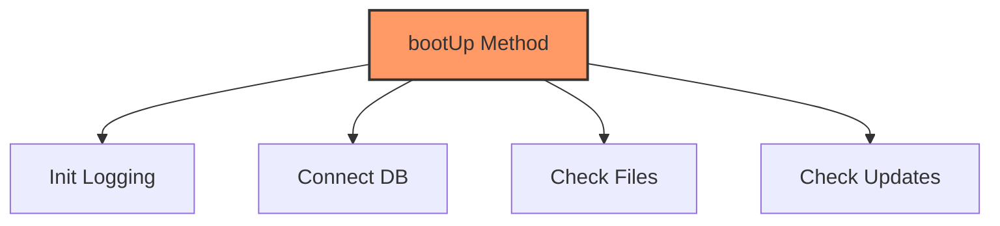

# Temporal và Procedural Cohesion

Trong thang đo mức độ gắn kết (Cohesion) của phần mềm, sau khi đi qua các mức độ thấp nhất như Coincidental (ngẫu nhiên) hay Logical (logic bề mặt), chúng ta tiến đến một vùng ranh giới khá phổ biến trong lập trình thực tế: **Temporal Cohesion** và **Procedural Cohesion**. 

Đây là hai mức độ gắn kết mà các lập trình viên Java thường xuyên mắc phải khi cố gắng tổ chức mã nguồn theo dòng chảy của chương trình thay vì theo bản chất của dữ liệu hay chức năng. Bài viết này sẽ phân tích sâu về cách nhận diện, hệ quả và phương pháp tái cấu trúc để đưa mã nguồn lên các cấp độ gắn kết cao hơn.

## Mục tiêu
* Phân tích và phân biệt rõ ràng giữa Temporal Cohesion (gắn kết thời gian) và Procedural Cohesion (gắn kết quy trình).
* Nhận diện các dấu hiệu "mã thối" (code smell) khi các hàm/lớp được gom nhóm dựa trên thời điểm thực thi hoặc trình tự chạy.
* Hiểu rõ tác động tiêu cực của hai loại gắn kết này đến khả năng tái sử dụng và kiểm thử đơn vị (Unit Test).
* Áp dụng kỹ thuật refactoring để chuyển đổi từ gắn kết yếu sang gắn kết chức năng (Functional Cohesion).

## 1. Temporal Cohesion (Gắn kết theo thời gian)

### Định nghĩa
Temporal Cohesion xảy ra khi các thành phần của một module được gom nhóm lại với nhau chỉ vì chúng **phải thực hiện tại cùng một thời điểm** trong quá trình vận hành của chương trình.

Trong Java, bạn thường thấy điều này ở các lớp có tên kết thúc bằng `Initializer`, `Startup`, `Bootstrapper` hoặc các phương thức kiểu `init()`, `setup()`, `cleanup()`. Mặc dù các tác vụ bên trong có vẻ cần thiết, nhưng về mặt logic, chúng không liên quan gì đến nhau ngoại trừ việc chúng cùng chạy lúc khởi động hoặc lúc đóng ứng dụng.

### Ví dụ minh họa
Hãy xem xét một lớp khởi tạo hệ thống sau:

```java
public class SystemManager {
    public void bootUp() {
        // 1. Khởi tạo cấu hình Logging
        LoggerConfig.init("log-path.xml");
        
        // 2. Kết nối Database
        DatabaseConnection.connect("jdbc:mysql://localhost:3306/db");
        
        // 3. Kiểm tra sự tồn tại của các thư mục tạm
        File tempDir = new File("/tmp/app");
        if (!tempDir.exists()) tempDir.mkdirs();
        
        // 4. Kiểm tra bản cập nhật phần mềm
        UpdateChecker.checkForUpdates();
    }
}
```

**Phân tích:**
* **Tính gắn kết:** Các hành động `init logging`, `connect DB`, `check files`, và `check updates` không có mối liên hệ logic chặt chẽ nào với nhau. 
* **Vấn đề:** Nếu bạn chỉ muốn viết một Unit Test cho việc kết nối Database, bạn bị buộc phải khởi tạo cả Logging và kiểm tra thư mục. Nếu việc kiểm tra Update bị lỗi (do không có mạng), toàn bộ quá trình `bootUp` thất bại, dù Database có thể đã sẵn sàng.

### Sơ đồ minh họa Temporal Cohesion



## 2. Procedural Cohesion (Gắn kết theo quy trình)

### Định nghĩa
Procedural Cohesion cao hơn Temporal một bậc. Ở đây, các thành phần được gom nhóm vì chúng **phải thực hiện theo một trình tự nhất định** (algorithm/procedure) để đạt được một mục tiêu cụ thể. Tuy nhiên, các bước này không nhất thiết phải chia sẻ dữ liệu với nhau một cách trực tiếp (khác với Sequential Cohesion nơi đầu ra của bước A là đầu vào của bước B).

### Ví dụ minh họa
Giả sử chúng ta có một lớp xử lý việc chuẩn bị báo cáo cuối tháng:

```java
public class MonthlyReportService {
    public void prepareReport(String employeeId) {
        // Bước 1: Kiểm tra quyền truy cập của người dùng
        checkUserPermission(employeeId);
        
        // Bước 2: Lấy dữ liệu từ file cấu hình
        loadReportTemplate();
        
        // Bước 3: Ghi log rằng quá trình bắt đầu
        AuditLogger.log("Starting report for: " + employeeId);
    }

    private void checkUserPermission(String id) { /* ... */ }
    private void loadReportTemplate() { /* ... */ }
}
```

**Phân tích:**
* **Tính gắn kết:** Các phương thức được gọi theo trình tự 1 -> 2 -> 3. Đây là một quy trình làm việc (workflow).
* **Vấn đề:** Lớp `MonthlyReportService` đang làm quá nhiều việc không thuộc phạm vi chính của nó. Việc kiểm tra quyền (Permission) và ghi log (Audit) thường là các Cross-cutting Concerns. Nếu quy trình thay đổi (ví dụ: không cần load template nếu không có quyền), mã nguồn sẽ trở nên chằng chịt các câu lệnh `if-else` bên trong một procedure duy nhất.

## 3. So sánh và Phân tích sự khác biệt

| Đặc điểm | Temporal Cohesion | Procedural Cohesion |
| :--- | :--- | :--- |
| **Tiêu chí gom nhóm** | Cùng thời điểm thực thi (Startup, Shutdown, Error). | Cùng một trình tự thực hiện (Algorithm steps). |
| **Mối quan hệ** | Các tác vụ độc lập hoàn toàn về logic. | Các tác vụ là một phần của một luồng xử lý. |
| **Khả năng tái sử dụng** | Rất thấp (phải lấy cả cụm). | Thấp (khó tách rời các bước trong quy trình). |
| **Ví dụ điển hình** | `init()`, `onClose()`, `handleError()`. | `processOrder()`, `prepareEnvironment()`. |

### Tại sao cả hai đều chưa tối ưu?
1. **Vi phạm Single Responsibility Principle (SRP):** Module gánh vác quá nhiều trách nhiệm khác nhau.
2. **Khó bảo trì:** Khi logic của một tác vụ nhỏ thay đổi (ví dụ: thay đổi cách kết nối DB), bạn phải sửa đổi lớp chứa cả những tác vụ không liên quan.
3. **Khó Unit Test:** Bạn không thể test cô lập từng hành vi mà không kích hoạt các hành vi đi kèm.

## 4. Hạn chế của việc gắn kết theo trình tự thực thi

Khi lập trình viên tư duy theo kiểu "Đầu tiên làm A, sau đó làm B, cuối cùng làm C", họ đang viết mã theo phong cách **Imperative (Mệnh lệnh)** thay vì **Object-Oriented (Hướng đối tượng)**. 

Trong Java, việc lạm dụng Procedural Cohesion dẫn đến các "God Classes" hoặc các Service phình to với hàng nghìn dòng code chỉ để điều phối các bước. Điều này làm mờ đi ranh giới giữa các Domain Object. 

**Hệ quả cụ thể:**
* **Fragility (Dễ vỡ):** Thay đổi thứ tự gọi hàm có thể gây ra lỗi ngầm định (side effects) mà trình biên dịch không phát hiện được.
* **Rigidity (Cứng nhắc):** Rất khó để chèn thêm một bước mới vào giữa quy trình mà không làm ảnh hưởng đến các bước xung quanh.

## 5. Chiến lược cải thiện và Refactoring

Để tối ưu hóa, chúng ta cần chuyển dịch từ Temporal/Procedural sang **Functional Cohesion** hoặc sử dụng các Design Patterns để tách biệt các mối quan tâm.

### Giải pháp cho Temporal Cohesion: Delegation (Ủy thác)
Thay vì để một phương thức `init()` làm mọi thứ, hãy sử dụng cơ chế Observer hoặc Dependency Injection để mỗi module tự quản lý việc khởi tạo của nó.

```java
// Tốt hơn: Mỗi service tự đăng ký khởi tạo
public interface Initializable {
    void initialize();
}

public class DatabaseService implements Initializable {
    public void initialize() { /* Kết nối DB */ }
}

public class AppInitializer {
    private List<Initializable> services;
    public void startAll() {
        services.forEach(Initializable::initialize);
    }
}
```

### Giải pháp cho Procedural Cohesion: Decorator hoặc Interceptor
Đối với các bước như ghi log, kiểm tra quyền, hãy tách chúng ra khỏi business logic chính bằng cách sử dụng **Aspect-Oriented Programming (AOP)** hoặc **Decorator Pattern**.

```java
// Sử dụng Decorator để tách biệt quy trình
public class AuthorizedReportService implements ReportService {
    private final ReportService target;

    public void prepareReport(String id) {
        if (authService.hasPermission(id)) {
            target.prepareReport(id);
        }
    }
}
```

## Tóm tắt
* **Temporal Cohesion** gom nhóm các tác vụ dựa trên thời điểm (ví dụ: cùng lúc khởi động). Đây là mức độ gắn kết yếu vì các tác vụ không liên quan logic.
* **Procedural Cohesion** gom nhóm dựa trên trình tự thực hiện. Dù khá hơn Temporal, nó vẫn gây khó khăn cho việc bảo trì và tái sử dụng do vi phạm SRP.
* Trong Java, hãy ưu tiên sử dụng **Dependency Injection**, **Observer Pattern**, và **AOP** để phá vỡ các liên kết theo thời gian và quy trình, hướng tới **Functional Cohesion** (mỗi module chỉ làm một việc duy nhất và làm tốt việc đó).

## Câu hỏi tự kiểm tra

1. **Câu hỏi:** Một phương thức `logAndExit(Exception e)` thực hiện ghi lỗi vào file sau đó đóng tất cả kết nối mạng và thoát chương trình. Đây là loại Cohesion nào?
   <details>
   <summary>Đáp án</summary>
   Đây là <b>Temporal Cohesion</b>. Việc ghi log và đóng kết nối mạng là hai hành động khác nhau về bản chất logic, nhưng được gom lại vì chúng cùng xảy ra khi chương trình gặp lỗi (thời điểm kết thúc).
   </details>

2. **Câu hỏi:** Sự khác biệt chính giữa Procedural Cohesion và Sequential Cohesion là gì?
   <details>
   <summary>Đáp án</summary>
   Trong <b>Sequential Cohesion</b>, đầu ra của bước này là đầu vào của bước kế tiếp (dòng dữ liệu). Trong <b>Procedural Cohesion</b>, các bước chỉ đơn thuần chạy theo thứ tự để thực hiện một thuật toán, dữ liệu không nhất thiết phải truyền trực tiếp từ bước này sang bước kia.
   </details>

3. **Câu hỏi:** Tại sao Temporal Cohesion lại gây khó khăn cho Unit Testing?
   <details>
   <summary>Đáp án</summary>
   Vì các tác vụ không liên quan bị "nhốt" chung trong một phương thức. Để kiểm tra một tác vụ nhỏ (ví dụ: kiểm tra thư mục tồn tại), bạn buộc phải kích hoạt các tác vụ nặng nề khác (ví dụ: kết nối Database), dẫn đến việc thiết lập môi trường test (test setup) trở nên phức tạp và chậm chạp.
   </details>

4. **Câu hỏi:** Design Pattern nào thường được dùng để giải quyết vấn đề Procedural Cohesion khi muốn thực hiện một chuỗi các bước kiểm tra?
   <details>
   <summary>Đáp án</summary>
   <b>Chain of Responsibility</b> hoặc <b>Template Method Pattern</b> thường được sử dụng để tổ chức lại các quy trình một cách linh hoạt hơn, giúp tách biệt các bước thực thi thành các lớp riêng biệt.
   </details>