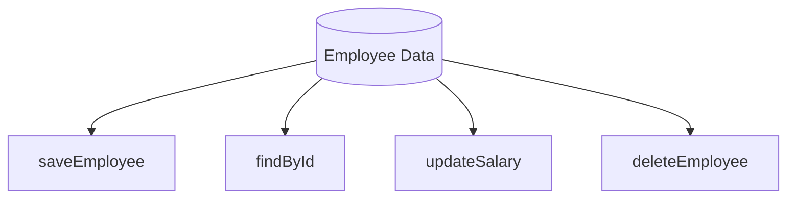
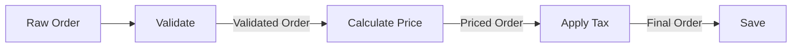

# Communicational và Sequential Cohesion

Chào mừng bạn đến với bài học chuyên sâu về hai cấp độ Cohesion (sự gắn kết) tập trung vào dòng chảy dữ liệu: **Communicational Cohesion** và **Sequential Cohesion**. Nếu như ở các bài học trước, chúng ta đã biết về những loại Cohesion yếu (như Coincidental hay Logical), nơi các thành phần được gom nhóm một cách khiên cưỡng, thì ở bài này, chúng ta bước vào thế giới của sự gắn kết thực thụ dựa trên dữ liệu.

Trong phát triển phần mềm Java hiện đại, hiểu rõ cách dữ liệu luân chuyển giữa các phương thức sẽ giúp bạn thiết kế những Class không chỉ mạnh mẽ mà còn cực kỳ dễ dự đoán.

## Mục tiêu

*   Phân biệt rõ ràng định nghĩa và đặc điểm của Communicational Cohesion và Sequential Cohesion.
*   Nhận diện được dòng chảy dữ liệu (Data Flow) bên trong một Class Java.
*   Học cách tổ chức mã nguồn theo mô hình "Dây chuyền sản xuất" (Pipeline) và "Trung tâm dữ liệu".
*   Áp dụng các kỹ thuật refactoring để nâng cấp các lớp từ mức gắn kết thấp lên mức gắn kết dựa trên dữ liệu.

---

## 1. Communicational Cohesion: Sự gắn kết qua dữ liệu chung

### Định nghĩa
**Communicational Cohesion** xảy ra khi một Class chứa các phương thức thực hiện các chức năng khác nhau, nhưng tất cả đều thao tác trên cùng một tập dữ liệu đầu vào hoặc tạo ra cùng một tập dữ liệu đầu ra.

Trong Java, điều này thường thấy ở các lớp DAO (Data Access Object) hoặc các Service tập trung vào một Entity duy nhất. Các phương thức trong lớp không nhất thiết phải gọi lẫn nhau, cũng không cần quan tâm đến thứ tự thực hiện, nhưng chúng "giao tiếp" với nhau thông qua trạng thái (state) chung của đối tượng hoặc cùng một nguồn dữ liệu ngoại vi.

### Ví dụ minh họa
Hãy xem xét một lớp `EmployeeRepository` trong một hệ thống quản lý nhân sự:

```java
public class EmployeeRepository {
    private Database connection;

    // Các phương thức khác nhau nhưng cùng thao tác trên bảng Employee
    public void saveEmployee(Employee emp) { /* ... */ }
    public Employee findById(String id) { /* ... */ }
    public void updateSalary(String id, double newSalary) { /* ... */ }
    public void deleteEmployee(String id) { /* ... */ }
    public List<Employee> listAll() { /* ... */ }
}
```

**Phân tích:**
*   **Điểm chung:** Tất cả các phương thức đều xoay quanh thực thể `Employee` và nguồn dữ liệu `connection`.
*   **Tính độc lập:** Bạn có thể gọi `findById` mà không cần gọi `updateSalary`. Thứ tự không quan trọng.
*   **Ưu điểm:** Dễ dàng tìm thấy mọi logic liên quan đến một đối tượng dữ liệu tại một nơi (High Encapsulation).
*   **Rủi ro:** Nếu lớp này phình to quá mức (ví dụ: thêm logic tính lương, logic bảo hiểm), nó sẽ vi phạm SRP (Single Responsibility Principle) và chuyển dần thành một "God Object".

### Sơ đồ luồng dữ liệu (Communicational)



---

## 2. Sequential Cohesion: Sự gắn kết theo chuỗi (Dây chuyền)

### Định nghĩa
**Sequential Cohesion** đạt mức độ gắn kết cao hơn Communicational. Nó xảy ra khi các thành phần trong một lớp được nhóm lại vì đầu ra (output) của phương thức này là đầu vào (input) của phương thức kia.

Đây chính là mô hình "dây chuyền sản xuất". Các phương thức phải được thực hiện theo một trình tự nhất định để đạt được kết quả cuối cùng. Nếu bạn thay đổi thứ tự, logic sẽ đổ vỡ.

### Ví dụ minh họa
Giả sử chúng ta có một lớp xử lý đơn hàng `OrderProcessor`:

```java
public class OrderProcessor {
    public void process(Order rawOrder) {
        Order validatedOrder = validate(rawOrder);
        Order pricedOrder = calculatePrice(validatedOrder);
        Order taxedOrder = applyTax(pricedOrder);
        saveToDatabase(taxedOrder);
    }

    private Order validate(Order order) { /* Kiểm tra tồn kho */ return order; }
    private Order calculatePrice(Order order) { /* Tính giá gốc */ return order; }
    private Order applyTax(Order order) { /* Cộng thuế VAT */ return order; }
    private void saveToDatabase(Order order) { /* Lưu trữ */ }
}
```

**Phân tích:**
*   **Tính phụ thuộc:** `calculatePrice` cần kết quả từ `validate`. `applyTax` cần kết quả từ `calculatePrice`.
*   **Dòng chảy:** Dữ liệu biến đổi dần qua từng bước (Transformation).
*   **Ưu điểm:** Logic cực kỳ minh bạch, dễ theo dõi luồng xử lý chính.
*   **Nhược điểm:** Các phương thức khó có thể tái sử dụng độc lập ở nơi khác vì chúng được thiết kế để khớp nối khăng khít với nhau.

### Sơ đồ luồng dữ liệu (Sequential)



---

## 3. So sánh Communicational và Sequential Cohesion

| Đặc điểm | Communicational Cohesion | Sequential Cohesion |
| :--- | :--- | :--- |
| **Mối liên kết** | Chung dữ liệu đầu vào/đầu ra. | Đầu ra bước A là đầu vào bước B. |
| **Thứ tự thực hiện** | Không quan trọng. | Rất quan trọng (tính tuần tự). |
| **Mục tiêu** | Tập trung quản lý một thực thể dữ liệu. | Tập trung hoàn thành một quy trình nghiệp vụ. |
| **Mức độ gắn kết** | Trung bình - Khá. | Cao. |
| **Khả năng tái sử dụng** | Các phương thức riêng lẻ dễ tái sử dụng hơn. | Khó tái sử dụng lẻ, thường dùng cả chuỗi. |

---

## 4. Ví dụ thực tế: Lớp xử lý Format văn bản (Text Processing Pipeline)

Để hiểu sâu hơn, chúng ta hãy xây dựng một hệ thống xử lý văn bản thô thành các định dạng khác nhau. Hệ thống này sẽ kết hợp cả hai loại Cohesion.

### Bước 1: Sequential Cohesion để chuẩn hóa văn bản
Chúng ta tạo một lớp `TextStandardizer` để làm sạch dữ liệu thô. Các bước phải đi theo trình tự: Xóa khoảng trắng thừa -> Loại bỏ ký tự đặc biệt -> Chuyển về viết thường.

```java
public class TextStandardizer {
    public String standardize(String input) {
        String trimmed = trimWhitespace(input);
        String sanitized = removeSpecialChars(trimmed);
        return convertToLowercase(sanitized);
    }

    private String trimWhitespace(String s) { return s.trim().replaceAll("\\s+", " "); }
    private String removeSpecialChars(String s) { return s.replaceAll("[^a-zA-Z0-0 ]", ""); }
    private String convertToLowercase(String s) { return s.toLowerCase(); }
}
```

### Bước 2: Communicational Cohesion để xuất bản dữ liệu
Sau khi có văn bản chuẩn, chúng ta cần xuất nó ra các định dạng khác nhau (JSON, XML, PlainText). Các phương thức này cùng dùng chung một dữ liệu đầu vào đã chuẩn hóa.

```java
public class TextExporter {
    private final String cleanText;

    public TextExporter(String cleanText) {
        this.cleanText = cleanText;
    }

    public String toJSON() {
        return "{\"content\": \"" + cleanText + "\"}";
    }

    public String toXML() {
        return "<content>" + cleanText + "</content>";
    }

    public String toPlainText() {
        return "Content: " + cleanText;
    }
}
```

### Tổng kết mô hình tổ chức
Trong thực tế, bạn sẽ thường thấy sự kết hợp này:
1.  Sử dụng **Sequential** để biến đổi dữ liệu từ dạng A sang dạng B (Processing).
2.  Sử dụng **Communicational** để cung cấp các góc nhìn khác nhau hoặc các thao tác khác nhau trên dữ liệu B đó (Reporting/Storage).

---

## 5. Cách thiết kế Class theo dòng chảy dữ liệu hiệu quả

Khi bạn nhận thấy một Class đang có dấu hiệu quá tải, hãy kiểm tra dòng chảy dữ liệu:

1.  **Nhận diện Input/Output:** Vẽ sơ đồ các phương thức và xem chúng có truyền dữ liệu cho nhau không. Nếu có, hãy nhóm chúng vào một Class mang tính Sequential.
2.  **Tách biệt biến đổi và hành động:** 
    *   Nếu một phương thức vừa tính toán (Sequential) vừa ghi log, vừa gửi mail (Communicational), hãy tách chúng ra.
    *   Sử dụng Pattern **Pipeline** hoặc **Chain of Responsibility** để triển khai Sequential Cohesion một cách linh hoạt hơn.
3.  **Tránh State không cần thiết:** Trong Communicational Cohesion, hãy cẩn thận với việc thay đổi trạng thái biến instance quá nhiều, vì nó có thể gây ra side-effect khó kiểm soát giữa các phương thức không liên quan.

---

## Tóm tắt

*   **Communicational Cohesion**: Các phương thức tụ họp lại vì chúng cùng phục vụ một tập dữ liệu. Đây là nền tảng của việc đóng gói (Encapsulation) quanh các Entity.
*   **Sequential Cohesion**: Các phương thức tụ họp lại vì chúng tạo thành một dây chuyền xử lý. Đây là nền tảng của các luồng nghiệp vụ (Workflow/Pipeline).
*   Cả hai loại này đều tốt hơn nhiều so với việc gom nhóm theo thời gian hay logic tình cờ, vì chúng dựa trên bản chất của dữ liệu - thứ ít thay đổi nhất trong phần mềm.
*   Trong Java, hãy ưu tiên Sequential cho các lớp xử lý (Processors/Services) và Communicational cho các lớp dữ liệu hoặc kho lưu trữ (Repositories/Models).

---

## Câu hỏi tự kiểm tra

**Câu 1:** Một lớp `ReportService` có hai phương thức: `generateMonthlyReport()` và `generateYearlyReport()`. Cả hai đều đọc dữ liệu từ cùng một Database Table. Đây là loại Cohesion nào?
<details><summary>Đáp án</summary>Đây là <b>Communicational Cohesion</b>. Các phương thức không cần thực hiện theo thứ tự, nhưng chúng cùng khai thác một nguồn dữ liệu chung.</details>

**Câu 2:** Tại sao Sequential Cohesion lại được đánh giá cao hơn Communicational Cohesion?
<details><summary>Đáp án</summary>Vì Sequential Cohesion thể hiện một mối liên kết chặt chẽ và có mục đích rõ ràng hơn (quy trình nghiệp vụ). Dòng dữ liệu được định nghĩa tường minh, giúp việc debug và hiểu luồng xử lý dễ dàng hơn so với việc các phương thức chỉ đơn thuần đứng cạnh nhau vì dùng chung dữ liệu.</details>

**Câu 3:** Nếu tôi có một chuỗi Sequential Cohesion quá dài (ví dụ 10 bước), tôi nên làm gì để mã nguồn sạch hơn?
<details><summary>Đáp án</summary>Bạn nên áp dụng <b>Pattern Pipeline</b> hoặc chia nhỏ chuỗi đó thành các lớp nhỏ hơn, mỗi lớp đảm nhận một phân đoạn của chuỗi. Điều này giúp tránh vi phạm SRP và cho phép Unit Test từng phần của dây chuyền dễ dàng hơn.</details>

**Câu 4:** Trong Java Stream API, đoạn code `list.stream().filter(...).map(...).collect(...)` minh họa cho loại Cohesion nào?
<details><summary>Đáp án</summary>Đây là minh họa hoàn hảo cho <b>Sequential Cohesion</b>. Kết quả của <code>filter</code> là đầu vào của <code>map</code>, và kết quả của <code>map</code> là đầu vào của <code>collect</code>.</details>