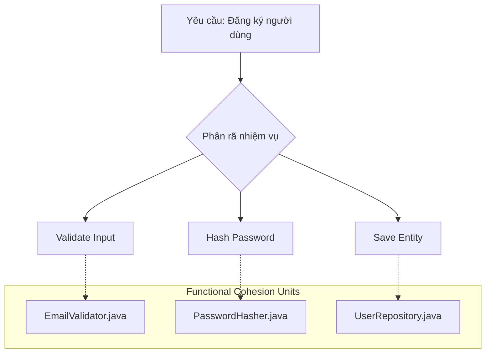

# Functional Cohesion: Mục tiêu lý tưởng

Trong thang đo mức độ gắn kết (Cohesion), **Functional Cohesion** được xếp ở bậc cao nhất – mức độ hoàn hảo mà mọi kiến trúc sư phần mềm đều hướng tới. Khi một module hay class đạt được Functional Cohesion, nó không chỉ đơn thuần là "chạy đúng" mà còn đạt được sự tinh khiết trong thiết kế, giúp hệ thống trở nên cực kỳ dễ dự đoán và bảo trì.

## Mục tiêu

Sau khi hoàn thành bài học này, bạn sẽ có khả năng:
*   Định nghĩa chính xác nhiệm vụ đơn nhất (Single Task) trong ngữ cảnh thiết kế Java.
*   Nhận diện các dấu hiệu của Functional Cohesion thông qua tên phương thức và cấu trúc lớp.
*   Phân biệt được sự khác biệt giữa "làm một việc" và "làm nhiều việc liên quan".
*   Áp dụng kỹ thuật Refactoring để đưa các đoạn mã rời rạc về trạng thái Functional Cohesion.
*   Đánh giá được lợi ích của tính tái sử dụng tuyệt đối trong các thư viện dùng chung.

## 1. Định nghĩa nhiệm vụ đơn nhất (Single Task)

Functional Cohesion xảy ra khi tất cả các thành phần bên trong một module (class hoặc method) cùng đóng góp vào việc thực hiện **một và chỉ một** nhiệm vụ duy nhất, được xác định rõ ràng.

Trong Java, một phương thức đạt Functional Cohesion là phương thức mà bạn có thể mô tả chức năng của nó bằng một câu đơn giản mà không cần dùng đến các từ nối như "và" (and), "sau đó" (then), "hoặc" (or).

### Đặc điểm nhận dạng:
*   **Tính nguyên tử:** Nhiệm vụ không thể chia nhỏ thêm nữa mà vẫn giữ được ý nghĩa nghiệp vụ.
*   **Tính tập trung:** Mọi dòng code trong phương thức đều phục vụ trực tiếp cho kết quả đầu ra của nhiệm vụ đó.
*   **Tính độc lập:** Nó không quan tâm đến ngữ cảnh gọi nó là gì, nó chỉ quan tâm đến dữ liệu đầu vào và kết quả đầu ra.

## 2. Dấu hiệu nhận biết qua tên gọi

Tên của một Class hoặc Method là "hàn thử biểu" chính xác nhất cho mức độ Cohesion. Với Functional Cohesion, tên gọi thường rất cụ thể và mang tính hành động (đối với method) hoặc định danh vai trò (đối với class).

| Loại Cohesion | Ví dụ tên Method/Class | Phân tích |
| :--- | :--- | :--- |
| **Thấp (Logical)** | `processData()` | Quá mơ hồ, có thể làm đủ thứ việc từ validate đến lưu trữ. |
| **Trung bình (Sequential)** | `validateAndSaveUser()` | Làm hai việc nối tiếp nhau. |
| **Cao (Functional)** | `calculateTax()` | Chỉ tính thuế, không làm gì khác. |
| **Cao (Functional)** | `PasswordHasher` | Class chỉ có một trách nhiệm duy nhất là băm chuỗi. |

**Quy tắc ngón tay cái:** Nếu bạn không thể đặt tên cho method mà không dùng từ "And", khả năng cao bạn đang vi phạm Functional Cohesion.

## 3. Ví dụ thực tế: Lớp PasswordHasher

Hãy xem xét một ví dụ điển hình trong Java về việc thiết kế một Class đạt Functional Cohesion.

### Thiết kế vi phạm (Coincidental/Procedural Cohesion)
Giả sử bạn có một lớp `UserUtils` chứa đủ thứ hàm liên quan đến User.

```java
public class UserUtils {
    public void processUser(User user) {
        // 1. Validate email
        // 2. Hash password
        // 3. Save to Database
    }
    
    public String hashPassword(String password) {
        // Logic băm mật khẩu ở đây
        return BCrypt.hashpw(password, BCrypt.gensalt());
    }
}
```
Trong ví dụ trên, `UserUtils` đang ôm đồm quá nhiều thứ. Hàm `hashPassword` nằm chung với logic lưu DB khiến nó khó tái sử dụng cho các đối tượng khác không phải `User` (ví dụ: băm mã PIN của ví điện tử).

### Thiết kế đạt Functional Cohesion
Chúng ta tách riêng nhiệm vụ băm mật khẩu thành một Class chuyên biệt.

```java
/**
 * Class này đạt Functional Cohesion tuyệt đối.
 * Nhiệm vụ duy nhất: Chuyển đổi Plaintext sang Hash.
 */
public final class PasswordHasher {
    
    private final int logRounds;

    public PasswordHasher(int logRounds) {
        this.logRounds = logRounds;
    }

    public String hash(String rawPassword) {
        if (rawPassword == null) {
            throw new IllegalArgumentException("Password cannot be null");
        }
        return BCrypt.hashpw(rawPassword, BCrypt.gensalt(logRounds));
    }

    public boolean check(String rawPassword, String hashed) {
        return BCrypt.checkpw(rawPassword, hashed);
    }
}
```

**Tại sao đây là Functional Cohesion?**
1.  **Tập trung:** Toàn bộ Class chỉ xoay quanh thuật toán băm. Không có logic gửi mail, không có logic database.
2.  **Dễ hiểu:** Bất kỳ lập trình viên nào nhìn vào tên Class cũng biết ngay nó dùng để làm gì.
3.  **Dễ Test:** Bạn có thể viết Unit Test cho `PasswordHasher` mà không cần Mock Database hay Web Server.

## 4. Sơ đồ luồng tư duy

Sơ đồ dưới đây mô tả cách một yêu cầu phức tạp được phân rã thành các đơn vị Functional Cohesion:



## 5. Lợi ích về khả năng tái sử dụng tuyệt đối

Khi một thành phần đạt Functional Cohesion, nó trở thành một "viên gạch" (Lego block) hoàn hảo. Bạn có thể mang viên gạch đó lắp vào bất kỳ công trình nào khác.

*   **Plug-and-Play:** Nếu ngày mai dự án yêu cầu băm mật khẩu cho hệ thống Admin riêng biệt, bạn chỉ cần copy (hoặc import) `PasswordHasher`. Bạn không cần kéo theo hàng tá dependency không liên quan.
*   **Giảm thiểu side-effects:** Vì hàm chỉ làm một việc, khả năng nó gây ra lỗi ngầm ở các vùng code khác là cực thấp. Bạn sửa logic băm (ví dụ nâng cấp từ SHA-256 lên Argon2), bạn chỉ cần sửa đúng tại một nơi.
*   **Tối ưu hóa Unit Test:** Các class Functional Cohesion thường có độ phủ code (Code Coverage) 100% rất dễ dàng vì các nhánh rẽ (branch) cực kỳ ít và rõ ràng.

## 6. Mối quan hệ với Single Responsibility Principle (SRP)

Nhiều người nhầm lẫn Functional Cohesion với SRP. Thực tế:
*   **SRP (SOLID):** Là một nguyên lý thiết kế ở mức cao (Class không nên có nhiều hơn một lý do để thay đổi).
*   **Functional Cohesion:** Là một mục tiêu đo lường chất lượng ở mức độ chi tiết (Các phần tử bên trong phải gắn kết chặt chẽ cho một nhiệm vụ).

Có thể nói: **Đạt được Functional Cohesion là cách tốt nhất để thực hiện SRP.**

## Tóm tắt

*   **Functional Cohesion** là đỉnh cao của thiết kế hướng module, nơi mỗi thành phần chỉ thực hiện một nhiệm vụ duy nhất.
*   **Dấu hiệu:** Tên hàm rõ ràng, không chứa từ nối, không phụ thuộc ngữ cảnh bên ngoài.
*   **Lợi ích:** Tái sử dụng tối đa, dễ kiểm thử, bảo trì chi phí thấp.
*   **Chiến lược:** Luôn đặt câu hỏi "Hàm này có thể chia nhỏ hơn nữa không?" khi viết code.

## Câu hỏi tự kiểm tra

1. Một phương thức tên là `calculateTotalAndApplyDiscount()` có đạt Functional Cohesion không? Tại sao?
<details><summary>Đáp án</summary>Không. Vì nó đang thực hiện hai nhiệm vụ riêng biệt: tính tổng và áp dụng giảm giá. Nên tách thành hai phương thức: <code>calculateTotal()</code> và <code>applyDiscount()</code>.</details>

2. Tại sao Functional Cohesion lại giúp giảm thiểu lỗi khi Refactoring?
<details><summary>Đáp án</summary>Vì phạm vi ảnh hưởng của thay đổi chỉ gói gọn trong một nhiệm vụ duy nhất. Khi bạn thay đổi logic bên trong một module Functional Cohesion, bạn không sợ làm hỏng các logic không liên quan khác vốn thường bị trộn lẫn trong các module có Cohesion thấp.</details>

3. Trong Java, việc sử dụng các Functional Interface (như <code>Predicate</code>, <code>Function</code>) có khuyến khích Functional Cohesion không?
<details><summary>Đáp án</summary>Có. Các Functional Interface ép buộc lập trình viên chỉ định nghĩa một phương thức trừu tượng duy nhất, từ đó hướng tư duy vào việc xây dựng các hàm xử lý đơn nhiệm, tinh khiết.</details>