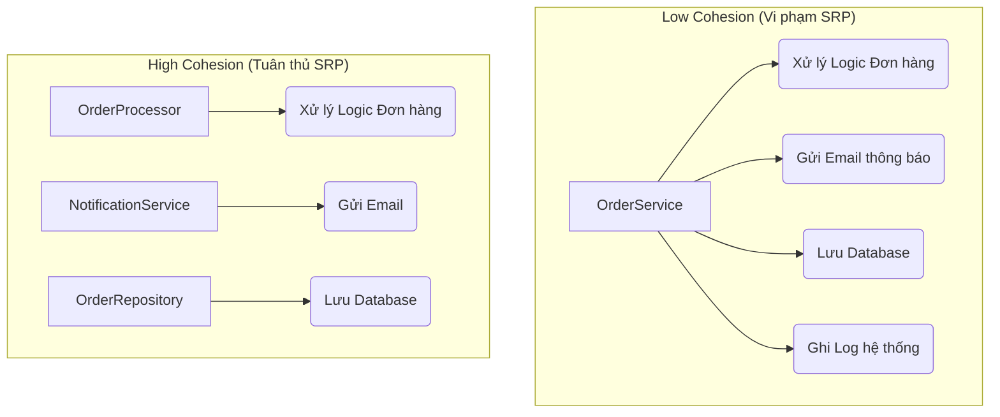

# SRP và Cohesion: Hai mặt của một đồng xu

Trong thiết kế phần mềm, chúng ta thường nghe về Single Responsibility Principle (SRP) và High Cohesion như hai khái niệm tách biệt. Tuy nhiên, thực tế chúng là hai góc nhìn khác nhau của cùng một vấn đề: Làm thế nào để gom nhóm các hành vi một cách logic và bền vững. Nếu Cohesion là cái đích chúng ta muốn đến (trạng thái lý tưởng của mã nguồn), thì SRP chính là con đường (nguyên lý chỉ đạo) để đạt được cái đích đó.

## Mục tiêu

*   Hiểu rõ mối quan hệ cộng sinh giữa nguyên lý SRP và chỉ số Cohesion.
*   Sử dụng khái niệm "Lý do thay đổi" (Reason to change) để định lượng mức độ Cohesion của một Class.
*   Nhận diện các dấu hiệu của một Class "ôm đồm" (God Object) thông qua các số liệu định tính và định lượng.
*   Thực hành kỹ thuật Refactoring để phân tách trách nhiệm, nâng cao tính bảo trì cho mã nguồn Java.

## 1. Mối liên hệ trực tiếp giữa 'Lý do thay đổi' và Cohesion

Robert C. Martin (Uncle Bob) định nghĩa SRP là: *"Một class chỉ nên có một lý do duy nhất để thay đổi"*. 

Hãy tưởng tượng một Class trong Java. Nếu bạn phải mở file đó ra để sửa code khi:
1.  Cấu trúc bảng Database thay đổi.
2.  Logic tính toán thuế thay đổi.
3.  Định dạng email gửi cho khách hàng thay đổi.

Thì Class đó đang có ít nhất 3 lý do để thay đổi. Trong thuật ngữ thiết kế, chúng ta nói Class này có **Low Cohesion (Độ gắn kết thấp)**. Các thành phần bên trong nó (method, field) không thực sự thuộc về nhau; chúng chỉ tình cờ được đặt chung một chỗ.

**Mối quan hệ có thể tóm tắt như sau:**
*   **SRP (Nguyên lý):** Tập trung vào việc giới hạn phạm vi tác động. Nếu bạn tuân thủ SRP, bạn sẽ tự động đẩy các thành phần không liên quan ra ngoài.
*   **Cohesion (Trạng thái):** Đo lường mức độ tập trung của các thành phần bên trong. Một Class tuân thủ SRP tốt sẽ có High Cohesion vì mọi dòng code bên trong đều phục vụ một mục đích duy nhất.

$$Cohesion \propto \frac{1}{Reasons\ to\ change}$$

Khi số lượng lý do thay đổi tiến dần về 1, độ gắn kết (Cohesion) sẽ tiến tới mức tối ưu (Functional Cohesion).

## 2. Phân tách trách nhiệm (Separation of Concerns)

Separation of Concerns (SoC) là chiến lược quản lý sự phức tạp bằng cách chia phần mềm thành các phần riêng biệt, mỗi phần giải quyết một "mối quan tâm" (concern) cụ thể. SRP là sự áp dụng SoC ở cấp độ Class.

Trong Java, việc phân tách trách nhiệm không chỉ là chia nhỏ code, mà là tạo ra các ranh giới (boundaries) rõ ràng. 



Khi tách biệt như sơ đồ trên, `OrderProcessor` không cần quan tâm email được gửi bằng SMTP hay SendGrid, cũng không cần biết dữ liệu lưu vào MySQL hay MongoDB. Đó là sự tinh tế của High Cohesion.

## 3. Ví dụ Refactor một Class vi phạm SRP trong Java

Xét một ví dụ điển hình về một Class "làm tất cả" thường gặp trong các dự án Legacy.

### Code ban đầu (Low Cohesion)

```java
public class EmployeeManager {
    // Trách nhiệm 1: Quản lý dữ liệu nhân viên
    public void saveEmployee(Employee emp) {
        // Logic kết nối DB và Insert
        System.out.println("Saving employee to database...");
    }

    // Trách nhiệm 2: Logic nghiệp vụ tính toán
    public double calculateSalary(Employee emp) {
        // Logic tính lương phức tạp
        return emp.getHoursWorked() * emp.getHourlyRate();
    }

    // Trách nhiệm 3: Trình diễn/Xuất báo cáo
    public void generateReport(Employee emp, String format) {
        if (format.equals("PDF")) {
            System.out.println("Exporting PDF report...");
        } else {
            System.out.println("Exporting HTML report...");
        }
    }
}
```

**Phân tích:**
Class `EmployeeManager` đang vi phạm SRP nghiêm trọng. Nếu quy định về thuế thay đổi, bạn sửa file này. Nếu công ty chuyển từ Oracle sang PostgreSQL, bạn sửa file này. Nếu phòng Marketing muốn đổi template báo cáo, bạn cũng sửa file này. Cohesion ở đây là **Logical Cohesion** (yếu).

### Sau khi Refactor (High Cohesion)

Chúng ta chia nhỏ thành các Class chuyên biệt, mỗi Class chỉ giữ một trách nhiệm.

```java
// 1. Chuyên biệt về lưu trữ (Data Access)
public class EmployeeRepository {
    public void save(Employee emp) {
        // Chỉ chứa logic tương tác DB
    }
}

// 2. Chuyên biệt về nghiệp vụ (Business Logic)
public class SalaryCalculator {
    public double calculate(Employee emp) {
        // Chỉ chứa công thức tính toán
        return emp.getHoursWorked() * emp.getHourlyRate();
    }
}

// 3. Chuyên biệt về hiển thị (Presentation/Reporting)
public class EmployeeReportGenerator {
    public void generatePDF(Employee emp) { /* ... */ }
    public void generateHTML(Employee emp) { /* ... */ }
}
```

**Kết quả:** Mỗi Class bây giờ cực kỳ tập trung (Highly Cohesive). Bạn có thể thay đổi cách lưu trữ mà không sợ làm hỏng logic tính lương.

## 4. Cách nhận diện Class 'ôm đồm' (God Object)

Làm sao để biết một Class đã đến lúc cần được chia tách? Ngoài cảm giác về thiết kế, chúng ta có thể dựa vào các dấu hiệu định lượng:

1.  **Số lượng dòng code (Lines of Code - LOC):** 
    *   Một Class Java vượt quá 300-500 dòng thường là dấu hiệu của việc ôm đồm quá nhiều trách nhiệm. 
    *   *Lưu ý:* Đây không phải con số tuyệt đối, nhưng là một "mùi" (code smell) cần kiểm tra.

2.  **Số lượng Method Public:** 
    *   Nếu một Class có 20 method public nhưng chia thành 3 nhóm hoàn toàn không liên quan đến nhau về mặt dữ liệu sử dụng, đó là Low Cohesion.

3.  **Số lượng Dependency (Import):**
    *   Một Class có quá nhiều câu lệnh `import` từ các package khác nhau (vừa import `java.sql.*`, vừa `javax.mail.*`, vừa `com.itextpdf.*`) chứng tỏ nó đang dính líu đến quá nhiều tầng (layer) khác nhau.

4.  **Chỉ số LCOM (Lack of Cohesion in Methods):**
    *   Đây là chỉ số đo lường sự chia sẻ các field giữa các method. Nếu các method trong Class không dùng chung các biến instance (field), chúng thực chất là những thực thể độc lập bị ép sống chung một nhà.

| Đặc điểm | High Cohesion (SRP) | Low Cohesion (God Object) |
| :--- | :--- | :--- |
| **Kích thước** | Nhỏ, gọn | Đồ sộ, khó đọc |
| **Dependency** | Ít, tập trung | Nhiều, chồng chéo |
| **Khả năng Test** | Dễ dàng (Unit Test) | Khó (Cần nhiều Mocking) |
| **Khả năng tái sử dụng** | Cao | Thấp (Kéo theo nhiều rác) |

## Tóm tắt

*   **SRP và Cohesion** là hai mặt của một đồng xu: SRP là phương pháp thực hiện, Cohesion là kết quả đạt được.
*   Một Class có **High Cohesion** khi tất cả các thành phần của nó tập trung vào một nhiệm vụ duy nhất.
*   Dấu hiệu nhận biết vi phạm SRP bao gồm: Class quá dài, quá nhiều import, và có nhiều hơn một lý do để thay đổi.
*   Việc tuân thủ SRP giúp mã nguồn dễ Unit Test hơn, giảm thiểu rủi ro lỗi lan truyền (side effects) khi thay đổi logic.

## Câu hỏi tự kiểm tra

1. **Tại sao nói SRP giúp tăng tính đóng gói (Encapsulation)?**
<details><summary>Đáp án</summary>Vì khi một Class chỉ có một trách nhiệm, nó che giấu các chi tiết thực thi của trách nhiệm đó tốt hơn. Các Class bên ngoài chỉ tương tác qua một interface hẹp, không cần biết về các logic phụ trợ không liên quan, từ đó giảm sự phụ thuộc.</details>

2. **Nếu một Class có 1000 dòng code nhưng tất cả đều phục vụ một logic thuật toán duy nhất (ví dụ: giải mã video), nó có vi phạm SRP không?**
<details><summary>Đáp án</summary>Về lý thuyết là KHÔNG vi phạm SRP nếu nó chỉ có một lý do thay đổi là thuật toán giải mã. Tuy nhiên, nó có thể vi phạm về tính đọc hiểu. Người ta thường chia nhỏ thành các class hỗ trợ (helper/utility) để đạt được sự phân tách ở mức độ thấp hơn, nhưng về mặt kiến trúc, nó vẫn là High Cohesion.</details>

3. **Làm thế nào để phát hiện một Class vi phạm SRP thông qua Unit Test?**
<details><summary>Đáp án</summary>Nếu bạn thấy việc viết Unit Test cho một Class quá khó khăn, phải Mock quá nhiều đối tượng không liên quan, hoặc một thay đổi nhỏ trong logic dẫn đến hàng loạt Test Case ở các module khác bị hỏng, đó là dấu hiệu Class đó đang ôm đồm quá nhiều trách nhiệm.</details>