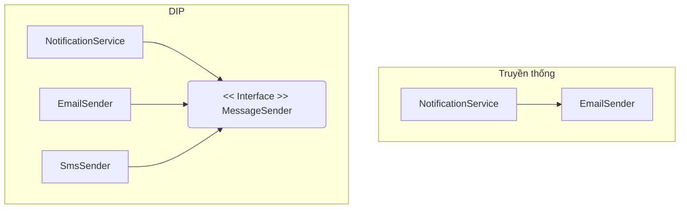

# DIP, ISP và chiến lược giảm Coupling

## Mục tiêu

*   **Làm chủ nguyên lý DIP:** Hiểu cách đảo ngược luồng phụ thuộc để module cấp cao không bị trói buộc vào module cấp thấp.
*   **Thực thi ISP hiệu quả:** Biết cách chia nhỏ các Interface cồng kềnh thành các giao diện đặc hóa, giúp giảm thiểu sự phụ thuộc không cần thiết.
*   **Sử dụng Interface làm vùng đệm:** Phân tích cơ chế "giảm sốc" của trừu tượng hóa khi hệ thống có thay đổi về công nghệ hoặc logic nghiệp vụ.
*   **Ứng dụng Spring DI:** Sử dụng Dependency Injection trong Spring Framework để hiện thực hóa chiến lược giảm Coupling trong dự án thực tế.

## 1. Dependency Inversion Principle (DIP): Phụ thuộc vào trừu tượng

Trong thiết kế truyền thống, các module cấp cao (chứa logic nghiệp vụ) thường phụ thuộc trực tiếp vào các module cấp thấp (chứa logic thực thi chi tiết như truy xuất database, gọi API bên thứ ba). Điều này tạo ra một cấu trúc phân tầng cứng nhắc, nơi một thay đổi nhỏ ở tầng dưới có thể gây ra hiệu ứng domino làm hỏng tầng trên.

### Định nghĩa chuẩn của DIP

1.  Các module cấp cao không nên phụ thuộc vào các module cấp thấp. Cả hai nên phụ thuộc vào sự trừu tượng (Abstractions).
2.  Sự trừu tượng không nên phụ thuộc vào chi tiết. Chi tiết nên phụ thuộc vào sự trừu tượng.

### Ví dụ minh họa: Hệ thống thông báo (Notification System)

**Cách làm sai (Tight Coupling):**

```java
// Module cấp thấp
public class EmailSender {
    public void sendEmail(String message) {
        System.out.println("Sending Email: " + message);
    }
}

// Module cấp cao phụ thuộc trực tiếp vào EmailSender
public class NotificationService {
    private EmailSender emailSender = new EmailSender(); // Hard-coded dependency

    public void notify(String message) {
        emailSender.sendEmail(message);
    }
}
```

Trong ví dụ này, `NotificationService` bị khóa chặt vào `EmailSender`. Nếu bạn muốn thêm SMS hoặc Push Notification, bạn phải sửa code của `NotificationService`. Đây chính là biểu hiện của Tight Coupling.

**Cách làm đúng với DIP (Loose Coupling):**

```java
// Sự trừu tượng (Abstraction)
public interface MessageSender {
    void send(String message);
}

// Module cấp thấp phụ thuộc vào Abstraction
public class EmailSender implements MessageSender {
    @Override
    public void send(String message) { /* ... */ }
}

public class SmsSender implements MessageSender {
    @Override
    public void send(String message) { /* ... */ }
}

// Module cấp cao phụ thuộc vào Abstraction
public class NotificationService {
    private final MessageSender sender;

    // Dependency Injection qua Constructor
    public NotificationService(MessageSender sender) {
        this.sender = sender;
    }

    public void notify(String message) {
        sender.send(message);
    }
}
```

### Sơ đồ đảo ngược phụ thuộc



Nhìn vào sơ đồ, ở mô hình DIP, mũi tên phụ thuộc từ `EmailSender` đã bị đảo ngược hướng về phía Interface do module cấp cao định nghĩa. Giờ đây, `NotificationService` là người quyết định "luật chơi" (Interface), còn các module cấp thấp phải tuân thủ.

## 2. Interface Segregation Principle (ISP): Chia nhỏ giao diện để giảm Coupling

Nguyên lý phân tách giao diện (ISP) phát biểu rằng: **"Client không nên bị buộc phải phụ thuộc vào những phương thức mà nó không sử dụng."**

Khi một Interface quá lớn (Fat Interface), nó chứa quá nhiều phương thức phục vụ cho nhiều mục đích khác nhau. Các lớp triển khai (Concrete classes) sẽ bị buộc phải override cả những phương thức không liên quan, dẫn đến tình trạng "Polluted Interface".

### Ví dụ: Hệ thống quản lý thiết bị đa năng

Giả sử ta có một Interface `SmartDevice` cho các loại máy văn phòng:

```java
public interface SmartDevice {
    void print();
    void scan();
    void fax();
}
```

Nếu ta có một chiếc máy in đời cũ chỉ có chức năng in:

```java
public class OldPrinter implements SmartDevice {
    public void print() { /* In tài liệu */ }
    public void scan() { throw new UnsupportedOperationException(); } // Thừa thãi
    public void fax() { throw new UnsupportedOperationException(); }  // Nguy hiểm
}
```

Việc quăng ngoại lệ `UnsupportedOperationException` là một dấu hiệu đỏ của thiết kế tồi. Nó vi phạm tính đóng gói và làm tăng Coupling vì Client gọi `OldPrinter` không biết chắc phương thức nào thực sự hoạt động.

**Áp dụng ISP để tinh chỉnh:**

```java
public interface Printer { void print(); }
public interface Scanner { void scan(); }
public interface FaxMachine { void fax(); }

public class ModernRobot implements Printer, Scanner, FaxMachine {
    // Triển khai tất cả
}

public class SimplePrinter implements Printer {
    public void print() { /* Chỉ triển khai in */ }
}
```

Bằng cách chia nhỏ Interface, ta giảm thiểu sự liên kết không cần thiết. Một lớp chỉ phụ thuộc vào những gì nó thực sự cần, giúp mã nguồn trở nên linh hoạt và dễ kiểm thử hơn.

## 3. Interface làm 'vùng đệm' giảm sốc khi thay đổi

Trong kiến trúc phần mềm, Interface đóng vai trò như một bản hợp đồng (Contract). Hãy tưởng tượng Interface như một ổ cắm điện trên tường và các lớp triển khai là các thiết bị điện (quạt, đèn, sạc laptop).

### Cơ chế giảm sốc (Shock Absorption)

Khi bạn thay đổi logic bên trong một lớp triển khai (ví dụ: tối ưu thuật toán sắp xếp, thay đổi thư viện JSON parser), miễn là chữ ký phương thức (method signature) trong Interface không đổi, các module đang sử dụng Interface đó sẽ hoàn toàn không bị ảnh hưởng. 

*   **Cách ly thay đổi:** Nếu `DatabaseInterface` có phương thức `saveUser()`, bạn có thể đổi từ Hibernate sang JDBC thuần mà logic nghiệp vụ ở tầng Service không cần sửa một dòng code nào.
*   **Mở rộng không giới hạn:** Bạn có thể thêm các implementation mới (ví dụ: `CloudStorage`, `LocalStorage`) mà không làm xáo trộn các lớp hiện có.

Công thức tính mức độ phụ thuộc khi có Interface:
Nếu lớp $A$ phụ thuộc trực tiếp vào lớp $B$, mọi thay đổi ở $B$ có xác suất $P$ gây lỗi ở $A$. Khi chèn Interface $I$ vào giữa, xác suất này giảm xuống chỉ còn phụ thuộc vào sự thay đổi của $I$ (vốn rất ít khi thay đổi).

## 4. Thực thi chiến lược với Spring Framework

Spring Framework là một minh chứng điển hình cho việc áp dụng DIP và ISP để đạt được Loose Coupling thông qua cơ chế Dependency Injection (DI).

### Sử dụng @Autowired với Interface

Trong Spring, thay vì khởi tạo đối tượng bằng từ khóa `new`, ta yêu cầu Spring Container cung cấp một Bean thông qua Interface.

```java
@Service
public class OrderProcessingService {
    
    private final PaymentProcessor paymentProcessor;

    // Spring sẽ tự tìm Bean nào triển khai PaymentProcessor để inject vào
    @Autowired
    public OrderProcessingService(PaymentProcessor paymentProcessor) {
        this.paymentProcessor = paymentProcessor;
    }

    public void processOrder(Order order) {
        paymentProcessor.pay(order.getAmount());
    }
}
```

### Chiến lược linh hoạt với Qualifier và Profile

Spring cho phép ta có nhiều triển khai của cùng một Interface và hoán đổi chúng dễ dàng:

*   **@Qualifier:** Chỉ định chính xác bean nào được dùng.
*   **@Profile:** Dùng `DevPaymentProcessor` cho môi trường phát triển và `ProductionPaymentProcessor` cho môi trường thực tế.

Điều này giúp hệ thống cực kỳ linh hoạt. Bạn có thể thay đổi toàn bộ hạ tầng thanh toán chỉ bằng cách thay đổi một dòng cấu hình trong file `application.properties` mà không cần compile lại logic nghiệp vụ.

## 5. Mối liên hệ giữa DIP, ISP và Unit Test

Thiết kế tuân thủ DIP và ISP là điều kiện tiên quyết để viết Unit Test hiệu quả. 

*   **Khả năng Mocking:** Nếu `NotificationService` phụ thuộc vào Interface `MessageSender`, trong Unit Test ta có thể dễ dàng tạo một bản giả (Mock) của `MessageSender` để kiểm tra logic của Service mà không cần gửi email thật.
*   **Test độc lập:** Nhờ ISP, các Interface nhỏ gọn giúp việc tạo Mock object trở nên đơn giản hơn. Bạn không cần phải giả lập 20 phương thức của một Fat Interface chỉ để test 1 phương thức duy nhất.

Nếu bạn thấy khó khăn khi viết Unit Test cho một lớp (phải khởi tạo quá nhiều đối tượng phụ thuộc), đó là dấu hiệu cho thấy bạn đang vi phạm DIP và hệ thống đang bị Tight Coupling.

## Tóm tắt

1.  **DIP** giúp đảo ngược sự phụ thuộc: Module cấp cao và cấp thấp đều phụ thuộc vào trừu tượng. Điều này bảo vệ logic nghiệp vụ khỏi những thay đổi của hạ tầng.
2.  **ISP** giúp làm sạch các liên kết: Chia nhỏ Interface để Client không phải gánh chịu những phụ thuộc thừa thãi.
3.  **Interface** là chìa khóa để tạo ra "vùng đệm", giúp hệ thống chịu đựng được các thay đổi công nghệ mà không cần đại tu mã nguồn.
4.  **Spring DI** là công cụ mạnh mẽ để thực thi các nguyên lý này trong Java, biến lý thuyết thành kiến trúc thực tế linh hoạt.

## Câu hỏi tự kiểm tra

1. **Tại sao nói DIP giúp giảm Ripple Effect (hiệu ứng lan tỏa) khi thay đổi code?**
<details><summary>Đáp án</summary>Vì DIP ngăn chặn sự phụ thuộc trực tiếp vào các implementation cụ thể. Khi chi tiết thay đổi, miễn là Interface không đổi, các module cấp cao sẽ không bị ảnh hưởng, từ đó ngăn chặn lỗi lan truyền khắp hệ thống.</details>

2. **Một Interface có 10 phương thức, nhưng lớp A chỉ dùng 2 phương thức. Vi phạm nguyên lý nào? Cách khắc phục?**
<details><summary>Đáp án</summary>Vi phạm nguyên lý ISP (Interface Segregation Principle). Cách khắc phục là tách Interface lớn đó thành nhiều Interface nhỏ hơn, hoặc sử dụng Pattern như Adapter để lọc bớt các phương thức không cần thiết.</details>

3. **Trong Spring, nếu một Interface có 2 implementation mà không dùng @Qualifier, chuyện gì sẽ xảy ra?**
<details><summary>Đáp án</summary>Spring sẽ tung ra ngoại lệ `NoUniqueBeanDefinitionException` khi khởi động ứng dụng vì nó không biết chọn implementation nào để inject. Đây là lúc ta cần dùng @Qualifier hoặc @Primary để chỉ định.</details>

4. **DIP và DI (Dependency Injection) có phải là một không?**
<details><summary>Đáp án</summary>Không. DIP là một nguyên lý thiết kế (chiến lược), còn DI là một kỹ thuật lập trình (công cụ/cách thức) để thực hiện nguyên lý DIP đó.</details>"}