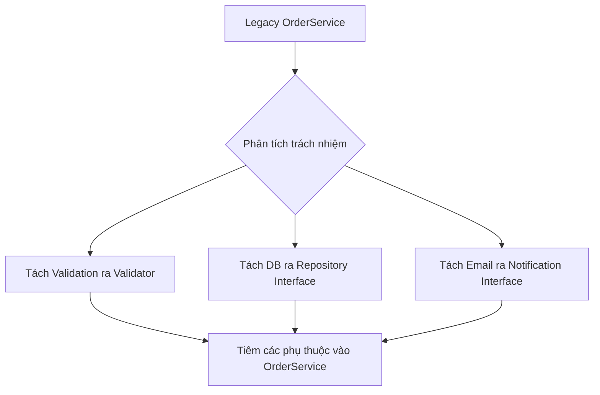

# Refactoring: Từ Tight đến Loose Coupling

Trong các bài học trước, chúng ta đã hiểu thế nào là Coupling (sự phụ thuộc) và Cohesion (tính gắn kết). Tuy nhiên, hiểu lý thuyết là một chuyện, việc bắt tay vào chỉnh sửa một hệ thống đang chạy với hàng nghìn dòng code chằng chịt lại là một thử thách khác. Bài học này tập trung vào các kỹ thuật Refactoring thực chiến để biến một hệ thống "cứng nhắc" thành một hệ thống linh hoạt.

## Mục tiêu

*   Nhận diện các dấu hiệu của Tight Coupling và Low Cohesion thông qua các "Code Smells".
*   Làm chủ kỹ thuật **Extract Class** để tăng tính đơn nhiệm cho Class.
*   Áp dụng **Move Method** để loại bỏ tình trạng "Feature Envy" (Ghen tị tính năng).
*   Thực hiện chuyển đổi từ **Inheritance sang Composition** để giảm sự phụ thuộc cứng.
*   Trải nghiệm quy trình tái cấu trúc một Legacy Module sang Clean Architecture.

## 1. Kỹ thuật Extract Class: Tăng Cohesion từ bên trong

Khi một Class đảm nhận quá nhiều trách nhiệm, nó trở thành một "God Object". Chỉ số LCOM (Lack of Cohesion in Methods) của nó sẽ rất cao vì các phương thức không chia sẻ chung các trường dữ liệu (fields).

### Dấu hiệu nhận biết
Một Class có quá nhiều instance variables, và chỉ một nhóm phương thức sử dụng một nhóm biến nhất định. 

### Ví dụ thực tế
Giả sử bạn có class `User` quản lý cả thông tin cá nhân lẫn logic xác thực.

**Trước khi Refactor (Low Cohesion):**
```java
public class User {
    private String username;
    private String email;
    private String passwordHash;
    private LocalDateTime lastLogin;
    private int loginAttempts;

    // Getters/Setters...

    public boolean validatePassword(String password) {
        // Logic kiểm tra hash
        return true;
    }

    public void resetPassword() {
        // Logic reset
    }
}
```

**Sau khi Refactor (Extract Class):**
Chúng ta tách logic xác thực ra class `UserAuthentication`.

```java
public class User {
    private String username;
    private String email;
    private UserAuthentication auth; // Composition
}

public class UserAuthentication {
    private String passwordHash;
    private LocalDateTime lastLogin;
    private int loginAttempts;

    public boolean validate(String password) { ... }
}
```
**Kết quả:** Class `User` giờ đây chỉ tập trung vào thông tin thực thể, còn `UserAuthentication` tập trung vào bảo mật. Nếu logic bảo mật thay đổi (ví dụ: thêm MFA), ta chỉ cần sửa `UserAuthentication`.

## 2. Kỹ thuật Move Method: Chữa trị bệnh "Feature Envy"

**Feature Envy** xảy ra khi một phương thức ở Class A sử dụng các phương thức hoặc dữ liệu của Class B nhiều hơn chính dữ liệu của Class A. Điều này gây ra Tight Coupling giữa A và B.

### Ví dụ thực tế
Class `Invoice` (Hóa đơn) đang tính toán thuế dựa trên thông tin của `Customer`.

**Trước khi Refactor (Tight Coupling):**
```java
public class Invoice {
    private Customer customer;
    private double amount;

    public double calculateTotal() {
        if (customer.getRegion().equals("VN")) {
            return amount + amount * 0.1; // VAT 10%
        }
        return amount;
    }
}
```
Trong ví dụ này, `Invoice` đang can thiệp quá sâu vào thuộc tính `region` của `Customer`. Nếu quy tắc thuế theo vùng thay đổi, ta phải sửa `Invoice`.

**Sau khi Refactor (Move Method):**
Đưa logic tính thuế về đúng nơi sở hữu dữ liệu vùng miền: Class `Customer` hoặc một `TaxStrategy`.

```java
public class Customer {
    private String region;
    public double applyTax(double amount) {
        return region.equals("VN") ? amount * 1.1 : amount;
    }
}

public class Invoice {
    private Customer customer;
    private double amount;

    public double calculateTotal() {
        return customer.applyTax(amount);
    }
}
```
**Kết quả:** `Invoice` không còn quan tâm `VN` hay `US` nữa. Nó chỉ yêu cầu `Customer` áp dụng thuế. Coupling giảm từ "phụ thuộc vào cấu trúc dữ liệu của Customer" xuống thành "phụ thuộc vào hành vi của Customer".

## 3. Thay thế Inheritance bằng Composition

Kế thừa (Inheritance) là loại Coupling mạnh nhất trong Java (Compile-time coupling). Khi class cha thay đổi, tất cả class con bị ảnh hưởng (Fragile Base Class problem).

### Bảng so sánh

| Đặc điểm | Inheritance (Is-a) | Composition (Has-a) |
| :--- | :--- | :--- |
| **Thời điểm liên kết** | Static (Compile-time) | Dynamic (Runtime) |
| **Mức độ Coupling** | Rất chặt chẽ | Lỏng lẻo (thông qua Interface) |
| **Tính linh hoạt** | Kém (Java không đa kế thừa) | Cao (Có thể thay đổi implementation tại runtime) |

### Ví dụ thực tế
Bạn có một `ReportGenerator` kế thừa từ `PdfWriter` để xuất báo cáo.

**Tệ (Inheritance):**
```java
public class ReportGenerator extends PdfWriter {
    public void createReport() {
        writeHeader("Monthly Report"); // Gọi phương thức của cha
    }
}
```
Nếu khách hàng muốn xuất file Excel, bạn phải viết lại một class mới kế thừa `ExcelWriter`.

**Tốt (Composition + Dependency Injection):**
```java
public class ReportGenerator {
    private final OutputWriter writer;

    public ReportGenerator(OutputWriter writer) {
        this.writer = writer;
    }

    public void createReport() {
        writer.write("Monthly Report");
    }
}
```
Bằng cách sử dụng Interface `OutputWriter`, `ReportGenerator` giờ đây hoàn toàn thoát khỏi sự lệ thuộc vào thư viện PDF hay Excel cụ thể.

## 4. Case Study: Refactoring Legacy Module sang Clean Architecture

Hãy xem xét một `OrderService` điển hình trong các dự án cũ, nơi mọi thứ bị trộn lẫn.

### Trạng thái ban đầu (The Mess)
```java
public class OrderService {
    public void processOrder(Order order) {
        // 1. Validation
        if (order.getItems().isEmpty()) throw new RuntimeException();
        
        // 2. Database logic
        String sql = "INSERT INTO orders ...";
        // Thực thi JDBC trực tiếp...
        
        // 3. Email notification
        String smtpServer = "smtp.gmail.com";
        // Cấu hình email và gửi...
    }
}
```
**Vấn đề:**
1.  **Tight Coupling:** Phụ thuộc trực tiếp vào JDBC và SMTP Library.
2.  **Low Cohesion:** Làm quá nhiều việc (Validate, DB, Mail).
3.  **Untestable:** Không thể Unit Test mà không có DB và Mail server thật.

### Quy trình Refactoring



### Trạng thái sau Refactoring

```java
public class OrderService {
    private final OrderRepository repository;
    private final NotificationService notificationService;
    private final OrderValidator validator;

    // Constructor Injection (Loose Coupling)
    public OrderService(OrderRepository repo, NotificationService notify, OrderValidator val) {
        this.repository = repo;
        this.notificationService = notify;
        this.validator = val;
    }

    public void processOrder(Order order) {
        validator.validate(order);
        repository.save(order);
        notificationService.sendConfirmation(order);
    }
}
```

**Tại sao đây là Loose Coupling?**
*   `OrderService` không biết dữ liệu lưu vào MySQL hay MongoDB (thông qua `OrderRepository`).
*   `OrderService` không biết email gửi qua SendGrid hay Mailchimp (thông qua `NotificationService`).
*   Dễ dàng viết Unit Test bằng cách Mock các Interface này.

## Tóm tắt

*   **Extract Class:** Giải quyết vấn đề Class quá lớn, tăng Cohesion bằng cách nhóm các dữ liệu và hành vi liên quan vào class mới.
*   **Move Method:** Đưa logic về nơi chứa dữ liệu của nó, giảm sự can thiệp thái quá giữa các class.
*   **Composition over Inheritance:** Ưu tiên việc lắp ghép các thành phần thông qua Interface thay vì kế thừa cứng nhắc, giúp hệ thống dễ mở rộng.
*   **Refactoring** không chỉ là làm code đẹp hơn, mà là quá trình chuyển dịch các phụ thuộc từ **Concrete (Cụ thể)** sang **Abstraction (Trừu tượng)**.

## Câu hỏi tự kiểm tra

1. Khi nào ta nên thực hiện Extract Class?
   <details><summary>Đáp án</summary>Khi một class vi phạm Single Responsibility Principle (SRP), có quá nhiều dòng code (thường > 300 dòng), hoặc có một nhóm các biến instance chỉ được sử dụng bởi một nhóm nhỏ các phương thức.</details>

2. Tại sao Move Method lại giúp giảm Coupling?
   <details><summary>Đáp án</summary>Vì nó loại bỏ hiện tượng Feature Envy. Thay vì Class A phải biết chi tiết cấu trúc dữ liệu của Class B để tính toán, Class A chỉ cần gọi một phương thức của Class B. Điều này che giấu chi tiết triển khai (Encapsulation).</details>

3. Trong ví dụ OrderService sau refactor, nếu ta muốn đổi từ gửi Email sang gửi SMS, ta cần làm gì?
   <details><summary>Đáp án</summary>Ta chỉ cần tạo một implementation mới của <code>NotificationService</code> (ví dụ <code>SmsNotificationServiceImpl</code>) và truyền nó vào constructor của <code>OrderService</code> lúc khởi tạo. Code của <code>OrderService</code> hoàn toàn không thay đổi.</details>

4. Mối quan hệ giữa Unit Test và việc Refactoring sang Loose Coupling là gì?
   <details><summary>Đáp án</summary>Loose Coupling là điều kiện tiên quyết để viết Unit Test hiệu quả. Khi code được refactor sang Loose Coupling (dùng DI và Interface), ta có thể dễ dàng thay thế các phụ thuộc ngoại vi (DB, API) bằng Mock objects để kiểm thử logic nghiệp vụ một cách độc lập.</details>