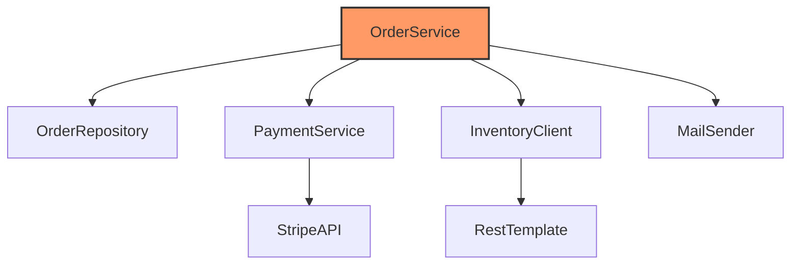

# Các Metric đo lường Coupling (CBO, RFC)

Trong thiết kế phần mềm, chúng ta thường nói về "Loose Coupling" (liên kết lỏng lẻo) như một mục tiêu lý tưởng. Tuy nhiên, làm thế nào để biết một hệ thống là "lỏng" hay "chặt"? Nếu không có những con số cụ thể, việc đánh giá chỉ dừng lại ở mức cảm tính. Bài học này sẽ giới thiệu hai chỉ số quan trọng nhất trong bộ chỉ số Chidamber & Kemerer (CK metrics) để định lượng sự phụ thuộc: **CBO (Coupling Between Objects)** và **RFC (Response For a Class)**.

## Mục tiêu

*   Hiểu rõ định nghĩa và cách tính toán chi tiết của hai chỉ số CBO và RFC.
*   Biết cách nhận diện các lớp có nguy cơ gây lỗi cao thông qua các ngưỡng (thresholds) định mức.
*   Sử dụng biểu đồ phụ thuộc (Dependency Graph) để trực quan hóa cấu trúc hệ thống.
*   Áp dụng các chỉ số này vào quy trình Code Review và Refactoring trong dự án Java thực tế.

## 1. CBO (Coupling Between Objects): Đếm số lớp phụ thuộc

### Định nghĩa
CBO của một lớp được xác định bằng số lượng các lớp khác mà lớp đó có liên kết. Một liên kết xảy ra khi một lớp sử dụng các phương thức hoặc biến thực thể của lớp khác. 

Trong Java, CBO tăng lên khi bạn:
*   Khai báo biến thực thể (instance variable) thuộc kiểu của lớp khác.
*   Gọi phương thức tĩnh của lớp khác.
*   Có tham số phương thức hoặc kiểu trả về là một lớp khác.
*   Khởi tạo đối tượng (keyword `new`) của lớp khác.
*   Kế thừa hoặc triển khai interface (tuy nhiên, một số công cụ tách biệt coupling kế thừa ra riêng).

**Lưu ý:** CBO tính theo số lượng lớp *duy nhất*. Nếu lớp A gọi 10 phương thức khác nhau của lớp B, CBO vẫn chỉ tính là 1.

### Ví dụ minh họa

Xét một lớp `OrderProcessor` trong hệ thống thương mại điện tử:

```java
public class OrderProcessor {
    private PaymentGateway paymentGateway; // 1: Liên kết với PaymentGateway
    private InventoryService inventoryService; // 2: Liên kết với InventoryService

    public void process(Order order) { // 3: Liên kết với Order
        if (inventoryService.checkStock(order.getItems())) {
            paymentGateway.charge(order.getTotalAmount());
            EmailNotification.send("Success"); // 4: Liên kết với EmailNotification (Static call)
        }
    }
}
```

Trong ví dụ trên, CBO của `OrderProcessor` là **4** (bao gồm: `PaymentGateway`, `InventoryService`, `Order`, `EmailNotification`).

### Tại sao CBO cao lại nguy hiểm?
1.  **Khó tái sử dụng:** Để mang `OrderProcessor` sang một dự án khác, bạn phải mang theo cả 4 lớp phụ thuộc kia.
2.  **Khó Unit Test:** Bạn cần phải Mock cả 4 đối tượng này để có thể viết test cho `OrderProcessor`.
3.  **Hiệu ứng lan tỏa (Ripple Effect):** Bất kỳ thay đổi nào trong 4 lớp kia đều có thể khiến `OrderProcessor` bị lỗi.

## 2. RFC (Response For a Class): Tập hợp các phương thức có thể thực thi

### Định nghĩa
RFC là kích thước của "Response Set" của một lớp. Response Set bao gồm tất cả các phương thức có thể được thực hiện để đáp lại một thông điệp gửi đến đối tượng của lớp đó.

Công thức đơn giản:
$$RFC = M + R$$
Trong đó:
*   $M$: Số lượng phương thức được định nghĩa bên trong lớp đó.
*   $R$: Số lượng phương thức của các lớp khác được gọi trực tiếp từ bên trong lớp đó.

RFC đo lường mức độ phức tạp về mặt giao tiếp. Một lớp có RFC cao nghĩa là nó có khả năng tác động đến rất nhiều logic bên ngoài, làm tăng độ phức tạp khi gỡ lỗi (debugging).

### Ví dụ minh họa

```java
public class ReportGenerator {
    // M1
    public void generateFullReport() {
        String data = fetchData(); // Gọi phương thức nội bộ
        formatData(data); // Gọi phương thức nội bộ
        Printer.print(data); // R1: Gọi phương thức bên ngoài
    }

    // M2
    private String fetchData() {
        return Database.query("SELECT..."); // R2: Gọi phương thức bên ngoài
    }

    // M3
    private void formatData(String d) {
        Formatter.applyStyle(d); // R3: Gọi phương thức bên ngoài
    }
}
```

Tính toán RFC cho `ReportGenerator`:
*   Số phương thức nội bộ ($M$): 3 (`generateFullReport`, `fetchData`, `formatData`).
*   Số phương thức bên ngoài được gọi ($R$): 3 (`Printer.print`, `Database.query`, `Formatter.applyStyle`).
*   **RFC = 3 + 3 = 6.**

Nếu `Printer.print` lại gọi thêm 5 phương thức khác của lớp `Hardware`, RFC của `ReportGenerator` vẫn không đổi vì RFC chỉ tính các lời gọi *trực tiếp*.

## 3. Cách đọc chỉ số và ngưỡng cảnh báo

Việc sở hữu các con số là chưa đủ, bạn cần biết khi nào con số đó vượt ngưỡng an toàn. Dưới đây là bảng tham chiếu dựa trên các nghiên cứu thực nghiệm về chất lượng phần mềm Java:

| Chỉ số | Ngưỡng thấp (Tốt) | Ngưỡng trung bình | Ngưỡng cao (Nguy hiểm) |
| :--- | :--- | :--- | :--- |
| **CBO** | 0 - 5 | 6 - 14 | > 14 |
| **RFC** | 0 - 20 | 21 - 50 | > 50 (hoặc > 100 tùy quy mô) |

### Phân tích ý nghĩa:
*   **CBO > 14:** Lớp này đang đóng vai trò là "God Class" hoặc một trung tâm điều phối quá mức. Nó quá nhạy cảm với những thay đổi của hệ thống. Bạn nên xem xét áp dụng *Interface Segregation Principle (ISP)* hoặc tách lớp.
*   **RFC > 50:** Lớp này rất khó để hiểu hết luồng xử lý. Khi xảy ra lỗi, việc trace log qua hàng chục phương thức ngoại vi sẽ là một cơn ác mộng. Cần refactor bằng cách chia nhỏ các phương thức hoặc sử dụng *Composition*.

## 4. Phân tích biểu đồ phụ thuộc (Dependency Graph)

Để có cái nhìn tổng thể thay vì chỉ nhìn vào từng con số đơn lẻ, chúng ta sử dụng Dependency Graph. Đây là một đồ thị có hướng trong đó:
*   **Node (Nút):** Đại diện cho các Class hoặc Package.
*   **Edge (Cạnh):** Đại diện cho mối quan hệ phụ thuộc.



### Các kiểu cấu trúc đồ thị cần lưu ý:
1.  **Fan-in (Afferent Coupling):** Có bao nhiêu lớp khác phụ thuộc vào lớp này. Fan-in cao nghĩa là lớp này rất quan trọng và ổn định (ví dụ: `String` class trong Java).
2.  **Fan-out (Efferent Coupling):** Lớp này phụ thuộc vào bao nhiêu lớp khác (Tương đương CBO). Fan-out cao nghĩa là lớp này không ổn định.
3.  **Circular Dependency (Phụ thuộc vòng):** Lớp A phụ thuộc B, B phụ thuộc C, C lại phụ thuộc A. Đây là "tử huyệt" của thiết kế, khiến việc đóng gói và kiểm thử trở nên bất khả thi. Các công cụ như JDepend hay ArchUnit có thể phát hiện lỗi này tự động.

## 5. Công cụ đo lường trong Java

Bạn không cần phải đếm thủ công. Có nhiều công cụ mạnh mẽ hỗ trợ:
*   **MetricsReloaded (IntelliJ Plugin):** Cung cấp báo cáo chi tiết về CBO, RFC và nhiều chỉ số khác ngay trong IDE.
*   **SonarQube:** Công cụ phân tích tĩnh phổ biến nhất, cho phép thiết lập "Quality Gates" để ngăn chặn code có CBO quá cao được merge vào nhánh chính.
*   **JDepend:** Chuyên sâu về phân tích phụ thuộc giữa các Package.
*   **Checkstyle:** Có thể cấu hình để giới hạn số lượng import hoặc độ phức tạp của lớp.

## Tóm tắt

*   **CBO** đo lường số lượng "hàng xóm" mà một lớp liên kết. CBO thấp giúp tăng khả năng tái sử dụng và dễ kiểm thử.
*   **RFC** đo lường phạm vi ảnh hưởng của một lớp khi nó thực thi. RFC thấp giúp giảm độ phức tạp khi bảo trì và gỡ lỗi.
*   Sử dụng các ngưỡng **CBO < 14** và **RFC < 50** làm mục tiêu khi thiết kế.
*   Luôn kết hợp số liệu định lượng với việc quan sát **Dependency Graph** để phát hiện các vùng "mã nguồn rối rắm" (spaghetti code) hoặc phụ thuộc vòng.

## Câu hỏi tự kiểm tra

1. Nếu lớp A gọi phương thức `save()` của lớp B ở 5 vị trí khác nhau trong code, chỉ số CBO của lớp A tăng thêm bao nhiêu?
<details><summary>Đáp án</summary>Tăng thêm 1. CBO tính dựa trên số lượng lớp duy nhất bị phụ thuộc, không tính số lần gọi phương thức.</details>

2. Một lớp có 0 phương thức nội bộ nhưng gọi 20 phương thức từ các thư viện bên ngoài. Chỉ số RFC của nó tối thiểu là bao nhiêu?
<details><summary>Đáp án</summary>RFC = 0 (nội bộ) + 20 (bên ngoài) = 20.</details>

3. Tại sao việc sử dụng Interface thay vì Class cụ thể trong khai báo biến lại giúp cải thiện chỉ số CBO (xét trên góc độ thiết kế logic)?
<details><summary>Đáp án</summary>Mặc dù về mặt kỹ thuật CBO vẫn tính liên kết với Interface, nhưng việc dùng Interface giúp giảm sự phụ thuộc vào các triển khai cụ thể (Implementation). Điều này cho phép lớp đó không bị ảnh hưởng khi logic bên trong các lớp thực thi thay đổi, giúp hệ thống linh hoạt hơn (DIP trong SOLID).</details>

4. Chỉ số Fan-in cao hay Fan-out cao đáng lo ngại hơn đối với một lớp Business Logic?
<details><summary>Đáp án</summary>Fan-out cao (tương đương CBO cao) đáng lo ngại hơn vì nó cho thấy lớp Business đó đang gánh vác quá nhiều trách nhiệm và phụ thuộc vào quá nhiều thành phần khác, dẫn đến khó bảo trì. Fan-in cao thường xuất hiện ở các lớp Utility hoặc Core Framework.</details>