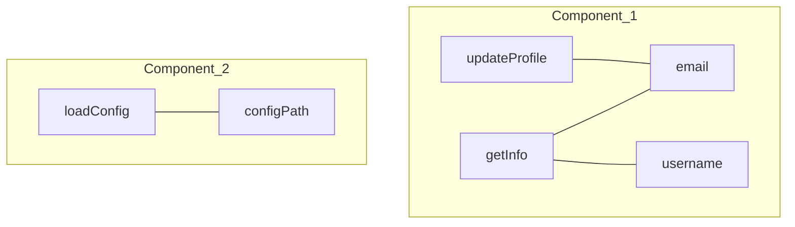

# Đo lường Cohesion bằng LCOM

Trong thiết kế hướng đối tượng, chúng ta thường nói về việc xây dựng các Class có "High Cohesion" (Độ kết dính cao). Tuy nhiên, làm sao để biết một Class thực sự gắn kết hay chỉ là một "thùng rác" chứa các phương thức không liên quan? Chỉ số **LCOM (Lack of Cohesion in Methods)** chính là thước đo định lượng giúp lập trình viên Java trả lời câu hỏi đó.

## Mục tiêu

*   Hiểu rõ bản chất của chỉ số LCOM và cách nó định nghĩa sự "rời rạc" của mã nguồn.
*   Nắm vững cách tính toán LCOM dựa trên mối quan hệ giữa Method và Field.
*   Phân biệt được các phiên bản LCOM (đặc biệt là LCOM4) để áp dụng trong thực tế.
*   Biết cách đọc hiểu chỉ số này để đưa ra quyết định Refactoring chính xác.

## 1. LCOM là gì? Nguyên lý của sự rời rạc

LCOM viết tắt của **Lack of Cohesion in Methods**. Điểm khác biệt thú vị ở đây là thay vì đo độ "kết dính", chỉ số này lại đo độ "thiếu kết dính". 

*   **Chỉ số LCOM thấp:** Các phương thức trong Class sử dụng chung nhiều thuộc tính (Field). Class tập trung vào một nhiệm vụ duy nhất. Đây là dấu hiệu của thiết kế tốt.
*   **Chỉ số LCOM cao:** Các phương thức trong Class hoạt động độc lập, mỗi nhóm phương thức dùng một nhóm Field riêng. Class có dấu hiệu vi phạm nguyên lý Single Responsibility (SRP).

### Triết lý đằng sau LCOM
Một Class được coi là gắn kết khi các thành phần bên trong nó phụ thuộc lẫn nhau để tồn tại. Nếu bạn có thể chia Class đó thành hai Class nhỏ hơn mà không làm thay đổi logic của các phương thức, thì Class ban đầu đang có độ kết dính thấp.

## 2. Cách tính toán LCOM (Phiên bản nguyên thủy)

Trong phiên bản đầu tiên của Chidamber và Kemerer (CK Metric), LCOM được tính bằng cách xét các cặp phương thức $(M_i, M_j)$.

Giả sử:
*   $P$ là số lượng cặp phương thức không có thuộc tính chung.
*   $Q$ là số lượng cặp phương thức có ít nhất một thuộc tính chung.

Công thức:
$$LCOM = \max(0, P - Q)$$

Tuy nhiên, công thức này khá phức tạp khi áp dụng thủ công. Vì vậy, cộng đồng đã phát triển các phiên bản cải tiến, trong đó **LCOM4** là phiên bản phổ biến nhất vì tính trực quan.

## 3. LCOM4: Phân tích các thành phần liên thông

LCOM4 không nhìn vào các cặp, mà nhìn vào **đồ thị liên kết**. 

*   **Nút (Node):** Là các Method và Field trong Class.
*   **Cạnh (Edge):** Một cạnh tồn tại nếu Method truy cập vào Field, hoặc Method này gọi Method kia.
*   **LCOM4 = Số lượng các thành phần liên thông (Connected Components) trong đồ thị.**

### Ví dụ minh họa

Xét một Class `UserProcessor` trong Java:

```java
public class UserProcessor {
    private String username;
    private String email;
    private String configPath;

    // Nhóm 1: Xử lý User
    public void updateProfile(String newEmail) {
        this.email = newEmail;
    }
    
    public String getInfo() {
        return username + " - " + email;
    }

    // Nhóm 2: Xử lý System Config
    public void loadConfig() {
        System.out.println("Loading from " + configPath);
    }
}
```

**Phân tích đồ thị liên kết:**
1.  `updateProfile` truy cập `email`.
2.  `getInfo` truy cập `username` và `email`.
    => Nhóm 1 tạo thành một khối liên thông (vì cùng dính tới `email`).
3.  `loadConfig` truy cập `configPath`.
    => Nhóm 2 tạo thành một khối độc lập.

**Kết quả:** LCOM4 = 2. 



**Ý nghĩa:** Chỉ số LCOM4 = 2 cho thấy Class này nên được tách làm đôi: `UserProfileService` và `ConfigurationLoader`.

## 4. Các mức giá trị LCOM4 và hướng xử lý

| Giá trị LCOM4 | Ý nghĩa | Hành động | 
| :--- | :--- | :--- |
| **1** | Cohesion hoàn hảo. | Giữ nguyên. |
| **2-3** | Thiếu kết dính nhẹ. | Xem xét liệu Class có đang chứa các logic "tiện ích" (helper) không liên quan hay không. |
| **>5** | Rất rời rạc. | Đây là một "God Object". Cần tái cấu trúc ngay lập tức. |
| **0** | Class không có phương thức nào. | Thường là các Data Class (POJO) hoặc Interface. |

## 5. Khi nào LCOM cao là chấp nhận được?

Không phải lúc nào LCOM cao cũng là xấu. Có những trường hợp đặc biệt trong Java mà chúng ta phải chấp nhận sự rời rạc:

1.  **Data Access Objects (DAO):** Đôi khi một DAO chứa nhiều phương thức Query không dùng chung Field (vì bản chất chúng chỉ gọi EntityManager hoặc JdbcTemplate). Tuy nhiên, chúng vẫn cùng phục vụ một Entity.
2.  **Utility Classes:** Các Class như `StringUtils` hay `MathUtils` có LCOM rất cao vì các phương thức static thường độc lập hoàn toàn. Đây là đặc thù của Functional-style trong Java.
3.  **Pattern Singleton:** Đôi khi các phương thức quản lý vòng đời của Singleton không liên quan đến logic nghiệp vụ chính bên trong nó.

## 6. Ví dụ thực tế: Refactoring dựa trên LCOM

Giả sử ta có Class `OrderManager` với LCOM4 = 2:

```java
// TRƯỚC KHI REFACTOR
public class OrderManager {
    private List<Item> items;
    private String dbUrl;

    public void addItem(Item item) { items.add(item); }
    public double calculateTotal() { return items.stream().mapToDouble(Item::getPrice).sum(); }
    
    public void connectToDb() { /* dùng dbUrl */ }
    public void logOrder() { /* dùng dbUrl */ }
}
```

**Vấn đề:** Logic quản lý giỏ hàng và logic kết nối DB đang bị trộn lẫn. LCOM4 = 2 do nhóm `{addItem, calculateTotal, items}` và nhóm `{connectToDb, logOrder, dbUrl}` tách biệt.

**Sau khi Refactor:**

```java
// Class 1: Tập trung vào nghiệp vụ
public class Order {
    private List<Item> items;
    public void addItem(Item item) { ... }
    public double calculateTotal() { ... }
}

// Class 2: Tập trung vào hạ tầng
public class OrderRepository {
    private String dbUrl;
    public void save(Order order) { ... }
}
```

Bây giờ, cả hai Class mới đều có LCOM4 = 1. Hệ thống trở nên dễ bảo trì hơn, dễ Unit Test hơn.

## Tóm tắt

*   **LCOM** đo lường mức độ rời rạc của một Class dựa trên việc các Method có dùng chung Field hay không.
*   **LCOM4** là phiên bản trực quan nhất: tính số lượng các cụm (component) không liên quan trong Class.
*   **LCOM = 1** là mục tiêu lý tưởng cho hầu hết các Class nghiệp vụ.
*   Khi **LCOM > 1**, hãy cân nhắc áp dụng **Extract Class** (trong SOLID) để tách nhỏ trách nhiệm.

## Câu hỏi tự kiểm tra

1. Nếu một Class có 10 phương thức và tất cả đều truy cập vào cùng một biến instance duy nhất, LCOM4 của Class đó là bao nhiêu?
<details><summary>Đáp án</summary>LCOM4 = 1. Vì tất cả các phương thức đều kết nối tới cùng một Field, chúng tạo thành một thành phần liên thông duy nhất.</details>

2. Tại sao LCOM cao lại làm cho Unit Test khó khăn hơn?
<details><summary>Đáp án</summary>LCOM cao nghĩa là Class làm nhiều việc không liên quan. Khi viết Unit Test cho một chức năng, bạn vẫn phải khởi tạo toàn bộ Class với các phụ thuộc (Dependencies) của các chức năng không liên quan khác, gây lãng phí và khó setup Mock.</details>

3. Một Class chỉ toàn các phương thức static (Utility Class) thì chỉ số LCOM thường như thế nào?
<details><summary>Đáp án</summary>Thường rất cao (bằng số lượng phương thức static), vì các phương thức static thường không truy cập vào biến instance (Field), dẫn đến không có sự kết nối giữa chúng theo cách tính của LCOM.</details>

4. Công cụ nào trong hệ sinh thái Java có thể đo LCOM tự động?
<details><summary>Đáp án</summary>Các công cụ phân tích tĩnh như SonarQube, Checkstyle, hoặc plugin JDepend và MetricsReloaded trên IntelliJ IDEA.</details>