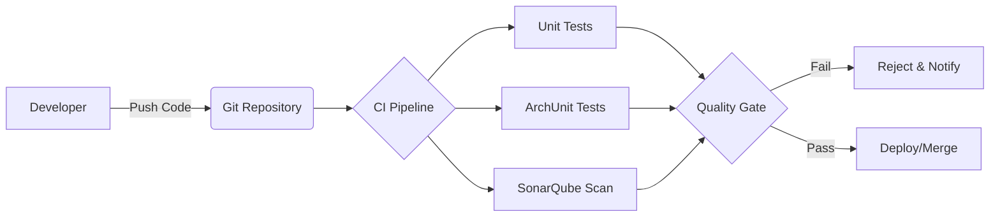

# Công cụ phân tích tĩnh trong Java

Việc hiểu lý thuyết về Coupling (Sự phụ thuộc) và Cohesion (Sự gắn kết) là bước đầu tiên, nhưng để duy trì chất lượng mã nguồn trong các dự án thực tế với hàng nghìn dòng code, bạn không thể chỉ dựa vào việc kiểm tra bằng mắt (Code Review). Bài học này sẽ hướng dẫn bạn cách sử dụng các công cụ phân tích tĩnh (Static Analysis Tools) để định lượng hóa các chỉ số thiết kế và tự động hóa việc kiểm soát chất lượng trong hệ sinh thái Java.

## Mục tiêu

*   Sử dụng SonarQube để nhận diện và đo lường các Code Smell liên quan đến Coupling và Cohesion.
*   Viết Unit Test cho kiến trúc bằng ArchUnit để ngăn chặn việc vi phạm các quy tắc thiết kế.
*   Khai thác các Plugin Metrics trên IntelliJ IDEA để theo dõi chỉ số LCOM, CBO ngay trong quá trình code.
*   Thiết lập quy trình tự động hóa (CI/CD) để biến các chỉ số này thành "chốt chặn" chất lượng.

## 1. SonarQube: Trung tâm quản lý nợ kỹ thuật

SonarQube là công cụ phổ biến nhất để phân tích chất lượng code. Thay vì chỉ tìm lỗi cú pháp, SonarQube tập trung vào **Maintainability** (Khả năng bảo trì).

### Phát hiện Code Smell liên quan đến Coupling

SonarQube sử dụng các quy tắc (Rules) để phát hiện sự phụ thuộc quá mức. Ví dụ, quy tắc "Cyclomatic Complexity" và "Cognitive Complexity" thường gián tiếp chỉ ra một Class đang ôm đồm quá nhiều trách nhiệm (Low Cohesion).

*   **Ví dụ:** Một Class có quá nhiều `import` từ các package khác nhau thường bị đánh dấu là "Brain Class" hoặc "God Class".
*   **Chỉ số Coupling:** SonarQube cung cấp biểu đồ "Dependency Structure Matrix" (trong các phiên bản Enterprise) để bạn thấy rõ module nào đang gọi module nào.

### Cách cấu hình cơ bản

Bạn có thể tích hợp SonarQube vào dự án Maven thông qua `pom.xml`:

```xml
<plugin>
    <groupId>org.sonarsource.scanner.maven</groupId>
    <artifactId>sonar-maven-plugin</artifactId>
    <version>3.9.1.2184</version>
</plugin>
```

Khi chạy lệnh `mvn sonar:sonar`, công cụ sẽ quét toàn bộ project và đưa ra báo cáo về các đoạn code có độ kết hợp quá chặt chẽ.

## 2. ArchUnit: Kiểm soát kiến trúc bằng mã nguồn

ArchUnit là một thư viện Java độc đáo cho phép bạn viết các Unit Test để kiểm tra kiến trúc. Đây là công cụ mạnh mẽ nhất để duy trì **Loose Coupling**.

### Tại sao cần ArchUnit?

Giả sử bạn thiết kế hệ thống theo mô hình Layered Architecture: `Controller -> Service -> Repository`. Một lập trình viên mới vô tình gọi trực tiếp `Repository` từ `Controller`. Về mặt logic code vẫn chạy, nhưng về mặt kiến trúc, bạn đã tạo ra một **Tight Coupling** không mong muốn.

### Ví dụ minh họa ArchUnit

```java
import com.tngtech.archunit.library.Architectures;
import static com.tngtech.archunit.lang.syntax.ArchRuleDefinition.classes;
import static com.tngtech.archunit.library.Architectures.layeredArchitecture;

@AnalyzeClasses(packages = "com.mycompany.myapp")
public class ArchitectureTest {

    @ArchTest
    static final ArchRule layer_dependencies_are_respected = layeredArchitecture()
        .consideringAllDependencies()
        .layer("Controller").definedBy("..controller..")
        .layer("Service").definedBy("..service..")
        .layer("Persistence").definedBy("..repository..")

        .whereLayer("Controller").mayNotBeAccessedByAnyLayer()
        .whereLayer("Service").mayOnlyBeAccessedByLayers("Controller")
        .whereLayer("Persistence").mayOnlyBeAccessedByLayers("Service");

    @ArchTest
    static final ArchRule no_generic_exceptions = classes()
        .should().notThrowCustomExceptions(RuntimeException.class)
        .because("Chúng ta muốn đảm bảo Functional Cohesion trong xử lý lỗi");
}
```

Với đoạn mã trên, nếu ai đó phá vỡ quy tắc về tầng (layer), Build sẽ thất bại ngay lập tức.

## 3. Plugin Metrics trong IntelliJ IDEA

Để tối ưu hóa vòng lặp phản hồi (feedback loop), bạn nên đo lường Coupling và Cohesion ngay khi đang viết code thay vì đợi đến khi đẩy lên Server.

### Plugin khuyến nghị: "MetricsReloaded"

Plugin này cho phép tính toán các chỉ số phức tạp như:

1.  **LCOM (Lack of Cohesion of Methods):** Nếu chỉ số này cao, Class của bạn đang rời rạc. Bạn nên tách nó ra.
2.  **CBO (Coupling Between Objects):** Đo số lượng class khác mà class hiện tại phụ thuộc vào.
3.  **RFC (Response For a Class):** Tổng số phương thức có thể được thực thi khi gọi một phương thức của class đó.

### Quy trình thực hiện trên IDE

1.  Cài đặt plugin **MetricsReloaded**.
2.  Chuột phải vào Package hoặc Class -> **Analyze** -> **Calculate Metrics**.
3.  Chọn profile "Complexity metrics" hoặc "Object-oriented metrics".

**Bảng diễn giải chỉ số:**

| Chỉ số | Ngưỡng cảnh báo | Hành động gợi ý |
| :--- | :--- | :--- |
| **LCOM** | > 0.8 (tùy thang đo) | Tách Class (Extract Class) vì các method không dùng chung field. |
| **CBO** | > 10 | Kiểm tra xem có đang vi phạm Law of Demeter không. |
| **WMC** | > 50 | Class quá phức tạp, cần chia nhỏ logic. |

## 4. Thiết lập Pipeline CI/CD: Chốt chặn tự động

Việc đo lường sẽ vô nghĩa nếu chúng ta lờ đi kết quả. Tích hợp vào CI/CD (như Jenkins, GitHub Actions, GitLab CI) giúp đảm bảo không có code "xấu" nào được merge vào nhánh chính.

### Mô hình hoạt động



### Cấu hình Quality Gate

Bạn có thể thiết lập Quality Gate trên SonarQube với các điều kiện khắt khe:
*   `Maintainability Rating` thấp hơn A: **Fail**.
*   `New Tight Coupling` xuất hiện: **Fail**.
*   `Coverage` trên code mới thấp hơn 80%: **Fail**.

## 5. Phân tích thực tế: Khi nào nên tin vào công cụ?

Công cụ phân tích tĩnh rất thông minh nhưng không hoàn hảo. 

*   **False Positive (Dương tính giả):** Đôi khi một Class có CBO cao là bắt buộc (ví dụ: một Facade Class hoặc một Configuration Class kết nối nhiều thành phần). Trong trường hợp này, bạn có thể sử dụng annotation `@SuppressWarnings` hoặc đánh dấu "Won't Fix" trên SonarQube.
*   **Tư duy thiết kế:** Đừng cố gắng đưa LCOM về 0 tuyệt đối nếu điều đó làm mã nguồn trở nên quá vụn vặt (Over-engineering). Mục tiêu là sự cân bằng.

## Tóm tắt

*   **SonarQube** giúp cái nhìn tổng quan về nợ kỹ thuật và các vi phạm thiết kế ở quy mô lớn.
*   **ArchUnit** biến các quy tắc kiến trúc (như phân tầng, hạn chế phụ thuộc chéo) thành các bài kiểm tra tự động.
*   **MetricsReloaded (IntelliJ)** cung cấp số liệu tức thời (LCOM, CBO) để điều chỉnh code ngay khi viết.
*   **CI/CD** là bước cuối cùng để đảm bảo các tiêu chuẩn về Coupling và Cohesion được thực thi nghiêm ngặt trong đội ngũ.

## Câu hỏi tự kiểm tra

1. Nếu chỉ số LCOM của một Class rất cao, điều đó có nghĩa là gì và bạn nên làm gì?
<details><summary>Đáp án</summary>LCOM cao nghĩa là các phương thức trong Class ít chia sẻ các biến thực thể (instance variables) với nhau, tức là Class có Low Cohesion. Bạn nên xem xét tách Class này thành nhiều Class nhỏ hơn, mỗi Class tập trung vào một nhiệm vụ cụ thể (tuân thủ SRP).</details>

2. ArchUnit khác gì so với các Unit Test thông thường (như JUnit)?
<details><summary>Đáp án</summary>JUnit tập trung kiểm tra logic nghiệp vụ (input/output), trong khi ArchUnit kiểm tra cấu trúc mã nguồn (ví dụ: Class A không được phép gọi Class B, hoặc các Class có hậu tố 'Service' phải nằm trong package 'service').</details>

3. Tại sao việc tích hợp SonarQube vào CI/CD lại quan trọng hơn việc chỉ chạy nó trên máy cá nhân?
<details><summary>Đáp án</summary>Vì nó tạo ra một tiêu chuẩn chung cho cả đội ngũ và ngăn chặn việc code kém chất lượng bị lọt vào hệ thống một cách khách quan, tránh tình trạng 'quên' kiểm tra hoặc bỏ qua các cảnh báo quan trọng.</details>