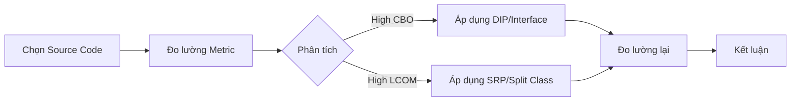

# Tổng kết và Xây dựng tư duy thiết kế

Chào mừng bạn đã đi đến chặng đường cuối cùng của khóa học chuyên sâu về **Coupling và Cohesion**. Sau khi đã đi qua các định nghĩa, phân loại chi tiết và các chỉ số đo lường (CBO, LCOM), bài học này đóng vai trò là "mảnh ghép cuối" giúp bạn chuyển hóa kiến thức lý thuyết thành bản năng thực chiến.

## Mục tiêu

*   Hệ thống hóa lộ trình chuyển đổi từ mã nguồn kém chất lượng (Code Smell) sang thiết kế sạch (Clean Design).
*   Xác lập tư duy ưu tiên tính bảo trì (Maintainability) trong môi trường phát triển phần mềm hiện đại.
*   Nắm vững quy trình tự học và cập nhật công nghệ thông qua lăng kính của tính kết dính và sự phụ thuộc.
*   Thực hành kỹ năng đánh giá hệ thống thực tế thông qua bài tập cuối khóa.

## 1. Lộ trình từ Code Smell đến Clean Code

Trong suốt khóa học, chúng ta thấy rằng không ai cố ý viết code tệ. Code Smell thường là kết quả của việc tích tụ các quyết định thiết kế vội vàng (Technical Debt). 

### Bảng tóm tắt sự chuyển dịch

| Đặc điểm | Trạng thái "Smell" | Trạng thái "Clean" |
| :--- | :--- | :--- |
| **Coupling** | Tight (Content/Common) - Phụ thuộc vào chi tiết cài đặt. | Loose (Message/Data) - Phụ thuộc vào Interface/Abstraction. |
| **Cohesion** | Low (Coincidental) - Class là một "kho chứa" tạp nham. | High (Functional) - Một Class chỉ làm một nhiệm vụ duy nhất. |
| **Thay đổi** | Hiệu ứng Domino: Sửa một chỗ, hỏng mười chỗ. | Cách ly (Isolation): Thay đổi cục bộ, không ảnh hưởng hệ thống. |
| **Kiểm thử** | Khó Mock, cần khởi tạo cả một đồ thị đối tượng phức tạp. | Dễ dàng Unit Test với các Mock/Stub đơn giản. |
| **Nguyên lý** | Vi phạm SRP, DIP. | Tuân thủ triệt để SOLID. |

### Ví dụ minh họa sự chuyển dịch trong Java

**Giai đoạn 1: Tight Coupling & Low Cohesion**
```java
public class OrderService {
    // Vừa xử lý logic, vừa trực tiếp ghi file, vừa gửi mail (Low Cohesion)
    // Phụ thuộc trực tiếp vào class cụ thể (Tight Coupling)
    public void processOrder(Order order) {
        if (order.isValid()) {
            // Ghi log trực tiếp vào FileSystem
            new FileLogger().log("Processing order"); 
            // Logic thanh toán trộn lẫn
            double tax = order.getAmount() * 0.1; 
            // Gửi mail bằng thư viện cụ thể
            GmailSender.send(order.getUserEmail(), "Success");
        }
    }
}
```

**Giai đoạn 2: Clean Design thông qua Abstraction**
```java
public class OrderService {
    private final List<OrderValidator> validators;
    private final PaymentProcessor paymentProcessor;
    private final NotificationService notificationService;

    // Dependency Injection giúp giảm Coupling
    public OrderService(List<OrderValidator> validators, 
                        PaymentProcessor paymentProcessor, 
                        NotificationService notificationService) {
        this.validators = validators;
        this.paymentProcessor = paymentProcessor;
        this.notificationService = notificationService;
    }

    public void processOrder(Order order) {
        // Functional Cohesion: Chỉ điều phối luồng nghiệp vụ
        if (validators.stream().allMatch(v -> v.validate(order))) {
            paymentProcessor.process(order);
            notificationService.notify(order.getUser());
        }
    }
}
```

## 2. Tư duy thiết kế: Tính năng hay Bảo trì?

Một lập trình viên giỏi không chỉ là người viết code chạy được, mà là người viết code có thể đọc và sửa được sau 2 năm. 

### Quy tắc đánh đổi (The Trade-off)
Trong ngắn hạn, việc tạo ra các Interface, tách nhỏ Class (tăng Cohesion) và thiết lập DI (giảm Coupling) có vẻ làm chậm tốc độ phát triển. Tuy nhiên, hãy nhìn vào công thức giá trị phần mềm:
$$Value = Functionality + Architecture$$

Nếu bạn chỉ tập trung vào *Functionality* (Tính năng), kiến trúc sẽ mục nát. Khi đó, chi phí để thêm một tính năng mới sẽ tăng theo hàm mũ vì bạn phải đối mặt với mớ hỗn độn của Tight Coupling.

### Tư duy "Design for Change"
Khi đứng trước một bài toán, hãy tự hỏi:
1.  Nếu thư viện này (ví dụ: Spring Data, Hibernate) bị thay thế, tôi phải sửa bao nhiêu Class? (Coupling check)
2.  Nếu logic tính thuế thay đổi, tôi có cần mở Class xử lý đơn hàng ra không? (Cohesion check)

## 3. Lời khuyên về việc học tập và cập nhật công nghệ

Công nghệ (Framework, Library) thay đổi mỗi ngày, nhưng nguyên lý thiết kế (Coupling/Cohesion) là bất biến. 

*   **Đừng học thuộc lòng Framework:** Hãy học cách Framework đó giải quyết vấn đề Coupling. Ví dụ: Spring IoC Container bản chất là một công cụ để quản lý Coupling.
*   **Đọc mã nguồn (Read Code):** Hãy xem các thư viện nổi tiếng như *JUnit*, *Guava* hoặc *Spring Core* tổ chức package như thế nào. Bạn sẽ thấy họ cực kỳ khắt khe trong việc giữ cho các module có tính Cohesion cao.
*   **Thực hành Refactoring hàng ngày:** Đừng đợi đến khi dự án quá nát mới sửa. Hãy áp dụng quy tắc "Boy Scout Rule": Luôn để lại mã nguồn sạch hơn một chút so với lúc bạn tìm thấy nó.

## 4. Bài tập cuối khóa: Đánh giá và tối ưu dự án Open Source

Để kết thúc khóa học, bạn hãy thực hiện một dự án nhỏ sau đây:

**Yêu cầu:**
1.  Chọn một dự án Java nhỏ trên GitHub (khoảng 20-50 classes).
2.  Sử dụng công cụ phân tích tĩnh (như **Checkstyle**, **PMD** hoặc **Sonarqube**) để xuất báo cáo về các chỉ số:
    *   **CBO (Coupling Between Objects):** Tìm ra 3 class có chỉ số cao nhất.
    *   **LCOM (Lack of Cohesion in Methods):** Tìm ra class có tính kết dính thấp nhất.
3.  **Phân tích:** Giải thích tại sao các chỉ số đó lại cao (Do logic nghiệp vụ phức tạp hay do thiết kế tồi?).
4.  **Refactoring:** Thực hiện tách ít nhất một Class có LCOM cao thành các Class nhỏ hơn có Functional Cohesion. Sử dụng Interface để giảm CBO cho một module quan trọng.
5.  **Kiểm chứng:** Chạy lại công cụ đo lường để thấy sự thay đổi của các con số.



## Tóm tắt

Khóa học đã trang bị cho bạn nhãn quan để nhìn thấu cấu trúc bên dưới của mã nguồn. **Coupling** và **Cohesion** không chỉ là lý thuyết suông; chúng là thước đo định lượng cho sự bền vững của hệ thống. 
*   **Low Coupling** bảo vệ bạn trước những thay đổi từ bên ngoài.
*   **High Cohesion** giúp bạn hiểu rõ nội tại bên trong của từng module.
Khi kết hợp chúng với **SOLID** và **Unit Test**, bạn đã sở hữu bộ công cụ mạnh mẽ nhất của một Software Architect.

## Câu hỏi tự kiểm tra

1. Nếu một Class có chỉ số LCOM rất cao, điều đó thường ám chỉ vi phạm nguyên lý nào trong SOLID?
<details><summary>Đáp án</summary>Vi phạm nguyên lý Đơn nhiệm (Single Responsibility Principle - SRP). LCOM cao nghĩa là các phương thức trong class ít chia sẻ thuộc tính chung, dẫn đến class đang làm quá nhiều việc không liên quan.</details>

2. Tại sao việc lạm dụng Interface (mỗi Class đều có một Interface tương ứng) đôi khi lại không tốt cho Coupling?
<details><summary>Đáp án</summary>Điều này dẫn đến tình trạng "Interface Bloat". Nếu Interface không mang tính trừu tượng thực sự mà chỉ là bản sao của Class, nó làm tăng độ phức tạp của hệ thống mà không mang lại lợi ích của Loose Coupling, đôi khi còn gây khó khăn cho việc điều hướng code.</details>

3. Trong ba loại Cohesion: Temporal, Sequential và Functional, loại nào được ưu tiên nhất và tại sao?
<details><summary>Đáp án</summary>Functional Cohesion được ưu tiên nhất. Vì nó đảm bảo một module chỉ thực hiện một nhiệm vụ duy nhất và trọn vẹn, giúp mã nguồn dễ hiểu, dễ tái sử dụng và ít bị ảnh hưởng bởi các thay đổi bên ngoài nhất.</details>